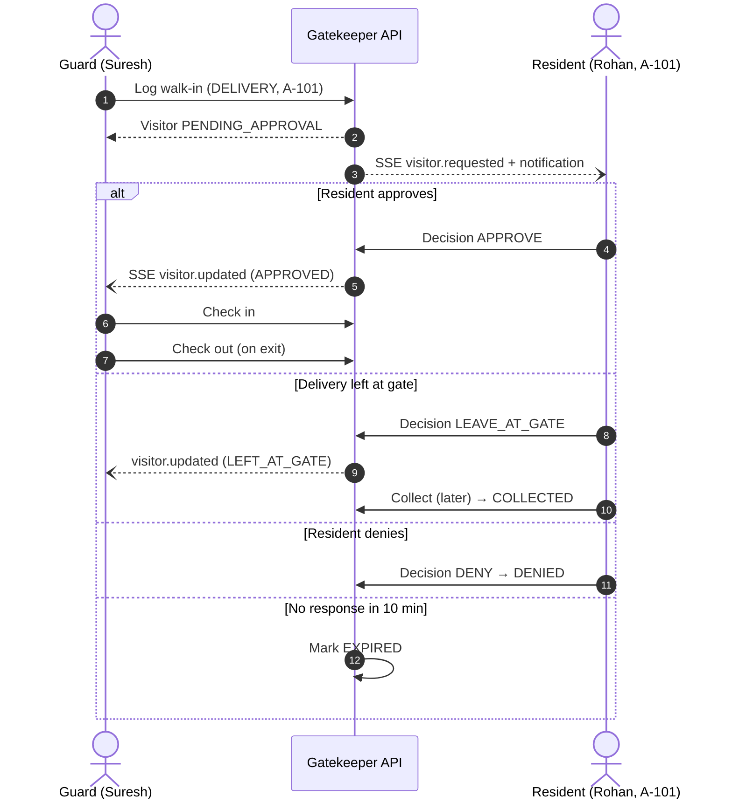
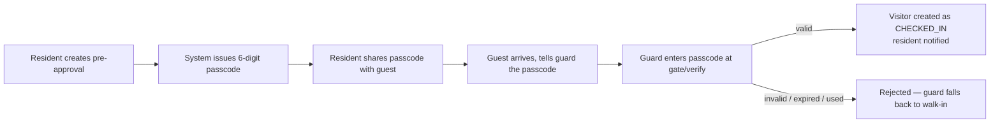
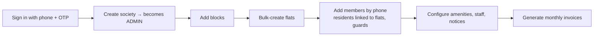

# Gatekeeper — Product Requirements Document (PRD)

| | |
|---|---|
| **Product** | Gatekeeper — residential community management platform |
| **Tagline** | *Every arrival, accounted for.* |
| **Document** | 01-PRD |
| **Version** | 1.0 (v1 release scope) |
| **Status** | Approved for build |
| **Source of truth** | [`00-PROJECT-BRIEF.md`](./00-PROJECT-BRIEF.md). Where this PRD and the brief differ, the brief wins. |
| **Related** | [`02-SRS.md`](./02-SRS.md) (functional requirement IDs `FR-*`), [`10-TEST-PLAN.md`](./10-TEST-PLAN.md), [`11-ROADMAP.md`](./11-ROADMAP.md) |

---

## 1. Overview

Gatekeeper is a platform for gated communities and apartment societies. It covers three areas:

1. **Gate security.** Guards log visitors and residents approve them in real time. Guests can be pre-approved with a passcode, and daily help is checked in and out.
2. **Resident convenience.** Residents get notices, polls, a helpdesk, amenity booking, an SOS button and in-app notifications.
3. **Society administration.** Admins manage members and flats, raise maintenance invoices, take mock payments, log expenses and track KPIs on a dashboard.

The platform has four surfaces:

| Surface | Primary users | Purpose |
|---|---|---|
| Marketing website (`/`) | Prospects and society committees | Explain the product, build trust, start sign-up |
| Web app (`/app/*`, responsive PWA) | Admin (primary), Resident, Guard | All workflows. The admin console is web-first |
| Mobile app (Expo) | Resident, Guard | Approvals on the go, the gate console and SOS |
| REST API + SSE | All clients | One backend for every surface |

Gatekeeper aims to match the public feature set of existing market solutions. Its brand, UX and codebase are original, built around a "premium, calm, trustworthy" design language.

## 2. Problem statement

| Stakeholder | Today's pain | Consequence |
|---|---|---|
| **Residents** | Guards phone the flat to confirm each visitor. Calls get missed at work or at night. Deliveries wait at the gate. | Friction, missed deliveries, security lapses when guards wave people through |
| **Guards** | Paper registers, phone calls to the flat, and no reliable record of who is inside | Slow gate, disputes, no audit trail |
| **Admins / committee** | Notices on WhatsApp groups, complaints in a register, maintenance tracked in spreadsheets, cash or cheque collection | Low collection rates, lost complaints, no transparency, volunteer burnout |
| **Everyone, in an emergency** | No single channel to reach on-duty security fast | Slow response to medical, fire and theft incidents |

Existing market solutions solve parts of this but are often loud, cluttered and ad-supported. Committees want a calm, trustworthy, ad-free tool they can show to every age group in the society.

## 3. Goals and non-goals

### 3.1 Goals (v1)

| # | Goal | Measured by (see §4) |
|---|---|---|
| G1 | Make every gate entry digital, attributable and approved by the resident or a pre-approval | K1, K2, K3 |
| G2 | Cut the time a visitor waits at the gate | K2 |
| G3 | Give admins one console for members, communication, helpdesk, amenities and dues | K5, K6, K7 |
| G4 | Bring on-duty guards to an emergency within seconds | K4 |
| G5 | Ship a credible, accessible, premium product that a committee can evaluate from the marketing site in one sitting | K8, K9 |

### 3.2 Non-goals (v1)

- Real payment gateway integration. Payments are **mocked** and still record a `Payment`.
- SMS delivery of OTPs. OTP is surfaced as `devCode` in dev mode only. A provider is post-v1.
- Photo capture or upload. Only a photo URL field exists.
- Smart locks, IoT boom barriers, guard patrolling, a marketplace or an ad platform.
- GST/TDS accounting, bank reconciliation and multi-language UI.
- Native push notifications. v1 uses in-app notifications plus SSE.
- Multi-region and horizontally scaled deployment. v1 is a single-node Docker stack.

## 4. Success metrics (KPIs)

| ID | KPI | Definition | v1 target (90 days after a society goes live) |
|---|---|---|---|
| K1 | Digital entry coverage | Gate entries logged in Gatekeeper ÷ all entries (audited sample) | ≥ 95% |
| K2 | Median approval time | `decidedAt − createdAt` for walk-ins decided by a resident | ≤ 60 s |
| K3 | Pre-approval share | Visitor entries via passcode ÷ all GUEST entries | ≥ 30% |
| K4 | SOS acknowledgement time | Median `acknowledgedAt − createdAt` | ≤ 60 s; p95 ≤ 3 min |
| K5 | Maintenance collection rate | Paid invoice amount ÷ invoiced amount for the period, by due date | ≥ 85% |
| K6 | Ticket resolution time | Median `resolvedAt − createdAt` | ≤ 72 h |
| K7 | Resident weekly active rate | Residents with ≥ 1 session/week ÷ active resident memberships | ≥ 60% |
| K8 | Pending expiry rate | Walk-ins that reach `EXPIRED` ÷ all walk-ins | ≤ 5% |
| K9 | Accessibility conformance | Automated axe violations (serious/critical) on key screens | 0 |
| K10 | API latency | p95 server latency on non-streaming endpoints | < 300 ms |

KPIs K5 and the visitor-related counters also feed the admin dashboard (`GET /reports/summary`).

## 5. Target users and personas

### 5.1 User classes

| Class | Role enum | Surfaces | Frequency |
|---|---|---|---|
| Society Admin | `ADMIN` | Web app (desktop-first) | Daily |
| Resident (owner, tenant or family) | `RESIDENT` | Mobile app, web app | Several times a day (approvals), weekly (community) |
| Guard | `GUARD` | Mobile app or tablet at the gate, web app | Continuous during a shift |
| Prospect / committee member | — (anonymous) | Marketing website | Once, during evaluation |

### 5.2 Personas

**Ananya Rao — Society Admin (facility manager, 41)**
- Runs operations for a 400-flat society and reports to an elected committee.
- *Needs:* one place for members, notices, complaints, bookings and dues, plus numbers she can show at the monthly committee meeting.
- *Frustrations:* chasing dues on WhatsApp, lost complaint slips, residents disputing who entered when.
- *Success:* the dashboard shows collection %, open tickets and today's visitors at a glance.

**Rohan Mehta — Resident, owner (34, works long hours)**
- Gets 3–6 deliveries a day and often has guests in the evening.
- *Needs:* to approve or deny visitors in one tap, pre-approve guests, and not get calls in meetings.
- *Frustrations:* missed calls from the gate, deliveries sent back.
- *Success:* approves a delivery from a notification in under 10 seconds.

**Priya Iyer — Resident, tenant (29)**
- Has a maid and a cook and books the tennis court on weekends.
- *Needs:* to see her daily help's attendance, book amenities without double-booking disputes, raise a plumbing complaint and track it.
- *Success:* she knows when the cook arrived and left, and the court booking is confirmed instantly.

**Suresh Kumar — Guard (47, limited English, shift worker)**
- Stands at a busy main gate on a shared Android tablet.
- *Needs:* large, simple screens; a fast walk-in log; one passcode field for guests and staff; clear status colours **with labels**.
- *Frustrations:* typing long forms, residents not picking up.
- *Success:* logs a delivery in under 20 seconds and sees the approval appear live.

**Vikram Shah — Committee secretary, prospect (55)**
- Evaluating tools for the society's AGM.
- *Needs:* a clear explanation of features, security and data privacy, and evidence that the product is trustworthy.
- *Success:* understands the offering from the marketing site and starts a society or contacts the team.

## 6. User journeys

### 6.1 Walk-in visitor (core flow)

### 6.2 Pre-approved guest

### 6.3 Daily help attendance

Admin registers staff, and the system issues a passcode. Admin or resident links the staff member to flats. Each day the guard enters the passcode: the first entry checks the staff member in, the next checks them out. Residents of linked flats see the attendance history.

### 6.4 Admin onboarding a society

### 6.5 SOS

The resident taps SOS and picks a type. All on-duty guards and admins get a realtime alert. The first guard acknowledges, then resolves. The resident sees each status change live.

### 6.6 Prospect evaluation

The prospect lands on the marketing site and reads the hero, features, gate-flow explainer, security and privacy, and FAQ. They then pick **Get started**, which opens the web app sign-in and lets them create a society, or **Talk to us** (contact link).

## 7. Feature requirements

Each module lists user stories and acceptance criteria. Detailed, testable rules (`FR-*`) are in [`02-SRS.md`](./02-SRS.md).

### 7.1 Marketing website

| ID | User story |
|---|---|
| US-WEB-01 | As a **prospect**, I want a clear overview of what Gatekeeper does so that I can judge whether it fits my society. |
| US-WEB-02 | As a **committee member**, I want to read about security, privacy and data handling so that I can justify the choice to residents. |
| US-WEB-03 | As a **prospect**, I want an obvious call to action so that I can start using the product or contact the team. |

**Acceptance criteria**
- **Given** an anonymous visitor on `/`, **when** the page loads, **then** they see the hero with the tagline, sections for gate security, community, administration, a security and privacy section, an FAQ, and **Get started** and **Sign in** CTAs.
- **Given** a visitor clicks **Get started**, **when** they are not signed in, **then** they reach the web app phone/OTP sign-in.
- **Given** any marketing page, **when** audited, **then** it meets WCAG 2.1 AA, renders correctly from 360 px to 1440 px wide, and uses the Gatekeeper brand tokens (navy, emerald, gold; Fraunces and Manrope).

### 7.2 Authentication and profile

| ID | User story |
|---|---|
| US-AUTH-01 | As a **user**, I want to sign in with my phone number and a one-time code so that I don't need to remember a password. |
| US-AUTH-02 | As a **user who belongs to several societies**, I want to choose which society I'm acting in so that I see the right data. |
| US-AUTH-03 | As a **user**, I want to update my name and email so that guards and admins see correct details. |

**Acceptance criteria**
- **Given** a valid phone number, **when** I request an OTP, **then** a 6-digit code is issued, valid for 5 minutes. In development the code is returned as `devCode`; in production it never is.
- **Given** I enter a wrong code 5 times, **when** I try again, **then** that code is locked and I must request a new one.
- **Given** I request OTPs too often, **when** I exceed the rate limit, **then** I receive a "too many requests" error.
- **Given** a correct code, **when** I verify, **then** I am signed in and see my memberships (society and flat). A first-time phone number gets a new user account.
- **Given** I have more than one active membership, **when** I sign in, **then** I am asked to pick a society, and I can switch later.

### 7.3 Society setup and members

| ID | User story |
|---|---|
| US-SOC-01 | As a **committee member**, I want to create my society so that I become its admin and can set it up. |
| US-SOC-02 | As an **admin**, I want to define blocks and bulk-create flats so that setup takes minutes, not hours. |
| US-SOC-03 | As an **admin**, I want to add residents and guards by phone number so that they can sign in straight away. |
| US-SOC-04 | As an **admin**, I want to deactivate a member or change their role so that people who move out lose access. |
| US-SOC-05 | As a **guard**, I want to see the residents of a flat so that I know who I'm logging a visitor for. |

**Acceptance criteria**
- **Given** a signed-in user, **when** they create a society, **then** they hold an `ADMIN` membership in it.
- **Given** block A exists, **when** the admin bulk-creates flats `101–104`, **then** four flats are created and existing numbers are skipped, not duplicated.
- **Given** the admin adds a phone number that has no account, **when** they save, **then** a user is created and given an `ACTIVE` membership. A `RESIDENT` must be linked to a flat.
- **Given** a member is set to `INACTIVE`, **when** they call any society endpoint, **then** access is refused.
- **Given** the society has a single admin, **when** that admin tries to deactivate or demote themselves, **then** the action is refused.

### 7.4 Visitor management (gate)

| ID | User story |
|---|---|
| US-VIS-01 | As a **guard**, I want to log a walk-in visitor (guest, delivery, cab, service) against a flat so that the residents can approve them. |
| US-VIS-02 | As a **resident**, I want an instant alert when someone arrives for my flat so that I can approve or deny with one tap. |
| US-VIS-03 | As a **resident**, I want to tell the guard to keep a delivery at the gate so that I can collect it later. |
| US-VIS-04 | As a **guard**, I want to see the decision live so that I can let the visitor in without calling. |
| US-VIS-05 | As a **guard**, I want to check visitors in and out so that we know who is inside the society. |
| US-VIS-06 | As a **resident**, I want to see my flat's visitor history so that I can review past entries. |
| US-VIS-07 | As an **admin**, I want to see all visitor logs with filters so that I can investigate incidents. |

**Acceptance criteria**
- **Given** a guard logs a walk-in for A-101, **when** it is saved, **then** its status is `PENDING_APPROVAL` and every active resident of A-101 receives a realtime alert and an in-app notification.
- **Given** a pending visitor, **when** any resident of that flat approves, **then** the status becomes `APPROVED`, the decider and time are recorded, and the guard sees the update live.
- **Given** a pending visitor of type `GUEST`, **when** a resident chooses "Leave at gate", **then** the request is rejected. That option is only for `DELIVERY`.
- **Given** a delivery marked `LEFT_AT_GATE`, **when** the guard or a resident of the flat marks it collected, **then** its status becomes `COLLECTED`.
- **Given** a visitor has been pending for more than 10 minutes, **when** anyone views it or the sweeper runs, **then** it is `EXPIRED` and any decision is rejected.
- **Given** a visitor is already decided, **when** another resident of the flat decides, **then** the second decision is rejected and the first one stands.
- **Given** a visitor is `DENIED` or `PENDING_APPROVAL`, **when** the guard tries to check them in, **then** the request is rejected.

### 7.5 Pre-approvals and gate passcode

| ID | User story |
|---|---|
| US-PRE-01 | As a **resident**, I want to pre-approve an expected guest so that they enter without waiting. |
| US-PRE-02 | As a **resident**, I want to cancel an invite so that the passcode stops working. |
| US-PRE-03 | As a **guard**, I want one passcode field for both guests and daily help so that the gate stays fast. |

**Acceptance criteria**
- **Given** a resident creates a pre-approval with a validity window, **when** it is saved, **then** a 6-digit passcode is issued. It is unique among the society's active pre-approvals and staff passcodes.
- **Given** a valid passcode within its window with uses left, **when** the guard verifies it, **then** a visitor is created directly as `CHECKED_IN`, the use count goes up, and the residents are notified.
- **Given** the pre-approval has reached `maxUses`, or is cancelled or past `validTo`, **when** its passcode is entered, **then** verification fails.
- **Given** a staff passcode, **when** the guard verifies it, **then** the response says `kind: STAFF` and the staff member's attendance is toggled (in, then out).

### 7.6 Daily help (staff)

| ID | User story |
|---|---|
| US-STF-01 | As an **admin**, I want to register daily help with a category so that the gate recognises them. |
| US-STF-02 | As a **resident**, I want to link my maid or cook to my flat so that I can see their attendance. |
| US-STF-03 | As a **resident**, I want to see when my daily help came and left so that I can manage payments and safety. |
| US-STF-04 | As an **admin**, I want to deactivate staff so that former staff cannot enter. |

**Acceptance criteria**
- **Given** an admin creates a staff member, **when** they save, **then** a unique 6-digit passcode is generated and shown.
- **Given** a resident links staff to their own flat, **when** they save, **then** the link is created. Linking to another flat is refused.
- **Given** staff is inactive, **when** their passcode is entered at the gate, **then** entry is refused with a clear message.
- **Given** a resident whose flat is linked to the staff member, **when** they open the staff profile, **then** they see check-in and check-out times, newest first.

### 7.7 Notices and polls

| ID | User story |
|---|---|
| US-NOT-01 | As an **admin**, I want to post categorised notices and pin important ones so that residents see what matters. |
| US-NOT-02 | As a **resident**, I want to be alerted to new notices so that I don't miss urgent updates. |
| US-POL-01 | As an **admin**, I want to create a poll with options and an optional close time so that I can gauge opinion. |
| US-POL-02 | As a **resident**, I want to vote once and see results so that the outcome is fair and transparent. |

**Acceptance criteria**
- **Given** an admin posts a notice, **when** it is saved, **then** all members get a `notice.created` event and a notification. Pinned notices are listed first.
- **Given** a poll with options, **when** a resident votes, **then** the vote is recorded. A second vote by the same membership is rejected.
- **Given** a poll's `closesAt` has passed, **when** a resident votes, **then** the vote is rejected.
- **Given** any member views polls, **then** they see vote counts per option and whether they have voted.

### 7.8 Helpdesk

| ID | User story |
|---|---|
| US-TKT-01 | As a **resident**, I want to raise a complaint with a category and priority so that it gets to the right person. |
| US-TKT-02 | As an **admin**, I want to assign tickets and update their status so that work is tracked to closure. |
| US-TKT-03 | As a **resident or admin**, I want a comment thread on a ticket so that we can talk in context. |

**Acceptance criteria**
- **Given** a resident raises a ticket, **when** it is saved, **then** it is `OPEN` and linked to their flat.
- **Given** an admin moves a ticket to `RESOLVED`, **when** it is saved, **then** `resolvedAt` is set and the raiser is notified.
- **Given** a ticket is `CLOSED`, **when** anyone tries to reopen it, **then** the transition is rejected.
- **Given** a resident, **when** they list tickets, **then** they only see tickets they raised.

### 7.9 Amenities and bookings

| ID | User story |
|---|---|
| US-AMN-01 | As an **admin**, I want to define amenities with hours, slot length, capacity and price so that residents can book them. |
| US-AMN-02 | As a **resident**, I want to see available slots for a date so that I can pick a free time. |
| US-AMN-03 | As a **resident**, I want instant confirmation and the ability to cancel so that I can plan. |

**Acceptance criteria**
- **Given** an amenity open 06:00–22:00 with 60-minute slots and capacity 2, **when** a resident opens availability for a date, **then** they see 16 slots, each with remaining capacity.
- **Given** a slot already has bookings up to its capacity, **when** another booking is attempted, even at the same moment, **then** it is rejected and capacity is never exceeded.
- **Given** a resident cancels their booking before it starts, **when** they confirm, **then** the slot's capacity is freed.
- **Given** an inactive amenity, **when** a resident tries to book it, **then** the booking is refused.

### 7.10 Billing and accounts

| ID | User story |
|---|---|
| US-BIL-01 | As an **admin**, I want to generate monthly maintenance invoices for every flat in one action so that billing is effortless. |
| US-BIL-02 | As a **resident**, I want to see my dues and pay online so that I don't need to write cheques. |
| US-BIL-03 | As an **admin**, I want to record society expenses so that the committee sees where money goes. |
| US-BIL-04 | As an **admin**, I want a dashboard of collection %, dues, expenses, today's visitors and open tickets so that I can report to the committee. |

**Acceptance criteria**
- **Given** period `2026-11` has no invoices, **when** the admin generates with an amount and due date, **then** exactly one invoice is created per flat. Re-running creates none (unique per flat + period).
- **Given** an unpaid invoice for my flat, **when** I pay with UPI, card or netbanking through the mock gateway, **then** a `Payment` is recorded and the invoice becomes `PAID`.
- **Given** an invoice is already `PAID`, **when** payment is attempted, **then** it is rejected.
- **Given** an unpaid invoice's due date has passed, **when** it is listed, **then** it shows as `OVERDUE`.
- **Given** any monetary amount, **then** it is stored and sent as integer paise and displayed as ₹ with two decimals.

### 7.11 SOS / emergency

| ID | User story |
|---|---|
| US-SOS-01 | As a **resident**, I want a one-tap SOS with a type so that security responds immediately. |
| US-SOS-02 | As a **guard**, I want a loud, unmissable alert with the flat and type so that I can respond. |
| US-SOS-03 | As a **resident**, I want to see that my SOS was acknowledged so that I know help is coming. |

**Acceptance criteria**
- **Given** a resident raises an SOS of type `MEDICAL`, **when** it is saved, **then** every active guard and admin in the society receives `sos.raised` within 2 seconds, plus a notification.
- **Given** a raised SOS, **when** a guard acknowledges it, **then** the status becomes `ACKNOWLEDGED`, the acknowledger and time are recorded, and the resident receives `sos.updated`.
- **Given** a `RESOLVED` SOS, **when** anyone tries to change its status, **then** the change is rejected.

### 7.12 Notifications and realtime

| ID | User story |
|---|---|
| US-NTF-01 | As a **user**, I want an in-app notification list with unread state so that I can catch up on anything I missed. |
| US-NTF-02 | As a **user**, I want live updates without refreshing so that approvals and alerts feel instant. |

**Acceptance criteria**
- **Given** an event that targets me, **when** it happens, **then** a notification record is stored and pushed over my SSE stream as `notification`.
- **Given** unread notifications, **when** I mark one or all as read, **then** `readAt` is set and the unread badge updates.
- **Given** my SSE connection drops, **when** the client reconnects, **then** it resumes receiving events. Anything missed while offline is still in the notification list.

### 7.13 Client apps (web app and mobile)

| ID | User story |
|---|---|
| US-APP-01 | As a **user**, I want navigation that matches my role so that I only see what I can use. |
| US-APP-02 | As an **admin**, I want a desktop-class console with tables and filters so that I can work efficiently. |
| US-APP-03 | As a **guard**, I want a gate console with big touch targets so that I can work quickly at the gate. |
| US-APP-04 | As a **resident**, I want the mobile app for approvals, pre-approvals, SOS and bookings so that I can act anywhere. |
| US-APP-05 | As a **user**, I want dark mode on the web app that follows my system setting so that it is comfortable at night. |

**Acceptance criteria**
- **Given** a signed-in guard, **when** they open the app, **then** the home screen is the gate console: log walk-in, passcode entry, live pending list, inside now, open SOS.
- **Given** any status chip, **then** it shows a dot **and** a text label, never colour alone.
- **Given** any interactive control on touch layouts, **then** its target is at least 44×44 px with a visible focus ring.
- **Given** the web app, **when** installed, **then** it runs as a PWA with a manifest and icons.

## 8. Prioritisation (MoSCoW)

| Priority | Capabilities |
|---|---|
| **Must** | Phone + OTP auth, JWT, society/membership tenancy and RBAC; society, blocks, flats, members; walk-in visitor flow with realtime approval, check-in/out, leave-at-gate/collect, 10-minute expiry; pre-approvals and gate passcode verify; SOS with realtime alerts; notifications and SSE; admin dashboard KPIs; web app for all three roles; docker-compose stack with seed data |
| **Should** | Daily help and attendance; notices (pinned, categorised); helpdesk tickets with comments; amenities and capacity-safe bookings; invoice generation and mock payments; expenses; marketing website; mobile app (resident and guard); web dark mode; PWA |
| **Could** | Polls; CSV export of visitor logs from the web table; staff attendance summaries per month; resident-side "frequent visitor" shortcuts reusing past pre-approval details |
| **Won't (v1)** | Smart locks, IoT/boom barrier, real payment gateway, SMS provider, photo upload, guard patrolling, marketplace, ad platform, GST/TDS accounting, bank reconciliation, multi-language, native push notifications |

## 9. Release scope

### 9.1 In scope for v1

All ten modules in brief §3: Auth, Society setup, Visitor management, Daily help, Notices & Polls, Helpdesk, Amenities, Billing & Accounts, SOS, Notifications. They are delivered across:
- `apps/api` — the REST API from brief §7 plus SSE.
- `apps/web` — the marketing site and the authenticated web app for Admin, Resident and Guard.
- `apps/mobile` — the Expo app for Resident and Guard.
- `docker-compose.yml` — `db`, `adminer`, `api` and `web`, with the seed society "Emerald Heights".

### 9.2 Out of scope (post-v1; see [`11-ROADMAP.md`](./11-ROADMAP.md))

Smart locks, ad platform, IoT/boom-barrier integration, real payment gateway, SMS provider, photo uploads (URL field only), guard patrolling, marketplace, GST/TDS accounting, bank reconciliation, multi-language, and native push notifications.

## 10. Assumptions

| # | Assumption |
|---|---|
| A1 | v1 has no shift or roster model. Every `ACTIVE` `GUARD` membership counts as "on duty" for SOS fan-out. |
| A2 | Each resident membership is linked to exactly one flat. A person with two flats holds two memberships (possibly in the same society, which needs separate society context switching). |
| A3 | All flats in a society are billed the same maintenance amount per period. Area-based billing is post-v1. |
| A4 | Amenity prices are shown for information only in v1. Booking charges are not invoiced automatically. |
| A5 | The society runs on India Standard Time. "Today", "this month" and slot times are computed in `Asia/Kolkata`. Storage is UTC. |
| A6 | Phone numbers are unique per person and form the identity. Changing a phone number is an admin-assisted, post-v1 flow. |
| A7 | A guard device is a reasonably modern Android phone or tablet with a stable data connection. The app degrades gracefully, polling every 15 s or less when SSE is unavailable. |
| A8 | Without an SMS provider, production OTP delivery is out of scope. Real deployments must add a provider before go-live (Roadmap post-v1). |

## 11. Risks and mitigations

| # | Risk | Likelihood | Impact | Mitigation |
|---|---|---|---|---|
| R1 | Residents don't respond, so the gate queue grows | Medium | High | 10-minute expiry; guard sees pending age; pre-approvals and "leave at gate" reduce live approvals; K8 tracked |
| R2 | Passcode brute force at the gate | Low | High | 6-digit space, uniqueness only among *active* codes, rate limit on `/gate/verify`, audit via `loggedById` |
| R3 | OTP abuse or SMS-pumping once a provider is added | Medium | Medium | Rate limit per IP and phone, 5-attempt cap, 5-minute expiry, hashed codes |
| R4 | The in-process event bus limits the API to a single instance | Medium | Medium | Documented constraint for v1; Roadmap adds a Redis-backed bus |
| R5 | Mobile SSE support is inconsistent in React Native | Medium | Medium | Polling fallback; notifications list is the source of truth |
| R6 | Double-booking under concurrent requests | Medium | Medium | Capacity check and insert in one DB transaction with row locking; tested with parallel requests |
| R7 | Tenant data leakage across societies | Low | Critical | `societyId` scoping in every query, tenancy middleware, cross-society tests (IDOR) |
| R8 | Visitor PII (names, phones, vehicles) retained indefinitely | Medium | High | Retention policy in SRS (NFR-PRIV); purge job; least-privilege views |
| R9 | Committees mistake mock payments for real collections | Low | High | Clear "Demo payment" labelling in UI; reference prefixed `MOCK-` |
| R10 | Brand perceived as a clone of existing market solutions | Low | Medium | Locked original design system (navy/emerald/gold, Fraunces/Manrope); no third-party names, assets or copy |

## 12. Dependencies

| Dependency | Type | Notes |
|---|---|---|
| PostgreSQL 16 (Docker) | Runtime | Single primary |
| Node 22+, Express 5, Prisma, Zod | Runtime | Locked stack (brief §5) |
| Vite/React 18/Tailwind 3/TanStack Query 5 | Web client | Locked |
| Expo (latest stable SDK), expo-router | Mobile | Expo Go / EAS for builds |
| Docker + docker-compose | Infra | Local and single-host deployment |
| Google Fonts (Fraunces, Manrope) | Web assets | Self-host for privacy and performance (decision in 09-UI-UX) |
| SMS provider | **Not in v1** | Blocks production go-live (A8) |
| Payment gateway | **Not in v1** | Mock only |

## 13. Open questions

| # | Question | Owner | Default if unanswered |
|---|---|---|---|
| Q1 | Should residents be able to cancel a false-alarm SOS themselves? | Product | No. Only guards and admins resolve it. |
| Q2 | Should paid amenity bookings add a charge to the next invoice? | Product / Finance | No (A4) |
| Q3 | Per-flat limit on concurrent future amenity bookings? | Product | No limit in v1 |
| Q4 | Should guards be able to see visitor history older than 7 days? | Security | Yes (guard/admin see all, per brief) |
| Q5 | Retention period for visitor logs: 13 months, or as the society configures? | Legal / Committee | 13 months fixed in v1 |
| Q6 | Partial payments of an invoice? | Finance | No. Full amount only. |
| Q7 | Should a resident's family members (FAMILY) be able to pay invoices and decide visitors? | Product | Yes. All active residents of the flat have equal rights in v1. |
| Q8 | Contact/lead form on the marketing site (needs a backend endpoint not in the brief)? | Marketing | `mailto:` link only in v1 |
