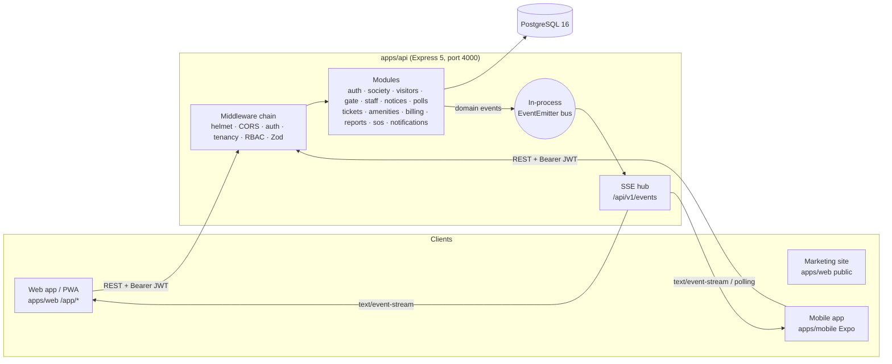
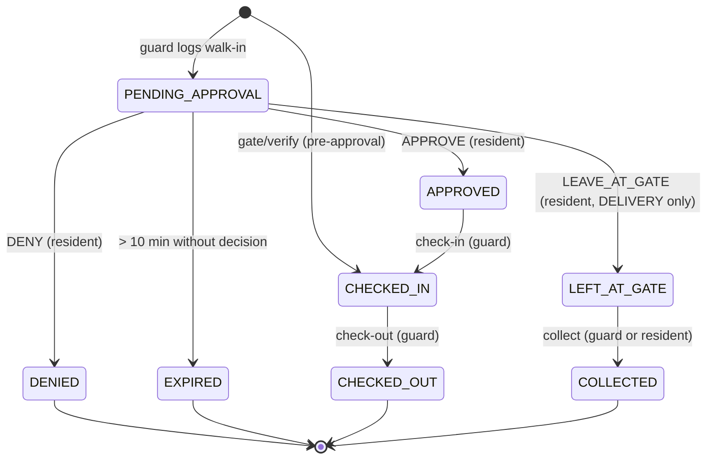
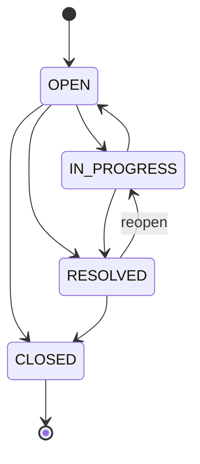

# Gatekeeper — Software Requirements Specification (SRS / SRD)

| | |
|---|---|
| **Document** | 02-SRS (IEEE 830-style) |
| **Version** | 1.0 |
| **Status** | Baseline for v1 |
| **Source of truth** | [`00-PROJECT-BRIEF.md`](./00-PROJECT-BRIEF.md) |
| **Related** | [`01-PRD.md`](./01-PRD.md), [`08-API-SPEC.md`](./08-API-SPEC.md) (wire-level contract), [`10-TEST-PLAN.md`](./10-TEST-PLAN.md) (test IDs `TC-*`) |

---

## 1. Introduction

### 1.1 Purpose
This document specifies the functional and non-functional requirements of Gatekeeper v1. It is written for developers, testers and reviewers. Every requirement has an ID, is testable, and is traced to an endpoint and a test case (§7).

### 1.2 Scope
Gatekeeper is a multi-tenant platform for gated residential communities. It covers gate and visitor management, daily-help attendance, community communication (notices, polls), a helpdesk, amenity booking, maintenance billing with a mock payment gateway, expenses and KPIs, SOS alerts, and in-app plus realtime notifications. It ships as a REST/SSE API, a web application (marketing site plus app), and a mobile app. Out-of-scope items are listed in brief §3 and [`11-ROADMAP.md`](./11-ROADMAP.md).

### 1.3 Definitions, acronyms, abbreviations

| Term | Definition |
|---|---|
| Society | A tenant: one gated community or apartment complex |
| Block | A tower or wing within a society |
| Flat | A residential unit within a block |
| Membership | A user's role in one society (`ADMIN`, `RESIDENT`, `GUARD`) with status `ACTIVE`/`INACTIVE` |
| Actor | The `Membership` performing an action. `…ById` fields reference `Membership.id` |
| Walk-in | A visitor logged by a guard without prior approval |
| Pre-approval | A resident-issued invite carrying a 6-digit passcode |
| Daily help / Staff | Recurring domestic workers (maid, cook, driver, …) with a passcode |
| Passcode | A 6-digit numeric string used at the gate |
| OTP | One-time password for phone login |
| SSE | Server-Sent Events (`text/event-stream`) |
| Paise | 1/100 of an Indian Rupee. All money is integer paise |
| IST | India Standard Time, `Asia/Kolkata` (UTC+05:30) |
| RBAC | Role-based access control |
| DTO | Data transfer object, validated with Zod |
| p95 | 95th-percentile latency |
| DPDP Act | India's Digital Personal Data Protection Act, 2023 |

### 1.4 References
- `00-PROJECT-BRIEF.md` — locked roles, modules, entities, API, stack and design
- `03-DATA-DICTIONARY.md`, `04-ERD.md` — entity definitions
- `07-LLD.md` — state machine and sequence details
- `08-API-SPEC.md` — request and response schemas, final error codes
- OWASP Top 10 (2021), WCAG 2.1, IEEE Std 830-1998

### 1.5 Overview
§2 describes the product context. §3 lists functional requirements by module. §4 covers external interfaces. §5 covers non-functional requirements. §6 tabulates use cases. §7 is the traceability matrix.

## 2. Overall description

### 2.1 Product perspective
Gatekeeper is a self-contained system. It is a **modular monolith** API (`routes → controller → service → Prisma`) backed by PostgreSQL 16, consumed by a web client and a mobile client.

### 2.2 Product functions (summary)
1. Phone/OTP authentication and profile.
2. Society, block, flat and member administration with tenancy isolation.
3. Walk-in visitor lifecycle with realtime resident approval.
4. Resident pre-approvals and unified gate passcode verification.
5. Daily-help registry, flat linking and attendance.
6. Notices and polls.
7. Helpdesk tickets with comments.
8. Amenities, availability and capacity-safe bookings.
9. Invoices, mock payments, expenses and dashboard KPIs.
10. SOS alerts.
11. Notifications and the SSE stream.

### 2.3 User classes and characteristics

| Class | Technical skill | Key permissions | Primary client |
|---|---|---|---|
| Anonymous prospect | Any | Marketing site, OTP endpoints | Browser |
| `ADMIN` | Moderate (office user) | Full read/write in own society. No visitor decisions or votes | Web app |
| `RESIDENT` (`OWNER`/`TENANT`/`FAMILY`) | Low–moderate, all ages | Own flat's data: decide visitors, pre-approvals, tickets, bookings, invoices, SOS | Mobile, web |
| `GUARD` | Low; may have limited English | Log and verify visitors, toggle staff, view flat residents, handle SOS | Mobile or tablet, web |

### 2.4 Operating environment

| Component | Environment |
|---|---|
| API | Node.js 22+ in a Docker container (Linux), port 4000 |
| DB | `postgres:16-alpine`, port 5432, persistent volume |
| Web | Static build served by nginx in Docker, port 8080. Browsers: last 2 versions of Chrome, Edge, Firefox and Safari; Android Chrome; iOS Safari 15+ |
| Admin DB UI | Adminer, port 8081 (dev only; must not be exposed publicly in production) |
| Mobile | Expo (latest stable SDK). Android 10+ and iOS versions supported by that SDK |
| Time | Server clock in UTC (NTP-synced). Business-day logic in `Asia/Kolkata` |

### 2.5 Design and implementation constraints
- C1: The stack is locked (brief §5). No shared workspace package; each app is standalone.
- C2: The REST base path is `/api/v1` on port 4000. JSON only.
- C3: JWT is HS256 with a 7-day expiry, payload `{ sub }` only.
- C4: Society context comes from the `X-Society-Id` header (from query params for SSE only).
- C5: The event bus is an in-process `EventEmitter`. **The v1 API therefore runs as a single instance.**
- C6: Money is integer paise. Timestamps are stored in UTC.
- C7: No secrets in source. Configuration comes from `.env` (`DATABASE_URL`, `JWT_SECRET`, `CORS_ORIGINS`, `NODE_ENV`, …).
- C8: Original branding. No third-party product names, assets or copy.

### 2.6 Assumptions and dependencies
See PRD §10 (A1–A8) and §12. In particular, every active guard is treated as on duty (A1), and production OTP delivery requires a post-v1 SMS provider (A8).

## 3. Functional requirements

**Conventions**
- *Shall* means mandatory. Each FR names its endpoint(s) and roles.
- "Member" means a caller with an `ACTIVE` membership in the society given by `X-Society-Id`.
- Error codes shown are indicative. `08-API-SPEC.md` holds the final list, with the HTTP statuses fixed by brief §4: 400 validation, 401, 403, 404, 409 conflict, 422 business rule, 429, 500.
- All society-scoped reads and writes are filtered by `societyId`. A resource from another society is reported as **404**, not 403, to avoid leaking that it exists.

### 3.1 Platform and cross-cutting (SYS)

| ID | Requirement |
|---|---|
| FR-SYS-01 | `GET /health` (and `/api/v1/health`) shall return `200 {status:"ok"}` without authentication, including DB reachability (`db: "up"\|"down"`; status 503 when the DB is down). |
| FR-SYS-02 | Every error response shall use `{ "error": { "code", "message", "details"? } }` with the HTTP status from brief §4. Unhandled errors return 500 `INTERNAL` without stack traces outside development. |
| FR-SYS-03 | List endpoints shall return `{ "items": [...] }`, newest first unless stated otherwise, and accept `?limit=` (integer ≥ 1; default 50; values above 200 are clamped to 200; non-integer or < 1 → 400). |
| FR-SYS-04 | Timestamps shall be stored in UTC and serialised as ISO-8601 with `Z`. Date-only inputs (`date`, `period`, availability `date`) are interpreted in IST. |
| FR-SYS-05 | A seed script shall create the demo data in brief §9 (Emerald Heights, blocks A and B, 8 flats, four users with their roles, staff passcode `482913`, pre-approval passcode `135790`, notices, a poll, tickets, three amenities, current-month invoices, expenses). It shall be idempotent (re-running does not duplicate). |
| FR-SYS-06 | All request bodies, params and queries shall be validated with Zod at the route boundary. Unknown body keys are stripped, so they cannot mass-assign protected fields (`societyId`, `status`, `…ById`). |

### 3.2 Authentication and profile (AUTH)

| ID | Requirement |
|---|---|
| FR-AUTH-01 | `POST /auth/otp/request {phone}` (public) shall validate `phone` as 10–15 digits (optional leading `+`, normalised to digits). It generates a cryptographically random 6-digit code, stores only its **bcrypt hash** in `OtpCode` with `expiresAt = now + 5 min` and `attempts = 0`, and invalidates any earlier unconsumed codes for that phone. Response `200 {sent: true}`. |
| FR-AUTH-02 | OTP requests shall be rate-limited with express-rate-limit. Default: **5 requests per 15 minutes per (IP, phone)** and 30 per 15 minutes per IP. Excess → `429 RATE_LIMITED`. |
| FR-AUTH-03 | `POST /auth/otp/verify {phone, code, name?}` (public) shall verify against the latest unconsumed, unexpired code. On success it sets `consumedAt`, creates the `User` if the phone is new (name = `name` if given, else the phone number until updated), and returns `{ token, user, memberships[] }`. Each membership includes its `society` and `flat` (with block). |
| FR-AUTH-04 | OTP rules. (a) Expired (> 5 min), consumed, or missing code → `401 OTP_INVALID`. (b) Each wrong code increments `attempts`. (c) Once `attempts ≥ 5`, the code is locked: every further verify, correct or not, → `429 OTP_LOCKED` until a new OTP is requested. (d) Codes are single-use. (e) Plaintext codes are never persisted or logged in production. |
| FR-AUTH-05 | When `NODE_ENV !== "production"`, the OTP request response shall include `devCode` and the code shall be logged at info level. In production `devCode` shall never appear in responses or logs. |
| FR-AUTH-06 | The issued JWT shall be HS256, signed with `JWT_SECRET`, `exp` = 7 days, payload `{sub: userId}` only. Protected routes require `Authorization: Bearer <token>`. A missing, malformed, expired or wrongly signed token (including `alg: none`) → `401 UNAUTHENTICATED`. |
| FR-AUTH-07 | `GET /me` (auth) shall return the user and all memberships, each with society and flat. |
| FR-AUTH-08 | `PATCH /me {name?, email?}` (auth) shall update the profile. `name` is 1–80 chars; `email` must be a valid email or `null`. Phone cannot be changed here. |

### 3.3 Tenancy and access control (TEN)

| ID | Requirement |
|---|---|
| FR-TEN-01 | Society-scoped routes (everything except `/health`, `/auth/*`, `/me`, `POST /societies`, `/notifications*` and `/events`) shall require the `X-Society-Id` header. Missing → `400 SOCIETY_REQUIRED`. |
| FR-TEN-02 | Tenancy middleware shall resolve the caller's membership in that society with `status = ACTIVE` and attach `req.member = {id, role, flatId, societyId, residentType}`. No active membership → `403 FORBIDDEN`. |
| FR-TEN-03 | RBAC middleware shall enforce the role matrix in §3.17. A role not permitted → `403 FORBIDDEN`. |
| FR-TEN-04 | Every query shall be scoped by `req.member.societyId`. Resident-scoped resources are further scoped by `flatId` or `raisedById`/`createdById`/`bookedById`. An ID outside the caller's scope → `404 NOT_FOUND`. |

### 3.4 Society setup (SOC)

| ID | Requirement |
|---|---|
| FR-SOC-01 | `POST /societies {name, addressLine, city, state, pincode}` (auth) shall create the society and an `ACTIVE` `ADMIN` membership for the caller in one transaction. `pincode` is 6 digits. Response 201 with society and membership. |
| FR-SOC-02 | `GET /society` (member) shall return the current society. |
| FR-SOC-03 | `GET /blocks` (member) shall list blocks ordered by name. |
| FR-SOC-04 | `POST /blocks {name}` (admin) shall create a block. A name that already exists in the society (case-insensitive) → `409 ALREADY_EXISTS`. |
| FR-SOC-05 | `GET /flats?blockId` (member) shall list flats with block, ordered by block name then number. `blockId` filters. |
| FR-SOC-06 | `POST /flats/bulk {blockId, numbers[]}` (admin) shall create the flats (1–500 numbers, each 1–10 chars, optional floor inferred only if given). Numbers that already exist in the block are skipped. Response `201 {created: Flat[], skipped: string[]}`. A `blockId` outside the society → 404. |
| FR-SOC-07 | `GET /members` (admin) shall list memberships with user and flat. A guard may call `GET /members?flatId=…` and receives only `ACTIVE` `RESIDENT` memberships of that flat (name, phone, residentType). A guard without `flatId` → `400 VALIDATION_ERROR`. |
| FR-SOC-08 | `POST /members {phone, name, role, flatId?, residentType?}` (admin) shall find or create the user by phone and create an `ACTIVE` membership. A `RESIDENT` requires `flatId` (in society) and `residentType`. `flatId` is not allowed for `ADMIN` or `GUARD`. If the user already has a membership in the society → `409 ALREADY_EXISTS`. |
| FR-SOC-09 | `PATCH /members/:id {status?, role?}` (admin) shall update the membership. Changing role to `RESIDENT` requires the membership to have a flat. An admin action that would leave the society with zero `ACTIVE` `ADMIN`s → `422 LAST_ADMIN`. |

### 3.5 Visitor management (VIS)

**Visitor state machine** (brief §3.3):

| ID | Requirement |
|---|---|
| FR-VIS-01 | `GET /visitors?status&date&flatId` shall list visitors. Guard and admin see all in the society. A resident sees only their flat (a `flatId` filter for another flat returns an empty list). `date` (YYYY-MM-DD, IST) filters on `createdAt`. Includes flat, block and the logging guard's name. |
| FR-VIS-02 | `POST /visitors {flatId, type, name, phone?, company?, vehicleNo?, purpose?}` (guard) shall create a visitor with `status = PENDING_APPROVAL` and `loggedById = req.member.id`. `type ∈ {GUEST, DELIVERY, CAB, SERVICE}`. `name` is 1–80 chars. `phone` is 10–15 digits if present. `vehicleNo` is upper-cased. The flat must exist in the society. It shall emit `visitor.requested` to all `ACTIVE` residents of the flat and create a `Notification` for each. |
| FR-VIS-03 | `POST /visitors/:id/decision {decision}` (resident of the visitor's flat) shall apply `APPROVE → APPROVED` or `DENY → DENIED`, setting `decidedById` and `decidedAt`. The transition is a conditional update (`WHERE status = 'PENDING_APPROVAL'`), so the **first decision wins**. Status already decided → `409 ALREADY_DECIDED`. A resident of another flat → 404. |
| FR-VIS-04 | `LEAVE_AT_GATE` shall be accepted only when `type = DELIVERY` (→ `LEFT_AT_GATE`). For other types → `422 LEAVE_AT_GATE_NOT_ALLOWED`. |
| FR-VIS-05 | `POST /visitors/:id/check-in` (guard) shall move `APPROVED → CHECKED_IN` and set `checkInAt`. |
| FR-VIS-06 | `POST /visitors/:id/check-out` (guard) shall move `CHECKED_IN → CHECKED_OUT` and set `checkOutAt`. |
| FR-VIS-07 | `POST /visitors/:id/collect` (guard, or resident of the flat) shall move `LEFT_AT_GATE → COLLECTED`. |
| FR-VIS-08 | A visitor in `PENDING_APPROVAL` whose `createdAt` is more than **10 minutes** ago shall become `EXPIRED`. This is enforced (a) lazily, before any read or transition of that visitor, and (b) by a background sweeper running at least every 60 s that emits `visitor.updated`. A decision on an expired visitor → `422 VISITOR_EXPIRED`. |
| FR-VIS-09 | Any transition not in the state machine above → `422 INVALID_TRANSITION` with `details: {from, to}`. |
| FR-VIS-10 | Every status change shall emit `visitor.updated` (payload: visitor) to the flat's active residents, all active guards and admins of the society. The guard who logged the visitor and the flat's residents receive a `Notification` for APPROVED, DENIED, LEFT_AT_GATE and EXPIRED outcomes. |

### 3.6 Pre-approvals (PRE)

| ID | Requirement |
|---|---|
| FR-PRE-01 | `POST /preapprovals {type, guestName, guestPhone?, validFrom, validTo, maxUses?}` (resident) shall create an `ACTIVE` pre-approval for the caller's flat with `createdById = req.member.id`, `usedCount = 0`, and `maxUses` defaulting to 1 (range 1–50). It shall generate and return the passcode. `validTo > validFrom`, `validTo > now`, and the window is at most 7 days. |
| FR-PRE-02 | The passcode shall be 6 numeric digits from a CSPRNG, unique among the society's **ACTIVE pre-approvals and all Staff passcodes**, so `/gate/verify` is never ambiguous. On collision the generator retries (max 10, then `500`). Uniqueness is backed by a DB constraint or transactional check. |
| FR-PRE-03 | `GET /preapprovals` shall list the caller's flat's pre-approvals for a resident, or all in the society for an admin. Guards → 403. Expired ones are reported as `EXPIRED` (lazy update). |
| FR-PRE-04 | `DELETE /preapprovals/:id` (resident of the flat) shall set `status = CANCELLED` (soft delete). Only `ACTIVE` ones can be cancelled, otherwise `422 INVALID_TRANSITION`. Response 200 with the updated record. |
| FR-PRE-05 | Lifecycle: `ACTIVE → USED` when `usedCount` reaches `maxUses`; `ACTIVE → EXPIRED` when `now > validTo`; `ACTIVE → CANCELLED` on delete. `USED`, `EXPIRED` and `CANCELLED` are terminal. |

### 3.7 Gate passcode verification (GATE)

| ID | Requirement |
|---|---|
| FR-GATE-01 | `POST /gate/verify {passcode}` (guard) shall look up an `ACTIVE` pre-approval in the society with that passcode, where `validFrom ≤ now ≤ validTo` and `usedCount < maxUses`. On a match, in one transaction, it creates a `Visitor` (`status = CHECKED_IN`, `checkInAt = now`, `preApprovalId`, `loggedById = guard`, `decidedById = preApproval.createdById`, fields copied from the pre-approval), increments `usedCount` (→ `USED` when exhausted), emits `visitor.updated` and notifies the flat's residents. Response `200 {kind:"VISITOR", visitor}`. |
| FR-GATE-02 | Otherwise it shall look up a `Staff` member in the society with that passcode. If `isActive`: when the staff member has an open `StaffAttendance` (`checkOutAt IS NULL`), close it; otherwise create one with `loggedById = guard`. Response `200 {kind:"STAFF", staff, action:"CHECK_IN"\|"CHECK_OUT", attendance}`. |
| FR-GATE-03 | Passcode not 6 digits → 400. No match, or a pre-approval outside its window or exhausted → `404 PASSCODE_NOT_FOUND` (the message does not say which). Inactive staff → `422 STAFF_INACTIVE`. |
| FR-GATE-04 | `/gate/verify` shall be rate-limited to **30 requests per minute per guard membership** → `429 RATE_LIMITED`. Every failed attempt is logged with guard ID, without the passcode. |

### 3.8 Daily help (STF)

| ID | Requirement |
|---|---|
| FR-STF-01 | `GET /staff` (member) shall list staff with linked flats. Filters: `?category`, `?flatId`. Residents see all active staff (so they can find and link their help); passcodes are returned **only** to admins and guards. |
| FR-STF-02 | `POST /staff {name, phone?, category, photoUrl?}` (admin) shall create staff with `isActive = true` and a generated passcode (rules as FR-PRE-02, unique per society). Response 201 including the passcode. |
| FR-STF-03 | `PATCH /staff/:id {name?, phone?, category?, photoUrl?, isActive?}` (admin) shall update staff. Deactivating closes any open attendance with `checkOutAt = now`. |
| FR-STF-04 | `POST /staff/:id/flats {flatId}` shall link staff to a flat. Admin: any flat in the society. Resident: only `flatId = req.member.flatId`, otherwise 403. Duplicate link → `409 ALREADY_EXISTS`. |
| FR-STF-05 | `GET /staff/:id/attendance?from&to` shall list attendance newest first. Admin and guard: any staff. Resident: only staff linked to their flat, otherwise 404. |

### 3.9 Notices (NOT)

| ID | Requirement |
|---|---|
| FR-NOT-01 | `GET /notices?category` (member) shall list notices with **pinned first**, then newest first, including the author's name. |
| FR-NOT-02 | `POST /notices {title, body, category, isPinned?}` (admin) shall create a notice. `title` is 1–120 chars, `body` 1–5000 chars, `category ∈ {GENERAL, MAINTENANCE, EVENT, URGENT}`. It shall emit `notice.created` to all members of the society and create a `Notification` for each active member except the author. |
| FR-NOT-03 | `PATCH /notices/:id {title?, body?, category?, isPinned?}` (admin) shall update a notice. |
| FR-NOT-04 | `DELETE /notices/:id` (admin) shall delete the notice. Response 204. |

### 3.10 Polls (POLL)

| ID | Requirement |
|---|---|
| FR-POLL-01 | `GET /polls` (member) shall list polls with options, a vote `count` per option, `totalVotes`, `isClosed` (`closesAt ≤ now`), and `myVoteOptionId` for the caller. |
| FR-POLL-02 | `POST /polls {question, options[], closesAt?}` (admin) shall create the poll and its options in one transaction. 2–10 options, each 1–100 chars and unique within the poll. `closesAt` must be in the future. |
| FR-POLL-03 | `POST /polls/:id/vote {optionId}` (resident) shall record a `PollVote`. **One vote per poll per membership**, enforced by a unique constraint (`pollId + membershipId`). A repeat → `409 ALREADY_VOTED`. Votes cannot be changed in v1. |
| FR-POLL-04 | A vote on a closed poll → `422 POLL_CLOSED`. An `optionId` that does not belong to the poll → `400 VALIDATION_ERROR`. |

### 3.11 Helpdesk (TKT)

**Ticket state machine**

| ID | Requirement |
|---|---|
| FR-TKT-01 | `POST /tickets {category, title, description, priority?}` (resident) shall create a ticket with `status = OPEN`, `flatId = req.member.flatId`, `raisedById = req.member.id`, and `priority` defaulting to `MEDIUM`. `title` is 1–120 chars, `description` 1–5000 chars. Admins notified. |
| FR-TKT-02 | `GET /tickets?status&category&priority` shall list a resident's own tickets, or all society tickets for an admin. |
| FR-TKT-03 | `GET /tickets/:id` shall return the ticket with its comments (oldest first) and actor names. A resident can only fetch their own (else 404). |
| FR-TKT-04 | `PATCH /tickets/:id {status?, assignedToId?, priority?}`. Admin: any field. `assignedToId` must be an `ACTIVE` membership in the society. Resident (own ticket): only `status: CLOSED`. Transitions follow the state machine above, otherwise `422 INVALID_TRANSITION`. Entering `RESOLVED` sets `resolvedAt`; leaving it clears `resolvedAt`. |
| FR-TKT-05 | `POST /tickets/:id/comments {body}` (raiser or admin) shall add a comment (1–2000 chars). Commenting on a `CLOSED` ticket → `422 TICKET_CLOSED`. |
| FR-TKT-06 | A status change, assignment or new comment shall create a `Notification` for the other party (raiser ↔ admins/assignee). |

### 3.12 Amenities and bookings (AMN, BKG)

| ID | Requirement |
|---|---|
| FR-AMN-01 | `GET /amenities` (member) shall list amenities. Residents and guards see only `isActive = true`; admins see all. |
| FR-AMN-02 | `POST /amenities {name, description?, openTime, closeTime, slotMinutes, capacity, pricePerSlot}` (admin). Times are `HH:mm` (24 h, IST) with `openTime < closeTime` (no overnight in v1). `slotMinutes` is 15–240. `capacity` is 1–500. `pricePerSlot` is an integer ≥ 0 in paise. Name is unique per society (409). |
| FR-AMN-03 | `PATCH /amenities/:id` (admin) shall update the same fields plus `isActive`. Changing hours does not cancel existing bookings. |
| FR-AMN-04 | `GET /amenities/:id/availability?date=YYYY-MM-DD` (member) shall return the slots for that IST date: `[openTime + k·slotMinutes, + slotMinutes)` for every whole slot ending at or before `closeTime`. Each slot has `startAt`, `endAt` (UTC ISO), `booked` (CONFIRMED count), `remaining = capacity − booked`, and `isPast`. |
| FR-BKG-01 | `POST /bookings {amenityId, startAt}` (resident) shall create a `CONFIRMED` booking for the caller's flat with `endAt = startAt + slotMinutes`. `startAt` must align to a slot boundary within opening hours (else `422 SLOT_INVALID`), be in the future (`422 SLOT_IN_PAST`), and be at most 30 days ahead (`422 SLOT_TOO_FAR`). The amenity must be active (`422 AMENITY_INACTIVE`). The same flat cannot hold two confirmed bookings for the same slot (409). |
| FR-BKG-02 | **Capacity**: the count of `CONFIRMED` bookings for the amenity and slot shall never exceed `capacity`. The check and insert run in a single transaction that locks the amenity row (`SELECT … FOR UPDATE`) or uses serializable isolation. Full → `409 SLOT_FULL`. |
| FR-BKG-03 | `GET /bookings?amenityId&date&status` shall list a resident's flat's bookings, or all for an admin. |
| FR-BKG-04 | `DELETE /bookings/:id` (resident of the booking's flat, or admin) shall set `status = CANCELLED`. A resident may cancel only before `startAt` (`422 BOOKING_STARTED`). Cancelling frees capacity. |

### 3.13 Billing, expenses and reports (BIL, RPT)

| ID | Requirement |
|---|---|
| FR-BIL-01 | `GET /invoices?status&period` shall list a resident's flat's invoices, or all for an admin (with flat and block). Each invoice includes its payment, if any. |
| FR-BIL-02 | `POST /invoices/generate {period, amount, dueDate}` (admin). `period` is `YYYY-MM`; `amount` is an integer > 0 in paise; `dueDate` is a date. It creates one `UNPAID` invoice per flat in the society that has none for that period. **Invoice is unique per (flatId, period)** by DB constraint; existing ones are skipped. Response `201 {created, skipped}` (counts). Residents of each flat with a new invoice are notified. |
| FR-BIL-03 | `POST /invoices/:id/pay {method}` (resident of the flat, or admin) runs the **mock payment gateway**. Allowed only for `UNPAID` or `OVERDUE`, otherwise `409 ALREADY_PAID`. In one transaction it creates a `Payment` (`amount = invoice.amount`, `method`, `reference = "MOCK-" + random id`, `paidById`, `paidAt = now`) and sets the invoice to `PAID`. `method ∈ {UPI, CARD, NETBANKING}` for residents; `CASH` is admin-only (recording an offline payment). Partial payments are not supported. |
| FR-BIL-04 | An `UNPAID` invoice whose `dueDate` is before today (IST) shall be `OVERDUE`. This is applied lazily on read and by a daily sweeper. |
| FR-BIL-05 | All monetary fields (`Invoice.amount`, `Payment.amount`, `Expense.amount`, `Amenity.pricePerSlot`, report totals) shall be integer paise in storage and on the wire. Non-integer or negative input → 400. Clients format them as ₹ with two decimals. |
| FR-BIL-06 | `GET /expenses?from&to&category` (admin) shall list expenses newest `spentOn` first. |
| FR-BIL-07 | `POST /expenses {category, amount, vendor?, note?, spentOn}` (admin) shall record an expense with `createdById`. `amount` is an integer > 0. `spentOn` is a date not in the future (IST). |
| FR-RPT-01 | `GET /reports/summary` (admin) shall return for the current IST month: `period`, `invoicedAmount`, `collectedAmount`, `collectionPct` (0–100, 1 decimal; 0 when nothing is invoiced), `outstandingDues` (sum of UNPAID + OVERDUE across all periods), `expensesThisMonth`, `visitorsToday` (visitors created today IST), `openTickets` (OPEN + IN_PROGRESS), and `activeSos` (RAISED + ACKNOWLEDGED). |

### 3.14 SOS (SOS)

**SOS state machine:** `RAISED → ACKNOWLEDGED → RESOLVED`, plus `RAISED → RESOLVED`. `RESOLVED` is terminal.

| ID | Requirement |
|---|---|
| FR-SOS-01 | `POST /sos {type, message?}` (resident) shall create an alert with `status = RAISED`, `flatId = req.member.flatId` and `raisedById`. `type ∈ {MEDICAL, FIRE, THEFT, OTHER}`; `message` up to 500 chars. |
| FR-SOS-02 | `GET /sos?status` shall list all of the society's alerts for guards and admins, or only the resident's own. Includes flat and raiser name and phone (for guard callback). |
| FR-SOS-03 | `PATCH /sos/:id {status}` (guard/admin). `ACKNOWLEDGED` sets `acknowledgedById` and `acknowledgedAt`. `RESOLVED` sets `resolvedAt` (and acknowledgement fields if still unset). Invalid transitions → `422 INVALID_TRANSITION`. |
| FR-SOS-04 | Raising an SOS shall emit `sos.raised` to all `ACTIVE` guards and admins of the society, and create a `Notification` for each, within 2 s (NFR-PERF-03). Every status change emits `sos.updated` to the raiser, guards and admins. |

### 3.15 Notifications and realtime (NTF)

| ID | Requirement |
|---|---|
| FR-NTF-01 | `GET /notifications?unread=true&societyId` (auth) shall list the caller's notifications (`userId = sub`), newest first, plus `unreadCount`. |
| FR-NTF-02 | `POST /notifications/:id/read` (auth) shall set `readAt` (idempotent). Another user's notification → 404. |
| FR-NTF-03 | `POST /notifications/read-all` (auth, optional `{societyId}`) shall mark all of the caller's unread notifications as read and return `{updated: n}`. |
| FR-NTF-04 | `GET /events?token=<jwt>&societyId=<id>` shall authenticate the JWT from the query string and require an `ACTIVE` membership in `societyId` (401 / 403 otherwise). It responds `200` with `Content-Type: text/event-stream`, `Cache-Control: no-cache`, `Connection: keep-alive`, sends a `: ping` comment every 25 s, and cleans up the subscription on client disconnect. |
| FR-NTF-05 | Events shall be named `visitor.requested`, `visitor.updated`, `sos.raised`, `sos.updated`, `notice.created` and `notification`. Each is delivered only to connections whose membership is a recipient under the rules in FR-VIS-02/10, FR-NOT-02 and FR-SOS-04. The `notification` event mirrors each stored `Notification` for that user. Event `data` is JSON. |
| FR-NTF-06 | Domain services shall publish events through the in-process event bus (observer pattern). A notification service subscribes, persists `Notification` rows and fans out to the SSE hub. A failure delivering to one subscriber shall not fail the originating request. |

### 3.16 Client applications (WEB, MOB)

| ID | Requirement |
|---|---|
| FR-WEB-01 | The marketing site (`/`, public) shall present the product (hero with tagline, feature sections per module group, gate-flow explainer, security and privacy, FAQ, footer) with CTAs to **Get started** / **Sign in** (`/app/login`) and a `mailto:` contact. It shall not require the API. |
| FR-WEB-02 | The web app shall implement phone → OTP sign-in (showing `devCode` in dev builds only), store the JWT, call `GET /me`, and offer a society switcher when there are multiple active memberships. It sends `X-Society-Id` on every society-scoped request. On 401 it signs out. |
| FR-WEB-03 | The web app shall render role-based navigation. **Admin**: Dashboard, Visitors, Members & Flats, Staff, Notices, Polls, Helpdesk, Amenities & Bookings, Billing, Expenses, SOS. **Resident**: Home (pending approvals), Visitors, Pre-approvals, Daily help, Notices, Polls, Helpdesk, Amenities, Invoices, SOS. **Guard**: Gate console (log walk-in, passcode, pending, inside now), Visitors, SOS. |
| FR-WEB-04 | The web app shall be an installable PWA (manifest, icons, service worker caching static assets only, never API responses). |
| FR-WEB-05 | The web app shall follow the system colour scheme (dark mode on a `navy-950` background) using the brief §8 tokens. |
| FR-WEB-06 | The web app shall subscribe to `/events` with `EventSource`, invalidate the relevant TanStack Query caches on events, and show toasts or alerts. SOS alerts for guards and admins show a persistent, high-contrast banner until acknowledged. |
| FR-MOB-01 | The mobile app (Resident) shall support sign-in, society switch, pending approval cards (approve / deny / leave at gate), visitor history, pre-approval creation and sharing of the passcode via the OS share sheet, daily-help attendance, notices, polls, tickets, bookings, invoices with mock pay, SOS, and notifications. |
| FR-MOB-02 | The mobile app (Guard) shall support the gate console: log walk-in (flat picker by block), passcode verify with a clear VISITOR / STAFF result, pending list with live status, check-in, check-out and collect, and an SOS inbox with acknowledge and resolve. |
| FR-MOB-03 | The mobile app shall receive realtime events via SSE where supported, otherwise poll the relevant lists at ≤ 15 s intervals while in the foreground. |

### 3.17 Role / permission matrix

| Endpoint group | ADMIN | RESIDENT | GUARD |
|---|---|---|---|
| `GET /society`, `GET /blocks`, `GET /flats` | ✓ | ✓ | ✓ |
| `POST /blocks`, `POST /flats/bulk` | ✓ | — | — |
| `GET /members` | ✓ all | — | ✓ `?flatId` residents only |
| `POST/PATCH /members` | ✓ | — | — |
| `GET /visitors` | ✓ all | ✓ own flat | ✓ all |
| `POST /visitors`, check-in, check-out | — | — | ✓ |
| `POST /visitors/:id/decision` | — | ✓ own flat | — |
| `POST /visitors/:id/collect` | — | ✓ own flat | ✓ |
| `POST /gate/verify` | — | — | ✓ |
| `GET /preapprovals` | ✓ read all | ✓ own flat | — |
| `POST/DELETE /preapprovals` | — | ✓ own flat | — |
| `GET /staff`, `GET /staff/:id/attendance` | ✓ | ✓ (attendance: linked only) | ✓ |
| `POST/PATCH /staff` | ✓ | — | — |
| `POST /staff/:id/flats` | ✓ any flat | ✓ own flat | — |
| `GET /notices`, `GET /polls` | ✓ | ✓ | ✓ |
| Notices write, `POST /polls` | ✓ | — | — |
| `POST /polls/:id/vote` | — | ✓ | — |
| Tickets | ✓ all | ✓ own (close only on PATCH) | — |
| `GET /amenities`, availability | ✓ | ✓ | ✓ |
| Amenities write | ✓ | — | — |
| Bookings | ✓ all (read/cancel) | ✓ own flat | — |
| `GET /invoices`, pay | ✓ all (pay incl. CASH) | ✓ own flat | — |
| `POST /invoices/generate`, expenses, reports | ✓ | — | — |
| `POST /sos` | — | ✓ | — |
| `GET /sos`, `PATCH /sos/:id` | ✓ | GET own only | ✓ |
| Notifications, `/events`, `/me` | ✓ | ✓ | ✓ |

## 4. External interface requirements

### 4.1 User interfaces
- **Design system:** the brief §8 tokens (navy-900 primary, emerald-600 approve/CTA, gold-500 accent on navy only, danger-600 deny/SOS, warning-500 pending/overdue), Fraunces for marketing headings, Manrope for UI, tabular numerals for amounts and times. Full specification in `09-UI-UX-DESIGN-SYSTEM.md`.
- **Status chips** combine a dot, a text label and colour, for example `● Pending approval`.
- **Breakpoints:** 360 px mobile, 768 px tablet (guard console), 1024 px or more for the desktop admin console.
- **Money** displays as `₹1,234.50` (en-IN grouping). **Times** display in IST.
- **Guard UI:** primary actions at least 56 px tall, passcode input with a numeric keypad, results that stay on screen until dismissed.

### 4.2 Software interfaces (REST API)
- Base URL `http(s)://<host>:4000/api/v1`; JSON UTF-8; `Authorization: Bearer <jwt>`; `X-Society-Id: <cuid>` on society routes.
- IDs are cuid strings. Unknown routes → `404 NOT_FOUND` in the error envelope.
- Success statuses: 200 read/update/action, 201 create, 204 delete with no body.
- The full endpoint list is brief §7. Schemas are in `08-API-SPEC.md`. Every endpoint is traced in §7.

### 4.3 Realtime interface (SSE)

| Event | Payload (`data`) | Recipients |
|---|---|---|
| `visitor.requested` | Visitor (with flat) | Active residents of `visitor.flatId` |
| `visitor.updated` | Visitor | Residents of the flat, all guards and admins |
| `sos.raised` | SosAlert (with flat, raiser) | All active guards and admins |
| `sos.updated` | SosAlert | Raiser, all guards and admins |
| `notice.created` | Notice | All active members |
| `notification` | Notification | The target user (any society connection matching `societyId`, or all their connections if `societyId` is null) |

The transport is `GET /api/v1/events?token&societyId`, with a 25 s heartbeat comment and a `retry: 5000` hint. Clients reconnect automatically and refetch lists on reconnect.

### 4.4 Hardware interfaces
None in v1. Boom barriers, smart locks and cameras are post-v1.

### 4.5 Communications interfaces
HTTPS (TLS 1.2+) is mandatory in any non-local deployment and is terminated at a reverse proxy. The proxy must not buffer `/api/v1/events` (`X-Accel-Buffering: no`). CORS allows only the origins in `CORS_ORIGINS`.

## 5. Non-functional requirements

### 5.1 Performance (PERF)

| ID | Requirement |
|---|---|
| NFR-PERF-01 | p95 server latency **< 300 ms** and p99 < 800 ms for all non-streaming endpoints at 100 requests/s sustained, on a 2 vCPU / 4 GB host with the seed dataset scaled to 50 societies × 500 flats × 90 days of visitors. |
| NFR-PERF-02 | `POST /gate/verify` and `POST /visitors` p95 < 200 ms (they are on the gate critical path). |
| NFR-PERF-03 | Realtime events shall reach connected recipients within **2 s** (p95) of the triggering commit. |
| NFR-PERF-04 | One API instance shall sustain 2,000 concurrent SSE connections. |
| NFR-PERF-05 | Web: marketing LCP < 2.5 s and CLS < 0.1 on simulated 4G mid-tier mobile. App initial JS ≤ 250 KB gzipped (route-split). |
| NFR-PERF-06 | All list queries are bounded by `limit`, and foreign-key and filter columns are indexed (`societyId`, `flatId`, `status`, `createdAt`). |

### 5.2 Availability and reliability (AVL)

| ID | Requirement |
|---|---|
| NFR-AVL-01 | Target availability is 99.5% monthly for a single-host deployment (excluding announced maintenance). |
| NFR-AVL-02 | Docker services use `restart: unless-stopped`. The `api` waits for a healthy `db` (healthcheck) before starting and applies Prisma migrations on start. |
| NFR-AVL-03 | Daily `pg_dump` backups, retained for 14 days. Restore procedure documented and tested once per phase-6 hardening. RPO ≤ 24 h, RTO ≤ 4 h. |
| NFR-AVL-04 | Multi-row state changes (gate verify, invoice pay, booking, society create, poll create) are atomic DB transactions. |
| NFR-AVL-05 | Graceful shutdown on SIGTERM: stop accepting connections, close SSE streams, drain in-flight requests (≤ 10 s), then disconnect Prisma. |

### 5.3 Security (SEC) — OWASP Top 10 (2021) mapping

| ID | OWASP | Requirement |
|---|---|---|
| NFR-SEC-01 | A01 Broken Access Control | Middleware chain auth → tenancy → RBAC on every protected route. `societyId` scoping in every service query. Cross-tenant IDs → 404. Automated IDOR tests per module. |
| NFR-SEC-02 | A02 Cryptographic Failures | OTPs bcrypt-hashed (cost ≥ 10). JWT secret ≥ 32 random bytes from env. TLS in transit. No secrets in the repo or images. |
| NFR-SEC-03 | A03 Injection | Prisma parameterised queries only (no `$queryRawUnsafe`). Zod validation of all input. React output escaping; no `dangerouslySetInnerHTML` on user content. |
| NFR-SEC-04 | A04 Insecure Design | State machines enforced server-side. Rate limits on OTP and gate verify. Passcode uniqueness across pre-approvals and staff. Threat model kept in `06-HLD.md`. |
| NFR-SEC-05 | A05 Security Misconfiguration | `helmet` defaults plus a strict CSP on web. CORS allowlist. `x-powered-by` disabled. Adminer is not exposed in production. Production build refuses to start if `JWT_SECRET` is unset or a default value. |
| NFR-SEC-06 | A06 Vulnerable Components | `npm audit --audit-level=high` reports no unresolved high or critical findings at release. Dependencies pinned via lockfiles. |
| NFR-SEC-07 | A07 Identification & Auth Failures | OTP 5-minute expiry, 5 attempts, single use, rate limits. JWT expiry 7 days, HS256 only (algorithm pinned on verify). Inactive memberships are rejected on every request (no stale role in the token). |
| NFR-SEC-08 | A08 Software & Data Integrity | Lockfiles committed. Docker images built from pinned base tags. Migrations reviewed and committed. |
| NFR-SEC-09 | A09 Logging & Monitoring Failures | Structured pino logs for auth failures, 403s, rate-limit hits, gate verify failures and SOS events, with request IDs. Redaction of `authorization`, `token` query param, `code`, `passcode`, `devCode` (prod) and `phone` (masked except last 4). |
| NFR-SEC-10 | A10 SSRF | The server makes no outbound requests to user-supplied URLs. `photoUrl`/`logoUrl`/`avatarUrl` are stored as strings, validated as `https:` URLs and never fetched server-side. |
| NFR-SEC-11 | — | Request body size limit of 100 KB. JSON only. |

### 5.4 Privacy and data retention (PRIV)

| ID | Requirement |
|---|---|
| NFR-PRIV-01 | Personal data (names, phones, vehicle numbers, visitor details) is collected only for the stated purpose (gate security and society administration), in line with the DPDP Act 2023 principles of purpose limitation and data minimisation. |
| NFR-PRIV-02 | Retention defaults are enforced by a scheduled purge job. **OtpCode**: deleted 24 h after expiry. **Visitor and PreApproval**: 13 months, then deleted. **StaffAttendance**: 13 months. **Notification**: 90 days. **SosAlert**: 3 years. **Financial records** (Invoice, Payment, Expense): 8 years. |
| NFR-PRIV-03 | Guards see only the minimum resident data needed: name, flat and phone for residents of the flat they query. Guards have no access to billing, tickets or member lists. |
| NFR-PRIV-04 | When a membership is deactivated, the user immediately loses access to that society. Data they authored is retained for audit. |
| NFR-PRIV-05 | The marketing site uses no third-party trackers in v1 and publishes a privacy notice. |

### 5.5 Accessibility (A11Y)

| ID | Requirement |
|---|---|
| NFR-A11Y-01 | Web and mobile meet **WCAG 2.1 AA**: text contrast ≥ 4.5:1 (≥ 3:1 for large text and UI components). Gold is never used as text on white. |
| NFR-A11Y-02 | Full keyboard operability with a visible focus ring (emerald-500, 2 px, 2 px offset) and logical focus order. Dialogs trap and restore focus. |
| NFR-A11Y-03 | Touch targets ≥ 44×44 px. Status is never conveyed by colour alone. |
| NFR-A11Y-04 | Semantic HTML and landmarks, labelled form fields, error messages tied via `aria-describedby`, and live regions (`aria-live="assertive"` for SOS, `polite` for visitor updates). Mobile uses `accessibilityLabel`/`accessibilityRole`. |
| NFR-A11Y-05 | Respects `prefers-reduced-motion`. Layout works at 200% zoom with no horizontal scroll at 320 px width. |

### 5.6 Scalability (SCAL)

| ID | Requirement |
|---|---|
| NFR-SCAL-01 | v1 supports up to 100 societies / 50,000 users on a single API instance and a single Postgres. |
| NFR-SCAL-02 | Because of C5, scaling beyond one API instance requires replacing the event bus with a shared broker (post-v1). The bus is accessed through one module so that swap stays local. |
| NFR-SCAL-03 | Every tenant table carries `societyId` with a leading index, which keeps per-society partitioning open as a future option. |

### 5.7 Maintainability (MAINT)

| ID | Requirement |
|---|---|
| NFR-MAINT-01 | TypeScript `strict` in all apps. ESLint with no errors at merge. |
| NFR-MAINT-02 | The module layout is fixed: `routes → controller → service → Prisma`. Business rules live in services, never in routes. |
| NFR-MAINT-03 | API line coverage ≥ 80% on services. Every FR has at least one automated or manual test (see §7). |
| NFR-MAINT-04 | Schema changes only through committed Prisma migrations. The seed is kept in sync. |
| NFR-MAINT-05 | `README.md` documents one-command start (`docker compose up`), env vars, seed accounts and the test command. |

### 5.8 Logging and observability (LOG)

| ID | Requirement |
|---|---|
| NFR-LOG-01 | pino JSON logs to stdout. Each request is logged with `reqId` (`X-Request-Id` echoed or generated), method, route, status, latency, `userId` and `societyId`. |
| NFR-LOG-02 | Levels: `info` for requests and domain events, `warn` for 4xx security-relevant events (401/403/429), `error` for 5xx with stack. Production default level is `info`. |
| NFR-LOG-03 | Redaction per NFR-SEC-09. Access logs strip the `token` query parameter from `/events` URLs. |
| NFR-LOG-04 | `/health` is suitable for container and uptime probes. The SSE hub logs connection counts every 5 minutes. |

## 6. Use cases

| UC | Name | Primary actor | Trigger | Main success scenario | Related FRs |
|---|---|---|---|---|---|
| UC-01 | Sign in | Any user | Opens app | Request OTP → enter code → token → pick society | FR-AUTH-01–07, FR-WEB-02 |
| UC-02 | Create society | Committee member | Get started | Sign in → create society → becomes ADMIN | FR-SOC-01 |
| UC-03 | Set up structure | Admin | Onboarding | Add blocks → bulk flats → add members | FR-SOC-03–09 |
| UC-04 | Log walk-in | Guard | Visitor at gate | Select flat and type → enter name → PENDING → residents alerted | FR-VIS-02, FR-NTF-05 |
| UC-05 | Decide visitor | Resident | Alert received | Approve / Deny / Leave at gate → guard sees update | FR-VIS-03, FR-VIS-04, FR-VIS-10 |
| UC-06 | Admit and exit visitor | Guard | Approval | Check in → later check out | FR-VIS-05, FR-VIS-06 |
| UC-07 | Collect parcel | Resident / Guard | Parcel at gate | Mark collected | FR-VIS-07 |
| UC-08 | Pre-approve guest | Resident | Expecting guest | Create invite → share passcode | FR-PRE-01–05 |
| UC-09 | Verify passcode | Guard | Guest or staff arrives | Enter passcode → VISITOR checked in, or STAFF toggled | FR-GATE-01–04 |
| UC-10 | Manage daily help | Admin / Resident | New help | Create staff → link flat → view attendance | FR-STF-01–05 |
| UC-11 | Publish notice | Admin | Announcement | Post (pin) → members notified | FR-NOT-01–04 |
| UC-12 | Run poll | Admin / Resident | Decision needed | Create poll → residents vote once → results | FR-POLL-01–04 |
| UC-13 | Raise and resolve complaint | Resident / Admin | Issue in flat | Raise → assign → in progress → resolved → closed | FR-TKT-01–06 |
| UC-14 | Book amenity | Resident | Wants facility | View availability → book slot → (cancel) | FR-AMN-01–04, FR-BKG-01–04 |
| UC-15 | Bill and collect | Admin / Resident | Month start | Generate invoices → resident pays (mock) → PAID | FR-BIL-01–05 |
| UC-16 | Record expense | Admin | Spend | Add expense | FR-BIL-06–07 |
| UC-17 | View dashboard | Admin | Daily review | KPIs shown | FR-RPT-01 |
| UC-18 | Raise and handle SOS | Resident / Guard | Emergency | Raise → guards alerted → acknowledge → resolve | FR-SOS-01–04 |
| UC-19 | Read notifications | Any | Badge | List → mark read / all read | FR-NTF-01–03 |
| UC-20 | Receive live updates | Any | App open | SSE connect → events → UI refresh | FR-NTF-04–06, FR-WEB-06, FR-MOB-03 |
| UC-21 | Evaluate product | Prospect | Visits site | Browse marketing → Get started | FR-WEB-01 |

## 7. Requirements traceability matrix

Test IDs refer to [`10-TEST-PLAN.md`](./10-TEST-PLAN.md) §7.

| FR | Module | Endpoint / component | Test IDs |
|---|---|---|---|
| FR-SYS-01 | Platform | `GET /health` | TC-SYS-01, TC-SMK-02 |
| FR-SYS-02 | Platform | Error handler (all) | TC-SYS-02 |
| FR-SYS-03 | Platform | All list endpoints | TC-SYS-03 |
| FR-SYS-04 | Platform | Serialisation | TC-SYS-04 |
| FR-SYS-05 | Platform | Seed script | TC-SYS-05, TC-SMK-03 |
| FR-SYS-06 | Platform | Zod validation (all) | TC-SYS-06, TC-SEC-05 |
| FR-AUTH-01 | Auth | `POST /auth/otp/request` | TC-AUTH-01, TC-AUTH-09 |
| FR-AUTH-02 | Auth | `POST /auth/otp/request` | TC-AUTH-02 |
| FR-AUTH-03 | Auth | `POST /auth/otp/verify` | TC-AUTH-03, TC-AUTH-12 |
| FR-AUTH-04 | Auth | `POST /auth/otp/verify` | TC-AUTH-04, TC-AUTH-10, TC-AUTH-11 |
| FR-AUTH-05 | Auth | `POST /auth/otp/request` | TC-AUTH-05 |
| FR-AUTH-06 | Auth | Auth middleware | TC-AUTH-06, TC-SEC-04 |
| FR-AUTH-07 | Auth | `GET /me` | TC-AUTH-07 |
| FR-AUTH-08 | Auth | `PATCH /me` | TC-AUTH-08 |
| FR-TEN-01 | Tenancy | Tenancy middleware | TC-TEN-01 |
| FR-TEN-02 | Tenancy | Tenancy middleware | TC-TEN-02, TC-TEN-05 |
| FR-TEN-03 | Tenancy | RBAC middleware | TC-TEN-03, TC-GATE-05, TC-POLL-05 |
| FR-TEN-04 | Tenancy | All society services | TC-TEN-04 |
| FR-SOC-01 | Society | `POST /societies` | TC-SOC-01 |
| FR-SOC-02 | Society | `GET /society` | TC-SOC-02 |
| FR-SOC-03 | Society | `GET /blocks` | TC-SOC-03 |
| FR-SOC-04 | Society | `POST /blocks` | TC-SOC-04 |
| FR-SOC-05 | Society | `GET /flats` | TC-SOC-05 |
| FR-SOC-06 | Society | `POST /flats/bulk` | TC-SOC-06 |
| FR-SOC-07 | Society | `GET /members` | TC-SOC-07 |
| FR-SOC-08 | Society | `POST /members` | TC-SOC-08 |
| FR-SOC-09 | Society | `PATCH /members/:id` | TC-SOC-09 |
| FR-VIS-01 | Visitors | `GET /visitors` | TC-VIS-01 |
| FR-VIS-02 | Visitors | `POST /visitors` | TC-VIS-02 |
| FR-VIS-03 | Visitors | `POST /visitors/:id/decision` | TC-VIS-03, TC-VIS-09, TC-VIS-11 |
| FR-VIS-04 | Visitors | `POST /visitors/:id/decision` | TC-VIS-04 |
| FR-VIS-05 | Visitors | `POST /visitors/:id/check-in` | TC-VIS-05 |
| FR-VIS-06 | Visitors | `POST /visitors/:id/check-out` | TC-VIS-06 |
| FR-VIS-07 | Visitors | `POST /visitors/:id/collect` | TC-VIS-07 |
| FR-VIS-08 | Visitors | Expiry sweeper + lazy check | TC-VIS-08 |
| FR-VIS-09 | Visitors | Visitor state machine | TC-VIS-05, TC-VIS-11, TC-VIS-12 |
| FR-VIS-10 | Visitors | Event bus / SSE | TC-VIS-10 |
| FR-PRE-01 | Pre-approvals | `POST /preapprovals` | TC-PRE-01 |
| FR-PRE-02 | Pre-approvals | Passcode generator | TC-PRE-02 |
| FR-PRE-03 | Pre-approvals | `GET /preapprovals` | TC-PRE-03 |
| FR-PRE-04 | Pre-approvals | `DELETE /preapprovals/:id` | TC-PRE-04 |
| FR-PRE-05 | Pre-approvals | Pre-approval lifecycle | TC-PRE-05 |
| FR-GATE-01 | Gate | `POST /gate/verify` | TC-GATE-01 |
| FR-GATE-02 | Gate | `POST /gate/verify` | TC-GATE-02 |
| FR-GATE-03 | Gate | `POST /gate/verify` | TC-GATE-03 |
| FR-GATE-04 | Gate | `POST /gate/verify` | TC-GATE-04 |
| FR-STF-01 | Staff | `GET /staff` | TC-STF-01 |
| FR-STF-02 | Staff | `POST /staff` | TC-STF-02 |
| FR-STF-03 | Staff | `PATCH /staff/:id` | TC-STF-03 |
| FR-STF-04 | Staff | `POST /staff/:id/flats` | TC-STF-04 |
| FR-STF-05 | Staff | `GET /staff/:id/attendance` | TC-STF-05 |
| FR-NOT-01 | Notices | `GET /notices` | TC-NOT-01 |
| FR-NOT-02 | Notices | `POST /notices` | TC-NOT-02 |
| FR-NOT-03 | Notices | `PATCH /notices/:id` | TC-NOT-03 |
| FR-NOT-04 | Notices | `DELETE /notices/:id` | TC-NOT-04 |
| FR-POLL-01 | Polls | `GET /polls` | TC-POLL-01 |
| FR-POLL-02 | Polls | `POST /polls` | TC-POLL-02 |
| FR-POLL-03 | Polls | `POST /polls/:id/vote` | TC-POLL-03 |
| FR-POLL-04 | Polls | `POST /polls/:id/vote` | TC-POLL-04 |
| FR-TKT-01 | Helpdesk | `POST /tickets` | TC-TKT-01 |
| FR-TKT-02 | Helpdesk | `GET /tickets` | TC-TKT-02 |
| FR-TKT-03 | Helpdesk | `GET /tickets/:id` | TC-TKT-03 |
| FR-TKT-04 | Helpdesk | `PATCH /tickets/:id` | TC-TKT-04 |
| FR-TKT-05 | Helpdesk | `POST /tickets/:id/comments` | TC-TKT-05 |
| FR-TKT-06 | Helpdesk | Event bus / notifications | TC-TKT-06 |
| FR-AMN-01 | Amenities | `GET /amenities` | TC-AMN-01 |
| FR-AMN-02 | Amenities | `POST /amenities` | TC-AMN-02 |
| FR-AMN-03 | Amenities | `PATCH /amenities/:id` | TC-AMN-03 |
| FR-AMN-04 | Amenities | `GET /amenities/:id/availability` | TC-AMN-04 |
| FR-BKG-01 | Bookings | `POST /bookings` | TC-BKG-01 |
| FR-BKG-02 | Bookings | `POST /bookings` | TC-BKG-02 |
| FR-BKG-03 | Bookings | `GET /bookings` | TC-BKG-03 |
| FR-BKG-04 | Bookings | `DELETE /bookings/:id` | TC-BKG-04 |
| FR-BIL-01 | Billing | `GET /invoices` | TC-BIL-01 |
| FR-BIL-02 | Billing | `POST /invoices/generate` | TC-BIL-02 |
| FR-BIL-03 | Billing | `POST /invoices/:id/pay` | TC-BIL-03 |
| FR-BIL-04 | Billing | Overdue sweeper + lazy check | TC-BIL-04 |
| FR-BIL-05 | Billing | All money fields | TC-BIL-05 |
| FR-BIL-06 | Billing | `GET /expenses` | TC-BIL-06 |
| FR-BIL-07 | Billing | `POST /expenses` | TC-BIL-07 |
| FR-RPT-01 | Reports | `GET /reports/summary` | TC-RPT-01 |
| FR-SOS-01 | SOS | `POST /sos` | TC-SOS-01 |
| FR-SOS-02 | SOS | `GET /sos` | TC-SOS-02 |
| FR-SOS-03 | SOS | `PATCH /sos/:id` | TC-SOS-03 |
| FR-SOS-04 | SOS | Event bus / SSE | TC-SOS-01, TC-SOS-04 |
| FR-NTF-01 | Notifications | `GET /notifications` | TC-NTF-01 |
| FR-NTF-02 | Notifications | `POST /notifications/:id/read` | TC-NTF-02 |
| FR-NTF-03 | Notifications | `POST /notifications/read-all` | TC-NTF-03 |
| FR-NTF-04 | Notifications | `GET /events` | TC-NTF-04 |
| FR-NTF-05 | Notifications | SSE hub routing | TC-NTF-05 |
| FR-NTF-06 | Notifications | Event bus | TC-NTF-06 |
| FR-WEB-01 | Web | Marketing site | TC-WEB-01 |
| FR-WEB-02 | Web | Login / society switcher | TC-WEB-02 |
| FR-WEB-03 | Web | Role navigation | TC-WEB-03 |
| FR-WEB-04 | Web | PWA | TC-WEB-04 |
| FR-WEB-05 | Web | Dark mode | TC-WEB-05 |
| FR-WEB-06 | Web | Realtime client | TC-WEB-06 |
| FR-MOB-01 | Mobile | Resident app | TC-MOB-01 |
| FR-MOB-02 | Mobile | Guard app | TC-MOB-02 |
| FR-MOB-03 | Mobile | Realtime / polling | TC-MOB-03 |

**Non-functional traceability**

| NFR | Test IDs |
|---|---|
| NFR-PERF-01, 02, 06 | TC-PERF-01 |
| NFR-PERF-03, 04 | TC-PERF-02 |
| NFR-PERF-05 | TC-PERF-03 |
| NFR-AVL-02 | TC-SMK-01 |
| NFR-AVL-03 | TC-OPS-01 |
| NFR-AVL-04 | TC-BKG-02, TC-GATE-01, TC-BIL-03 |
| NFR-AVL-05 | TC-OPS-02 |
| NFR-SEC-01 | TC-TEN-04, TC-SEC-06 |
| NFR-SEC-02 | TC-AUTH-01, TC-SEC-07 |
| NFR-SEC-03 | TC-SEC-03 |
| NFR-SEC-04 | TC-GATE-04, TC-PRE-02 |
| NFR-SEC-05 | TC-SEC-01, TC-SEC-02, TC-SEC-10 |
| NFR-SEC-06, 08 | TC-SEC-08 |
| NFR-SEC-07 | TC-AUTH-04, TC-AUTH-06, TC-TEN-05 |
| NFR-SEC-09, NFR-LOG-03 | TC-SEC-09 |
| NFR-SEC-10 | TC-SEC-11 |
| NFR-SEC-11 | TC-SEC-12 |
| NFR-PRIV-02 | TC-PRIV-01 |
| NFR-PRIV-03 | TC-SOC-07, TC-TEN-03 |
| NFR-A11Y-01 – 05 | TC-A11Y-01 – TC-A11Y-05 |
| NFR-MAINT-01, 03 | TC-QA-01 |
| NFR-LOG-01, 02 | TC-SEC-09 |
