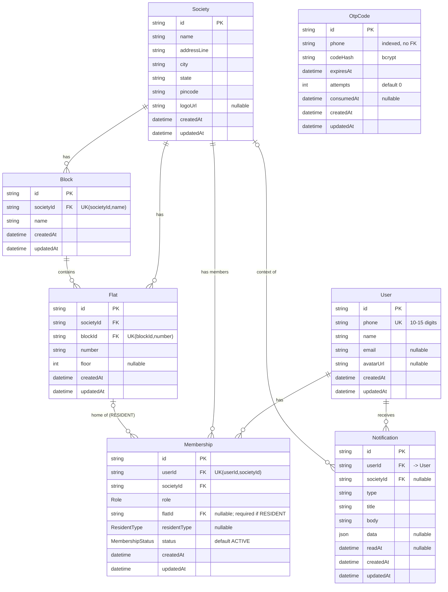
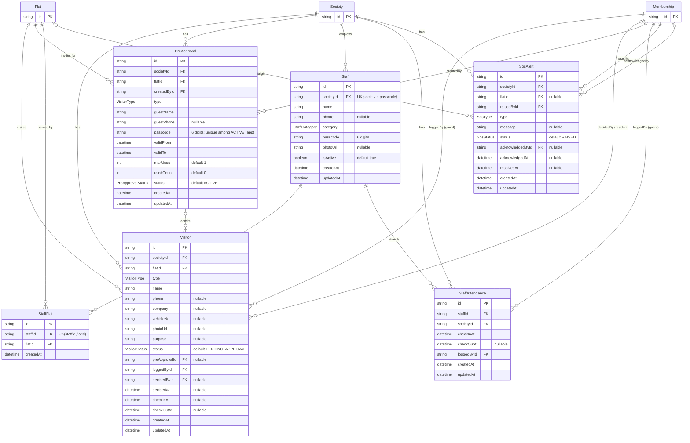
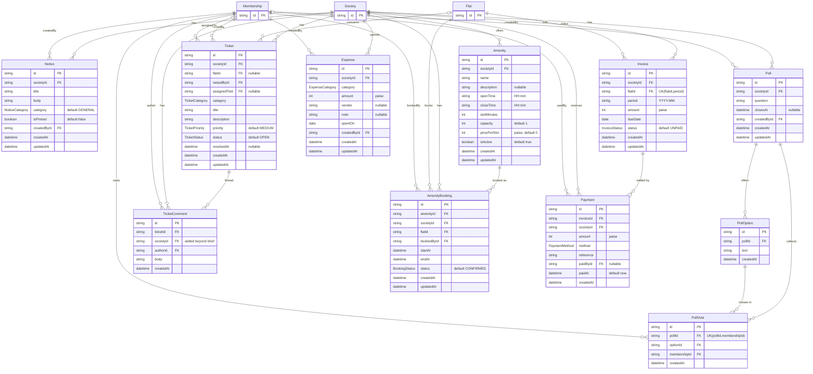

# 04 — Entity Relationship Diagram

> Mirrors `apps/api/prisma/schema.prisma` (canonical) and `03-DATA-DICTIONARY.md`.
> 24 models, 17 enums. Split into three diagrams; `Society`, `Flat` and `Membership` reappear as stubs (id only) where referenced.
> Physical names are snake_case (`Visitor` → `visitors`, `loggedById` → `logged_by_id`); diagrams use Prisma names.
> Optional FK = `o|` on the parent side. Actor fields (`…ById`) all point to `Membership`.

## 1. Core / Tenancy

## 2. Gate, Staff & SOS

## 3. Community & Finance

## 4. Relationships

On delete: **Cascade** = child rows removed; **NoAction** = delete refused while referenced (restrict semantics, checked at end of statement); **SetNull** = FK cleared.

| # | From (child) | To (parent) | Cardinality (parent : child) | FK | On delete |
|---|---|---|---|---|---|
| 1 | Membership | User | 1 : 0..N | memberships.user_id | Cascade |
| 2 | Notification | User | 1 : 0..N | notifications.user_id | Cascade |
| 3 | Block | Society | 1 : 0..N | blocks.society_id | Cascade |
| 4 | Flat | Society | 1 : 0..N | flats.society_id | Cascade |
| 5 | Flat | Block | 1 : 0..N | flats.block_id | Cascade |
| 6 | Membership | Society | 1 : 0..N | memberships.society_id | Cascade |
| 7 | Membership | Flat | 0..1 : 0..N | memberships.flat_id | NoAction |
| 8 | Notification | Society | 0..1 : 0..N | notifications.society_id | Cascade |
| 9 | Visitor | Society | 1 : 0..N | visitors.society_id | Cascade |
| 10 | Visitor | Flat | 1 : 0..N | visitors.flat_id | NoAction |
| 11 | Visitor | PreApproval | 0..1 : 0..N | visitors.pre_approval_id | SetNull |
| 12 | Visitor | Membership (loggedBy) | 1 : 0..N | visitors.logged_by_id | NoAction |
| 13 | Visitor | Membership (decidedBy) | 0..1 : 0..N | visitors.decided_by_id | SetNull |
| 14 | PreApproval | Society | 1 : 0..N | pre_approvals.society_id | Cascade |
| 15 | PreApproval | Flat | 1 : 0..N | pre_approvals.flat_id | Cascade |
| 16 | PreApproval | Membership (createdBy) | 1 : 0..N | pre_approvals.created_by_id | NoAction |
| 17 | Staff | Society | 1 : 0..N | staff.society_id | Cascade |
| 18 | StaffFlat | Staff | 1 : 0..N | staff_flats.staff_id | Cascade |
| 19 | StaffFlat | Flat | 1 : 0..N | staff_flats.flat_id | Cascade |
| 20 | StaffAttendance | Staff | 1 : 0..N | staff_attendance.staff_id | Cascade |
| 21 | StaffAttendance | Society | 1 : 0..N | staff_attendance.society_id | Cascade |
| 22 | StaffAttendance | Membership (loggedBy) | 1 : 0..N | staff_attendance.logged_by_id | NoAction |
| 23 | SosAlert | Society | 1 : 0..N | sos_alerts.society_id | Cascade |
| 24 | SosAlert | Flat | 0..1 : 0..N | sos_alerts.flat_id | SetNull |
| 25 | SosAlert | Membership (raisedBy) | 1 : 0..N | sos_alerts.raised_by_id | NoAction |
| 26 | SosAlert | Membership (acknowledgedBy) | 0..1 : 0..N | sos_alerts.acknowledged_by_id | SetNull |
| 27 | Notice | Society | 1 : 0..N | notices.society_id | Cascade |
| 28 | Notice | Membership (createdBy) | 1 : 0..N | notices.created_by_id | NoAction |
| 29 | Poll | Society | 1 : 0..N | polls.society_id | Cascade |
| 30 | Poll | Membership (createdBy) | 1 : 0..N | polls.created_by_id | NoAction |
| 31 | PollOption | Poll | 1 : 0..N | poll_options.poll_id | Cascade |
| 32 | PollVote | Poll | 1 : 0..N | poll_votes.poll_id | Cascade |
| 33 | PollVote | PollOption | 1 : 0..N | poll_votes.option_id | Cascade |
| 34 | PollVote | Membership (voter) | 1 : 0..N (max 1 per poll) | poll_votes.membership_id | Cascade |
| 35 | Ticket | Society | 1 : 0..N | tickets.society_id | Cascade |
| 36 | Ticket | Flat | 0..1 : 0..N | tickets.flat_id | SetNull |
| 37 | Ticket | Membership (raisedBy) | 1 : 0..N | tickets.raised_by_id | NoAction |
| 38 | Ticket | Membership (assignedTo) | 0..1 : 0..N | tickets.assigned_to_id | SetNull |
| 39 | TicketComment | Ticket | 1 : 0..N | ticket_comments.ticket_id | Cascade |
| 40 | TicketComment | Society | 1 : 0..N | ticket_comments.society_id | Cascade |
| 41 | TicketComment | Membership (author) | 1 : 0..N | ticket_comments.author_id | NoAction |
| 42 | Amenity | Society | 1 : 0..N | amenities.society_id | Cascade |
| 43 | AmenityBooking | Amenity | 1 : 0..N | amenity_bookings.amenity_id | Cascade |
| 44 | AmenityBooking | Society | 1 : 0..N | amenity_bookings.society_id | Cascade |
| 45 | AmenityBooking | Flat | 1 : 0..N | amenity_bookings.flat_id | Cascade |
| 46 | AmenityBooking | Membership (bookedBy) | 1 : 0..N | amenity_bookings.booked_by_id | NoAction |
| 47 | Invoice | Society | 1 : 0..N | invoices.society_id | Cascade |
| 48 | Invoice | Flat | 1 : 0..N (max 1 per period) | invoices.flat_id | NoAction |
| 49 | Payment | Invoice | 1 : 0..N | payments.invoice_id | NoAction |
| 50 | Payment | Society | 1 : 0..N | payments.society_id | Cascade |
| 51 | Payment | Membership (paidBy) | 0..1 : 0..N | payments.paid_by_id | SetNull |
| 52 | Expense | Society | 1 : 0..N | expenses.society_id | Cascade |
| 53 | Expense | Membership (createdBy) | 1 : 0..N | expenses.created_by_id | NoAction |

Many-to-many: **Staff ↔ Flat** via `StaffFlat`. `OtpCode` has no FK (matched to `User` by phone only).

## 5. Notes

- **Tenancy hub.** `Society` is the root of every tenant-owned row. A hard delete of a Society cascades to everything beneath it in one statement (verified on Postgres 16); `User` rows survive because users span societies.
- **Actor = Membership.** Every `…ById` points at `Membership`, so the same person acting in two societies leaves two distinct actor ids. Required actor refs use NoAction (members with history must be deactivated, not deleted); optional ones (`decidedById`, `assignedToId`, `acknowledgedById`, `paidById`) use SetNull.
- **Why `TicketComment.societyId`.** Without it, comments are two cascade hops from Society while their author memberships are one hop, and the author FK check fires first and blocks the Society delete. The extra column fixes that and satisfies the tenancy rule.
- **History is protected from flat deletion.** Visitors, invoices (and their payments) and resident memberships block deleting a flat (NoAction). Pre-approvals, bookings and staff links are transient and cascade. Tickets and SOS alerts keep the record and null the flat.
- **Self-consistency rules the DB can't express** (enforced in services): `Flat.societyId = Block.societyId`; `PollVote.optionId` belongs to `pollId`; every referenced flat/membership/staff shares the row's `societyId`; ACTIVE pre-approval passcodes are unique per society and don't collide with staff passcodes.
