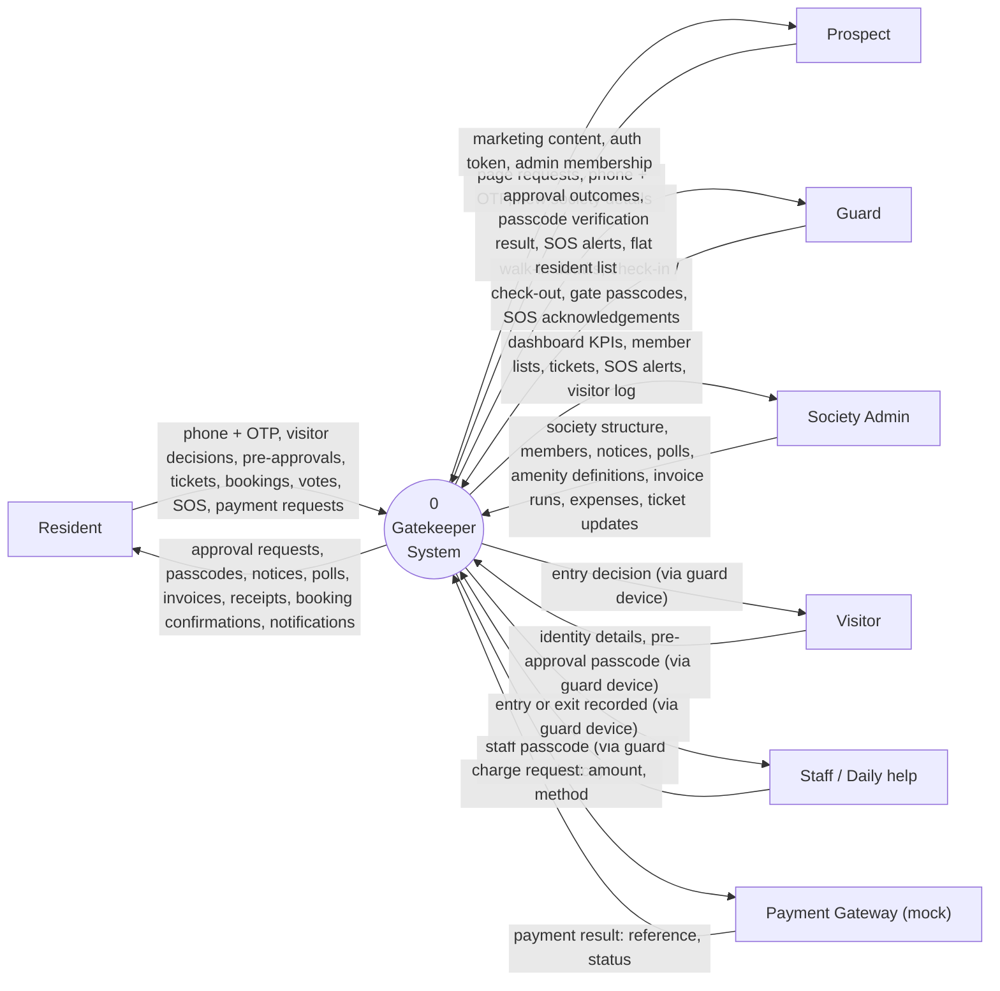
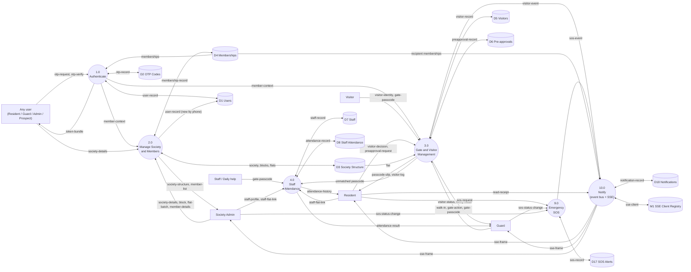
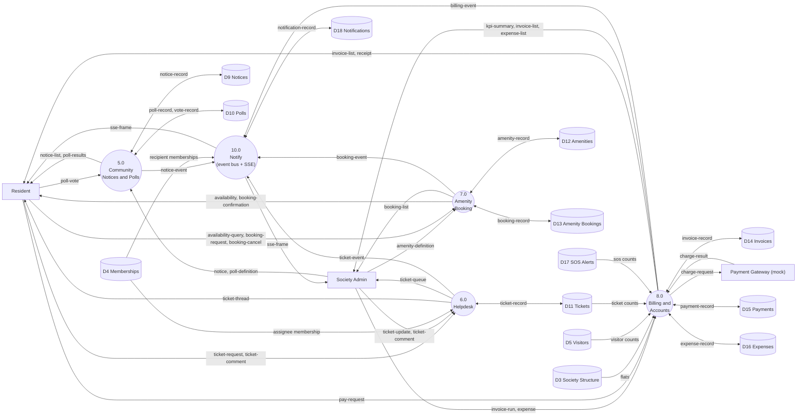
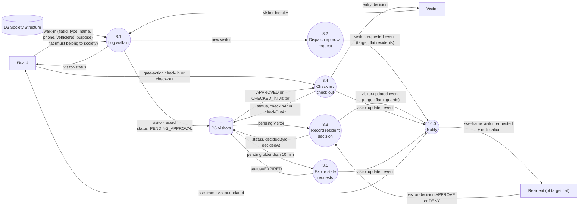
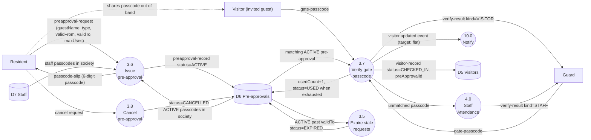
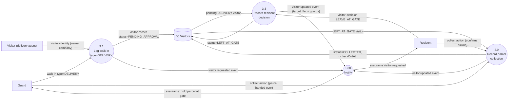
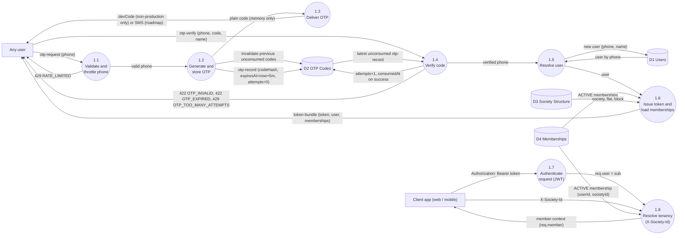
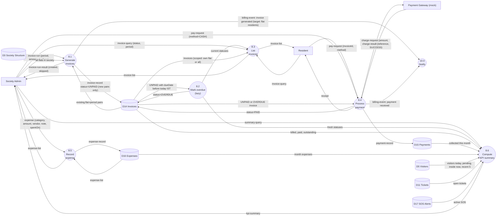

# 05 — Data Flow Diagrams (DFD)

> Conforms to `00-PROJECT-BRIEF.md`. Entities and field names match brief §6; endpoints match brief §7.
> Notation: Yourdon/DeMarco, drawn with Mermaid flowcharts.

## 0. Notation

| Symbol | Mermaid shape | Meaning |
|---|---|---|
| External entity | rectangle `E["Resident"]` | Person or system outside Gatekeeper that sends/receives data |
| Process | circle `P(("3.0 Gate"))` | Transforms data. Numbered hierarchically (3.0 → 3.1, 3.2 …) |
| Data store | cylinder `D[("D5 Visitors")]` | Data at rest (PostgreSQL table group, or in-memory registry `M1`) |
| Data flow | labelled arrow | Named packet of data; composition in §6 dictionary |

Rules followed: every process has at least one input and one output; data stores are only touched by processes
(never directly by external entities); flows between external entities are not modelled (the guard relaying a
visitor's spoken passcode is modelled as Visitor → 3.0, because the data enters the system through the guard's device).

---

## 1. Level 0 — Context diagram

Notes
- **Prospect** consumes the static marketing site. A prospect becomes an Admin by logging in with OTP and calling
  `POST /societies` (caller becomes `ADMIN`). There is no lead-capture API in v1; `/contact` is static content.
- **Payment Gateway (mock)** is an in-process function in v1 (ADR-006 in `06-HLD.md`); it is drawn as an external
  entity because a real gateway will replace it behind the same flow.
- **SMS provider** is out of scope v1 — OTPs reach the user via `devCode` in non-production only.

---

## 2. Data stores

| ID | Store | Prisma models (tables) | Written by | Read by |
|---|---|---|---|---|
| D1 | Users | `User` | 1.0, 2.0 | 1.0, 2.0, 10.0 |
| D2 | OTP Codes | `OtpCode` | 1.0 | 1.0 |
| D3 | Society Structure | `Society`, `Block`, `Flat` | 2.0 | all processes |
| D4 | Memberships | `Membership` | 2.0 | 1.0 (tenancy), 3.0, 6.0, 10.0 |
| D5 | Visitors | `Visitor` | 3.0 | 3.0, 8.0 (KPIs) |
| D6 | Pre-approvals | `PreApproval` | 3.0 | 3.0 |
| D7 | Staff | `Staff`, `StaffFlat` | 4.0 | 3.0 (gate verify), 4.0 |
| D8 | Staff Attendance | `StaffAttendance` | 4.0 | 4.0 |
| D9 | Notices | `Notice` | 5.0 | 5.0 |
| D10 | Polls | `Poll`, `PollOption`, `PollVote` | 5.0 | 5.0 |
| D11 | Tickets | `Ticket`, `TicketComment` | 6.0 | 6.0, 8.0 (KPIs) |
| D12 | Amenities | `Amenity` | 7.0 | 7.0 |
| D13 | Amenity Bookings | `AmenityBooking` | 7.0 | 7.0 |
| D14 | Invoices | `Invoice` | 8.0 | 8.0 |
| D15 | Payments | `Payment` | 8.0 | 8.0 |
| D16 | Expenses | `Expense` | 8.0 | 8.0 |
| D17 | SOS Alerts | `SosAlert` | 9.0 | 9.0, 8.0 (KPIs) |
| D18 | Notifications | `Notification` | 10.0 | 10.0 |
| M1 | SSE Client Registry | in-memory `Map<societyId, Set<Client>>` (not persisted) | 10.0 | 10.0 |

### Process × store CRUD matrix

C = create, R = read, U = update, D = delete.

| Process | D1 | D2 | D3 | D4 | D5 | D6 | D7 | D8 | D9 | D10 | D11 | D12 | D13 | D14 | D15 | D16 | D17 | D18 | M1 |
|---|---|---|---|---|---|---|---|---|---|---|---|---|---|---|---|---|---|---|---|
| 1.0 Authenticate | CRU | CRU | R | R | | | | | | | | | | | | | | | |
| 2.0 Society & Members | CR | | CR | CRU | | | | | | | | | | | | | | | |
| 3.0 Gate & Visitor | | | R | R | CRU | CRU | R | | | | | | | | | | | | |
| 4.0 Staff Attendance | | | R | | | | CRU | CRU | | | | | | | | | | | |
| 5.0 Community | | | | R | | | | | CRUD | CR | | | | | | | | | |
| 6.0 Helpdesk | | | R | R | | | | | | | CRU | | | | | | | | |
| 7.0 Amenity Booking | | | R | | | | | | | | | CRU | CRU | | | | | | |
| 8.0 Billing & Accounts | | | R | | R | | | | | | R | | | CRU | CR | CR | R | | |
| 9.0 Emergency SOS | | | R | | | | | | | | | | | | | | CRU | | |
| 10.0 Notify | R | | | R | | | | | | | | | | | | | | CRU | CRUD |

---

## 3. Level 1 — System decomposition

Level 1 is split into two diagrams for legibility. Both show the same process 10.0 and the same stores; together they
form the complete Level 1.

### 3.1 Level 1a — Identity, gate, safety

### 3.2 Level 1b — Community, helpdesk, amenities, finance

### 3.3 Level 1 process descriptions

| # | Process | Purpose | Main endpoints |
|---|---|---|---|
| 1.0 | Authenticate | OTP issue/verify, JWT issue, per-request token check and tenancy resolution (`X-Society-Id` → `req.member`) | `/auth/otp/request`, `/auth/otp/verify`, `/me` |
| 2.0 | Manage Society & Members | Create society (creator → ADMIN), blocks, bulk flats, add/patch memberships | `/societies`, `/society`, `/blocks`, `/flats`, `/members` |
| 3.0 | Gate & Visitor Management | Walk-in logging, resident decision, check-in/out, parcel collection, pre-approvals + passcode verify, expiry | `/visitors/*`, `/gate/verify`, `/preapprovals` |
| 4.0 | Staff Attendance | Staff profiles, flat links, passcode-driven attendance toggle | `/staff/*`, `/gate/verify` (staff branch) |
| 5.0 | Community | Notices (pinned/categorised), polls, one vote per membership | `/notices`, `/polls` |
| 6.0 | Helpdesk | Tickets, assignment, status lifecycle, comments | `/tickets/*` |
| 7.0 | Amenity Booking | Amenity definitions, slot availability, capacity-safe booking | `/amenities/*`, `/bookings` |
| 8.0 | Billing & Accounts | Monthly invoice generation, overdue marking, mock payment, expenses, KPIs | `/invoices/*`, `/expenses`, `/reports/summary` |
| 9.0 | Emergency SOS | Raise, acknowledge, resolve | `/sos` |
| 10.0 | Notify | In-process event bus → persist `Notification` rows + SSE fan-out | `/notifications/*`, `/events` |

---

## 4. Level 2 — Process 3.0 Gate & Visitor Management

Sub-processes:

| # | Sub-process | Trigger |
|---|---|---|
| 3.1 | Log walk-in | Guard `POST /visitors` |
| 3.2 | Dispatch approval request | after 3.1 commits |
| 3.3 | Record resident decision | Resident `POST /visitors/:id/decision` |
| 3.4 | Check in / check out | Guard `POST /visitors/:id/check-in`, `/check-out` |
| 3.5 | Expire stale requests | 60 s sweeper + lazy on read (pending > 10 min) |
| 3.6 | Issue pre-approval | Resident `POST /preapprovals` |
| 3.7 | Verify gate passcode | Guard `POST /gate/verify` |
| 3.8 | Cancel pre-approval | Resident `DELETE /preapprovals/:id` |
| 3.9 | Record parcel collection | Guard or resident `POST /visitors/:id/collect` |

### 4.1 Level 2-A — Walk-in approval

### 4.2 Level 2-B — Pre-approval passcode

The dotted arrow is outside the system boundary (resident shares the passcode by phone/message) and is shown only for
readability.

### 4.3 Level 2-C — Delivery "leave at gate"

`LEAVE_AT_GATE` is only valid when `type = DELIVERY` (otherwise 422 `INVALID_TRANSITION`). Collection sets
`checkOutAt` as the collection time.

---

## 5. Level 2 — Process 1.0 Authenticate (OTP)

Key rules (detail in `07-LLD.md` §6.1):
- Code: 6 digits via `crypto.randomInt`, stored only as bcrypt hash, 5-minute expiry, max 5 verify attempts.
- An attempt is reserved atomically **before** the bcrypt compare (and released on a match), so parallel guesses
  cannot exceed the cap.
- New user without `name` → 422 `NAME_REQUIRED`; the OTP is **not** consumed so the client can resubmit with a name.
- 1.7/1.8 run on every protected request (middleware); `member-context` is consumed by processes 2.0–10.0.

---

## 6. Level 2 — Process 8.0 Billing & Accounts

Key rules (detail in `07-LLD.md` §6.6–§6.8 and §7.12):
- 8.1 creates one invoice for **every flat** in the society for the period; existing `(flatId, period)` rows are skipped
  (`@@unique([flatId, period])` + `createMany({ skipDuplicates: true })`) → re-running is idempotent.
- 8.4 is full-payment only; the `PAID` transition is a conditional update (`status IN (UNPAID, OVERDUE)`), so a double
  click cannot create two payments. `CASH` may only be recorded by an admin.
- All amounts are integer paise.

---

## 7. Data-flow dictionary

Notation (DeMarco): `=` is composed of, `+` and, `( )` optional, `{ }` zero-or-more, `[ a | b ]` one of.

| Flow | Composition |
|---|---|
| otp-request | phone |
| otp-verify | phone + code + (name) |
| otp-record | phone + codeHash + expiresAt + attempts + (consumedAt) |
| token-bundle | token + user + {membership + society + (flat + block)} |
| user-record | id + phone + name + (email) + (avatarUrl) |
| member-context | membershipId + userId + societyId + role + (flatId) + (residentType) |
| memberships | {membershipId + role + status + societyId + (flatId)} |
| society-details | name + addressLine + city + state + pincode |
| block | name |
| flat-batch | blockId + {number} |
| member-details | phone + name + role + (flatId) + (residentType) |
| membership-record | userId + societyId + role + (flatId) + (residentType) + status |
| member-list | {membership + user + (flat)} |
| society-structure | society + {block + {flat}} |
| visitor-identity | name + (phone) + (company) + (vehicleNo) + (photoUrl) |
| walk-in | flatId + type + visitor-identity + (purpose) |
| visitor-record | id + societyId + flatId + type + visitor-identity + (purpose) + status + (preApprovalId) + loggedById + (decidedById) + (decidedAt) + (checkInAt) + (checkOutAt) |
| visitor-status | visitorId + status + (updatedAt) |
| visitor-decision | visitorId + [ APPROVE \| DENY \| LEAVE_AT_GATE ] |
| gate-action | visitorId + [ check-in \| check-out \| collect ] |
| visitor-log | {visitor-record} |
| gate-passcode | passcode (6 digits) |
| verify-result | [ kind=VISITOR + visitor-record \| kind=STAFF + action + staff + attendance-record \| PASSCODE_INVALID + reason ] |
| preapproval-request | flatId (implicit) + (type) + guestName + (guestPhone) + (validFrom) + (validTo) + (maxUses) |
| preapproval-record | id + societyId + flatId + createdById + type + guestName + (guestPhone) + passcode + validFrom + validTo + maxUses + usedCount + status |
| passcode-slip | passcode + guestName + validFrom + validTo |
| staff-profile | name + (phone) + category + (photoUrl) + (isActive) |
| staff-record | staff-profile + passcode + {flatId} |
| staff-flat-link | staffId + flatId |
| attendance-record | staffId + societyId + checkInAt + (checkOutAt) + loggedById |
| attendance-result | staff + attendance-record + [ CHECK_IN \| CHECK_OUT ] |
| staff-notification | [ STAFF_ENTRY \| STAFF_EXIT ] + staffId + attendanceId (to residents of linked flats) |
| attendance-history | {attendance-record} |
| notice | title + body + category + (isPinned) |
| notice-record | notice + id + createdById + createdAt |
| poll-definition | question + {option text}(2..10) + (closesAt) |
| poll-vote | pollId + optionId |
| poll-results | poll + {option + voteCount} + (myOptionId) |
| ticket-request | category + title + description + (priority) |
| ticket-update | ticketId + (status) + (assignedToId) + (priority) |
| ticket-comment | ticketId + body |
| ticket-record | id + societyId + (flatId) + raisedById + (assignedToId) + category + title + description + priority + status + (resolvedAt) |
| ticket-thread | ticket-record + {comment + author} |
| amenity-definition | name + (description) + openTime + closeTime + slotMinutes + capacity + pricePerSlot + (isActive) |
| availability-query | amenityId + date |
| availability | {startAt + endAt + booked + capacity + available} |
| booking-request | amenityId + startAt + (flatId, admin only) |
| booking-record | id + amenityId + societyId + flatId + bookedById + startAt + endAt + status |
| booking-confirmation | booking-record + amenity name |
| invoice-run | period (YYYY-MM) + amount (paise) + dueDate |
| invoice-run-result | created + skipped |
| invoice-record | id + societyId + flatId + period + amount + dueDate + status |
| invoice-query | (status) + (period) + (limit) |
| pay-request | invoiceId + method |
| charge-request | amount + method + invoiceId |
| charge-result | reference + status |
| payment-record | invoiceId + societyId + amount + method + reference + (paidById) + paidAt |
| receipt | payment-record + invoice-record |
| expense | category + amount + (vendor) + (note) + spentOn |
| summary-query | (none — always the current IST month) |
| kpi-summary | visitorsToday + pendingApprovals + insideNow + openTickets + collectionRate + totalDue + totalCollected + expensesThisMonth + residents + flats + {recent visitor-record}(0..5) + sosActive |
| sos-request | type + (message) |
| sos-record | id + societyId + (flatId) + raisedById + type + (message) + status + (acknowledgedById) + (acknowledgedAt) + (resolvedAt) |
| sos-status-change | sosId + [ ACKNOWLEDGED \| RESOLVED ] |
| *-event (visitor, sos, notice, ticket, booking, billing) | eventName + target + payload |
| target | societyId + (flatId) + ({role}) + ({userId}) + (exceptUserId) |
| notification-record | userId + (societyId) + type + title + body + (data) + (readAt) |
| sse-client | userId + membershipId + role + (flatId) + response stream |
| sse-frame | `event:` eventName + `data:` JSON payload |
| read-receipt | [ notificationId \| all ] |
