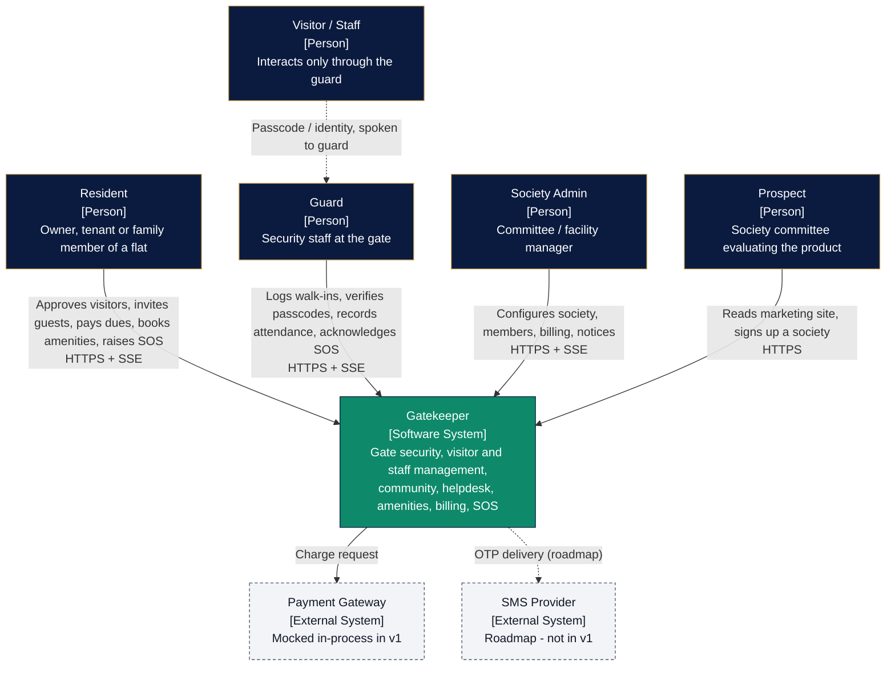
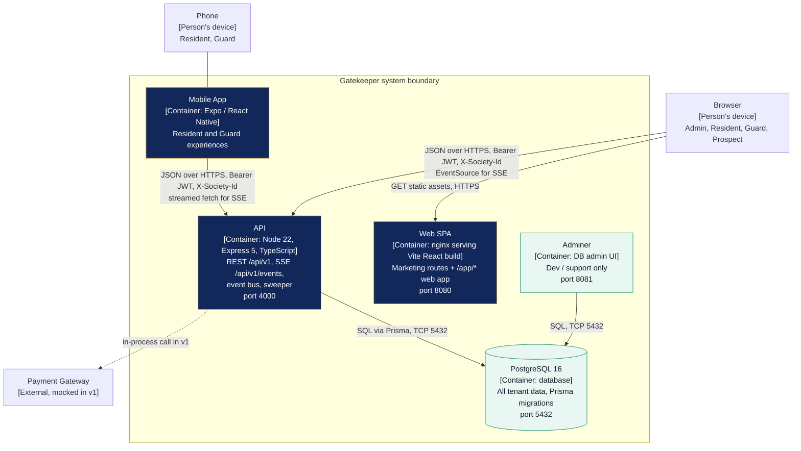
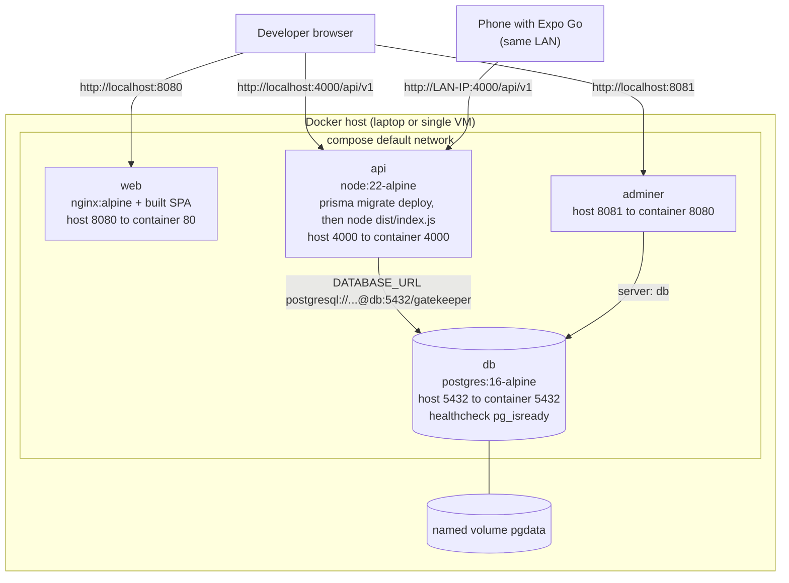
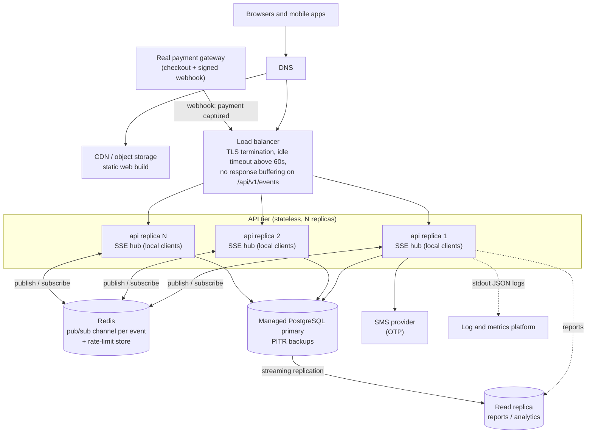
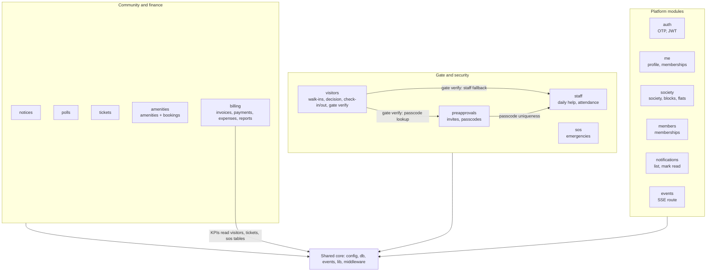
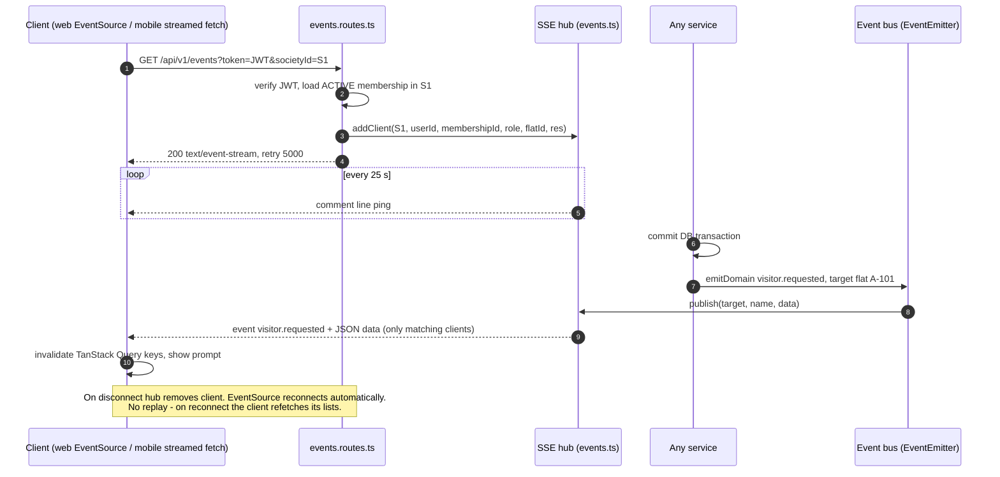

# 06 — High-Level Design (HLD)

> Conforms to `00-PROJECT-BRIEF.md` (architecture §4, stack §5, entities §6, API §7).
> Detailed module/class design is in `07-LLD.md`; data flows in `05-DFD.md`.

## 1. Architecture at a glance

- **One deployable API** (`apps/api`): an Express 5 + TypeScript **modular monolith**, REST/JSON under `/api/v1`, port 4000.
- **One database**: PostgreSQL 16, accessed only through Prisma.
- **Two clients**: `apps/web` (Vite React SPA — marketing site + responsive web app, served by nginx) and
  `apps/mobile` (Expo / React Native for residents and guards).
- **Realtime**: Server-Sent Events from the API, fed by an in-process event bus (`EventEmitter`).
- **Multi-tenant**: one schema, every society-owned row carries `societyId`; the `X-Society-Id` header selects the tenant.
- **Ops**: `docker-compose.yml` runs `db`, `adminer`, `api`, `web` locally / on a single VM.

---

## 2. C4 Level 1 — System context

## 3. C4 Level 2 — Containers

The browser calls the API **directly** (cross-origin, CORS allowlist), not through the web nginx. This keeps nginx a
dumb static server and avoids SSE proxy-buffering issues in the local stack.

## 4. C4 Level 3 — API components

```mermaid
flowchart LR
  REQ["HTTP request"]

  subgraph MW ["Middleware chain"]
    direction TB
    H["helmet + cors + json body"]
    LOG["pino-http<br/>request id"]
    RL["rateLimit<br/>(OTP routes)"]
    AUTH["auth<br/>JWT to req.user"]
    TEN["tenancy<br/>X-Society-Id to req.member"]
    RBAC["rbac<br/>requireRole"]
    VAL["validate<br/>Zod DTO"]
  end

  subgraph MODS ["Feature modules (routes + service + schemas)"]
    direction TB
    M1["auth, me"]
    M2["society, members"]
    M3["visitors, preapprovals"]
    M4["staff"]
    M5["notices, polls"]
    M6["tickets"]
    M7["amenities"]
    M8["billing"]
    M9["sos"]
    M10["notifications, events"]
  end

  subgraph CORE ["Shared core"]
    direction TB
    CFG["config.ts<br/>env (zod) + logger"]
    DBC["db.ts<br/>Prisma singleton"]
    EVT["events.ts<br/>EventEmitter bus + SSE hub"]
    LIB["lib/<br/>errors, otp, passcode, jwt, time"]
  end

  ERR["error.ts<br/>central error handler"]
  PG[("PostgreSQL")]

  REQ --> H --> LOG --> RL --> AUTH --> TEN --> RBAC --> VAL --> MODS
  MODS --> DBC --> PG
  MODS -->|"emitDomain / notify"| EVT
  EVT -->|"persist Notification"| DBC
  MODS --> LIB
  MODS -->|"throw AppError"| ERR
  MW -->|"throw AppError"| ERR
```

---

## 5. Deployment

### 5.1 Local / single-VM — docker-compose (v1)

| Service | Image / build | Ports | Depends on | Key env |
|---|---|---|---|---|
| `db` | `postgres:16-alpine` | 5432 | — | `POSTGRES_USER`, `POSTGRES_PASSWORD`, `POSTGRES_DB=gatekeeper`; volume `pgdata` |
| `adminer` | `adminer` | 8081→8080 | `db` | — |
| `api` | build `apps/api` (multi-stage: `tsc` + `prisma generate`) | 4000 | `db` (`service_healthy`) | `DATABASE_URL`, `JWT_SECRET`, `CORS_ORIGINS=http://localhost:8080`, `NODE_ENV=development` (demo stack, so `devCode` works), `SEED_ON_START=true` |
| `web` | build `apps/web` (Vite build → `nginx:alpine`) | 8080→80 | `api` | build arg `VITE_API_URL=http://localhost:4000/api/v1`; nginx `try_files $uri /index.html` for SPA routes |

API container start: `prisma migrate deploy` → optional idempotent seed (`SEED_ON_START=true`) → `node dist/index.js`.
Healthchecks: `db` uses `pg_isready`; `api` uses `GET /health`.

### 5.2 Future production sketch (scaling path)

**The scaling path for realtime is the single most important change.** In v1 the SSE hub is an in-memory
`Map<societyId, Set<client>>` inside one process, and the event bus is a Node `EventEmitter`. With more than one API
replica, an event emitted on replica 1 would never reach an SSE client connected to replica 2. The fix is contained to
`src/events.ts`:

1. `emitDomain()` / `notify()` publish to Redis (`PUBLISH gk:events <json>`) instead of `bus.emit()`.
2. Every replica `SUBSCRIBE`s once and, on message, calls its **local** `hub.publish(target, name, data)`.
3. Notification rows are persisted **once** by the emitting replica (before publishing), never by subscribers.

No module code changes, because modules only call `emitDomain()` / `notify()`. Sticky sessions are not required.

Other changes on that path:

| Concern | v1 (single process) | Production |
|---|---|---|
| Event fan-out | `EventEmitter` + local SSE hub | Redis pub/sub + local SSE hub per replica |
| Rate-limit counters | `express-rate-limit` memory store | Redis store (shared across replicas) |
| Sweeper (visitor / pre-approval expiry) | `setInterval` in the single process | Same code, guarded by `pg_try_advisory_lock` so only one replica sweeps per tick |
| OTP delivery | `devCode` in response (non-prod) | SMS provider; `devCode` disabled (config refuses it when `NODE_ENV=production`) |
| Payments | In-process mock | Gateway checkout + signed webhook marks invoice `PAID` (idempotent on `reference`) |
| Static web | nginx container | CDN |
| DB | Container + volume | Managed Postgres, PITR, read replica for reports |
| Secrets | `.env` | Secret manager injected as env vars |

---

## 6. Module decomposition

Rules:
- A module owns its routes, service and Zod schemas. Cross-module calls go **service → service** (never route → other
  module's route), and only where shown above.
- The only shared mutable state is the database and the SSE hub in `events.ts`.
- Modules never import from `apps/web` or `apps/mobile`; clients never import API code (no shared package — ADR-005).

---

## 7. Architectural patterns and why

| Pattern | Where | Why |
|---|---|---|
| **Modular monolith** | whole API | One deploy, one DB transaction boundary, trivial local dev; module folders keep seams for later extraction (ADR-001). |
| **Layered architecture** | each module: `routes → service → Prisma` | Handlers stay thin (HTTP only), services hold rules and are unit-testable without HTTP; Prisma is the data-access layer. |
| **Chain of responsibility (middleware)** | `helmet → cors → json → requestId/log → rateLimit → auth → tenancy → rbac → validate → handler → error` | Each concern is one small function that either passes, enriches `req`, or short-circuits with an `AppError`. Order is security-relevant and declared once in `app.ts`. |
| **Observer / pub-sub** | `events.ts` bus; listeners for SSE fan-out and notification persistence | Services announce *what happened* without knowing who listens; adding a channel (push, email) adds a listener, not edits in every service. Same seam is where Redis plugs in. |
| **State machine** | Visitor, PreApproval, Ticket, SOS, Invoice, Booking | Lifecycles are explicit transition tables; illegal moves become a single `422 INVALID_TRANSITION`. Transitions are applied with conditional updates (`WHERE status = from`) for race safety. |
| **Row-level multi-tenancy** | `societyId` on every society-owned row; tenancy middleware | Cheapest isolation for many small tenants on one DB; every query filters by `req.member.societyId`; foreign IDs from other societies return 404. |
| **DTO validation at the boundary** | Zod schemas per module, `validate` middleware | Nothing unvalidated reaches services; schemas double as TypeScript types (`z.infer`). |
| **Centralized error handling** | `middleware/error.ts` + `AppError` | One error envelope `{ error: { code, message, details? } }`; maps Zod, Prisma and unknown errors consistently; Express 5 forwards async throws automatically. |
| **Lazy evaluation + sweeper** | visitor/pre-approval expiry, invoice overdue | Reads are always correct (lazy fix-up on read) without depending on timer precision; the sweeper only makes pushes timely. |

---

## 8. Cross-cutting concerns

| Concern | Design |
|---|---|
| **Authentication** | Phone + OTP → JWT HS256, 7-day expiry, payload `{ sub: userId }`. `auth` middleware verifies with `algorithms: ['HS256']`, sets `req.user = { id }`. SSE accepts `?token=` because `EventSource` cannot set headers. |
| **Authorization** | Two layers: (1) route-level `requireRole('ADMIN' \| 'RESIDENT' \| 'GUARD')`; (2) record-level in services (resident may act only on own `flatId`; ticket raiser; etc.). Record-level denials on another tenant's data return 404, not 403. |
| **Tenancy** | `X-Society-Id` header → `tenancy` middleware loads the caller's ACTIVE membership in that society → `req.member = { id, role, flatId, societyId, residentType }`; missing header 400, no membership 403. Every service query includes `societyId: m.societyId`. |
| **Validation** | Zod at the trust boundary for body and query; IDs are opaque strings resolved with tenant-scoped `findFirst`. |
| **Logging** | `pino` (JSON to stdout) + `pino-http`. Request id = incoming `X-Request-Id` or `crypto.randomUUID()`, echoed in the response header and on every log line. Redaction: `req.headers.authorization`, `*.code`, `*.codeHash`, `*.passcode`, `*.token`; the query string of `/events` is never logged (it carries the JWT). |
| **Error model** | `{ "error": { "code", "message", "details"? } }`; statuses 400/401/403/404/409/413/422/429/500. Unknown errors log the stack and return a generic 500 message. Catalog in `08-API-SPEC.md` §2 / `07-LLD.md` §3. |
| **Rate limiting** | `express-rate-limit` on `POST /auth/otp/request`: 5 per 15 min keyed by phone + IP → 429 `RATE_LIMITED`. OTP verify is bounded by the 5-attempts-per-code cap (429 `OTP_TOO_MANY_ATTEMPTS`). Production: Redis store + edge limits at the LB. |
| **CORS** | Allowlist from `CORS_ORIGINS` (comma-separated). Credentials not needed (bearer tokens, no cookies). Mobile apps are not subject to CORS. |
| **Security headers** | `helmet()` defaults. API serves JSON only, so CSP is minimal. |
| **Config** | `config.ts` parses `process.env` with Zod at startup and exits on invalid config. No secrets in code; `.env.example` documents keys. |
| **Health checks** | `GET /health` and `GET /api/v1/health` → `{ "status": "ok", "time": ISO }` (liveness, public, no DB call). DB readiness is covered by the `db` container's `pg_isready` healthcheck and `depends_on: service_healthy`. Used by docker healthcheck and future LB. |
| **Time and money** | Timestamps stored UTC; IST (`+05:30`, no DST) for day boundaries, slot times and invoice periods via `lib/time.ts`. Money is integer paise everywhere. |

---

## 9. Realtime design (SSE)

- **Why SSE**: all realtime traffic is server → client; client actions are ordinary REST calls (ADR-002).
- **Targeting**: by flat (residents of that flat), by role (e.g. all GUARD + ADMIN for SOS), by user id, or society-wide;
  union semantics; optional `exceptUserId` to skip the actor. `notification` frames go to **every** open stream of the
  recipient user, whatever society that stream is for (`08-API-SPEC.md` §5.2).
- **Connect handshake**: `retry: 5000` then the comment `: connected`; deactivating a membership closes its streams.
- **Event names** (brief §4): `visitor.requested`, `visitor.updated`, `sos.raised`, `sos.updated`, `notice.created`,
  `notification`.
- **Delivery guarantee**: best effort, at-most-once. Durable record = `Notification` table + the domain table itself;
  clients refetch on (re)connect, so missed frames never lose state.
- **Mobile limitation**: SSE only works while the app is foregrounded. Background alerts (critical for SOS) need push
  notifications — roadmap.

---

## 10. Data design summary

- Single PostgreSQL schema, 24 Prisma models (brief §6), cuid string ids, `createdAt`/`updatedAt`.
- Tenancy column `societyId` on every society-owned table; composite indexes lead with `societyId`.
- Actor references (`…ById`) point to `Membership.id` (actor-in-society); `Notification.userId` → `User`.
- Uniqueness enforced in the DB where possible: `User.phone`, `Block(societyId, name)`, `Flat(blockId, number)`,
  `Membership(userId, societyId)`, `Staff(societyId, passcode)`, `StaffFlat(staffId, flatId)`,
  `PollVote(pollId, membershipId)`, `Invoice(flatId, period)`. Pre-approval passcode uniqueness among ACTIVE rows is
  enforced in the service (see `07-LLD.md` §6.3).
- Enums are Prisma enums (Postgres enum types).
- Migrations: `prisma migrate` (committed SQL); seed `prisma/seed.ts` is idempotent (upserts).
- Retention: no deletion jobs in v1. Visitor and attendance logs grow linearly — partition by month or archive when a
  society passes ~1M visitor rows.
- Full field list: `03-DATA-DICTIONARY.md`; relationships: `04-ERD.md`.

---

## 11. Security architecture — STRIDE threat model

| # | STRIDE | Threat | Asset / entry point | Mitigation |
|---|---|---|---|---|
| S1 | Spoofing | OTP brute force | `/auth/otp/verify` | 6-digit code, 5 attempts per code (attempt reserved atomically before the bcrypt compare, so parallel guesses cannot exceed it), 5-min expiry, new request invalidates old codes, request rate limit caps fresh codes |
| S2 | Spoofing | OTP flooding / SMS pumping (when SMS exists) | `/auth/otp/request` | Per-phone + per-IP rate limits; production SMS provider quotas |
| S3 | Spoofing | Forged JWT / algorithm confusion | all protected routes | HS256 only (`algorithms` pinned), secret ≥ 32 chars from env, 7-day expiry |
| S4 | Spoofing | Guessing a gate passcode at the gate | `/gate/verify` | Guard-only route (authenticated guard device); passcodes valid only in window and for `maxUses`; audit trail (`loggedById`) |
| T1 | Tampering | SQL injection | all inputs | Prisma parameterized queries; no raw SQL built from input |
| T2 | Tampering | Mass assignment / unexpected fields | request bodies | Zod schemas with explicit fields (unknown keys stripped); services pass explicit fields to Prisma |
| T3 | Tampering | Race on state transitions (double approve, double pay, overbooking) | visitors, invoices, bookings | Conditional updates `WHERE status = from`; serializable transaction for bookings; DB unique constraints |
| R1 | Repudiation | "I never approved that visitor" | visitor, SOS, payments | `decidedById`/`decidedAt`, `loggedById`, `acknowledgedById`, `paidById`, request-id in logs |
| I1 | Information disclosure | Cross-tenant data access (IDOR) | any `:id` route | Tenancy middleware + every query filtered by `societyId`; other-tenant ids → 404 |
| I2 | Information disclosure | Resident reads another flat's visitors / bills | resident routes | Record-level rules: resident queries forced to `flatId = m.flatId` |
| I3 | Information disclosure | JWT in SSE query string leaks via logs | `/events?token=` | `/events` query string never logged; HTTPS only in prod; roadmap: short-lived one-time SSE ticket |
| I4 | Information disclosure | OTP leakage | `devCode` | `devCode` only when not production; config refuses `EXPOSE_DEV_OTP` with `NODE_ENV=production`; OTP stored hashed |
| I5 | Information disclosure | Staff passcode exposure to non-admins | `GET /staff` | `passcode` omitted unless caller is ADMIN |
| D1 | Denial of service | Large payloads / request floods | all | `express.json({ limit: '100kb' })`, `limit` max 200, rate limits, LB limits in prod |
| D2 | Denial of service | SSE connection exhaustion | `/events` | Auth required; one hub entry per connection removed on `close`; heartbeat detects dead sockets; LB connection caps |
| E1 | Elevation of privilege | Resident calling admin/guard routes | role-gated routes | `requireRole` on every write route; role read from DB membership, never from token or client |
| E2 | Elevation of privilege | Admin demoting/deactivating the last admin | `/members/:id` | 422 `LAST_ADMIN` business rule |
| E3 | Elevation of privilege | Inactive member keeps acting | all society routes | Tenancy loads ACTIVE membership on every request (deactivation is immediate despite 7-day JWT) |

---

## 12. Scalability and availability

| Dimension | v1 target | How |
|---|---|---|
| Tenants | hundreds of societies, ~500 flats each | Row-level tenancy, `societyId`-leading indexes |
| Request load | tens of req/s per instance | Stateless handlers; one tenancy lookup per request (indexed `Membership(userId, societyId)`) |
| SSE connections | low thousands per instance | One idle socket per client; 25 s heartbeat; no per-connection timers beyond one global interval |
| Availability | single VM, best effort | Docker restart policy, health checks, named volume for DB |

Scaling steps, in order (stop at the first that suffices):
1. Vertical scale the VM; tune Prisma `connection_limit`.
2. Move Postgres to a managed service with backups/PITR.
3. Add Redis and switch `events.ts` to pub/sub (§5.2) → run N API replicas behind a load balancer.
4. Read replica for `/reports/summary` and history lists.
5. Extract a module into its own service only if one has a materially different scaling profile (most likely SSE /
   notifications). The module boundaries and event seam already allow that.

Failure behaviour: if the DB is down, requests fail with 500 `INTERNAL_ERROR` and clients show a retry state; the
`db` healthcheck turns unhealthy so the cause is visible in `docker compose ps`. If the SSE stream drops, clients auto-reconnect and refetch — no state is lost.

---

## 13. Observability

| Signal | v1 | Later |
|---|---|---|
| Logs | pino JSON to stdout, request id, method, path, status, latency, `societyId` and `userId` bound by middleware | Ship to a log platform; dashboards on error codes |
| Health | `/health` (DB ping) | LB health checks, uptime monitor |
| Metrics | Derived from logs (status/latency) | `prom-client` `/metrics`: request histogram, SSE clients gauge, sweeper counts |
| Tracing | Request id correlation | OpenTelemetry auto-instrumentation (http, pg) |
| Audit | Actor columns on domain rows | Dedicated audit log table if compliance requires |

---

## 14. Tech-stack rationale

| Layer | Choice | Why | Alternatives considered |
|---|---|---|---|
| Runtime | Node 22 + TypeScript | One language across API, web and mobile; strong typing; LTS | Go (faster, but splits the team's language), Java/Spring (heavier) |
| HTTP framework | Express 5 | Ubiquitous, minimal, native async error propagation in v5 | Fastify (faster, schema-first — less familiar), NestJS (DI and decorators are overkill for this size) |
| ORM | Prisma | Typed client generated from schema, migrations, simple relations (ADR-004) | Drizzle (lighter, SQL-like), TypeORM (decorator-heavy, weaker types), Knex (no types) |
| Validation | Zod | Runtime validation + inferred TS types in one place | Joi (no inferred types), class-validator (decorators) |
| Database | PostgreSQL 16 | Relational integrity, enums, partial indexes, serializable isolation, mature managed offerings | MySQL (fine, weaker partial-index story), MongoDB (relations are core here) |
| Auth | Phone OTP + JWT | Matches how residents/guards identify; no passwords (ADR-003) | Email+password, OAuth social login, session cookies |
| Realtime | SSE | One-way push, plain HTTP, auto-reconnect (ADR-002) | WebSockets / Socket.IO, polling, push notifications |
| Logging | pino | Fast JSON logs, redaction built in | winston, morgan |
| Web | Vite + React 18 + Tailwind 3 + React Router 6 + TanStack Query 5 | Fast builds, utility CSS for the brand tokens, server-state caching with invalidation | Next.js (SSR not needed for an auth-gated SPA; marketing pages are few), CRA (deprecated) |
| Mobile | Expo + expo-router | One codebase iOS/Android, file-based routing, OTA-friendly, Expo Go for demos | Bare React Native, Flutter (different language) |
| Tests | Vitest + supertest | Fast TS-native runner; supertest drives the `app.ts` factory without listening | Jest |
| Infra | Docker Compose | One command brings up the whole stack | Kubernetes (premature) |

---

## 15. Architecture Decision Records

### ADR-001 — Modular monolith over microservices
- **Status**: Accepted.
- **Context**: Small team, v1 scope of 10 modules, strong cross-module transactions (gate verify touches pre-approvals,
  visitors and staff; KPIs read several modules).
- **Decision**: One Express app, one Postgres DB, modules as folders with routes/service/schemas; cross-module access
  via service functions only.
- **Consequences**: + single deploy, ACID transactions, simple local dev and tests. − whole API scales as one unit;
  discipline needed to keep module boundaries (enforced by review and the module dependency diagram in §6).
  Extraction path: the event seam (`events.ts`) and per-module services.

### ADR-002 — SSE over WebSockets
- **Status**: Accepted.
- **Context**: Realtime needs are server → client only (visitor requests, SOS alerts, notices, notifications).
- **Decision**: `GET /api/v1/events` Server-Sent Events, token in query string; actions remain REST.
- **Consequences**: + plain HTTP, works through proxies, browser auto-reconnect, no extra library or protocol upgrade.
  − token in URL (mitigated by log redaction; one-time SSE ticket on roadmap); HTTP/1.1 browsers cap ~6 connections
  per origin (one stream per tab is enough); multi-replica needs Redis pub/sub (§5.2). React Native lacks
  `EventSource`, so mobile reads the stream with `expo/fetch` streaming.

### ADR-003 — Phone OTP authentication
- **Status**: Accepted.
- **Context**: Residents, guards and admins in Indian housing societies are identified by mobile number; admins add
  members by phone; passwords create support burden.
- **Decision**: Passwordless phone + 6-digit OTP, JWT with `sub` only; roles and tenancy resolved from DB per request.
- **Consequences**: + no password storage, matches member onboarding by phone. − depends on an SMS provider in
  production (out of scope v1; dev uses `devCode`); 7-day JWTs cannot be revoked individually (mitigated: tenancy
  re-checks ACTIVE membership every request).

### ADR-004 — Prisma as the data-access layer
- **Status**: Accepted.
- **Context**: Need typed queries, migrations and seed with minimal boilerplate.
- **Decision**: Prisma Client called directly from services; no separate repository layer.
- **Consequences**: + generated types flow end-to-end, parameterized SQL, migrations. − Prisma lacks partial unique
  indexes in schema (raw SQL migration if needed) and some aggregate queries need `$queryRaw` (tagged template, still
  parameterized). A repository layer would be a pass-through wrapper over an already-abstracted client; tests use a
  real Postgres instead of mocks.

### ADR-005 — Standalone apps, no monorepo tooling
- **Status**: Accepted.
- **Context**: Three apps with different toolchains (Node API, Vite, Expo/Metro). Shared workspaces complicate Docker
  build contexts and Expo/Metro resolution.
- **Decision**: `apps/api`, `apps/web`, `apps/mobile` each have their own `package.json` and lockfile; no shared package.
- **Consequences**: + each Dockerfile builds from its own folder; Expo works out of the box. − API types are duplicated in
  clients (small hand-written `types.ts` per client mirroring `08-API-SPEC.md`). Revisit (e.g. OpenAPI-generated client)
  if drift becomes a problem.

### ADR-006 — Mock payment gateway
- **Status**: Accepted.
- **Context**: Real gateway integration (KYC, merchant onboarding, webhooks) is out of scope v1, but the billing flow
  must be demonstrable end to end.
- **Decision**: `POST /invoices/:id/pay` calls an in-process `mockCharge()` that always succeeds and returns a
  `MOCK-…` reference; a `Payment` row is written exactly as a real one would be.
- **Consequences**: + full UX and accounting flow testable now. − no failure/pending states exercised. Migration: replace
  `mockCharge` with gateway order creation; mark `PAID` from a signed, idempotent webhook keyed on `reference`.
