# 07 — Low-Level Design (LLD)

> Conforms to `00-PROJECT-BRIEF.md`. Architecture context: `06-HLD.md`. Data flows: `05-DFD.md`.
> Endpoint contract (payloads, response shapes, error codes) is `08-API-SPEC.md`; fields, constraints and indexes are
> `03-DATA-DICTIONARY.md`. Where this document and `08-API-SPEC.md` overlap they say the same thing; if they ever
> differ, `08-API-SPEC.md` wins for the wire contract.

## 1. Conventions

- TypeScript `strict`, ESM, Node 22. Express 5 (async handler rejections reach the error middleware automatically — no
  `asyncHandler` wrapper).
- **Handlers are thin**: validated input → one service call → `res.json(...)` / `res.status(201).json(...)`.
- **Services hold all business logic and Prisma calls.** There is **no repository layer**: Prisma Client already is a
  typed data-access layer (query builder, parameterization, transactions, generated types). A repository on top would be
  a pass-through that doubles the surface without adding a seam we use — tests run against a real Postgres, not mocks.
- Every service function that touches society data takes the actor context `m: Member` as its first argument and
  filters by `m.societyId`. Lookups by id use `findFirst({ where: { id, societyId: m.societyId } })` — never
  `findUnique({ where: { id } })` alone — so ids from another tenant are a plain 404.
- Lists return `{ items }`, `limit` 1–200 default 50, newest first unless stated. **Reference lists** (`/blocks`,
  `/flats`, `/members`, `/staff`, `/amenities`) ignore `limit` and return all rows (08 §1.5).
- Responses use the shapes in 08 §3 (e.g. `flat: { id, number, blockName, label }`, actor refs `{ id, name }`). Each
  service has one `toDTO()` mapper next to its Prisma `include`.
- Money is integer paise. Timestamps are UTC `Date`; IST helpers in `lib/time.ts`.
- **State transitions are compare-and-set**: `updateMany({ where: { id, societyId, status: from }, data })` and
  `count === 0` → reload and throw `INVALID_TRANSITION`. Double-clicks and concurrent actors are safe without locks
  ("first decision wins").
- **Events are emitted after the DB write commits**, never inside a transaction callback.

---

## 2. Backend folder structure (exact)

```
apps/api/
  package.json            # scripts: dev (tsx watch), build (tsc), start, test (vitest), prisma:*, seed
  tsconfig.json
  Dockerfile
  .env.example
  src/
    index.ts              # bootstrap: createApp(), listen(PORT), start sweeper, graceful shutdown
    app.ts                # createApp(): Express — middleware chain + routers (no listen, no timers; used by tests)
    config.ts             # env parsing with zod -> `config`; pino `logger`
    db.ts                 # PrismaClient singleton -> `prisma`; type `Tx`
    events.ts             # typed event bus (EventEmitter) + SSE hub + emitDomain() + notify()
    middleware/
      auth.ts             # requireAuth: Bearer JWT -> req.user; Express Request augmentation
      tenancy.ts          # requireMember: X-Society-Id -> req.member
      rbac.ts             # requireRole(...roles)
      validate.ts         # validate({ body?, query? }) -> req.body / req.q
      error.ts            # notFoundHandler, errorHandler
      rateLimit.ts        # otpRequestLimiter
    lib/
      errors.ts           # AppError + helpers + assertTransition()
      otp.ts              # generateOtp, hashOtp, compareOtp, OTP constants
      passcode.ts         # generateUniquePasscode(tx, societyId)
      jwt.ts              # signToken(userId), verifyToken(token)
      time.ts             # IST helpers: istDayRange, istDateTimeToUtc, currentPeriod, startOfTodayIst
    modules/
      auth/           auth.routes.ts          auth.service.ts          auth.schemas.ts
      me/             me.routes.ts            me.service.ts            me.schemas.ts
      society/        society.routes.ts       society.service.ts       society.schemas.ts       # society + blocks + flats
      members/        members.routes.ts       members.service.ts       members.schemas.ts
      visitors/       visitors.routes.ts      visitors.service.ts      visitors.schemas.ts      # visitors + /gate/verify
      preapprovals/   preapprovals.routes.ts  preapprovals.service.ts  preapprovals.schemas.ts
      staff/          staff.routes.ts         staff.service.ts         staff.schemas.ts
      notices/        notices.routes.ts       notices.service.ts       notices.schemas.ts
      polls/          polls.routes.ts         polls.service.ts         polls.schemas.ts
      tickets/        tickets.routes.ts       tickets.service.ts       tickets.schemas.ts
      amenities/      amenities.routes.ts     amenities.service.ts     amenities.schemas.ts     # amenities + bookings
      billing/        billing.routes.ts       billing.service.ts       billing.schemas.ts       # invoices + payments + expenses + reports
      sos/            sos.routes.ts           sos.service.ts           sos.schemas.ts
      notifications/  notifications.routes.ts notifications.service.ts notifications.schemas.ts
      events/         events.routes.ts                                                           # SSE route (hub lives in src/events.ts)
  prisma/
    schema.prisma
    migrations/
    seed.ts               # idempotent demo data (brief §9, 08 §6)
  tests/
    setup.ts              # loads .env.test, resets DB (prisma migrate reset --force --skip-seed) once
    helpers.ts            # login(phone) via devCode -> token; as(token, societyId) supertest helper
    auth.test.ts  visitors.test.ts  gate.test.ts  amenities.test.ts  billing.test.ts  tenancy.test.ts  sos.test.ts
```

Each `<module>.routes.ts` exports `router: Router`. `app.ts` mounts them; routers for society-scoped modules are mounted
after `requireAuth, requireMember`.

### 2.1 Handler shape (reference)

```ts
// modules/visitors/visitors.routes.ts
export const router = Router();

router.get('/visitors', validate({ query: listVisitorsQuery }), async (req, res) => {
  res.json({ items: await svc.listVisitors(req.member!, req.q as ListVisitorsQuery) });
});

router.post('/visitors', requireRole('GUARD'), validate({ body: createVisitorBody }), async (req, res) => {
  res.status(201).json(await svc.logWalkIn(req.member!, req.body));
});

router.post('/visitors/:id/decision', requireRole('RESIDENT'), validate({ body: decisionBody }), async (req, res) => {
  res.json(await svc.decide(req.member!, req.params.id, req.body.decision));
});
```

---

## 3. Error model

### 3.1 `AppError` (`lib/errors.ts`)

```ts
export class AppError extends Error {
  constructor(
    public readonly status: number,   // HTTP status
    public readonly code: string,     // stable machine code, UPPER_SNAKE (catalog §3.3)
    message: string,                  // human readable, safe to show
    public readonly details?: unknown // optional structured context
  ) { super(message); this.name = 'AppError'; }
}

export const badRequest    = (msg: string, details?: unknown) => new AppError(400, 'VALIDATION_ERROR', msg, details);
export const unauthorized  = (msg = 'Authentication required') => new AppError(401, 'UNAUTHORIZED', msg);
export const forbidden     = (msg = 'You are not allowed to do this') => new AppError(403, 'FORBIDDEN', msg);
export const notFound      = (what: string) => new AppError(404, 'NOT_FOUND', `${what} not found`);
export const conflict      = (code: string, msg: string, details?: unknown) => new AppError(409, code, msg, details);
export const unprocessable = (code: string, msg: string, details?: unknown) => new AppError(422, code, msg, details);

/** Throws 422 INVALID_TRANSITION unless `to` is listed for `from`. */
export function assertTransition<S extends string>(table: Record<S, readonly S[]>, from: S, to: S): void {
  if (!table[from].includes(to)) throw unprocessable('INVALID_TRANSITION', `Cannot move from ${from} to ${to}`, { from, to });
}
```

Response envelope (brief §4): `{ "error": { "code": "STRING_CODE", "message": "Human readable", "details"?: any } }`.

### 3.2 Error handler mapping (`middleware/error.ts`)

| Thrown | Status | Code | Details |
|---|---|---|---|
| `AppError` | `err.status` | `err.code` | `err.details` |
| `ZodError` | 400 | `VALIDATION_ERROR` | `err.issues.map(i => ({ path: i.path.join('.'), message: i.message }))` |
| body-parser `entity.parse.failed` | 400 | `VALIDATION_ERROR` | `[{ path: '', message: 'Malformed JSON' }]` |
| body-parser `entity.too.large` | 413 | `VALIDATION_ERROR` | `[{ path: '', message: 'Body too large' }]` |
| Prisma `P2002` (unique) | 409 | `CONFLICT` | `{ target: meta.target }` |
| Prisma `P2025` (record not found) | 404 | `NOT_FOUND` | — |
| Prisma `P2034` (serialization failure, after retries) | 409 | `CONFLICT` | — |
| anything else | 500 | `INTERNAL_ERROR` | none; message `"Something went wrong"`; stack logged with request id, never returned |

`notFoundHandler` (after all routers) → 404 `NOT_FOUND` "Route not found". 4xx logged at `info`, 5xx at `error`.

### 3.3 Error code catalog (identical to `08-API-SPEC.md` §2)

| Code | HTTP | Raised by | When |
|---|---|---|---|
| `VALIDATION_ERROR` | 400 / 413 | validate, tenancy, error handler, services | Body/query fails schema; `X-Society-Id` missing; malformed JSON; body > 100 kb (413); cross-field rules (e.g. `validTo` window, `openTime < closeTime`, poll option not in poll, `flatId` given for ADMIN/GUARD) |
| `UNAUTHORIZED` | 401 | auth, events | Missing, invalid or expired JWT; token user no longer exists (SSE) |
| `FORBIDDEN` | 403 | tenancy, rbac, services | No ACTIVE membership in society; role not allowed; resident linking staff to another flat; resident paying `CASH`; resident PATCHing ticket fields other than allowed status |
| `NOT_FOUND` | 404 | services, router | Unknown id, other society's row, row not visible to caller (e.g. another flat's visitor), unknown route, invalid ticket assignee |
| `CONFLICT` | 409 | services, error handler | Block name / amenity name exists; membership exists (ACTIVE or INACTIVE); flat already booked the slot; unique / serialization conflicts |
| `OTP_INVALID` | 422 | auth | Wrong code, or no outstanding OTP for the phone; `details.attemptsLeft` on wrong code |
| `OTP_EXPIRED` | 422 | auth | Latest OTP past its 5-minute expiry |
| `OTP_TOO_MANY_ATTEMPTS` | 429 | auth | 5 wrong attempts on the current OTP |
| `NAME_REQUIRED` | 422 | auth | Code correct, phone is new, no `name` sent (OTP not consumed) |
| `RATE_LIMITED` | 429 | rateLimit | OTP request limit hit |
| `INVALID_TRANSITION` | 422 | visitors, preapprovals, tickets, sos, bookings | State machine refuses; `details: { from, to }`. Includes deciding an already-decided or expired visitor and `LEAVE_AT_GATE` on non-DELIVERY |
| `PASSCODE_INVALID` | 404 | visitors (gate verify) | No usable match; `details.reason`: `NOT_FOUND` \| `NOT_YET_VALID` \| `EXPIRED` |
| `SLOT_FULL` | 409 | amenities | CONFIRMED bookings for the slot = capacity |
| `SLOT_IN_PAST` | 422 | amenities | Booking or cancelling a slot with `startAt <= now` |
| `SLOT_INVALID` | 422 | amenities | `startAt` not a slot boundary within hours |
| `AMENITY_INACTIVE` | 422 | amenities | Booking an inactive amenity |
| `ALREADY_VOTED` | 409 | polls | Membership already voted |
| `POLL_CLOSED` | 422 | polls | Voting after `closesAt` |
| `ALREADY_PAID` | 409 | billing | Paying a `PAID` invoice |
| `FLAT_REQUIRED` | 422 | members | A RESIDENT membership would end up without a flat |
| `LAST_ADMIN` | 422 | members | Change would leave zero ACTIVE ADMINs |
| `INTERNAL_ERROR` | 500 | error handler, lib/passcode | Anything unexpected (incl. 10 passcode collisions in a row) |

---

## 4. Request pipeline

### 4.1 Middleware chain order (`app.ts`)

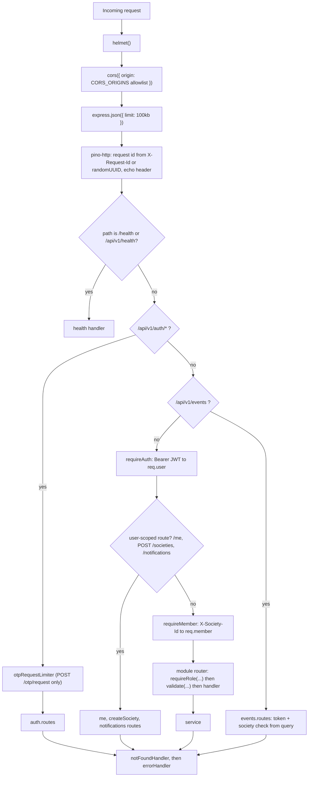

Mount order in code:

```ts
export function createApp(): Express {
  const app = express();
  app.set('trust proxy', 1);                       // correct client IP for rate limits behind nginx/LB
  app.use(helmet());
  app.use(cors({ origin: config.CORS_ORIGINS }));
  app.use(express.json({ limit: '100kb' }));
  app.use(httpLogger);                             // pino-http with genReqId + redaction; skips query string on /events
  app.get(['/health', '/api/v1/health'], (_req, res) => res.json({ status: 'ok', time: new Date().toISOString() }));

  const v1 = Router();
  v1.use('/auth', authRouter);                     // otpRequestLimiter applied on POST /otp/request
  v1.use(eventsRouter);                            // GET /events (authenticates from query)
  v1.use(requireAuth);
  v1.use(meRouter);                                // /me
  v1.use(notificationsRouter);                     // /notifications/*
  v1.post('/societies', validate({ body: createSocietyBody }), createSocietyHandler);
  v1.use(requireMember);                           // everything below is society-scoped
  v1.use(societyRouter, membersRouter, visitorsRouter, preapprovalsRouter, staffRouter, noticesRouter,
         pollsRouter, ticketsRouter, amenitiesRouter, billingRouter, sosRouter);
  app.use('/api/v1', v1);

  app.use(notFoundHandler);
  app.use(errorHandler);
  return app;
}
```

### 4.2 Request typing (in `middleware/auth.ts`)

```ts
import type { Role, ResidentType } from '@prisma/client';

export interface AuthUser { id: string }                     // from JWT sub
export interface Member {                                     // brief §4 + userId for event targeting
  id: string;                 // Membership.id (the actor id stored in ...ById columns)
  userId: string;
  societyId: string;
  role: Role;                 // 'ADMIN' | 'RESIDENT' | 'GUARD'
  flatId: string | null;      // non-null for RESIDENT
  residentType: ResidentType | null;
}

declare global {
  namespace Express {
    interface Request {
      user?: AuthUser;        // set by requireAuth
      member?: Member;        // set by requireMember
      q?: unknown;            // parsed query (Express 5 req.query is a read-only getter)
    }
  }
}
```

### 4.3 JWT payload (`lib/jwt.ts`)

```ts
interface JwtPayload { sub: string; iat: number; exp: number }   // sub = User.id, nothing else

export function signToken(userId: string): string;              // jwt.sign({ sub }, JWT_SECRET, { algorithm: 'HS256', expiresIn: '7d' })
export function verifyToken(token: string): { sub: string };    // jwt.verify(..., { algorithms: ['HS256'] }); any failure -> unauthorized()
```

Roles and flats are **not** in the token: they are resolved per request from `Membership`, so role changes and
deactivation take effect immediately.

### 4.4 Middleware specifications

| File | Export | Behaviour |
|---|---|---|
| `auth.ts` | `requireAuth` | Reads `Authorization: Bearer <t>`; missing/invalid → 401 `UNAUTHORIZED`; sets `req.user = { id: sub }`. No DB call (a deleted user fails at tenancy / `GET /me`). |
| `tenancy.ts` | `requireMember` | Reads `X-Society-Id`; missing → 400 `VALIDATION_ERROR`; `prisma.membership.findFirst({ where: { userId, societyId, status: 'ACTIVE' } })`; none → 403 `FORBIDDEN`; sets `req.member`; binds `societyId`/`membershipId` onto `req.log`. |
| `rbac.ts` | `requireRole(...roles: Role[])` | `!roles.includes(req.member!.role)` → 403 `FORBIDDEN`. |
| `validate.ts` | `validate({ body?, query? }: { body?: ZodTypeAny; query?: ZodTypeAny })` | `req.body = body.parse(req.body ?? {})`; `req.q = query.parse(req.query)`. Zod objects strip unknown keys; strings are trimmed; optional empty strings become `null` (08 §1.4). ZodError → 400. Path params are not validated (opaque ids; services 404). |
| `rateLimit.ts` | `otpRequestLimiter` | `express-rate-limit`: 5 requests / 15 min, key = `${req.body.phone}:${req.ip}`, `standardHeaders: true`; handler throws `new AppError(429, 'RATE_LIMITED', ...)` (`Retry-After` set by the library). No other limiter in v1 (08 §1.8); OTP verify is bounded by the 5-attempt cap. |
| `error.ts` | `notFoundHandler`, `errorHandler` | §3.2. |

### 4.5 Core files

**`config.ts`**

```ts
const Env = z.object({
  NODE_ENV: z.enum(['development', 'test', 'production']).default('development'),
  PORT: z.coerce.number().default(4000),
  DATABASE_URL: z.string().url(),
  JWT_SECRET: z.string().min(32),
  JWT_EXPIRES_IN: z.string().default('7d'),
  CORS_ORIGINS: z.string().default('http://localhost:8080,http://localhost:5173')
    .transform(s => s.split(',').map(x => x.trim()).filter(Boolean)),
  EXPOSE_DEV_OTP: z.enum(['true', 'false']).optional(),   // default: NODE_ENV !== 'production'
  LOG_LEVEL: z.enum(['fatal', 'error', 'warn', 'info', 'debug', 'trace']).default('info'),
  SEED_ON_START: z.enum(['true', 'false']).default('false'),
});
// After parse: exposeDevOtp = EXPOSE_DEV_OTP ? EXPOSE_DEV_OTP === 'true' : NODE_ENV !== 'production';
// if (NODE_ENV === 'production' && exposeDevOtp) -> log fatal + process.exit(1).
export const config: Readonly<z.infer<typeof Env> & { exposeDevOtp: boolean }>;
export const logger = pino({ level: config.LOG_LEVEL,
  redact: ['req.headers.authorization', '*.code', '*.codeHash', '*.passcode', '*.token'] });
```

(`z.coerce.boolean()` is deliberately not used: it turns the string `"false"` into `true`.)

Domain constants are code, not config: `OTP_TTL_MS = 5 * 60_000`, `OTP_MAX_ATTEMPTS = 5`,
`VISITOR_PENDING_TTL_MS = 10 * 60_000`, `SWEEP_INTERVAL_MS = 60_000`, `SSE_HEARTBEAT_MS = 25_000`.

**`db.ts`** — `export const prisma = new PrismaClient()` (single instance; reused across hot reloads via `globalThis`
in dev); `export type Tx = Prisma.TransactionClient`.

**`index.ts`** — `createApp().listen(config.PORT)`; starts the sweeper (§6.4); on `SIGTERM`/`SIGINT`: stop sweeper,
`hub.closeAll()`, `server.close()`, `prisma.$disconnect()`.

**`lib/time.ts`** (IST = UTC+05:30, no DST, so fixed-offset arithmetic is exact)

```ts
export const IST_OFFSET_MIN = 330;
export function istDateTimeToUtc(date: string /* YYYY-MM-DD */, hhmm: string): Date;
export function istDayRange(date: string): { start: Date; end: Date };       // [00:00 IST, next 00:00 IST)
export function istDateOf(d: Date): string;                                     // YYYY-MM-DD in IST
export function startOfTodayIst(now = new Date()): Date;
export function currentPeriod(now = new Date()): string;                        // YYYY-MM in IST
export function periodRange(period: string): { start: Date; end: Date };        // IST month bounds in UTC
export const addMinutes = (d: Date, n: number) => new Date(d.getTime() + n * 60_000);
```

---

## 5. Event bus and SSE hub (`src/events.ts`)

### 5.1 Types

```ts
import { EventEmitter } from 'node:events';
import type { Response } from 'express';

export interface Target {
  societyId: string;
  flatIds?: string[];       // RESIDENT members of these flats
  roles?: Role[];           // members with these roles
  userIds?: string[];       // specific users
  exceptUserId?: string;    // skip the actor
}                           // no flatIds/roles/userIds => whole society

export interface DomainEvents {            // payload = the same DTO the REST endpoint returns (08 §5.2)
  'visitor.requested': VisitorDTO;
  'visitor.updated':   VisitorDTO;
  'sos.raised':        SosDTO;
  'sos.updated':       SosDTO;
  'notice.created':    NoticeDTO;
}

export interface NotifySpec { type: NotificationType; title: string; body: string; data: Record<string, unknown> }

interface SseClient { userId: string; membershipId: string; societyId: string; role: Role; flatId: string | null; res: Response }
```

### 5.2 Public API

```ts
export const bus = new EventEmitter();          // events: 'domain', 'notify'

export function emitDomain<K extends keyof DomainEvents>(name: K, target: Target, data: DomainEvents[K]): void;
  // bus.emit('domain', { name, target, data })

export function notify(target: Target, n: NotifySpec): void;
  // bus.emit('notify', { target, n })

export const hub: {
  add(client: SseClient): () => void;                          // returns remove()
  publish(target: Target, event: string, data: unknown): number; // society-scoped fan-out; returns frames written
  publishToUsers(userIds: string[], event: string, data: unknown): number; // every stream of those users, any society
  dropMembership(membershipId: string): void;                  // close streams of a deactivated membership
  closeAll(): void;
  size(): number;
};
```

Listeners registered once at module load:

```ts
bus.on('domain', ({ name, target, data }) => hub.publish(target, name, data));

bus.on('notify', ({ target, n }) => {
  deliverNotification(target, n).catch(err => logger.error({ err }, 'notify failed'));
});

async function deliverNotification(t: Target, n: NotifySpec) {
  // 1. resolve recipients from DB (works for offline users too)
  const rows = await prisma.membership.findMany({
    where: { societyId: t.societyId, status: 'ACTIVE', OR: recipientFilter(t) },  // flatIds(RESIDENT) | roles | userIds
    select: { userId: true },
  });
  const userIds = [...new Set(rows.map(r => r.userId))].filter(u => u !== t.exceptUserId);
  if (!userIds.length) return;
  // 2. persist one row per user (createManyAndReturn so the SSE frame carries the real Notification)
  const created = await prisma.notification.createManyAndReturn({
    data: userIds.map(userId => ({ userId, societyId: t.societyId, type: n.type, title: n.title, body: n.body,
                                   data: { societyId: t.societyId, ...n.data } })),
  });
  // 3. push each row to every open stream of its user, regardless of the stream's society (08 §5.2)
  for (const row of created) hub.publishToUsers([row.userId], 'notification', row);
}
```

### 5.3 Hub design

```
clients: Map<societyId, Set<SseClient>>
```

- `add(c)`: get-or-create the set for `c.societyId`, add `c`; return `remove()` which deletes `c` and drops the empty set.
- `publish(t, event, data)`: iterate `clients.get(t.societyId)`. With no filter every client matches; otherwise a
  client matches if **any** holds: `t.flatIds` contains `c.flatId` and `c.role === 'RESIDENT'`; `t.roles` contains
  `c.role`; `t.userIds` contains `c.userId`. Then skip `c.userId === t.exceptUserId`. Frame:
  `event: ${event}\ndata: ${JSON.stringify(data)}\n\n` (single-line JSON). A write that throws removes the client.
- `publishToUsers(ids, …)`: iterate all societies' sets (used only for `notification`).
- `dropMembership(id)`: `res.end()` + remove for clients with that `membershipId`; called by `members.updateMember`
  when a membership becomes INACTIVE (08 §5.1: stream closes on deactivation).
- Heartbeat: **one** global `setInterval(SSE_HEARTBEAT_MS = 25s)` writes `: ping\n\n` to every client (keeps proxies
  from idling the socket out; failed writes evict dead sockets). Started lazily on first `add`, `unref()`ed.
- Complexity: `publish` is O(clients in that society); `publishToUsers` is O(all clients) — fine at v1 scale.

```ts
// ponytail: in-process hub, reaches only clients on this instance. Multi-replica => Redis pub/sub in emitDomain/notify (06-HLD §5.2).
```

### 5.4 SSE route (`modules/events/events.routes.ts`)

```
GET /api/v1/events?token=<jwt>&societyId=<id>
```

1. Missing `token` or `societyId` → 400 `VALIDATION_ERROR`.
2. `verifyToken(token)` → 401 `UNAUTHORIZED`.
3. ACTIVE membership for `(sub, societyId)` → else 403 `FORBIDDEN`.
4. Headers: `Content-Type: text/event-stream`, `Cache-Control: no-cache`, `Connection: keep-alive`,
   `X-Accel-Buffering: no`; `res.flushHeaders()`; write `retry: 5000\n: connected\n\n`.
5. `const remove = hub.add({ userId, membershipId, societyId, role, flatId, res })`; `req.on('close', remove)`.
6. No `id:` fields, no `Last-Event-ID` replay — clients refetch on reconnect.

### 5.5 Event emission matrix (matches 08 §5.2–§5.3)

| Service action | SSE event (`emitDomain`) → target | Notification (`notify`) type → recipients |
|---|---|---|
| members.addMember | — | `MEMBERSHIP_ADDED` → the added user |
| visitors.logWalkIn | `visitor.requested` → flatIds [flat] | `VISITOR_REQUESTED` → flat residents |
| visitors.decide / checkIn / checkOut / collect / expire | `visitor.updated` → flatIds [flat] + roles [GUARD] | — |
| gate verify, pre-approval entry | `visitor.updated` → flatIds [flat] + roles [GUARD] | `VISITOR_ARRIVED` → flat residents |
| gate verify, staff toggle | — | `STAFF_ENTRY` / `STAFF_EXIT` → residents of every linked flat |
| notices.create | `notice.created` → whole society | `NOTICE_POSTED` → all members except author |
| polls.create | — | `POLL_CREATED` → all RESIDENT members |
| tickets.create | — | `TICKET_CREATED` → ADMIN, except author |
| tickets.update | — | status change: `TICKET_UPDATED` → raiser (unless caller); new assignee: `TICKET_UPDATED` → assignee |
| tickets.addComment | — | `TICKET_COMMENT` → raiser if author is not raiser; else assignee, or all ADMIN if unassigned |
| billing.generateInvoices | — | `INVOICE_GENERATED` → residents of each flat that got an invoice |
| billing.payInvoice | — | `PAYMENT_RECEIVED` → flat residents + ADMIN, except payer |
| sos.raise | `sos.raised` → roles [GUARD, ADMIN] + userIds [raiser] | `SOS_RAISED` → GUARD + ADMIN |
| sos.updateStatus | `sos.updated` → roles [GUARD, ADMIN] + userIds [raiser] | `SOS_UPDATED` → raiser |

---

## 6. Algorithms

### 6.1 OTP (`lib/otp.ts` + `auth.service.ts`)

```ts
export const OTP_TTL_MS = 5 * 60_000, OTP_MAX_ATTEMPTS = 5;
export const generateOtp = () => crypto.randomInt(0, 1_000_000).toString().padStart(6, '0');
export const hashOtp = (code: string) => bcrypt.hash(code, 10);
export const compareOtp = (code: string, hash: string) => bcrypt.compare(code, hash);
```

**requestOtp(phone)**
1. (`otpRequestLimiter` already applied.) Zod: digits only, 10–15 chars.
2. `updateMany({ where: { phone, consumedAt: null }, data: { consumedAt: now } })` — only one live code per phone.
3. `code = generateOtp()`; `create({ phone, codeHash: await hashOtp(code), expiresAt: now + 5 min, attempts: 0 })`.
4. If `config.exposeDevOtp`: `logger.info({ phone, devCode: code }, 'dev OTP')` and return `{ expiresInSec: 300, devCode: code }`;
   else return `{ expiresInSec: 300 }` (production delivery = SMS provider, roadmap).

**verifyOtp({ phone, code, name? })** — observable order exactly as 08 §4.1:
1. `otp` = latest row with `consumedAt = null` for phone; none → 422 `OTP_INVALID`.
2. `otp.attempts >= 5` → 429 `OTP_TOO_MANY_ATTEMPTS`.
3. `otp.expiresAt <= now` → 422 `OTP_EXPIRED`.
4. **Reserve an attempt atomically** before the (slow) bcrypt compare, so parallel guesses can never exceed the cap:
   `updateMany({ where: { id, attempts: { lt: 5 } }, data: { attempts: { increment: 1 } } })`; `count === 0` → 429.
5. `compareOtp(code, otp.codeHash)`:
   - mismatch → the reserved attempt stands; if it was the 5th → 429 `OTP_TOO_MANY_ATTEMPTS`, else 422 `OTP_INVALID`
     with `details: { attemptsLeft }`;
   - match → release the reservation (`attempts: { decrement: 1 }`), so a correct code never counts as an attempt.
6. `user = findUnique({ where: { phone } })`; none and no `name` → 422 `NAME_REQUIRED` (OTP **not** consumed, attempts
   unchanged — the client resubmits the same code with `name`).
7. Transaction: `updateMany({ where: { id, consumedAt: null }, data: { consumedAt: now } })` (`count === 0` → a
   concurrent verify already won → 422 `OTP_INVALID`); `user ??= create({ phone, name })`.
8. Return `{ token: signToken(user.id), user, memberships: await loadMemberships(user.id) }` (ACTIVE only, ordered by
   society name, with `society` and `flat { block }`).

### 6.2 Tenancy resolution

One query per society-scoped request on the unique `Membership(userId, societyId)`. Accepted cost; cache with a short
TTL only if profiling shows it matters (caching would delay deactivation).

### 6.3 Passcode generation (`lib/passcode.ts`)

Pre-approval and staff passcodes share the gate's single input, so a code must be unique **across both** in a society:
not equal to any ACTIVE pre-approval and not equal to any staff passcode (03 §3.6, 08 §4.5). Used for both
`createPreApproval` and `createStaff`.

```ts
export async function generateUniquePasscode(tx: Tx, societyId: string): Promise<string> {
  for (let i = 0; i < 10; i++) {
    const code = crypto.randomInt(0, 1_000_000).toString().padStart(6, '0');
    const [pa, st] = await Promise.all([
      tx.preApproval.findFirst({ where: { societyId, passcode: code, status: 'ACTIVE' }, select: { id: true } }),
      tx.staff.findFirst({ where: { societyId, passcode: code }, select: { id: true } }),
    ]);
    if (!pa && !st) return code;
  }
  throw new AppError(500, 'INTERNAL_ERROR', 'Could not allocate a passcode, please retry');
}
```

- Staff uniqueness is also a DB constraint `@@unique([societyId, passcode])`.
- `// ponytail: ACTIVE pre-approval uniqueness is app-checked; two concurrent creates colliding needs a 1-in-10^6 draw in the same ms. Add the raw-SQL partial unique index from 03 §3.6 if ever observed.`
- Passcodes are never logged (pino redaction) and staff passcodes are returned only to ADMIN (`passcode: null` otherwise).

### 6.4 Pending-visitor and pre-approval expiry

`VisitorDTO.expiresAt = createdAt + 10 min` is computed in the mapper (08 §4.4); it is not a column.

```ts
// visitors.service
export async function expireStale(societyId?: string): Promise<number> {
  const cutoff = new Date(Date.now() - VISITOR_PENDING_TTL_MS);
  const stale = await prisma.visitor.findMany({
    where: { status: 'PENDING_APPROVAL', createdAt: { lte: cutoff }, ...(societyId && { societyId }) },
    select: { id: true }, take: 500,
  });
  let n = 0;
  for (const { id } of stale) {
    const r = await prisma.visitor.updateMany({ where: { id, status: 'PENDING_APPROVAL' }, data: { status: 'EXPIRED' } });
    if (r.count) { n++; const v = await loadDTO(id); emitDomain('visitor.updated', visitorTarget(v), v); }
  }
  return n;
}
```

- **Sweeper**: `index.ts` → `setInterval(() => Promise.all([visitors.expireStale(), preapprovals.expireStale()]).catch(logErr), 60_000).unref()`.
- **Lazy on read**: `listVisitors` calls `expireStale(m.societyId)` first. `decide` on a pending row with
  `createdAt <= cutoff` expires it (emitting `visitor.updated`) and then throws 422 `INVALID_TRANSITION`
  `{ from: 'EXPIRED', to }` (08 §4.4).
- The per-row conditional update guarantees a resident's concurrent APPROVE and the sweeper cannot both win.
- `preapprovals.expireStale(societyId?)`: `updateMany({ where: { status: 'ACTIVE', validTo: { lt: now } }, data: { status: 'EXPIRED' } })`
  (no event); also called by `listPreApprovals`; gate verify expires a single row inline.
- `// ponytail: setInterval in-process; with N replicas wrap the tick in pg_try_advisory_lock so one replica sweeps.`

### 6.5 Amenity availability

Inputs: `amenity { openTime, closeTime, slotMinutes, capacity }`, `date` (YYYY-MM-DD, IST).

```ts
export function generateSlots(a: Amenity, date: string): { startAt: Date; endAt: Date }[] {
  const open = istDateTimeToUtc(date, a.openTime), close = istDateTimeToUtc(date, a.closeTime);
  const slots = [];
  for (let s = open; addMinutes(s, a.slotMinutes) <= close; s = addMinutes(s, a.slotMinutes))
    slots.push({ startAt: s, endAt: addMinutes(s, a.slotMinutes) });
  return slots;                       // trailing partial slot is dropped
}

export async function getAvailability(m: Member, amenityId: string, date: string) {
  const a = await findAmenity(m, amenityId);           // 404 if not in society, or inactive and caller not ADMIN
  const slots = generateSlots(a, date);
  const { start, end } = istDayRange(date);
  const counts = await prisma.amenityBooking.groupBy({
    by: ['startAt'], _count: { _all: true },
    where: { amenityId, status: 'CONFIRMED', startAt: { gte: start, lt: end } },
  });
  const byStart = new Map(counts.map(c => [c.startAt.getTime(), c._count._all]));
  return slots.map(s => {
    const booked = byStart.get(s.startAt.getTime()) ?? 0;
    return { ...s, booked, capacity: a.capacity, available: Math.max(0, a.capacity - booked) };
  });
}
```

Past slots are included; clients disable `startAt <= now` (08 §4.11). The server rejects them at booking time.

**createBooking(m, { amenityId, startAt, flatId? })** (RESIDENT: own flat; ADMIN: `flatId` required, on behalf of a flat)
1. Amenity in society (404); `!isActive` → 422 `AMENITY_INACTIVE`.
2. `slot = generateSlots(a, istDateOf(startAt)).find(s => +s.startAt === +startAt)` → none → 422 `SLOT_INVALID`.
3. `startAt <= now` → 422 `SLOT_IN_PAST`.
4. `prisma.$transaction(async tx => { … }, { isolationLevel: 'Serializable' })`:
   - flat already has CONFIRMED `(amenityId, startAt)` → 409 `CONFLICT`;
   - `count CONFIRMED (amenityId, startAt) >= capacity` → 409 `SLOT_FULL`;
   - `create({ amenityId, societyId, flatId, bookedById: m.id, startAt, endAt: slot.endAt, status: 'CONFIRMED' })`.
5. Prisma `P2034` (serialization failure) → retry the transaction up to 3 times, then 409 `CONFLICT`.

`pricePerSlot` is display-only in v1; amenity charges are not invoiced (roadmap).

### 6.6 Invoice generation (idempotent)

**One invoice for every flat** in the society (not only flats with an ACTIVE resident) — maintenance is owed by the
unit regardless of occupancy, and it keeps the run deterministic.

```ts
export async function generateInvoices(m: Member, { period, amount, dueDate }: GenerateInvoicesBody) {
  const flats = await prisma.flat.findMany({ where: { societyId: m.societyId }, select: { id: true } });
  const existing = await prisma.invoice.findMany({ where: { societyId: m.societyId, period }, select: { flatId: true } });
  const have = new Set(existing.map(e => e.flatId));
  const toCreate = flats.filter(f => !have.has(f.id));
  const created = await prisma.invoice.createManyAndReturn({
    data: toCreate.map(f => ({ societyId: m.societyId, flatId: f.id, period, amount, dueDate, status: 'UNPAID' })),
    skipDuplicates: true,                       // @@unique([flatId, period]) makes concurrent runs safe
  });
  for (const inv of created) notify({ societyId: m.societyId, flatIds: [inv.flatId] },
    { type: 'INVOICE_GENERATED', title: `Maintenance bill ${period}`,
      body: `₹${(amount / 100).toFixed(2)} due ${istDateOf(dueDate)}`, data: { invoiceId: inv.id, period } });
  return { created: created.length, skipped: flats.length - created.length };   // 201
}
```

Re-running for the same period creates invoices only for flats added since. Amount changes never touch existing
invoices.

**Overdue (lazy)**: `markOverdue(societyId)` = `updateMany({ where: { societyId, status: 'UNPAID', dueDate: { lt: startOfTodayIst() } }, data: { status: 'OVERDUE' } })`,
called at the start of `listInvoices`, `payInvoice` and `getSummary` (08 §4.13: filters see the updated value).

### 6.7 Mock payment

```ts
// billing.service (private) — the only function a real gateway replaces (ADR-006)
function mockCharge(method: PaymentMethod) {
  const rand = Array.from(crypto.randomBytes(8), b => 'ABCDEFGHIJKLMNOPQRSTUVWXYZ0123456789'[b % 36]).join('');
  return { status: 'SUCCESS' as const, reference: `MOCK-${method}-${rand}` };
}

export async function payInvoice(m: Member, invoiceId: string, { method }: PayBody) {
  if (m.role === 'RESIDENT' && method === 'CASH') throw forbidden('Cash payments are recorded by the office');
  await markOverdue(m.societyId);
  const inv = await findInvoiceScoped(m, invoiceId);            // resident: own flat only, else 404
  if (inv.status === 'PAID') throw conflict('ALREADY_PAID', 'Invoice already paid');
  const charge = mockCharge(method);
  await prisma.$transaction(async tx => {
    const r = await tx.invoice.updateMany({ where: { id: inv.id, status: { in: ['UNPAID', 'OVERDUE'] } }, data: { status: 'PAID' } });
    if (!r.count) throw conflict('ALREADY_PAID', 'Invoice already paid');
    const p = await tx.payment.create({ data: { invoiceId: inv.id, societyId: m.societyId, amount: inv.amount, method,
      reference: charge.reference, paidById: m.id, paidAt: new Date() } });
    return p;
  }).then(p => notify({ societyId: m.societyId, flatIds: [inv.flatId], roles: ['ADMIN'], exceptUserId: m.userId },
    { type: 'PAYMENT_RECEIVED', title: `Payment received for ${inv.period}`,
      body: `₹${(inv.amount / 100).toFixed(2)} via ${method}`, data: { invoiceId: inv.id, paymentId: p.id } }));
  return loadInvoiceDTO(inv.id);                                // Invoice, status PAID, with payments (200)
}
```

Full payment only. The conditional update inside the transaction makes a double submit produce exactly one `Payment`.

### 6.8 Reports summary (`GET /reports/summary`, ADMIN; field contract 08 §3 `ReportSummary`)

All queries filter `societyId = m.societyId` and run in parallel after `markOverdue`. `P = currentPeriod()`,
`M = periodRange(P)`, `T = startOfTodayIst()`.

| Field | Query |
|---|---|
| `visitorsToday` | `visitor.count({ createdAt >= T })` |
| `pendingApprovals` | `visitor.count({ status: PENDING_APPROVAL })` (after lazy `expireStale`) |
| `insideNow` | `visitor.count({ status: CHECKED_IN })` |
| `openTickets` | `ticket.count({ status in [OPEN, IN_PROGRESS] })` |
| `collectionRate` | `billed = SUM(invoice.amount where period = P)`, `paid = SUM(... and status = PAID)`; `billed ? Math.round(paid / billed * 100) : 0` |
| `totalDue` | `SUM(invoice.amount where status in [UNPAID, OVERDUE])` (all periods) |
| `totalCollected` | `SUM(payment.amount where paidAt in M)` |
| `expensesThisMonth` | `SUM(expense.amount where spentOn in M)` |
| `residents` | `membership.count({ role: RESIDENT, status: ACTIVE })` |
| `flats` | `flat.count()` |
| `recentVisitors` | `visitor.findMany({ orderBy: createdAt desc, take: 5 })` → DTO |
| `sosActive` | `sosAlert.count({ status in [RAISED, ACKNOWLEDGED] })` |

Sums use `aggregate({ _sum: { amount: true } })` and default `null` to 0.

---

## 7. Modules

Each module lists: responsibilities, service signatures, Zod schemas, authorization, business rules, events, errors.
Shared Zod pieces are re-declared per module where used (no shared module needed):
`limit = z.coerce.number().int().min(1).max(200).default(50)`, `phone = z.string().regex(/^[0-9]{10,15}$/)`,
`date = z.string().regex(/^\d{4}-\d{2}-\d{2}$/)`, `period = z.string().regex(/^[0-9]{4}-(0[1-9]|1[0-2])$/)`,
`hhmm = z.string().regex(/^([01][0-9]|2[0-3]):[0-5][0-9]$/)`, `url = z.string().url().max(500)`,
`statusList(enum) = z.string().transform(s => s.split(',')).pipe(z.array(enum))` for comma-separated status filters.

### 7.1 auth

- **Responsibilities**: OTP request/verify, token issue.
- **Routes**: `POST /auth/otp/request` (otpRequestLimiter), `POST /auth/otp/verify`. Public.
- **Service**
  ```ts
  requestOtp(phone: string): Promise<{ expiresInSec: number; devCode?: string }>
  verifyOtp(input: VerifyOtpBody): Promise<{ token: string; user: UserDTO; memberships: MembershipView[] }>
  ```
- **Schemas**: `otpRequestBody { phone }`; `verifyOtpBody { phone, code: /^[0-9]{6}$/, name?: string(1..80) }`.
- **Rules / errors**: §6.1 — 422 `OTP_INVALID`, 422 `OTP_EXPIRED`, 429 `OTP_TOO_MANY_ATTEMPTS`, 422 `NAME_REQUIRED`,
  429 `RATE_LIMITED`, 400 `VALIDATION_ERROR`.
- **Events**: none.

### 7.2 me

- **Routes**: `GET /me`, `PATCH /me` (auth, no society header).
- **Service**
  ```ts
  getMe(userId: string): Promise<{ user: UserDTO; memberships: MembershipView[] }>   // 401 if user no longer exists
  updateMe(userId: string, input: UpdateMeBody): Promise<UserDTO>
  loadMemberships(userId: string): Promise<MembershipView[]>   // ACTIVE, ordered by society name; reused by auth
  ```
- **Schemas**: `updateMeBody { name?: string(1..80), email?: email | null }`, at least one key (empty body → 400).

### 7.3 society (society + blocks + flats)

- **Routes**: `POST /societies` (auth), `GET /society`, `GET /blocks`, `POST /blocks` (ADMIN), `GET /flats?blockId`,
  `POST /flats/bulk` (ADMIN).
- **Service**
  ```ts
  createSociety(userId: string, input: CreateSocietyBody): Promise<{ society: Society; membership: MembershipView }>
  getSociety(m: Member): Promise<SocietyDTO>
  listBlocks(m: Member): Promise<BlockDTO[]>                       // reference list, by name
  createBlock(m: Member, input: CreateBlockBody): Promise<BlockDTO>
  listFlats(m: Member, q: ListFlatsQuery): Promise<FlatDTO[]>       // reference list, by block name then number
  bulkCreateFlats(m: Member, input: BulkFlatsBody): Promise<{ created: number; skipped: number; items: FlatDTO[] }>
  ```
- **Schemas**: `createSocietyBody { name, addressLine, city, state, pincode }` (constraints per 08 §4.3);
  `createBlockBody { name }`; `listFlatsQuery { blockId? }`; `bulkFlatsBody { blockId, numbers: string[] }`.
- **Authorization**: create society — any authenticated user; GET — any member; POST — ADMIN.
- **Rules**: `createSociety` is one transaction: `Society` + `Membership { role: ADMIN, status: ACTIVE }`. `blockId`
  must belong to `m.societyId` (404). Bulk flats: `createMany({ skipDuplicates: true })` on `@@unique([blockId, number])`
  → idempotent. Duplicate block name → P2002 → 409 `CONFLICT`.
- **Errors**: 400, 403, 404, 409 `CONFLICT`.

### 7.4 members

- **Routes**: `GET /members?flatId&role&status`, `POST /members`, `PATCH /members/:id`.
- **Service**
  ```ts
  listMembers(m: Member, q: ListMembersQuery): Promise<MemberDTO[]>      // reference list, by user name
  addMember(m: Member, input: AddMemberBody): Promise<MemberDTO>          // 201
  updateMember(m: Member, id: string, input: UpdateMemberBody): Promise<MemberDTO>
  ```
- **Schemas**: `addMemberBody { phone, name(1..80), role, flatId?, residentType? }` with refinements: RESIDENT needs
  `flatId`; ADMIN/GUARD must not send `flatId` or `residentType` (400); `updateMemberBody { status?, role? }` (≥ 1 key);
  `listMembersQuery { flatId?, role?, status? }`.
- **Authorization**: ADMIN all. GUARD only with `flatId` → ACTIVE RESIDENT members of that flat (name + phone, so the
  guard can call); GUARD without `flatId` → 403. RESIDENT → 403.
- **Rules**:
  - Find-or-create User by phone; an existing user's name is never overwritten.
  - `flatId` must be a flat in the society → else 404. `residentType` defaults to `OWNER`.
  - `@@unique([userId, societyId])`: an existing membership (ACTIVE **or** INACTIVE) → 409 `CONFLICT` ("use PATCH to
    reactivate").
  - PATCH role → ADMIN/GUARD clears `flatId` and `residentType`; role → RESIDENT requires an existing `flatId`
    (else 422 `FLAT_REQUIRED`). Any change leaving zero ACTIVE ADMINs (incl. self-demotion) → 422 `LAST_ADMIN`
    (count checked inside the same transaction as the update).
  - Status → INACTIVE: after commit call `hub.dropMembership(id)`.
- **Events**: `MEMBERSHIP_ADDED` → added user.

### 7.5 visitors (visitors + gate verify)

- **Routes**: `GET /visitors?status&date&flatId`, `POST /visitors`, `POST /visitors/:id/decision`,
  `POST /visitors/:id/check-in`, `POST /visitors/:id/check-out`, `POST /visitors/:id/collect`, `POST /gate/verify`.
- **Service**
  ```ts
  listVisitors(m: Member, q: ListVisitorsQuery): Promise<VisitorDTO[]>
  logWalkIn(m: Member, input: CreateVisitorBody): Promise<VisitorDTO>                 // 201
  decide(m: Member, id: string, decision: 'APPROVE' | 'DENY' | 'LEAVE_AT_GATE'): Promise<VisitorDTO>
  checkIn(m: Member, id: string): Promise<VisitorDTO>
  checkOut(m: Member, id: string): Promise<VisitorDTO>
  collect(m: Member, id: string): Promise<VisitorDTO>
  verifyGatePasscode(m: Member, passcode: string): Promise<GateVerifyResult>
  expireStale(societyId?: string): Promise<number>

  type GateVerifyResult =
    | { kind: 'VISITOR'; visitor: VisitorDTO }
    | { kind: 'STAFF'; action: 'CHECK_IN' | 'CHECK_OUT'; staff: StaffDTO; attendance: AttendanceDTO };  // staff.isInside = state after action
  ```
- **Schemas**: `createVisitorBody { flatId, type, name(1..80), phone?, company?(..80), vehicleNo?(..20, uppercased),
  purpose?(..200), photoUrl?: url }`; `decisionBody { decision }`; `listVisitorsQuery { status?: statusList, date?,
  flatId?, limit }`; `gateVerifyBody { passcode: /^[0-9]{6}$/ }`.
- **Authorization**:

  | Action | Allowed | Record rule |
  |---|---|---|
  | list | GUARD, ADMIN: all; RESIDENT: `flatId` forced to `m.flatId` | — |
  | logWalkIn | GUARD | flat in society (404) |
  | decide | RESIDENT (ADMIN/GUARD → 403) | `visitor.flatId === m.flatId`, else 404 |
  | checkIn / checkOut | GUARD | — |
  | collect | GUARD, or RESIDENT of the flat (other residents 404, ADMIN 403) | — |
  | gate verify | GUARD | — |

- **Rules**: state machine §8.1 via conditional updates. `loggedById = m.id` on create; decision sets
  `decidedById = m.id`, `decidedAt = now`; check-in sets `checkInAt`; check-out sets `checkOutAt`; collect sets
  `checkOutAt` (collection time). A flat with no residents still gets the visitor (it will expire).
- **Gate verify algorithm** (08 §4.5):
  1. `pa = preApproval.findFirst({ societyId, passcode, status: 'ACTIVE' })`.
     - `now < validFrom` → 404 `PASSCODE_INVALID` `{ reason: 'NOT_YET_VALID' }`.
     - `now > validTo` → set EXPIRED, 404 `PASSCODE_INVALID` `{ reason: 'EXPIRED' }`.
     - valid → transaction: `updateMany({ where: { id, status: 'ACTIVE', usedCount: { lt: maxUses } }, data: { usedCount: { increment: 1 } } })`
       (count 0 → fall through to step 2); if `usedCount + 1 === maxUses` set `USED`; create `Visitor { status: CHECKED_IN,
       type: pa.type, name: pa.guestName, phone: pa.guestPhone, flatId: pa.flatId, preApprovalId, loggedById: m.id,
       decidedById: pa.createdById, decidedAt: now, checkInAt: now }`. Emit + notify. Return `kind: 'VISITOR'`.
  2. `staff.toggleAttendanceByPasscode(m, passcode)` → non-null → `kind: 'STAFF'`.
  3. Else 404 `PASSCODE_INVALID` `{ reason: 'NOT_FOUND' }` (covers USED/CANCELLED/EXPIRED pre-approvals, inactive staff).
- **Events**: §5.5.
- **Errors**: 400, 403, 404, 404 `PASSCODE_INVALID`, 422 `INVALID_TRANSITION`.

### 7.6 preapprovals

- **Routes**: `GET /preapprovals?status`, `POST /preapprovals`, `DELETE /preapprovals/:id`.
- **Service**
  ```ts
  listPreApprovals(m: Member, q: ListPreApprovalsQuery): Promise<PreApprovalDTO[]>
  createPreApproval(m: Member, input: CreatePreApprovalBody): Promise<PreApprovalDTO>   // 201, includes passcode
  cancelPreApproval(m: Member, id: string): Promise<PreApprovalDTO>                     // soft cancel, 200
  expireStale(societyId?: string): Promise<number>
  ```
- **Schemas**: `createPreApprovalBody { type? (default GUEST), guestName(1..80), guestPhone?, validFrom? (default now,
  at most 5 min in the past), validTo? (default validFrom + 24h, > validFrom, ≤ validFrom + 30 days), maxUses?: int 1..10
  (default 1) }` — window rules are Zod refinements → 400; `listPreApprovalsQuery { status?, limit }`.
- **Authorization**: create — RESIDENT (flat = caller's). Cancel — RESIDENT of the pre-approval's flat (others 404).
  Read — RESIDENT own flat; ADMIN all. GUARD → 403 (guards only verify).
- **Rules**: `flatId = m.flatId`, `createdById = m.id`; passcode via §6.3 inside the create transaction. Cancel:
  ACTIVE → CANCELLED (conditional update) else 422 `INVALID_TRANSITION`.
- **Events**: none.

### 7.7 staff

- **Routes**: `GET /staff?flatId&category&isActive`, `POST /staff`, `PATCH /staff/:id`, `POST /staff/:id/flats`,
  `GET /staff/:id/attendance?date`.
- **Service**
  ```ts
  listStaff(m: Member, q: ListStaffQuery): Promise<StaffDTO[]>          // reference list by name; passcode only for ADMIN
  createStaff(m: Member, input: CreateStaffBody): Promise<StaffDTO>     // 201
  updateStaff(m: Member, id: string, input: UpdateStaffBody): Promise<StaffDTO>
  linkFlat(m: Member, id: string, flatId: string): Promise<StaffDTO>    // idempotent, 200
  listAttendance(m: Member, id: string, q: AttendanceQuery): Promise<AttendanceDTO[]>   // checkInAt desc
  toggleAttendanceByPasscode(m: Member, passcode: string):
    Promise<{ action: 'CHECK_IN' | 'CHECK_OUT'; staff: StaffDTO; attendance: AttendanceDTO } | null>
  ```
- **Schemas**: `createStaffBody { name(1..80), phone?, category, photoUrl?: url, flatIds?: string[] (0..50) }`;
  `updateStaffBody { name?, phone?: string | null, category?, photoUrl?: string | null, isActive? }` (≥ 1 key);
  `linkFlatBody { flatId }`; `listStaffQuery { flatId?, category?, isActive?: 'true' | 'false' }` (default: ADMIN all,
  others active only); `attendanceQuery { date?, limit }`.
- **Authorization**: GET and attendance — any member; POST/PATCH — ADMIN; link flat — ADMIN (any flat) or RESIDENT
  (`flatId === m.flatId`, else 403); GUARD → 403 on link.
- **Rules**: passcode via §6.3 on create (immutable in v1); all `flatIds` must be flats in society (404). Link uses
  upsert on `@@unique([staffId, flatId])` (already linked → 200, no change). Toggle: `isActive` staff only; an open
  attendance row (`checkOutAt = null`) → set `checkOutAt = now` (`CHECK_OUT`), else create `{ checkInAt: now,
  loggedById: m.id, societyId }` (`CHECK_IN`). Deactivating staff does not auto-check-out; the passcode just stops
  working.
- **Events**: `STAFF_ENTRY` / `STAFF_EXIT` → residents of all linked flats.

### 7.8 notices

- **Routes**: `GET /notices?category`, `POST /notices`, `PATCH /notices/:id`, `DELETE /notices/:id`.
- **Service**
  ```ts
  listNotices(m: Member, q: ListNoticesQuery): Promise<NoticeDTO[]>   // orderBy [{ isPinned: 'desc' }, { createdAt: 'desc' }]
  createNotice(m: Member, input: CreateNoticeBody): Promise<NoticeDTO> // 201
  updateNotice(m: Member, id: string, input: UpdateNoticeBody): Promise<NoticeDTO>   // no events
  deleteNotice(m: Member, id: string): Promise<void>                  // hard delete, 204
  ```
- **Schemas**: `createNoticeBody { title(1..120), body(1..5000), category? (default GENERAL), isPinned? (default false) }`;
  update = partial, ≥ 1 key.
- **Authorization**: GET member; write ADMIN.
- **Events**: `notice.created` → whole society; `NOTICE_POSTED` → all members except author.

### 7.9 polls

- **Routes**: `GET /polls`, `POST /polls`, `POST /polls/:id/vote`.
- **Service**
  ```ts
  listPolls(m: Member, q: { limit: number }): Promise<PollDTO[]>
  createPoll(m: Member, input: CreatePollBody): Promise<PollDTO>        // 201
  vote(m: Member, pollId: string, optionId: string): Promise<PollDTO>   // 200

  type PollDTO = { id; question; closesAt; isClosed; options: { id; text; votes }[]; totalVotes; myVoteOptionId: string | null; createdBy; createdAt };
  ```
- **Schemas**: `createPollBody { question(1..200), options: string(1..100)[] (2..10, unique case-insensitive),
  closesAt?: future datetime }`; `voteBody { optionId }`.
- **Authorization**: GET member; POST ADMIN; vote RESIDENT.
- **Rules**: counts via `pollVote.groupBy({ by: ['optionId'] })`; `closesAt <= now` → 422 `POLL_CLOSED`; option not
  in poll → 400 `VALIDATION_ERROR`; second vote → P2002 on `@@unique([pollId, membershipId])` → 409 `ALREADY_VOTED`.
- **Events**: `POLL_CREATED` → all RESIDENT members.

### 7.10 tickets

- **Routes**: `GET /tickets?status&category`, `POST /tickets`, `GET /tickets/:id`, `PATCH /tickets/:id`,
  `POST /tickets/:id/comments`.
- **Service**
  ```ts
  listTickets(m: Member, q: ListTicketsQuery): Promise<TicketDTO[]>                   // without comments
  getTicket(m: Member, id: string): Promise<TicketDTO & { comments: CommentDTO[] }>   // comments oldest first
  createTicket(m: Member, input: CreateTicketBody): Promise<TicketDTO>                // 201, comments: []
  updateTicket(m: Member, id: string, input: UpdateTicketBody): Promise<TicketDTO & { comments: CommentDTO[] }>
  addComment(m: Member, id: string, input: CommentBody): Promise<CommentDTO>          // 201
  ```
- **Schemas**: `createTicketBody { title(1..120), description(1..2000), category, priority? (default MEDIUM),
  flatId? (ADMIN only; ignored for RESIDENT) }`; `updateTicketBody { status?, priority?, category?, assignedToId?: string | null }`
  (≥ 1 key); `commentBody { body(1..2000) }`; `listTicketsQuery { status?: statusList, category?, limit }`.
- **Authorization**: RESIDENT — create (flat = own), list/get/comment tickets of **own flat** (others 404), PATCH only
  `status` per §8.3 (any other field → 403). ADMIN — everything. GUARD → 403.
- **Rules**: state machine §8.3 (same status → no-op 200). `resolvedAt` set on → RESOLVED, cleared on reopen to OPEN.
  `assignedToId` must be an ACTIVE ADMIN **or GUARD** membership in society, else 404; `null` unassigns. Comments
  allowed in any status.
- **Events**: `TICKET_CREATED`, `TICKET_UPDATED`, `TICKET_COMMENT` per §5.5.

### 7.11 amenities (amenities + bookings)

- **Routes**: `GET /amenities`, `POST /amenities`, `PATCH /amenities/:id`, `GET /amenities/:id/availability?date`,
  `GET /bookings?amenityId&date&status`, `POST /bookings`, `DELETE /bookings/:id`.
- **Service**
  ```ts
  listAmenities(m: Member): Promise<AmenityDTO[]>             // reference list by name; non-admins: isActive only
  createAmenity(m: Member, input: CreateAmenityBody): Promise<AmenityDTO>
  updateAmenity(m: Member, id: string, input: UpdateAmenityBody): Promise<AmenityDTO>   // cross-field rules on merged values
  getAvailability(m: Member, amenityId: string, date: string): Promise<SlotDTO[]>
  listBookings(m: Member, q: ListBookingsQuery): Promise<BookingDTO[]>                   // startAt desc
  createBooking(m: Member, input: CreateBookingBody): Promise<BookingDTO>               // 201
  cancelBooking(m: Member, id: string): Promise<BookingDTO>                             // soft cancel, 200

  type SlotDTO = { startAt: Date; endAt: Date; booked: number; capacity: number; available: number };
  ```
- **Schemas**: `createAmenityBody { name(1..80), description?(..500), openTime: hhmm, closeTime: hhmm,
  slotMinutes: int 15..480, capacity: int 1..500, pricePerSlot?: int ≥ 0 (default 0), isActive? (default true) }` with
  refinements `openTime < closeTime` and window ≥ `slotMinutes` (400); `availabilityQuery { date }`;
  `createBookingBody { amenityId, startAt: datetime, flatId? (required for ADMIN) }`;
  `listBookingsQuery { amenityId?, date?, status?, limit }`.
- **Authorization**: amenities GET member, write ADMIN; availability on an inactive amenity → 404 for non-admins.
  Bookings: RESIDENT create / list / cancel own flat (others 404); ADMIN all and books on behalf of a flat; GUARD → 403.
- **Rules**: §6.5. Amenity name unique per society — app-checked (`findFirst`) → 409 `CONFLICT` (03 has no DB unique on
  it). Cancel: CONFIRMED → CANCELLED (conditional update; already cancelled → 422 `INVALID_TRANSITION`), and only while
  `startAt > now` (else 422 `SLOT_IN_PAST`). Editing an amenity never changes existing bookings.
- **Errors**: 400, 403, 404, 409 `CONFLICT`, 409 `SLOT_FULL`, 422 `AMENITY_INACTIVE` / `SLOT_INVALID` / `SLOT_IN_PAST` /
  `INVALID_TRANSITION`.

### 7.12 billing (invoices + payments + expenses + reports)

- **Routes**: `GET /invoices?status&period&flatId`, `POST /invoices/generate`, `POST /invoices/:id/pay`,
  `GET /expenses?category&month`, `POST /expenses`, `GET /reports/summary`.
- **Service**
  ```ts
  listInvoices(m: Member, q: ListInvoicesQuery): Promise<InvoiceDTO[]>   // markOverdue first; period desc, flat label asc; includes payments
  generateInvoices(m: Member, input: GenerateInvoicesBody): Promise<{ created: number; skipped: number }>   // 201
  payInvoice(m: Member, id: string, input: PayBody): Promise<InvoiceDTO>                                    // 200
  listExpenses(m: Member, q: ListExpensesQuery): Promise<ExpenseDTO[]>   // spentOn desc, createdAt desc
  createExpense(m: Member, input: CreateExpenseBody): Promise<ExpenseDTO>  // 201
  getSummary(m: Member): Promise<ReportSummary>
  markOverdue(societyId: string): Promise<number>
  ```
- **Schemas**: `generateInvoicesBody { period, amount: int 1..100_000_000, dueDate: date }`; `payBody { method }`;
  `listInvoicesQuery { status?, period?, flatId? (ADMIN only), limit }`; `createExpenseBody { category,
  amount: int 1..100_000_000, vendor?(..120), note?(..500), spentOn: date not in the future (IST) }`;
  `listExpensesQuery { category?, month?: period, limit }`.
- **Authorization**: invoices — RESIDENT own flat (forced filter), ADMIN all, GUARD 403; generate ADMIN; pay —
  RESIDENT of the invoice's flat (UPI/CARD/NETBANKING; `CASH` → 403), ADMIN any method. Expenses and reports — ADMIN.
- **Rules / algorithms**: §6.6, §6.7, §6.8; state machine §8.5.
- **Errors**: 400, 403, 404, 409 `ALREADY_PAID`.

### 7.13 sos

- **Routes**: `GET /sos?status`, `POST /sos`, `PATCH /sos/:id`.
- **Service**
  ```ts
  listSos(m: Member, q: ListSosQuery): Promise<SosDTO[]>          // RESIDENT: raisedById = m.id; GUARD/ADMIN: all
  raiseSos(m: Member, input: RaiseSosBody): Promise<SosDTO>       // 201
  updateSosStatus(m: Member, id: string, status: 'ACKNOWLEDGED' | 'RESOLVED'): Promise<SosDTO>
  ```
- **Schemas**: `raiseSosBody { type, message?(..300) }`; `updateSosBody { status }`; `listSosQuery { status?: statusList, limit }`.
- **Authorization**: raise RESIDENT (flat = own); list GUARD/ADMIN all, RESIDENT own; PATCH GUARD/ADMIN.
- **Rules**: duplicate active alerts are **never** blocked — emergencies must not be rejected. Transitions §8.4:
  → ACKNOWLEDGED sets `acknowledgedById = m.id`, `acknowledgedAt`; → RESOLVED sets `resolvedAt`, and fills the ack fields
  when going straight from RAISED. "On-duty" guards = all ACTIVE GUARD memberships (no shift model in v1); realtime
  reaches those connected.
- **Events**: `sos.raised` / `sos.updated` and `SOS_RAISED` / `SOS_UPDATED` per §5.5.
- **Errors**: 400, 403, 404, 422 `INVALID_TRANSITION`.

### 7.14 notifications

- **Routes** (auth, no society header): `GET /notifications?unread`, `POST /notifications/:id/read`,
  `POST /notifications/read-all`.
- **Service**
  ```ts
  listNotifications(userId: string, q: { unread?: boolean; limit: number }): Promise<{ items: Notification[]; unreadCount: number }>
  markRead(userId: string, id: string): Promise<Notification>    // idempotent; 404 if not the caller's
  markAllRead(userId: string): Promise<{ updated: number }>       // rows newly marked
  ```
- **Rules**: always `where: { userId }`, across all societies; `unreadCount` is independent of `limit`/`unread`.
  Writing notifications is done by `events.ts` (§5.2), not by this module.

### 7.15 events

- **Route**: `GET /events?token&societyId` — §5.4. No service file (the hub is in `src/events.ts`).

---

## 8. State machines

Transition tables live as `const` objects in the owning service and are checked with `assertTransition` before the
conditional update.

### 8.1 Visitor

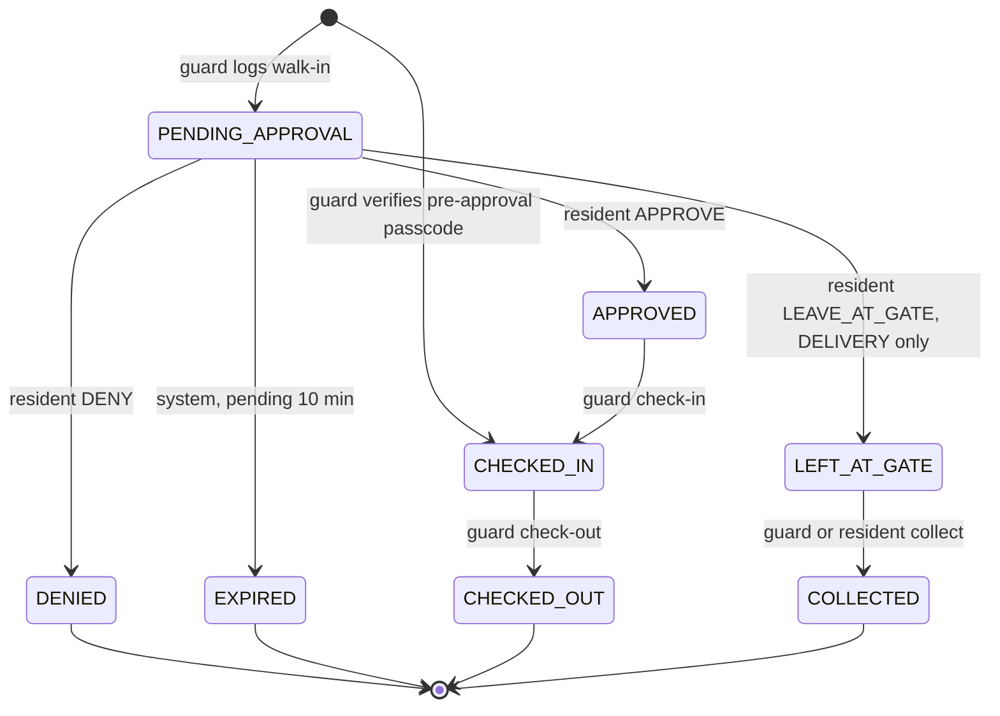

| From | To | Trigger / endpoint | Who | Side effects |
|---|---|---|---|---|
| — | PENDING_APPROVAL | `POST /visitors` | GUARD | `loggedById`; `visitor.requested`; `VISITOR_REQUESTED` |
| — | CHECKED_IN | `POST /gate/verify` (pre-approval match) | GUARD | `preApprovalId`, `decidedById = preApproval.createdById`, `decidedAt = checkInAt = now`; `VISITOR_ARRIVED` |
| PENDING_APPROVAL | APPROVED | `POST /visitors/:id/decision` APPROVE | RESIDENT of flat | `decidedById`, `decidedAt` |
| PENDING_APPROVAL | DENIED | decision DENY | RESIDENT of flat | `decidedById`, `decidedAt` |
| PENDING_APPROVAL | LEFT_AT_GATE | decision LEAVE_AT_GATE, `type = DELIVERY` only | RESIDENT of flat | `decidedById`, `decidedAt` |
| PENDING_APPROVAL | EXPIRED | sweeper / lazy, `createdAt <= now - 10 min` | system | — |
| APPROVED | CHECKED_IN | `POST /visitors/:id/check-in` | GUARD | `checkInAt` |
| CHECKED_IN | CHECKED_OUT | `POST /visitors/:id/check-out` | GUARD | `checkOutAt` |
| LEFT_AT_GATE | COLLECTED | `POST /visitors/:id/collect` | GUARD or RESIDENT of flat | `checkOutAt` = collection time |

Every row above except creation emits `visitor.updated`. Anything else → 422 `INVALID_TRANSITION`.

```ts
const VISITOR_TRANSITIONS = {
  PENDING_APPROVAL: ['APPROVED', 'DENIED', 'LEFT_AT_GATE', 'EXPIRED'],
  APPROVED: ['CHECKED_IN'], CHECKED_IN: ['CHECKED_OUT'], LEFT_AT_GATE: ['COLLECTED'],
  DENIED: [], EXPIRED: [], CHECKED_OUT: [], COLLECTED: [],
} as const satisfies Record<VisitorStatus, readonly VisitorStatus[]>;
// decide(): LEAVE_AT_GATE on non-DELIVERY -> assert fails explicitly with { from: v.status, to: 'LEFT_AT_GATE' }
```

`APPROVED` visitors that never arrive stay `APPROVED` in v1 (shown as "awaiting entry"); end-of-day auto-expiry is roadmap.

### 8.2 Pre-approval

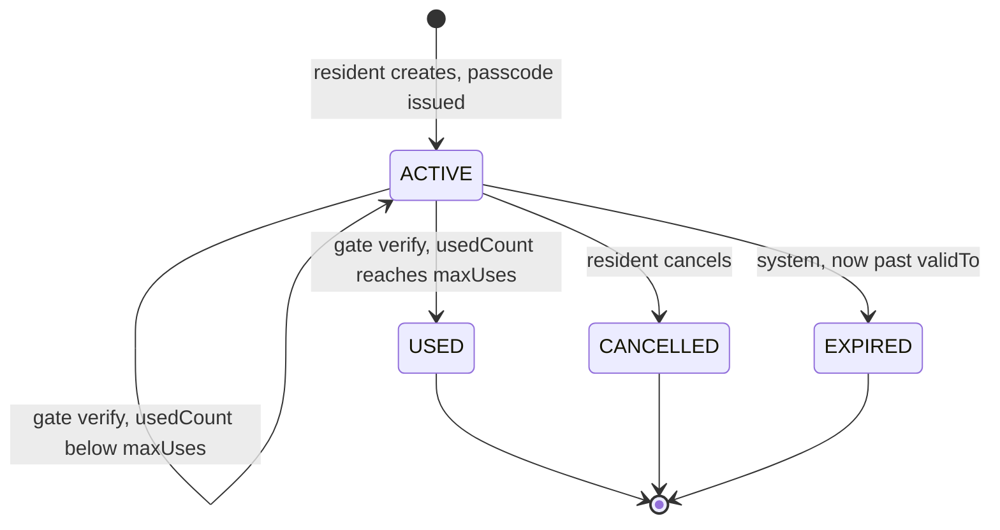

| From | To | Trigger | Who |
|---|---|---|---|
| — | ACTIVE | `POST /preapprovals` | RESIDENT |
| ACTIVE | USED | `POST /gate/verify` and `usedCount` reaches `maxUses` | GUARD |
| ACTIVE | CANCELLED | `DELETE /preapprovals/:id` | RESIDENT of flat |
| ACTIVE | EXPIRED | sweeper / lazy on list / gate verify after `validTo` | system |

### 8.3 Ticket (08 §4.10)

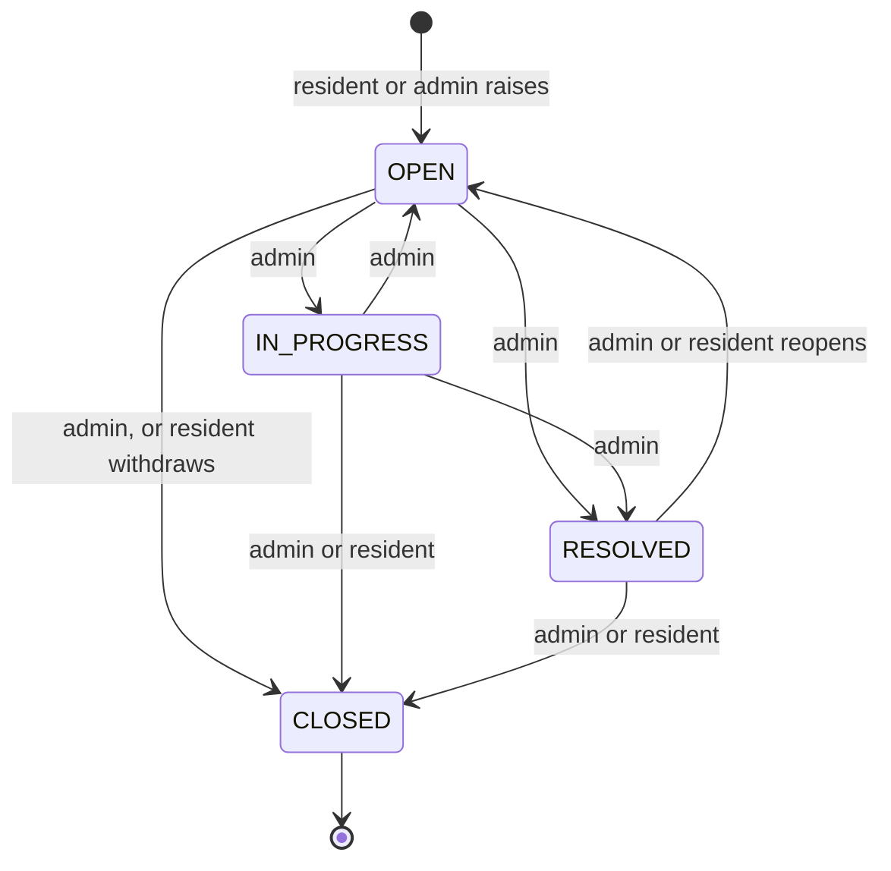

| From | To | ADMIN | RESIDENT of ticket's flat | Side effects |
|---|---|---|---|---|
| OPEN | IN_PROGRESS, RESOLVED | yes | no | RESOLVED: `resolvedAt = now` |
| OPEN | CLOSED | yes | yes (withdraw) | — |
| IN_PROGRESS | OPEN, RESOLVED | yes | no | RESOLVED: `resolvedAt = now` |
| IN_PROGRESS | CLOSED | yes | yes | — |
| RESOLVED | CLOSED | yes | yes | — |
| RESOLVED | OPEN (reopen) | yes | yes | `resolvedAt = null` |
| CLOSED | — | terminal | terminal | — |

Same status as current → no-op 200. Every status change notifies the raiser (`TICKET_UPDATED`) unless the raiser made it.

### 8.4 SOS

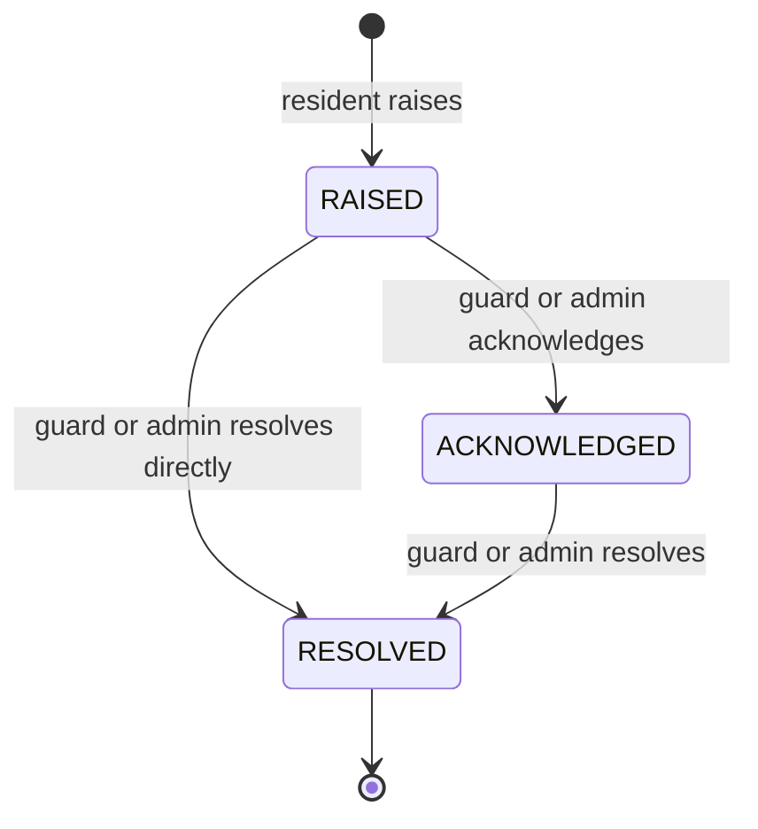

| From | To | Who | Side effects |
|---|---|---|---|
| — | RAISED | RESIDENT | `sos.raised` → GUARD + ADMIN + raiser; `SOS_RAISED` → GUARD + ADMIN |
| RAISED | ACKNOWLEDGED | GUARD / ADMIN | `acknowledgedById`, `acknowledgedAt`; `sos.updated`; `SOS_UPDATED` → raiser |
| RAISED / ACKNOWLEDGED | RESOLVED | GUARD / ADMIN | `resolvedAt` (ack fields filled if empty); `sos.updated`; `SOS_UPDATED` → raiser |

### 8.5 Invoice

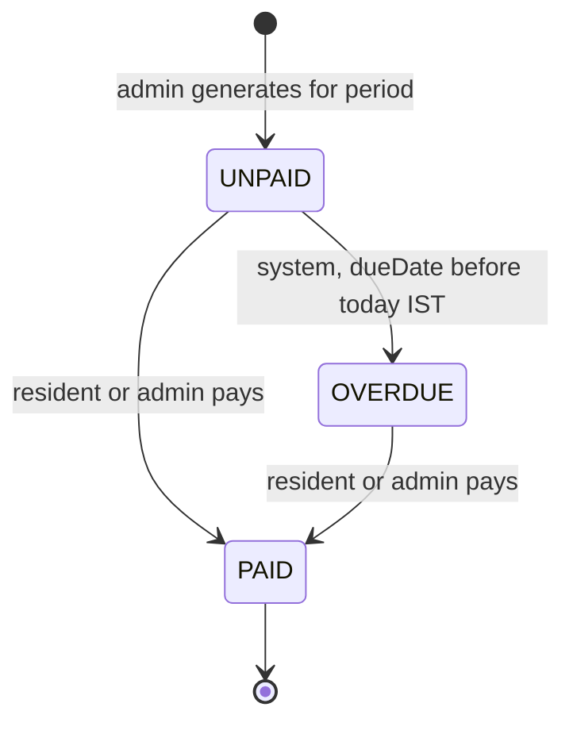

| From | To | Trigger | Who |
|---|---|---|---|
| — | UNPAID | `POST /invoices/generate` | ADMIN |
| UNPAID | OVERDUE | `markOverdue` (lazy on list / pay / summary) | system |
| UNPAID / OVERDUE | PAID | `POST /invoices/:id/pay` | RESIDENT of flat (UPI/CARD/NETBANKING), ADMIN (any method) |

### 8.6 Amenity booking

`CONFIRMED → CANCELLED` via `DELETE /bookings/:id` (RESIDENT of flat or ADMIN), only while `startAt > now`
(else 422 `SLOT_IN_PAST`); cancelling a CANCELLED booking → 422 `INVALID_TRANSITION`.

---

## 9. Sequence diagrams

### 9.1 OTP login

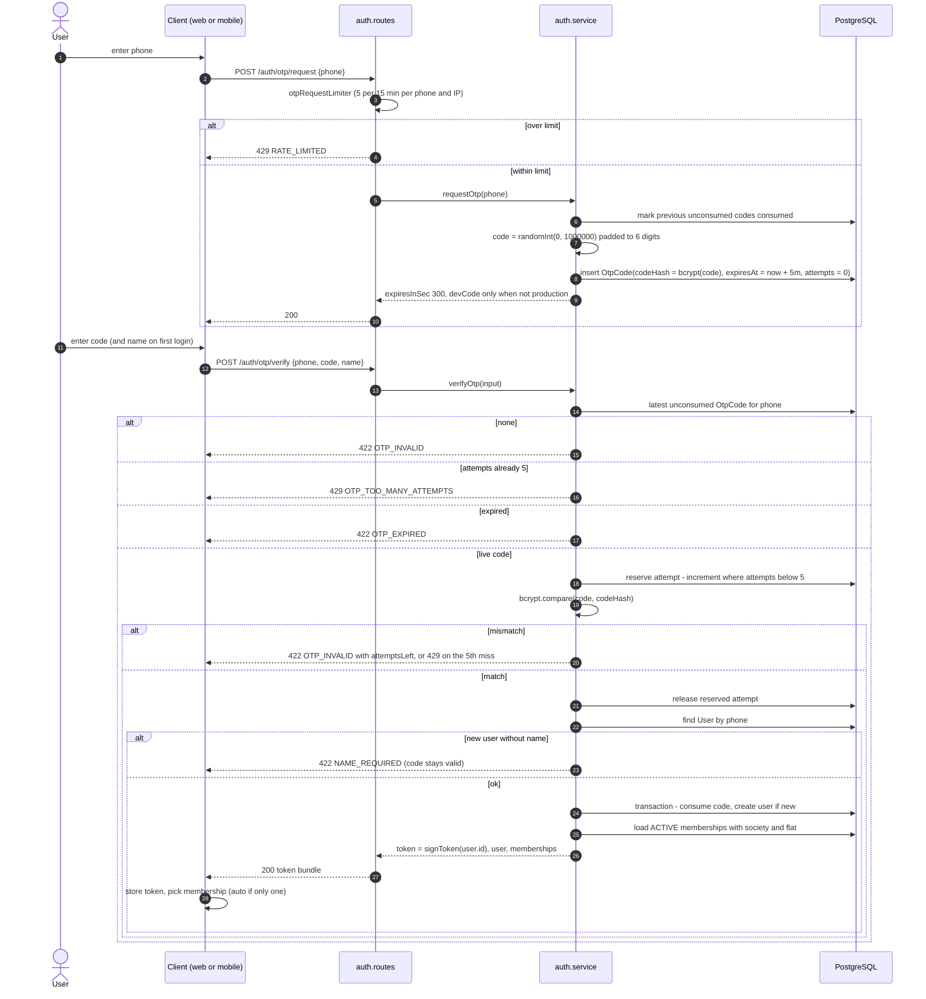

### 9.2 Walk-in: guard logs → resident approves → guard checks in

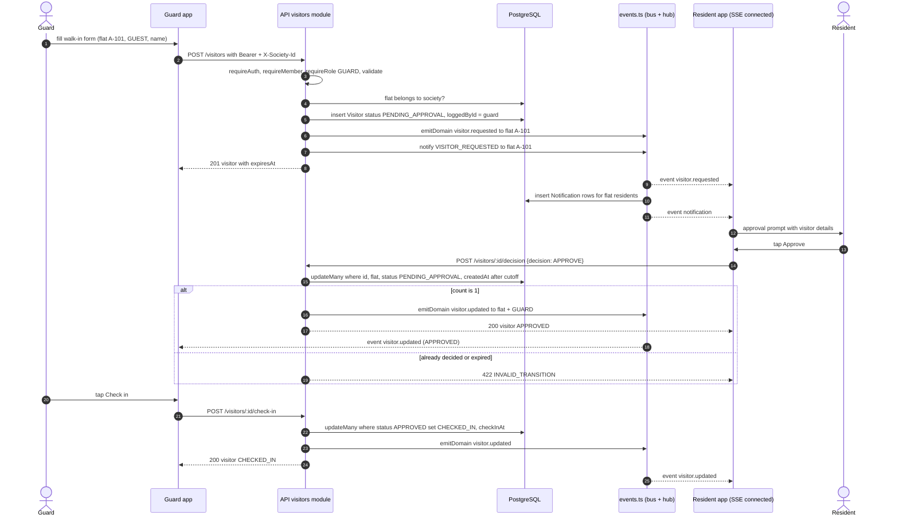

### 9.3 Passcode verify at gate

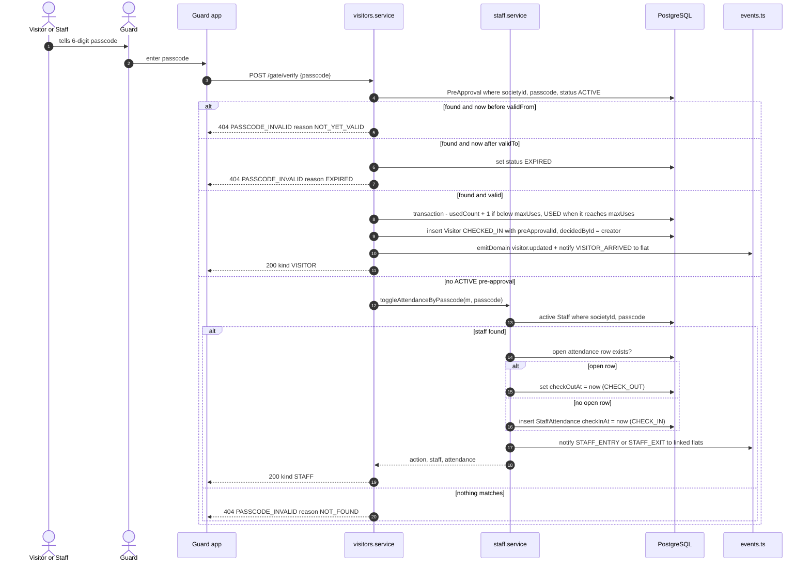

### 9.4 SOS raise → guard acknowledges

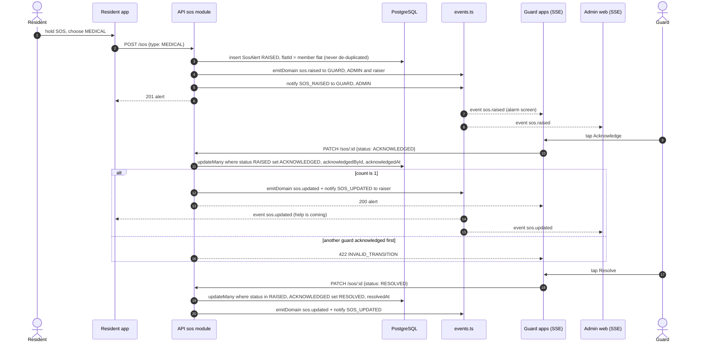

### 9.5 Amenity booking

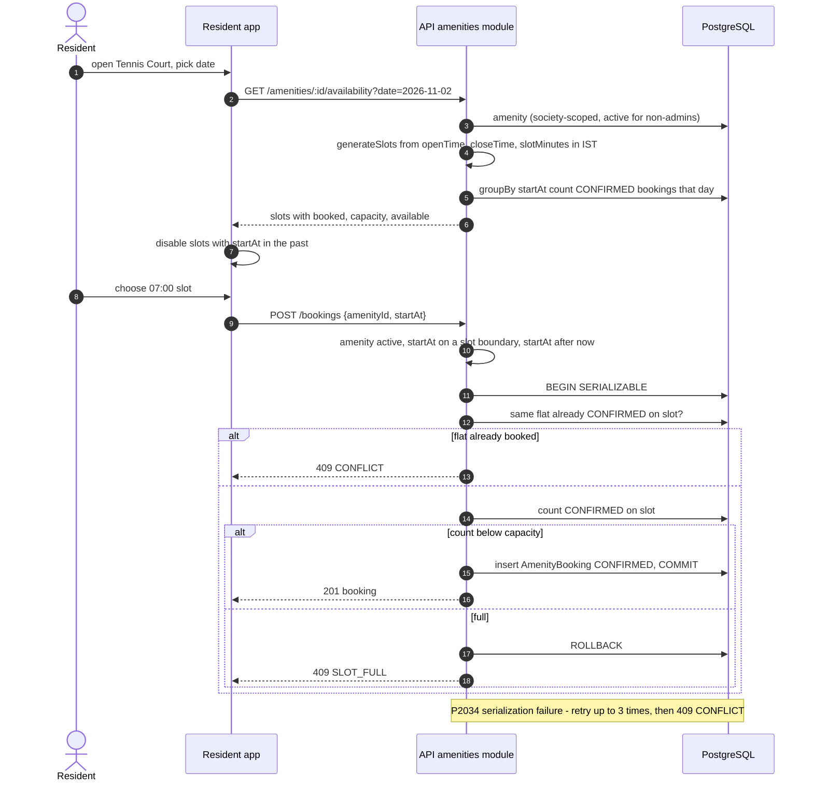

### 9.6 Invoice payment (mock gateway)

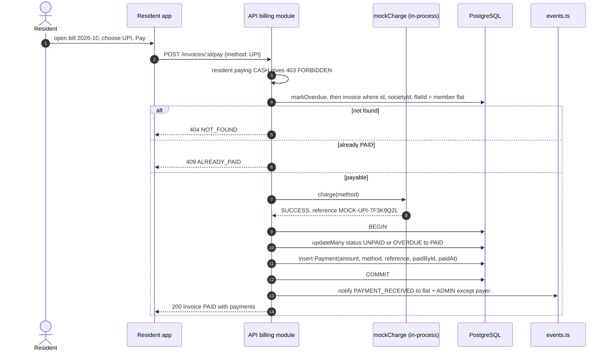

---

## 10. Database constraints and indexes

The authoritative list is `03-DATA-DICTIONARY.md` (index table). The design above depends on these in particular:

| Constraint / index | Relied on by |
|---|---|
| `Membership @@unique([userId, societyId])` | tenancy lookup (§6.2), 409 on add member |
| `Invoice @@unique([flatId, period])` | idempotent generation (§6.6) |
| `PollVote @@unique([pollId, membershipId])` | `ALREADY_VOTED` |
| `Staff @@unique([societyId, passcode])`, `PreApproval (societyId, passcode)` index | gate verify (§7.5), passcode generation (§6.3) |
| `StaffFlat @@unique([staffId, flatId])` | idempotent link |
| `Visitor (societyId, status)`, `(societyId, createdAt)`, `(flatId, createdAt)` | gate lists, sweeper, KPIs |
| `AmenityBooking (amenityId, startAt)` | availability and capacity count (§6.5) |
| `Notification (userId, readAt)`, `(userId, createdAt)` | inbox, `unreadCount` |

---

## 11. Testing (API)

- `tests/setup.ts` resets a dedicated test DB once; each test file seeds what it needs through the API (OTP login with
  `devCode` → create society → add members), so tests exercise the real middleware chain.
- Minimum suites: auth (attempt cap incl. parallel wrong guesses, expiry, `NAME_REQUIRED` keeps code valid), tenancy
  (cross-society id → 404, missing header → 400, inactive member → 403), visitors (full walk-in path, LEAVE_AT_GATE on
  GUEST → 422, expiry via backdated `createdAt`, two residents deciding concurrently → one wins), gate (pre-approval
  `maxUses`, NOT_YET_VALID / EXPIRED reasons, staff toggle), amenities (capacity under `Promise.all` of N bookings),
  billing (generate twice → idempotent, double pay → one Payment, resident CASH → 403), sos (transitions, raiser
  receives `sos.updated`).
- `generateSlots`, `currentPeriod`, `istDayRange` get plain unit tests.

---

## 12. Frontend LLD — `apps/web`

### 12.1 Structure

```
apps/web/
  index.html  vite.config.ts  tailwind.config.ts  nginx.conf  Dockerfile
  src/
    main.tsx                 # QueryClientProvider, AuthProvider, RouterProvider
    router.tsx               # route table below
    lib/
      api.ts                 # fetch wrapper + ApiError
      auth.tsx               # AuthContext (token, user, memberships, current membership)
      sse.ts                 # useEventStream()
      queryKeys.ts           # key factory
      format.ts              # paise to rupees, IST date formatting
      types.ts               # hand-written API types mirroring 08 §3 (ADR-005)
    components/              # Button, Card, StatusChip, DataTable, Modal, EmptyState, AppShell, Sidebar
    pages/
      marketing/             # Home, Features, Pricing, About, Contact, Login
      app/
        SelectSociety.tsx  Onboarding.tsx  Notifications.tsx  Profile.tsx
        admin/  resident/  guard/
```

### 12.2 Route map

| Path | Access | Page |
|---|---|---|
| `/` | public | Marketing home |
| `/features`, `/pricing`, `/about`, `/contact` | public | Marketing pages |
| `/login` | public | Phone → OTP (shows `devCode` hint when returned) |
| `/app` | auth | Redirect: no memberships → `/app/onboarding`; several and none selected → `/app/select-society`; else role home |
| `/app/select-society` | auth | Membership picker |
| `/app/onboarding` | auth | Create society (`POST /societies`) or "ask your admin to add you" |
| `/app/notifications`, `/app/profile` | auth + member | Shared |
| `/app/admin` | ADMIN | Dashboard (`/reports/summary`) |
| `/app/admin/society` | ADMIN | Blocks and flats |
| `/app/admin/members` | ADMIN | Members |
| `/app/admin/visitors` | ADMIN | Visitor log |
| `/app/admin/staff` | ADMIN | Daily help + attendance |
| `/app/admin/notices`, `/app/admin/polls` | ADMIN | Community |
| `/app/admin/helpdesk`, `/app/admin/helpdesk/:id` | ADMIN | Tickets |
| `/app/admin/amenities`, `/app/admin/bookings` | ADMIN | Amenities |
| `/app/admin/billing`, `/app/admin/expenses` | ADMIN | Invoices (generate), expenses |
| `/app/admin/sos` | ADMIN | Emergency log |
| `/app/resident` | RESIDENT | Home: pending approvals, pinned notices, dues |
| `/app/resident/visitors`, `/app/resident/preapprovals` | RESIDENT | Visitor history, invites |
| `/app/resident/staff` | RESIDENT | My daily help + attendance |
| `/app/resident/notices`, `/app/resident/polls` | RESIDENT | Community |
| `/app/resident/helpdesk`, `/app/resident/helpdesk/:id` | RESIDENT | Tickets |
| `/app/resident/amenities`, `/app/resident/bookings` | RESIDENT | Book slots |
| `/app/resident/bills` | RESIDENT | Invoices + mock pay |
| `/app/resident/sos` | RESIDENT | SOS button + history |
| `/app/guard` | GUARD | Gate console: passcode box + "New walk-in" |
| `/app/guard/visitors` | GUARD | Pending / inside / parcels at gate |
| `/app/guard/staff` | GUARD | Staff inside today |
| `/app/guard/sos` | GUARD | Active alerts |

Guards: `<RequireAuth>` (token present, else `/login`), `<RequireMembership>` (else `/app/select-society`),
`<RequireRole role>` (else redirect to own role home). Unknown `/app/*` → role home.

### 12.3 API client (`lib/api.ts`)

```ts
const BASE = import.meta.env.VITE_API_URL;               // e.g. http://localhost:4000/api/v1

export class ApiError extends Error {
  constructor(public status: number, public code: string, message: string, public details?: unknown) { super(message); }
}

export async function api<T>(path: string, init: { method?: string; body?: unknown; query?: Record<string, string | number | undefined> } = {}): Promise<T> {
  const { token, membership } = readSession();          // from localStorage
  const params = Object.entries(init.query ?? {}).filter(([, v]) => v !== undefined).map(([k, v]) => [k, String(v)]);
  const qs = params.length ? '?' + new URLSearchParams(params) : '';
  const res = await fetch(BASE + path + qs, {
    method: init.method ?? 'GET',
    headers: {
      ...(init.body !== undefined && { 'Content-Type': 'application/json' }),
      ...(token && { Authorization: `Bearer ${token}` }),
      ...(membership && { 'X-Society-Id': membership.society.id }),
    },
    body: init.body !== undefined ? JSON.stringify(init.body) : undefined,
  });
  if (res.status === 204) return undefined as T;
  const json = await res.json().catch(() => ({}));
  if (!res.ok) {
    if (res.status === 401) clearSession();              // AuthContext listens and routes to /login
    throw new ApiError(res.status, json.error?.code ?? 'UNKNOWN', json.error?.message ?? res.statusText, json.error?.details);
  }
  return json as T;
}
```

### 12.4 Auth context (`lib/auth.tsx`)

- localStorage keys: `gk.token`, `gk.membershipId` (reads/writes wrapped in try/catch).
- State: `{ token, user, memberships, membership }`; `membership = memberships.find(m => m.id === membershipId)`.
- `login(bundle)` stores the token and auto-selects when exactly one membership; `selectMembership(id)`; `logout()`
  clears storage and `queryClient.clear()`.
- On boot with a token: `GET /me` refreshes `user` + `memberships` (drops a stale `membershipId`).
- Switching society calls `queryClient.clear()` so no cross-tenant cache bleeds, and reopens the SSE stream.

### 12.5 TanStack Query keys (`lib/queryKeys.ts`)

All society data keys start with `[resource, societyId]`, so invalidating `[resource, sid]` hits every filter variant.

| Key | Endpoint |
|---|---|
| `['me']` | `GET /me` |
| `['society', sid]`, `['blocks', sid]`, `['flats', sid, { blockId }]` | society module |
| `['members', sid, filters]` | `GET /members` |
| `['visitors', sid, filters]` | `GET /visitors` |
| `['preapprovals', sid, filters]` | `GET /preapprovals` |
| `['staff', sid, filters]`, `['staff', sid, id, 'attendance', date]` | staff |
| `['notices', sid]`, `['polls', sid]` | community |
| `['tickets', sid, filters]`, `['tickets', sid, id]` | helpdesk |
| `['amenities', sid]`, `['availability', sid, amenityId, date]`, `['bookings', sid, filters]` | amenities |
| `['invoices', sid, filters]`, `['expenses', sid, filters]`, `['summary', sid]` | billing |
| `['sos', sid, filters]` | sos |
| `['notifications']` | notifications (user-wide) |

Mutations invalidate their resource key on success (e.g. pay → `['invoices', sid]` and `['summary', sid]`).

### 12.6 SSE hook (`lib/sse.ts`)

```ts
const INVALIDATE: Record<string, string[]> = {
  'visitor.requested': ['visitors', 'summary'], 'visitor.updated': ['visitors', 'summary'],
  'sos.raised': ['sos', 'summary'], 'sos.updated': ['sos', 'summary'],
  'notice.created': ['notices'],
};

export function useEventStream(onEvent?: (name: string, data: unknown) => void) {
  const { token, membership } = useAuth();
  const qc = useQueryClient();
  const sid = membership?.society.id;
  useEffect(() => {
    if (!token || !sid) return;
    const es = new EventSource(`${BASE}/events?token=${encodeURIComponent(token)}&societyId=${sid}`);
    es.onopen = () => qc.invalidateQueries();                          // (re)connected: no replay, so refetch
    for (const name of Object.keys(INVALIDATE)) es.addEventListener(name, e => {
      INVALIDATE[name].forEach(k => qc.invalidateQueries({ queryKey: [k, sid] }));
      onEvent?.(name, JSON.parse((e as MessageEvent).data));
    });
    es.addEventListener('notification', () => qc.invalidateQueries({ queryKey: ['notifications'] }));
    return () => es.close();                                            // EventSource auto-reconnects by itself
  }, [token, sid]);
}
```

Mounted once in `AppShell`. `onEvent` drives the resident approval sheet on `visitor.requested` and the guard/admin
full-screen alarm on `sos.raised`.

---

## 13. Frontend LLD — `apps/mobile` (Expo)

### 13.1 expo-router file tree

```
apps/mobile/
  app.json                      # scheme "gatekeeper"
  app/
    _layout.tsx                 # QueryClientProvider + AuthProvider + <Slot/>; redirects by auth state
    index.tsx                   # route by role: (resident) or (guard); ADMIN -> "use the web app" screen
    notifications.tsx
    profile.tsx
    (auth)/
      _layout.tsx               # Stack
      login.tsx                 # phone
      verify.tsx                # OTP (+ name on first login)
      select-society.tsx
    (resident)/
      _layout.tsx               # Tabs: Home, Visitors, Bills, Helpdesk, More
      index.tsx                 # pending approvals (approve / deny / leave at gate), pinned notices, dues
      visitors.tsx
      preapprovals/index.tsx
      preapprovals/new.tsx      # creates invite, shows passcode + Share sheet
      bills.tsx                 # invoices + mock pay
      helpdesk/index.tsx
      helpdesk/[id].tsx
      amenities/index.tsx
      amenities/[id].tsx        # availability by date + book
      staff.tsx
      notices.tsx
      polls.tsx
      sos.tsx                   # large SOS button + type picker
      more.tsx
    (guard)/
      _layout.tsx               # Tabs: Gate, Visitors, Staff, SOS
      index.tsx                 # passcode keypad -> POST /gate/verify
      new-visitor.tsx           # walk-in form with flat picker
      visitors.tsx              # pending / inside / parcels; check-in, check-out, collect
      staff.tsx
      sos.tsx                   # active alerts, acknowledge / resolve
  src/
    lib/api.ts                  # same contract as web; base from EXPO_PUBLIC_API_URL
    lib/auth.tsx                # same shape as web; storage = expo-secure-store
    lib/storage.ts              # getItemAsync / setItemAsync / deleteItemAsync wrappers
    lib/sse.ts                  # streamed-fetch SSE reader
    lib/queryKeys.ts            # identical to web
    lib/types.ts
    components/
```

Admins use the web app (brief §1: mobile is Resident + Guard); an ADMIN-only login sees a short "open the web app"
screen.

### 13.2 Secure storage and config

- Token and selected membership id in `expo-secure-store` (`gk_token`, `gk_membership`) — Keychain / Keystore backed;
  never `AsyncStorage`.
- `EXPO_PUBLIC_API_URL`, e.g. `http://192.168.1.20:4000/api/v1` on a LAN device, `http://10.0.2.2:4000/api/v1` on the
  Android emulator. Read once in `lib/api.ts`; the app shows a visible config error if it is missing.
- CORS does not apply to native `fetch`, so no API config change is needed for mobile.

### 13.3 Realtime on mobile

React Native has no `EventSource`. `lib/sse.ts` uses `fetch` from `expo/fetch` (streaming response bodies) against the
same `GET /events?token&societyId` endpoint, splits the stream on blank lines, parses `event:` / `data:` fields
(ignoring `:` comment lines), and dispatches to the same `INVALIDATE` map as web. Reconnect with backoff (1 s → 30 s)
and invalidate all society queries after each (re)connect. The stream is closed when the app goes to background
(`AppState`) and reopened on foreground; TanStack Query's `focusManager` is wired to `AppState` so lists refetch on
foreground too.

Skipped in v1: background push (`expo-notifications`). Add it before relying on mobile for SOS alerts to guards — SSE
cannot wake a backgrounded app.
