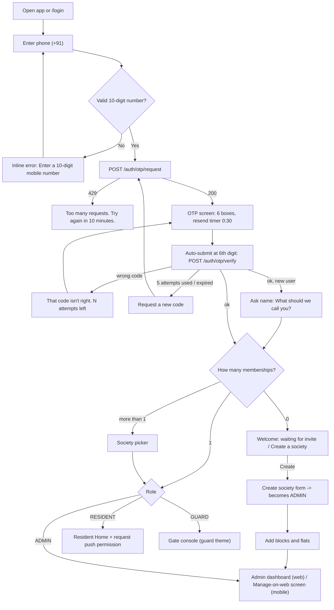
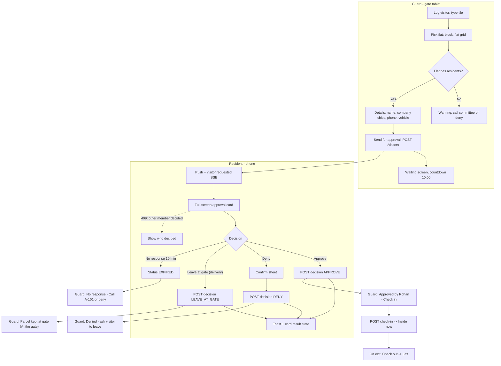
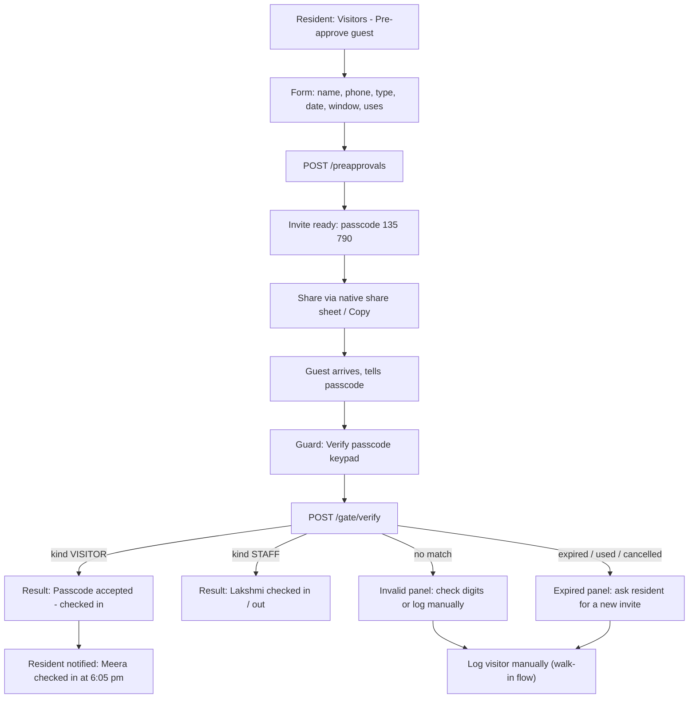
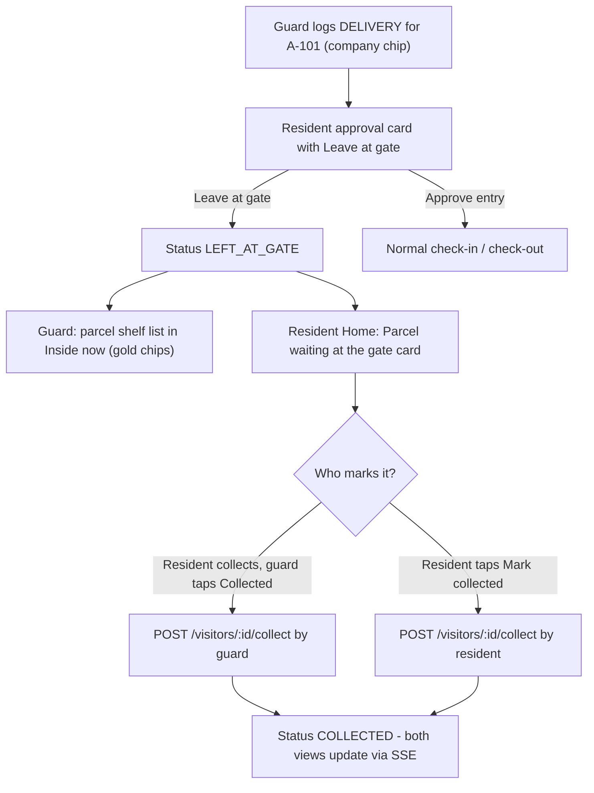
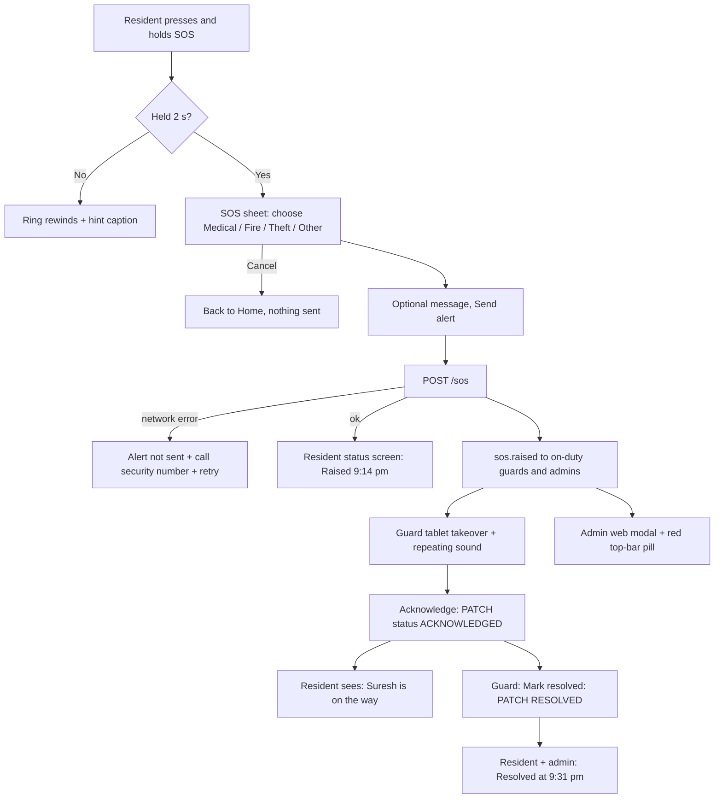
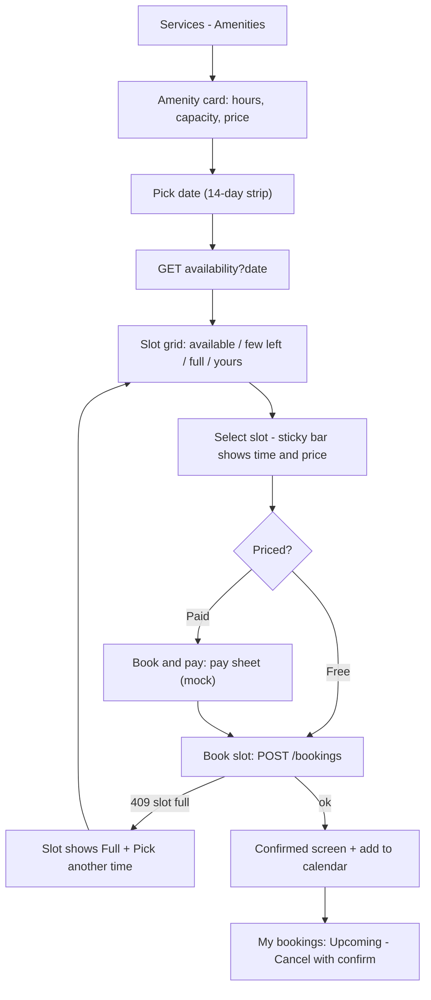
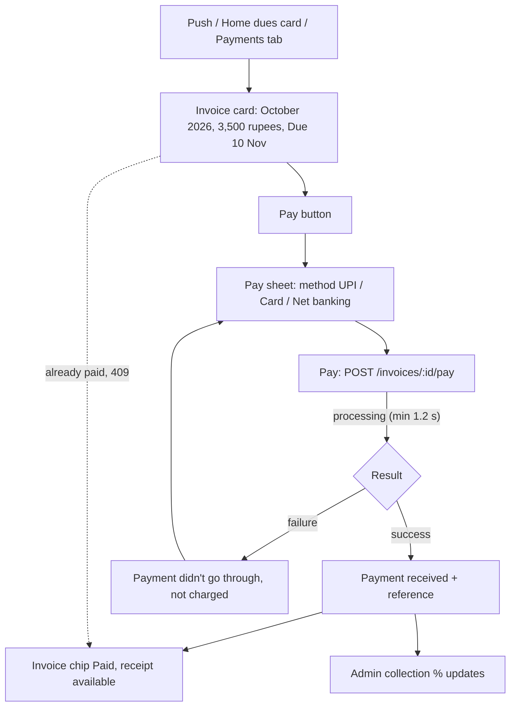
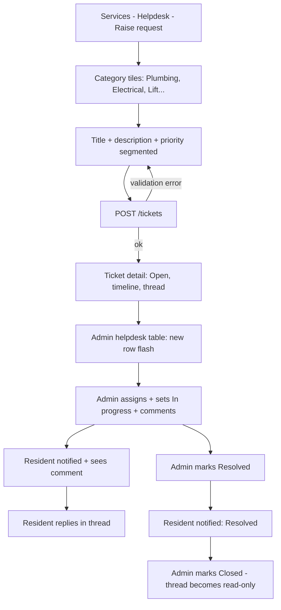

# Gatekeeper — UI/UX Design System

> Conforms to `00-PROJECT-BRIEF.md` §8 (brand, locked). Where WCAG AA and a locked hex collide, AA wins and the
> reconciliation is called out explicitly (see §2.1.4). Audience: the web developer (`apps/web`, Vite + React 18 +
> Tailwind 3 + lucide-react) and the mobile developer (`apps/mobile`, Expo + expo-router). Everything needed to build
> consistent UI is in this file; if something is missing, extend this doc before inventing locally.

**Contents**
1. [Brand foundations](#1-brand-foundations)
2. [Design tokens](#2-design-tokens)
3. [Ready-to-paste code](#3-ready-to-paste-code)
4. [Component library](#4-component-library)
5. [Information architecture & navigation](#5-information-architecture--navigation)
6. [Screen inventory & wireframes](#6-screen-inventory--wireframes)
7. [Key user flows](#7-key-user-flows)
8. [Accessibility, responsive, dark mode, data formatting](#8-accessibility-responsive-dark-mode-data-formatting)

---

## 1. Brand foundations

### 1.1 Concept: "The Gatehouse"

Gatekeeper should feel like walking into the lobby of a well-run private bank: quiet, ordered, attentive, unhurried.
Nothing shouts. Security is communicated through **composure** — precise times, exact names, a clear record of who came
and who left — not through red badges, alarm iconography or bright gradients.

**The one memorable thing: the Threshold.** A single gold hairline with a small keyhole notch at its centre. It is the
brand's signature device and it appears in exactly these places:

| Where | How |
|---|---|
| Visitor approval card (hero component) | Top edge of the card; on Approve it "opens" (the two halves part 8px from the notch) |
| Marketing section dividers | Full-width hairline between major sections, notch centred |
| Login card | Above the OTP boxes |
| Logo mark | Inner hairline of the shield |
| Printed/exported invoice header | Under the society name |

Everything around the Threshold stays disciplined: navy, paper, one emerald action colour, generous whitespace, few
borders. Do not add the Threshold anywhere else; scarcity is what makes it read as premium.

**Distinctness rules** (how Gatekeeper must never look):
- No saturated full-bleed brand-colour app headers on mobile. Resident app headers are **paper** with navy text.
- No playful illustrations of cartoon people, no confetti, no emoji in UI copy.
- No purple, no teal-on-white gradients, no orange accents. Emerald is the only "go" colour; gold is the only ornament.
- Navigation icons are outline (lucide, 1.75 stroke), never filled blobs.

### 1.2 Personality

| We are | We are not |
|---|---|
| Calm | Alarmist (even SOS is firm, not frantic) |
| Precise (exact times, flat numbers, names) | Vague ("Someone is at the gate") |
| Reassuring | Chatty, cute, salesy |
| Discreet (mask phone numbers, minimal personal data on shared screens) | Surveillance-flavoured |
| Courteous to guards and staff | Treating staff as second-class users |

### 1.3 Voice & tone

**Rules**
- Sentence case everywhere (buttons, titles, tabs, menu items). Never all caps — not even for small labels.
- Lead with the fact, then the action: who, where, when, what to do.
- Use the person's name and the flat label: "Ravi (Swiggy) is at the gate for A-101."
- Active voice, plain verbs. A button says exactly what happens: "Approve entry", not "Submit".
- An action keeps its name through the flow: button "Approve entry" → toast "Entry approved" → log "Approved by Rohan".
- Errors explain what happened and how to fix it. No "Oops", no "Something went wrong" without a next step, no apologies.
- Numbers are digits ("3 visitors"), times are exact ("5:42 pm"), money is exact ("₹3,500").
- No exclamation marks. Urgency comes from clarity and placement, not punctuation.

**Microcopy library** — use these strings verbatim; add new ones in the same register.

| Moment | Copy |
|---|---|
| Approval push (title / body) | **Ravi is at the gate** / Delivery from Swiggy for A-101. Tap to respond. |
| Approval card helper | Respond within 10 minutes. After that the request expires and the guard will call you. |
| Approved (toast) | Entry approved. Suresh at Main Gate has been told. |
| Denied — confirm sheet | Deny entry to Ravi? The guard will ask them to leave. |
| Denied (toast) | Entry denied. Suresh at Main Gate has been told. |
| Leave at gate (toast) | The guard will keep the parcel at the gate. We'll remind you to collect it. |
| Expired (resident) | This request expired at 5:52 pm. The visitor was not let in. |
| Guard — waiting | Waiting for A-101 to respond… Rohan Mehta and 1 other have been notified. |
| Guard — approved | Approved by Rohan Mehta (A-101). Let them in, then tap Check in. |
| Guard — denied | Denied by A-101. Please ask the visitor to leave politely. |
| Guard — expired | No response from A-101 in 10 minutes. Call the flat or deny entry. |
| Passcode valid | Passcode accepted. Meera Shah, guest of B-201. Checked in at 6:05 pm. |
| Passcode invalid | That passcode doesn't match any active invite. Check the digits or log the visitor manually. |
| Passcode expired | This passcode expired on 28 Oct. Ask the resident to send a new invite. |
| Staff check-in | Lakshmi (maid) checked in at 7:58 am. |
| SOS hold hint | Press and hold for 2 seconds to alert security. |
| SOS confirm | Send a medical alert to security now? Guards on duty and the committee will be alerted with your flat number. |
| SOS sent | Alert sent at 9:14 pm. Security has been notified. Stay where you are if it is safe. |
| SOS acknowledged | Suresh (security) is on the way. Acknowledged at 9:15 pm. |
| SOS resolved | Marked resolved at 9:31 pm by Suresh. |
| Guard SOS takeover | **Medical emergency — A-101** / Raised by Rohan Mehta at 9:14 pm. Acknowledge to let them know you're on the way. |
| Empty — visitors today | No visitors yet today. Expecting someone? Pre-approve them for a faster entry. |
| Empty — inside now (guard) | Nobody is inside right now. Checked-in visitors will appear here. |
| Empty — tickets | No open requests. If something in the society needs attention, raise a request. |
| Empty — notices | No notices yet. Notices from the committee will appear here. |
| Empty — invoices | You're all paid up. New maintenance bills appear here on the 1st. |
| Empty — search | No results for "A-404". Check the flat number or clear filters. |
| Error — offline | You're offline. Showing the last saved list from 5:40 pm. |
| Error — network on action | Couldn't reach Gatekeeper. Your response was not sent. Try again. |
| Error — 403 | You don't have access to this in Emerald Heights. Ask the society admin if you need it. |
| Error — 409 booking | That slot just filled up. Pick another time. |
| Error — 422 business rule | Use the message from the API `error.message`; it is written for humans. |
| Error — OTP wrong | That code isn't right. 3 attempts left. |
| Error — OTP locked | Too many attempts. Request a new code in 4:59. |
| Payment success | Payment received. ₹3,500 for October 2026. Receipt GK-7F3K2. |
| Payment failed | The payment didn't go through. You haven't been charged. Try again or choose another method. |
| Destructive confirm | Remove Lakshmi from A-101? She will no longer be able to enter using her passcode for this flat. |

### 1.4 Logo

**Concept.** A heraldic shield (navy) containing a fine inset gold hairline. Inside sits a monogram **G** drawn as an
open circle whose crossbar points to a **keyhole** at the shield's centre. Reading: the gate (G) guards the home
(keyhole), within a shield (security). Geometry on a 48 × 48 grid:

| Element | Geometry |
|---|---|
| Shield | Apex (24,3); shoulders (7,9) and (41,9); straight sides down to y=22; sides curve to the point (24,45). Fill navy-900. |
| Inner hairline | Same shape inset ~2.8 units (apex 24,6.2), 0.75 stroke, gold-500. Omitted below 24px. |
| G | Circle centre (24,23), r 9, stroke 3, round caps, paper. Arc from 320° (upper-right) counter-clockwise to 0°; crossbar from (33,23) left to (28.6,23). |
| Keyhole | Circle centre (24,21.8) r 2.2, plus trapezoid slot down to y 27.6 (top 2.2 wide, bottom 3.4 wide). Fill gold-500. |

**Logo mark — SVG (colour, on light or dark)**

```svg
<svg xmlns="http://www.w3.org/2000/svg" viewBox="0 0 48 48" width="48" height="48" role="img" aria-labelledby="gk-mark-t">
  <title id="gk-mark-t">Gatekeeper</title>
  <!-- Shield -->
  <path d="M24 3 41 9v13c0 11-7.5 19.5-17 23C14.5 41.5 7 33 7 22V9Z" fill="#0B1B3F"/>
  <!-- Inner gold hairline (drop below 24px) -->
  <path d="M24 6.2 38.2 11.2V22c0 9.4-6.1 16.6-14.2 19.8C15.9 38.6 9.8 31.4 9.8 22V11.2Z"
        fill="none" stroke="#C8A04A" stroke-width=".75"/>
  <!-- G: open arc + crossbar -->
  <path d="M30.9 17.2A9 9 0 1 0 33 23h-4.4" fill="none" stroke="#FBFAF7" stroke-width="3"
        stroke-linecap="round" stroke-linejoin="round"/>
  <!-- Keyhole -->
  <path d="M22.9 23.7A2.2 2.2 0 1 1 25.1 23.7L25.7 27.6H22.3Z" fill="#C8A04A"/>
</svg>
```

**Wordmark lockup — SVG (horizontal, light background)**

```svg
<svg xmlns="http://www.w3.org/2000/svg" viewBox="0 0 220 48" width="220" height="48" role="img" aria-labelledby="gk-lock-t">
  <title id="gk-lock-t">Gatekeeper</title>
  <g>
    <path d="M24 3 41 9v13c0 11-7.5 19.5-17 23C14.5 41.5 7 33 7 22V9Z" fill="#0B1B3F"/>
    <path d="M24 6.2 38.2 11.2V22c0 9.4-6.1 16.6-14.2 19.8C15.9 38.6 9.8 31.4 9.8 22V11.2Z"
          fill="none" stroke="#C8A04A" stroke-width=".75"/>
    <path d="M30.9 17.2A9 9 0 1 0 33 23h-4.4" fill="none" stroke="#FBFAF7" stroke-width="3"
          stroke-linecap="round" stroke-linejoin="round"/>
    <path d="M22.9 23.7A2.2 2.2 0 1 1 25.1 23.7L25.7 27.6H22.3Z" fill="#C8A04A"/>
  </g>
  <text x="58" y="32.5" fill="#0B1B3F" font-family="Fraunces, Georgia, 'Times New Roman', serif"
        font-size="26" font-weight="600" letter-spacing="-0.3">Gatekeeper</text>
</svg>
```

Lockup rules
- **Reversed** (on navy-900/950): wordmark `fill="#FBFAF7"`; the mark is unchanged (navy shield sits on navy with the
  gold hairline defining it — this is intentional and is the hero treatment). On navy-950 you may add a 1px
  `#13285A` stroke to the outer shield path for separation.
- **Mono** (fax, stamp, single-colour print): shield `currentColor`, G and keyhole knocked out (`fill="#fff"`), hairline omitted.
- Clear space = height of the keyhole circle × 4 (≈ 9 units at 48px) on all sides. Minimum mark size 20px (hairline
  dropped below 24px); minimum lockup width 120px.
- For production, convert the `<text>` in the lockup to outlines (Fraunces 600, opsz 48) so it does not depend on the
  webfont. In React, keep the mark as a component `<LogoMark size={32} />` and render the wordmark as live text
  (`font-display font-semibold tracking-tight`) next to it.
- Never: stretch, rotate, recolour the shield emerald, add drop shadows, place on photos without a navy scrim.

### 1.5 App icon

- **Canvas** 1024 × 1024, background navy-950 `#060E22` with a soft radial lift to navy-900 `#0B1B3F` centred at
  (50%, 38%), radius 70%. No gloss, no gradient banding (dither or use 16-bit export).
- **Mark** centred, shield height = 62% of canvas, optically nudged up 2%. Inner gold hairline at 6px (scaled), so it
  survives at 60px home-screen size.
- **Android adaptive icon:** background layer = the navy radial; foreground = mark sized to fit the 66dp safe zone
  (shield height 58% of the 108dp layer). Monochrome layer (Android 13 themed icons) = mono mark.
- **iOS:** supply the 1024 PNG with no transparency; let the system mask.
- **Splash (Expo `splash`):** `backgroundColor: "#060E22"`, mark at 120pt, no wordmark, no tagline.
- **Favicon:** 32px and 16px simplified mark (no hairline); `apple-touch-icon` 180px from the app icon; PWA
  `theme_color` `#0B1B3F`, `background_color` `#FBFAF7`.

---

## 2. Design tokens

All tokens have one name used in Figma, Tailwind, CSS variables and `theme.ts`. Web components use **semantic**
tokens (`bg-surface`, `text-fg-muted`) so dark mode is automatic; raw ramps (`navy-900`) are used for brand moments
(marketing hero, sidebar) that do not change by theme.

### 2.1 Colour

#### 2.1.1 Brand ramps

Values marked **(brief)** are locked by `00-PROJECT-BRIEF.md`. The rest are derived steps so developers never
hand-mix tints.

| Step | Navy | Emerald | Gold |
|---|---|---|---|
| 50 | `#EEF2FA` | `#E8F7F1` **(brief)** | `#FBF7EC` |
| 100 | `#D9E1F2` | `#C9EDDF` | `#F6EDD6` **(brief)** |
| 200 | `#B3C2E3` | `#9BDDC5` | `#EBD9A8` |
| 300 | `#8099CC` | `#62C7A6` | `#DEC17A` |
| 400 | `#4F6FB0` | `#2FB38C` | `#D3AD5D` |
| 500 | `#2E5094` | `#12A37E` **(brief)** | `#C8A04A` **(brief)** |
| 600 | `#244485` | `#0E8A6A` **(brief)** | `#A9832F` |
| 650 | — | `#0C7F62` (CTA fill, see 2.1.4) | — |
| 700 | `#1D3B7A` **(brief)** | `#0B6F56` | `#846524` |
| 800 | `#13285A` **(brief)** | `#095845` | `#5F481A` |
| 900 | `#0B1B3F` **(brief)** | `#074536` | `#3F3012` |
| 950 | `#060E22` **(brief)** | `#03271E` | — |

#### 2.1.2 Neutral ramp ("slate") + fixed neutrals

| Token | Hex | Typical use |
|---|---|---|
| `slate-25` | `#FCFCFD` | Table zebra (light) |
| `slate-50` | `#F9FAFB` | Hover row, input disabled fill |
| `slate-100` | `#F2F4F7` **(brief)** | App background tint, neutral chip bg |
| `slate-200` | `#EAECF0` | Dividers inside cards, skeleton base |
| `slate-300` | `#D0D5DD` **(brief)** | Card & decorative borders |
| `slate-400` | `#98A2B3` | Placeholder icons, disabled text (not for meaningful text) |
| `slate-450` | `#7A8599` | **Form-control borders** (3.72:1 on white — meets 1.4.11) |
| `slate-500` | `#667085` | Tertiary text, captions (4.97:1 on white) |
| `slate-600` | `#475467` **(brief)** | Secondary text |
| `slate-700` | `#344054` | Strong secondary text, neutral chip text |
| `slate-800` | `#1D2939` | — |
| `slate-900` | `#101828` | — |
| `ink-900` | `#111827` **(brief)** | Body text |
| `paper` | `#FBFAF7` **(brief)** | Page background (warm off-white) |
| `white` | `#FFFFFF` | Card / surface |

#### 2.1.3 Semantic status ramps

| Step | Success (= emerald) | Warning | Danger | Info (= navy-blue) |
|---|---|---|---|---|
| 50 (tint bg) | `#E8F7F1` | `#FDF6E0` | `#FDEDED` | `#EDF3FD` |
| 100 | `#C9EDDF` | `#FAE9B3` | `#FAD4D4` | `#D6E4FA` |
| 500 (dot / icon / fill) | `#12A37E` | `#E0A100` **(brief)** | `#E25C5C` | `#3B73D9` |
| 600 | `#0E8A6A` | `#B98500` | `#D14343` **(brief)** | `#2B5FC0` |
| 700 (text on white) | `#0B6F56` | `#8F6600` | `#B03232` | `#224C9A` |
| 800 (text on tint) | `#095845` | `#6B4D00` | `#8C2828` | `#1A3B78` |

#### 2.1.4 Contrast reconciliation (read this)

Measured WCAG 2.1 ratios (sRGB relative luminance):

| Pair | Ratio | Verdict / rule |
|---|---|---|
| white on emerald-600 `#0E8A6A` | **4.32** | Fails AA for normal text. **Do not put button labels on emerald-600.** |
| white on emerald-650 `#0C7F62` | 4.97 | Passes. **Primary button fill = emerald-650.** Visually indistinguishable from 600 at a glance. |
| white on emerald-700 `#0B6F56` | 6.14 | Passes. Primary button **hover/pressed** goes *darker* to 700 (the brief's "emerald-500 hover-light" would drop to 3.2:1, so emerald-500 is used for the focus ring and glows only). |
| emerald-600 on white | 4.32 | Not for body-size text. Text links use **emerald-700** (6.14). Emerald-600 stays for icons, dots, large display numerals (≥24px), and non-text fills. |
| emerald-500 on white | 3.20 | Non-text only (focus ring ≥ 3:1 ✓). |
| warning-500 on white | 2.27 | Never text. Use warning-700 `#8F6600` (5.16) for text; warning-500 for dots/fills with **ink** text on top (7.83). |
| gold-500 on white | 2.45 | As per brief: gold never as text on light. Gold-800 `#5F481A` on gold-100 = 7.41 for gold chips. |
| gold-500 on navy-900 / 950 | 6.91 / 7.85 | Gold text/icons allowed on navy. |
| danger-600 on white / white on danger-600 | 4.57 | Passes (narrowly). Danger text prefers danger-700 (6.27). |
| slate-300 border on white | 1.47 | Decorative borders only (cards, dividers). Inputs use slate-450 (3.72). |

> Brief impact: emerald-600 remains *the* brand emerald everywhere (logo-adjacent accents, icons, success dots,
> charts). Only the fill behind white button text is nudged to `#0C7F62`. Propose adding `emerald-650` to brief §8.

#### 2.1.5 Semantic tokens — light & dark

| Semantic token | Light | Dark | Purpose |
|---|---|---|---|
| `canvas` | `#FBFAF7` paper | `#060E22` navy-950 | Page background |
| `canvas-tint` | `#F2F4F7` slate-100 | `#040A19` | App shell behind cards (admin) |
| `surface` | `#FFFFFF` | `#0C1730` | Cards, sheets, inputs |
| `surface-raised` | `#FFFFFF` (+shadow-md) | `#12203F` | Popovers, modals, menus |
| `surface-sunken` | `#F9FAFB` | `#081227` | Table header, input disabled, code |
| `line` | `#EAECF0` slate-200 | `#22335A` | Dividers, card borders |
| `line-strong` | `#7A8599` slate-450 | `#6A7BA3` | Control borders (≥3:1) |
| `fg` | `#111827` ink-900 | `#EEF1F7` | Primary text |
| `fg-muted` | `#475467` slate-600 | `#A9B4CB` | Secondary text |
| `fg-subtle` | `#667085` slate-500 | `#7D89A3` | Captions, timestamps |
| `fg-heading` | `#0B1B3F` navy-900 | `#FFFFFF` | Headings |
| `fg-on-brand` | `#FFFFFF` | `#FFFFFF` | Text on CTA/navy/danger fills |
| `brand` | `#0C7F62` emerald-650 | `#0C7F62` | Primary CTA fill |
| `brand-hover` | `#0B6F56` emerald-700 | `#0B6F56` | CTA hover/pressed |
| `brand-fg` | `#0B6F56` emerald-700 | `#3CC79D` | Links, emerald text |
| `navy` | `#0B1B3F` | `#13285A` | Secondary button fill, sidebar |
| `navy-hover` | `#1D3B7A` | `#1D3B7A` | Secondary hover |
| `focus` | `#12A37E` emerald-500 | `#3CC79D` | Focus ring |
| `accent-gold` | `#C8A04A` | `#D9B967` | Hairlines, premium badges (on navy/dark only for text) |
| `success-bg / -fg / -dot` | `#E8F7F1 / #095845 / #0E8A6A` | `#0F2E2A / #3CC79D / #3CC79D` | Success chip |
| `warning-bg / -fg / -dot` | `#FDF6E0 / #6B4D00 / #E0A100` | `#2E2610 / #F2C14E / #F2C14E` | Warning chip |
| `danger-bg / -fg / -dot` | `#FDEDED / #8C2828 / #D14343` | `#351A22 / #F07A7A / #F07A7A` | Danger chip |
| `info-bg / -fg / -dot` | `#EEF2FA / #13285A / #1D3B7A` | `#142650 / #8DB0F0 / #8DB0F0` | Info chip |
| `neutral-bg / -fg / -dot` | `#F2F4F7 / #344054 / #98A2B3` | `#1A2747 / #A9B4CB / #7D89A3` | Neutral chip |
| `gold-bg / -fg / -dot` | `#F6EDD6 / #5F481A / #C8A04A` | `#2C2615 / #D9B967 / #D9B967` | Gold chip |
| `danger` | `#D14343` | `#D14343` | Danger button fill (white text 4.57) |
| `danger-fg` | `#B03232` | `#F07A7A` | Danger text |
| `overlay` | `rgba(6,14,34,.48)` | `rgba(0,0,0,.64)` | Modal scrim |

#### 2.1.6 Key text-pair contrast (verified)

| Pair | Light | Dark |
|---|---|---|
| `fg` on `canvas` | 17.0 : 1 (ink on paper) | 16.97 : 1 |
| `fg` on `surface` | 17.74 : 1 | 15.72 : 1 |
| `fg` on `canvas-tint` | 16.1 : 1 | — |
| `fg-muted` on `canvas` / `surface` | 7.36 / 7.69 | 9.21 / 8.53 |
| `fg-muted` on `canvas-tint` | 6.98 | — |
| `fg-subtle` on `surface` | 4.97 | 5.06 |
| `fg-heading` (navy-900) on paper | 16.19 | — |
| paper on navy-950 (marketing hero) | 18.4 | — |
| white on `brand` | 4.97 | 4.97 |
| white on `brand-hover` | 6.14 | 6.14 |
| white on navy-700 (secondary hover) | 10.72 | — |
| `brand-fg` link on paper | 5.88 | 9.0 (on navy-950) |
| gold-500 on navy-900 | 6.91 | 7.27 (on surface) |
| success chip fg on bg | 7.62 | 6.82 |
| warning chip fg on bg | 7.23 | 8.93 |
| danger chip fg on bg | 5.53 (700) / ≥7 (800) | 5.88 |
| info chip fg on bg | 12.66 | 6.75 |
| neutral chip fg on bg | 9.49 | 7.07 |
| gold chip fg on bg | 7.41 | 7.95 |
| `line-strong` on `surface` (non-text) | 3.72 | 4.21 |
| focus ring emerald-500 on white (non-text) | 3.20 | 6.0 |

#### 2.1.7 Colour usage rules
- One emerald primary action per view region. If two actions compete, one becomes secondary (navy) or outline.
- Navy is the "institution" colour: sidebar, headings, secondary buttons, marketing hero. Never use navy for status.
- Gold is ornament only: Threshold hairlines, the "Premium" pricing badge, icon accents on navy surfaces. Max one gold
  element per viewport on light surfaces (excluding the logo).
- Status is always **colour + icon + label** (never colour alone, see §4.7).
- Red (danger) is reserved for: Deny, destructive confirms, SOS, overdue amounts past 30 days, error text. Do not use
  red for "unread" counts — those use navy badges.

### 2.2 Typography

**Families**
- `display` — **Fraunces** (variable; axes `opsz` 9–144, `wght`, `SOFT`, `WONK`). Use `opsz` auto, `SOFT 50`,
  `WONK 0` for a calm, slightly softened serif. Weights 500–600 only.
- `sans` — **Manrope** (variable 200–800). Weights used: 400, 500, 600, 700. Never 800 (too loud).
- Numbers: always `font-variant-numeric: tabular-nums` for times, amounts, flat numbers, counts, passcodes, tables
  (Tailwind `tabular-nums`; RN `fontVariant: ['tabular-nums']`).
- No monospace face anywhere — passcodes use Manrope 600 tabular with wide tracking.

**Where Fraunces appears**
- Marketing: all display and h1–h2 headings, pull quotes, pricing amounts.
- App (only three "ceremonial" moments): the resident home greeting ("Good evening, Rohan"), the visitor name on the
  Visitor approval card, and the Login heading. Everything else in-app is Manrope.

**Loading**
- Web (`index.html`):
  ```html
  <link rel="preconnect" href="https://fonts.googleapis.com">
  <link rel="preconnect" href="https://fonts.gstatic.com" crossorigin>
  <link href="https://fonts.googleapis.com/css2?family=Fraunces:opsz,wght,SOFT@9..144,500..600,50&family=Manrope:wght@400..700&display=swap" rel="stylesheet">
  ```
- Mobile: `@expo-google-fonts/manrope` (`Manrope_400Regular`, `Manrope_500Medium`, `Manrope_600SemiBold`,
  `Manrope_700Bold`) and `@expo-google-fonts/fraunces` (`Fraunces_500Medium`, `Fraunces_600SemiBold`) via `useFonts`
  in the root layout; keep the splash visible until loaded.

**Type scale** (web base 16px; mobile in pt/dp — RN units)

| Token | Family | Web size | Web line-height | Weight | Letter-spacing | Mobile size / LH | Use |
|---|---|---|---|---|---|---|---|
| `display-2xl` | Fraunces | 4.5rem (72px) | 1.02 | 500 | -0.025em | 44 / 48 | Marketing hero (≥1024px) |
| `display-xl` | Fraunces | 3.5rem (56px) | 1.05 | 500 | -0.02em | 38 / 42 | Marketing hero (<1024), section openers |
| `display-lg` | Fraunces | 2.5rem (40px) | 1.1 | 500 | -0.015em | 30 / 36 | Marketing h2, approval-card visitor name, greeting |
| `display-md` | Fraunces | 2rem (32px) | 1.15 | 600 | -0.01em | 26 / 32 | Marketing h3, Login heading, pricing amount |
| `h1` | Manrope | 1.75rem (28px) | 1.25 | 700 | -0.015em | 26 / 32 | App page title |
| `h2` | Manrope | 1.375rem (22px) | 1.3 | 700 | -0.01em | 21 / 28 | Section title |
| `h3` | Manrope | 1.125rem (18px) | 1.4 | 600 | -0.005em | 18 / 24 | Card title |
| `h4` | Manrope | 1rem (16px) | 1.4 | 600 | 0 | 16 / 22 | Sub-section, list primary |
| `body-lg` | Manrope | 1.125rem (18px) | 1.6 | 400 | 0 | 17 / 26 | Marketing paragraphs |
| `body` | Manrope | 1rem (16px) | 1.55 | 400 | 0 | 16 / 24 | Default UI text |
| `body-sm` | Manrope | 0.875rem (14px) | 1.5 | 400 | 0 | 14 / 20 | Secondary lines, table cells |
| `label` | Manrope | 0.875rem (14px) | 1.3 | 600 | 0.005em | 14 / 18 | Form labels, buttons (md), tabs |
| `caption` | Manrope | 0.75rem (12px) | 1.4 | 500 | 0.01em | 12 / 16 | Timestamps, helper text, chip text |
| `numeric-xl` | Manrope tabular | 2rem (32px) | 1.1 | 700 | -0.02em | 30 / 34 | KPI values |
| `numeric-lg` | Manrope tabular | 1.5rem (24px) | 1.2 | 700 | -0.01em | 22 / 28 | Invoice amount, slot times |
| `passcode` | Manrope tabular | 2rem (32px) | 1 | 600 | 0.12em | 32 / 36 | OTP boxes, passcode display |
| `guard-xl` | Manrope | 2.25rem (36px) | 1.15 | 700 | -0.01em | 34 / 40 | Guard console headings, keypad digits |
| `guard-body` | Manrope | 1.25rem (20px) | 1.45 | 500 | 0 | 20 / 28 | All guard console body text |

Rules: max line length 68ch for body copy (marketing paragraphs 60ch); headings `text-wrap: balance`; paragraphs
`text-wrap: pretty`. Respect OS font scaling on mobile (`allowFontScaling` default true; cap with
`maxFontSizeMultiplier={1.6}` on dense rows only — never on body text).

### 2.3 Spacing (4px base)

Tailwind's default spacing scale is already 4px-based — **use it as-is** (`p-4` = 16px). Mobile mirrors it in `theme.space`.

| Token | px | Tailwind | Typical use |
|---|---|---|---|
| `0.5` | 2 | `*-0.5` | Hairline offsets |
| `1` | 4 | `*-1` | Icon-to-text in chips |
| `1.5` | 6 | `*-1.5` | Chip vertical padding |
| `2` | 8 | `*-2` | Icon-to-label in buttons, tight stacks |
| `3` | 12 | `*-3` | Input inner padding, list row gap |
| `4` | 16 | `*-4` | **Mobile page gutter**, card padding (compact) |
| `5` | 20 | `*-5` | Card padding (mobile) |
| `6` | 24 | `*-6` | Card padding (web), section gap in cards, **web page gutter (md+)** |
| `8` | 32 | `*-8` | Between card groups |
| `10` | 40 | `*-10` | Page top padding (web app) |
| `12` | 48 | `*-12` | Marketing block inner spacing |
| `16` | 64 | `*-16` | — |
| `24` | 96 | `*-24` | Marketing section vertical rhythm (md+) |
| `32` | 128 | `*-32` | Marketing hero vertical padding (lg+) |

Layout widths: web app content max `1280px` (`max-w-7xl`); forms max `640px`; marketing text column max `640px`;
marketing container `1200px` with 24px gutter (16px < 640px).

### 2.4 Radii

| Token | Value | Use |
|---|---|---|
| `rounded-xs` | 4px | Checkbox, keyboard key hints, progress bar |
| `rounded-sm` | 6px | Tooltip, small tag |
| `rounded-control` | **10px (brief)** | Buttons, inputs, selects, OTP boxes, segmented controls |
| `rounded-card` | **12px (brief)** | Cards, tables, list groups, toasts |
| `rounded-sheet` | 20px | Bottom sheet top corners, modal (web 16px → use `rounded-card`+4) |
| `rounded-panel` | 24px | Marketing feature panels, app icon preview |
| `rounded-full` | 9999px | **Pill** badges/status chips, avatars, SOS button, keypad keys (guard) |

Nested radius rule: inner radius = outer radius − padding (min 4px). A button inside a 12px card with 4px padding is 8px — prefer keeping buttons 10px and padding ≥ 2px larger.

### 2.5 Elevation & shadows

Shadows are cool-tinted (`16,24,40`) and layered. Light mode only; in dark mode elevation = lighter surface + 1px
`line` border, with a black shadow at low opacity.

| Token | Light value | Dark value | Use |
|---|---|---|---|
| `shadow-xs` | `0 1px 2px rgba(16,24,40,.06)` | `0 1px 2px rgba(0,0,0,.4)` | Inputs, segmented controls |
| `shadow-card` | `0 1px 2px rgba(16,24,40,.06), 0 8px 24px rgba(16,24,40,.06)` **(brief)** | `0 1px 2px rgba(0,0,0,.4)` | Cards |
| `shadow-raised` | `0 2px 4px rgba(16,24,40,.06), 0 12px 32px rgba(16,24,40,.10)` | `0 8px 24px rgba(0,0,0,.5)` | Popovers, dropdowns, hovered interactive cards |
| `shadow-overlay` | `0 4px 8px rgba(16,24,40,.06), 0 24px 48px rgba(16,24,40,.14)` | `0 24px 48px rgba(0,0,0,.6)` | Modals, sheets, toasts |
| `shadow-focus` | `0 0 0 2px #FFFFFF, 0 0 0 4px #12A37E` | `0 0 0 2px #060E22, 0 0 0 4px #3CC79D` | Focus ring (2px offset) when `outline` can't be used |
| `shadow-sos` | `0 0 0 8px rgba(209,67,67,.12), 0 12px 32px rgba(209,67,67,.28)` | same | SOS button |

React Native: iOS `shadowColor:'#101828'`, `shadowOpacity`, `shadowRadius`, `shadowOffset`; Android `elevation`
(card 2, raised 6, overlay 12). Provided in `theme.ts`.

### 2.6 Motion

| Token | Duration | Easing | Use |
|---|---|---|---|
| `instant` | 80ms | `linear` | Press feedback (scale 0.98), colour changes |
| `fast` | 140ms | `standard` | Hover, chip/state changes, tooltip |
| `base` | 200ms | `standard` | Dropdowns, tabs underline, toasts in |
| `slow` | 320ms | `decelerate` | Modals, sheets enter; Threshold "opening" |
| `deliberate` | 480ms | `decelerate` | Marketing hero ledger reveal (once per page load) |
| `exit` | 160ms | `accelerate` | Anything leaving |

| Easing | Cubic-bezier |
|---|---|
| `standard` | `cubic-bezier(0.2, 0, 0, 1)` |
| `decelerate` | `cubic-bezier(0.05, 0.7, 0.1, 1)` |
| `accelerate` | `cubic-bezier(0.3, 0, 1, 1)` |

Choreography rules
- **One signature moment per surface.** Marketing: the hero "gate ledger" entries stagger in once (60ms apart) on load.
  App: the Threshold on the approval card opens on Approve (320ms) and the card collapses into the timeline.
- No scroll-triggered fade-ups on every section; no hover lift on every card. Interactive cards (links) may raise to
  `shadow-raised` on hover — static cards never animate.
- Pending states pulse **only the status dot** (1.6s ease-in-out, opacity 1 → .35), never the whole card.
- SOS long-press: a ring fills clockwise over exactly 2000ms (linear) — this is functional feedback, not decoration.
- Live updates (SSE) that insert a row: highlight background `success-bg`/`warning-bg` fading over 1200ms.

**Reduced motion** (`prefers-reduced-motion: reduce` / RN `AccessibilityInfo.isReduceMotionEnabled()`):
- Replace all translate/scale with opacity fades ≤ 120ms; disable dot pulses and the hero stagger.
- SOS long-press ring still fills (it communicates progress) but without the glow; additionally announce
  "Hold… 1 second left" via `aria-live`/`accessibilityLiveRegion`.
- Skeleton shimmer becomes a static `slate-200` block.

### 2.7 Z-index

| Token | Value | Layer |
|---|---|---|
| `z-base` | 0 | Content |
| `z-raised` | 10 | Sticky table headers, card overlays |
| `z-sticky` | 100 | Top bar, bottom tab bar, sticky action bars |
| `z-sidebar` | 150 | Admin sidebar (mobile drawer) |
| `z-dropdown` | 200 | Menus, selects, society switcher, date pickers |
| `z-overlay` | 300 | Modal scrim |
| `z-modal` | 400 | Modal / sheet |
| `z-toast` | 500 | Toasts |
| `z-sos` | 600 | SOS takeover (guard/admin) — sits above everything |
| `z-tooltip` | 700 | Tooltips |

### 2.8 Breakpoints

Tailwind defaults, mobile-first.

| Name | Min width | Layout behaviour |
|---|---|---|
| (base) | 0 | Single column, 16px gutter, bottom tab bar (resident web), drawer sidebar (admin) |
| `sm` | 640px | 2-column card grids where useful |
| `md` | 768px | 24px gutter; guard console usable (tablet portrait) |
| `lg` | 1024px | Admin persistent sidebar (264px); guard console 2-pane (tablet landscape) |
| `xl` | 1280px | Admin dashboard 4-up KPI row; content max 1280 |
| `2xl` | 1536px | Marketing only: wider hero art; app stays at 1280 max |

### 2.9 Iconography

- Library: **lucide** (`lucide-react` web, `lucide-react-native` mobile). Same names on both.
- Stroke **1.75** everywhere (`strokeWidth={1.75}`; set once via a wrapper `<Icon />`). Guard console icons: 2.0.
- Sizes: 16 (inline in chips/captions), 20 (buttons, list rows, inputs), 24 (nav, top bar), 32 (empty states,
  guard tiles), 48 (empty-state hero in a 72px tinted circle).
- Colour: inherit `currentColor`. Never fill outline icons. Status icons take the chip's `-fg` colour.
- Icons are decorative (`aria-hidden`) when next to a text label; icon-only controls require an `aria-label`
  / `accessibilityLabel`.
- If an icon name below is missing in the installed lucide version, use the alias noted in brackets.

**Module & navigation icons**

| Module / item | Icon |
|---|---|
| Dashboard | `layout-dashboard` |
| Visitors | `user-round-check` [`user-check`] |
| Residents & Flats | `building-2` |
| Staff / Daily help | `hand-helping` [`handshake`] |
| Notices | `megaphone` |
| Polls | `vote` |
| Helpdesk | `life-buoy` |
| Amenities | `calendar-days` |
| Billing | `receipt-indian-rupee` [`receipt`] |
| Expenses | `wallet` |
| SOS | `siren` |
| Settings | `settings` |
| Home (resident) | `house` [`home`] |
| Community (resident) | `users-round` [`users`] |
| Services (resident) | `concierge-bell` |
| Payments (resident) | `indian-rupee` |
| Profile | `circle-user-round` [`user-circle`] |
| Notifications | `bell` |
| Society switcher | `chevrons-up-down` |
| Guard: Verify passcode | `key-round` |
| Guard: Log visitor | `user-round-plus` [`user-plus`] |
| Guard: Inside now | `door-open` |
| Guard: Expected | `calendar-clock` |
| Pre-approve / invite | `ticket` |
| Share invite | `share-2` |
| Check in / out | `log-in` / `log-out` |

**Enum icons**

| Enum | Values → icon |
|---|---|
| Visitor `type` | GUEST `user-round` · DELIVERY `package` · CAB `car-taxi-front` [`car`] · SERVICE `wrench` |
| SOS `type` | MEDICAL `heart-pulse` · FIRE `flame` · THEFT `shield-alert` · OTHER `triangle-alert` [`alert-triangle`] |
| Notice `category` | GENERAL `info` · MAINTENANCE `wrench` · EVENT `party-popper` · URGENT `octagon-alert` [`alert-octagon`] |
| Ticket `category` | PLUMBING `droplets` · ELECTRICAL `zap` · CLEANING `spray-can` · SECURITY `shield` · LIFT `arrow-up-down` · PARKING `square-parking` [`parking-square`] · OTHER `circle-help` [`help-circle`] |
| Staff `category` | MAID `house` · COOK `chef-hat` · DRIVER `car` · NANNY `baby` · CLEANER `spray-can` · GARDENER `sprout` · OTHER `user-round` |
| Expense `category` | SECURITY `shield` · HOUSEKEEPING `spray-can` · ELECTRICITY `zap` · WATER `droplet` · REPAIRS `hammer` · SALARIES `banknote` · OTHER `receipt` |
| Payment `method` | UPI `smartphone` · CARD `credit-card` · NETBANKING `landmark` · CASH `banknote` |
| Role | ADMIN `shield-check` · RESIDENT `house` · GUARD `badge-check` |
| residentType | OWNER `key-round` · TENANT `file-signature` [`file-pen`] · FAMILY `users-round` |

### 2.10 Illustration & imagery

- **No character illustration.** Empty states use a single lucide icon (48px, stroke 1.5) inside a 72px circle of
  `neutral-bg`, optionally with a gold 1px ring on marketing only.
- **Marketing imagery:** architectural photography of Indian residential communities at dusk/early morning — gates,
  lobbies, corridors, landscaped courtyards. Warm practical lights against blue-hour sky (echoes navy + gold). No
  stock "smiling family pointing at phone", no faces of guards in uniform posed as props.
  Treatment: slight desaturation (-15%), navy-950 gradient scrim from the text side (0% → 72%), 24px radius
  when inset, full-bleed only in the hero.
- **Product shots:** show real UI in a neutral device frame (no notch caricatures), on `paper` or navy-950. Use the
  demo society "Emerald Heights" data.
- **Abstract ornament:** only the Threshold hairline and a faint isometric "site plan" line drawing (1px navy-800 at
  40% on navy-950) behind the hero ledger. Nothing else.
- **Avatars:** initials on a deterministic tint (see §4.8). Visitor `photoUrl` displays when present, always with
  initials fallback.
- Image alt text describes purpose ("Main gate of a residential society at dusk"), never "image of".

---

## 3. Ready-to-paste code

### 3.1 Web — CSS variables (`apps/web/src/styles/tokens.css`)

Channels are space-separated RGB so Tailwind can apply opacity (`bg-surface/80`). Import this file at the top of
`src/index.css`, before the `@tailwind` directives.

```css
/* Gatekeeper tokens — light by default; dark when <html class="dark"> (set by the head script below) */
:root {
  color-scheme: light;
  --gk-canvas: 251 250 247;          /* paper */
  --gk-canvas-tint: 242 244 247;     /* slate-100 */
  --gk-surface: 255 255 255;
  --gk-surface-raised: 255 255 255;
  --gk-surface-sunken: 249 250 251;
  --gk-line: 234 236 240;            /* slate-200 */
  --gk-line-strong: 122 133 153;     /* slate-450, >=3:1 */
  --gk-fg: 17 24 39;                 /* ink-900 */
  --gk-fg-muted: 71 84 103;          /* slate-600 */
  --gk-fg-subtle: 102 112 133;       /* slate-500 */
  --gk-fg-heading: 11 27 63;         /* navy-900 */
  --gk-fg-on-brand: 255 255 255;
  --gk-brand: 12 127 98;             /* emerald-650 (CTA fill) */
  --gk-brand-hover: 11 111 86;       /* emerald-700 */
  --gk-brand-fg: 11 111 86;          /* emerald-700 (links) */
  --gk-navy: 11 27 63;
  --gk-navy-hover: 29 59 122;
  --gk-focus: 18 163 126;            /* emerald-500 */
  --gk-gold: 200 160 74;
  --gk-danger: 209 67 67;
  --gk-danger-hover: 176 50 50;
  --gk-danger-fg: 176 50 50;

  --gk-success-bg: 232 247 241;  --gk-success-fg: 9 88 69;       --gk-success-dot: 14 138 106;
  --gk-warning-bg: 253 246 224;  --gk-warning-fg: 107 77 0;      --gk-warning-dot: 224 161 0;
  --gk-danger-bg: 253 237 237;   --gk-danger-chip-fg: 140 40 40; --gk-danger-dot: 209 67 67;
  --gk-info-bg: 238 242 250;     --gk-info-fg: 19 40 90;         --gk-info-dot: 29 59 122;
  --gk-neutral-bg: 242 244 247;  --gk-neutral-fg: 52 64 84;      --gk-neutral-dot: 152 162 179;
  --gk-gold-bg: 246 237 214;     --gk-gold-fg: 95 72 26;         --gk-gold-dot: 200 160 74;

  --gk-overlay: rgb(6 14 34 / .48);

  --gk-shadow-xs: 0 1px 2px rgb(16 24 40 / .06);
  --gk-shadow-card: 0 1px 2px rgb(16 24 40 / .06), 0 8px 24px rgb(16 24 40 / .06);
  --gk-shadow-raised: 0 2px 4px rgb(16 24 40 / .06), 0 12px 32px rgb(16 24 40 / .10);
  --gk-shadow-overlay: 0 4px 8px rgb(16 24 40 / .06), 0 24px 48px rgb(16 24 40 / .14);
  --gk-ring-offset: 255 255 255;
}

.dark {
  color-scheme: dark;
  --gk-canvas: 6 14 34;              /* navy-950 */
  --gk-canvas-tint: 4 10 25;
  --gk-surface: 12 23 48;
  --gk-surface-raised: 18 32 63;
  --gk-surface-sunken: 8 18 39;
  --gk-line: 34 51 90;
  --gk-line-strong: 106 123 163;
  --gk-fg: 238 241 247;
  --gk-fg-muted: 169 180 203;
  --gk-fg-subtle: 125 137 163;
  --gk-fg-heading: 255 255 255;
  --gk-fg-on-brand: 255 255 255;
  --gk-brand: 12 127 98;
  --gk-brand-hover: 11 111 86;
  --gk-brand-fg: 60 199 157;
  --gk-navy: 19 40 90;
  --gk-navy-hover: 29 59 122;
  --gk-focus: 60 199 157;
  --gk-gold: 217 185 103;
  --gk-danger: 209 67 67;
  --gk-danger-hover: 176 50 50;
  --gk-danger-fg: 240 122 122;

  --gk-success-bg: 15 46 42;   --gk-success-fg: 60 199 157;      --gk-success-dot: 60 199 157;
  --gk-warning-bg: 46 38 16;   --gk-warning-fg: 242 193 78;      --gk-warning-dot: 242 193 78;
  --gk-danger-bg: 53 26 34;    --gk-danger-chip-fg: 240 122 122; --gk-danger-dot: 240 122 122;
  --gk-info-bg: 20 38 80;      --gk-info-fg: 141 176 240;        --gk-info-dot: 141 176 240;
  --gk-neutral-bg: 26 39 71;   --gk-neutral-fg: 169 180 203;     --gk-neutral-dot: 125 137 163;
  --gk-gold-bg: 44 38 21;      --gk-gold-fg: 217 185 103;        --gk-gold-dot: 217 185 103;

  --gk-overlay: rgb(0 0 0 / .64);

  --gk-shadow-xs: 0 1px 2px rgb(0 0 0 / .4);
  --gk-shadow-card: 0 1px 2px rgb(0 0 0 / .4);
  --gk-shadow-raised: 0 8px 24px rgb(0 0 0 / .5);
  --gk-shadow-overlay: 0 24px 48px rgb(0 0 0 / .6);
  --gk-ring-offset: 6 14 34;
}

@layer base {
  html { font-family: Manrope, system-ui, -apple-system, "Segoe UI", Roboto, sans-serif; }
  body { background: rgb(var(--gk-canvas)); color: rgb(var(--gk-fg)); -webkit-font-smoothing: antialiased; }
  :focus-visible { outline: 2px solid rgb(var(--gk-focus)); outline-offset: 2px; }
  h1, h2, h3, h4 { color: rgb(var(--gk-fg-heading)); text-wrap: balance; }
  p { text-wrap: pretty; }
}

@media (prefers-reduced-motion: reduce) {
  *, *::before, *::after {
    animation-duration: 1ms !important; animation-iteration-count: 1 !important;
    transition-duration: 1ms !important; scroll-behavior: auto !important;
  }
  .gk-sos-ring { transition-duration: 2000ms !important; } /* functional progress stays */
}
```

Theme switch — put this in `index.html` `<head>` (runs before first paint; only `/app` routes go dark — the marketing
site is always light):

```html
<script>
  (function () {
    try {
      var pref = localStorage.getItem('gk-theme'); // 'light' | 'dark' | null (= follow system)
      var isApp = location.pathname.indexOf('/app') === 0;
      var dark = isApp && (pref === 'dark' || (!pref && matchMedia('(prefers-color-scheme: dark)').matches));
      document.documentElement.classList.toggle('dark', dark);
    } catch (e) {}
  })();
</script>
```

The app shell repeats the same logic on route change (marketing ↔ app) and on
`matchMedia('(prefers-color-scheme: dark)')` `change` while `pref` is null. Profile → Appearance offers System /
Light / Dark and writes `gk-theme`.

### 3.2 Web — `tailwind.config.ts`

```ts
import type { Config } from 'tailwindcss';

const v = (name: string) => `rgb(var(--gk-${name}) / <alpha-value>)`;

export default {
  content: ['./index.html', './src/**/*.{ts,tsx}'],
  darkMode: 'class',
  theme: {
    extend: {
      colors: {
        // ── Raw brand ramps (theme-independent) ──
        navy: {
          50: '#EEF2FA', 100: '#D9E1F2', 200: '#B3C2E3', 300: '#8099CC', 400: '#4F6FB0',
          500: '#2E5094', 600: '#244485', 700: '#1D3B7A', 800: '#13285A', 900: '#0B1B3F', 950: '#060E22',
        },
        emerald: {
          50: '#E8F7F1', 100: '#C9EDDF', 200: '#9BDDC5', 300: '#62C7A6', 400: '#2FB38C', 500: '#12A37E',
          600: '#0E8A6A', 650: '#0C7F62', 700: '#0B6F56', 800: '#095845', 900: '#074536', 950: '#03271E',
        },
        gold: {
          50: '#FBF7EC', 100: '#F6EDD6', 200: '#EBD9A8', 300: '#DEC17A', 400: '#D3AD5D',
          500: '#C8A04A', 600: '#A9832F', 700: '#846524', 800: '#5F481A', 900: '#3F3012',
        },
        slate: {
          25: '#FCFCFD', 50: '#F9FAFB', 100: '#F2F4F7', 200: '#EAECF0', 300: '#D0D5DD', 400: '#98A2B3',
          450: '#7A8599', 500: '#667085', 600: '#475467', 700: '#344054', 800: '#1D2939', 900: '#101828',
        },
        ink: { 900: '#111827' },
        paper: '#FBFAF7',
        warning: { 50: '#FDF6E0', 100: '#FAE9B3', 500: '#E0A100', 600: '#B98500', 700: '#8F6600', 800: '#6B4D00' },
        danger: { 50: '#FDEDED', 100: '#FAD4D4', 500: '#E25C5C', 600: '#D14343', 700: '#B03232', 800: '#8C2828' },
        info: { 50: '#EDF3FD', 100: '#D6E4FA', 500: '#3B73D9', 600: '#2B5FC0', 700: '#224C9A', 800: '#1A3B78' },

        // ── Semantic (theme-aware via CSS variables) ──
        canvas: { DEFAULT: v('canvas'), tint: v('canvas-tint') },
        surface: { DEFAULT: v('surface'), raised: v('surface-raised'), sunken: v('surface-sunken') },
        line: { DEFAULT: v('line'), strong: v('line-strong') },
        fg: {
          DEFAULT: v('fg'), muted: v('fg-muted'), subtle: v('fg-subtle'),
          heading: v('fg-heading'), 'on-brand': v('fg-on-brand'),
        },
        brand: { DEFAULT: v('brand'), hover: v('brand-hover'), fg: v('brand-fg') },
        primary: { DEFAULT: v('navy'), hover: v('navy-hover') }, // navy "secondary" button
        focus: v('focus'),
        accent: { gold: v('gold') },
        critical: { DEFAULT: v('danger'), hover: v('danger-hover'), fg: v('danger-fg') },
        status: {
          'success-bg': v('success-bg'), 'success-fg': v('success-fg'), 'success-dot': v('success-dot'),
          'warning-bg': v('warning-bg'), 'warning-fg': v('warning-fg'), 'warning-dot': v('warning-dot'),
          'danger-bg': v('danger-bg'), 'danger-fg': v('danger-chip-fg'), 'danger-dot': v('danger-dot'),
          'info-bg': v('info-bg'), 'info-fg': v('info-fg'), 'info-dot': v('info-dot'),
          'neutral-bg': v('neutral-bg'), 'neutral-fg': v('neutral-fg'), 'neutral-dot': v('neutral-dot'),
          'gold-bg': v('gold-bg'), 'gold-fg': v('gold-fg'), 'gold-dot': v('gold-dot'),
        },
      },
      fontFamily: {
        display: ['Fraunces', 'Georgia', '"Times New Roman"', 'serif'],
        sans: ['Manrope', 'system-ui', '-apple-system', '"Segoe UI"', 'Roboto', 'sans-serif'],
      },
      fontSize: {
        'display-2xl': ['4.5rem', { lineHeight: '1.02', letterSpacing: '-0.025em', fontWeight: '500' }],
        'display-xl': ['3.5rem', { lineHeight: '1.05', letterSpacing: '-0.02em', fontWeight: '500' }],
        'display-lg': ['2.5rem', { lineHeight: '1.1', letterSpacing: '-0.015em', fontWeight: '500' }],
        'display-md': ['2rem', { lineHeight: '1.15', letterSpacing: '-0.01em', fontWeight: '600' }],
        h1: ['1.75rem', { lineHeight: '1.25', letterSpacing: '-0.015em', fontWeight: '700' }],
        h2: ['1.375rem', { lineHeight: '1.3', letterSpacing: '-0.01em', fontWeight: '700' }],
        h3: ['1.125rem', { lineHeight: '1.4', letterSpacing: '-0.005em', fontWeight: '600' }],
        h4: ['1rem', { lineHeight: '1.4', fontWeight: '600' }],
        'body-lg': ['1.125rem', { lineHeight: '1.6' }],
        body: ['1rem', { lineHeight: '1.55' }],
        'body-sm': ['0.875rem', { lineHeight: '1.5' }],
        label: ['0.875rem', { lineHeight: '1.3', letterSpacing: '0.005em', fontWeight: '600' }],
        caption: ['0.75rem', { lineHeight: '1.4', letterSpacing: '0.01em', fontWeight: '500' }],
        'numeric-xl': ['2rem', { lineHeight: '1.1', letterSpacing: '-0.02em', fontWeight: '700' }],
        'numeric-lg': ['1.5rem', { lineHeight: '1.2', letterSpacing: '-0.01em', fontWeight: '700' }],
        passcode: ['2rem', { lineHeight: '1', letterSpacing: '0.12em', fontWeight: '600' }],
        'guard-xl': ['2.25rem', { lineHeight: '1.15', letterSpacing: '-0.01em', fontWeight: '700' }],
        'guard-body': ['1.25rem', { lineHeight: '1.45', fontWeight: '500' }],
      },
      borderRadius: {
        xs: '4px',
        sm: '6px',
        control: '10px',
        card: '12px',
        sheet: '20px',
        panel: '24px',
      },
      boxShadow: {
        xs: 'var(--gk-shadow-xs)',
        card: 'var(--gk-shadow-card)',
        raised: 'var(--gk-shadow-raised)',
        overlay: 'var(--gk-shadow-overlay)',
        focus: '0 0 0 2px rgb(var(--gk-ring-offset)), 0 0 0 4px rgb(var(--gk-focus))',
        sos: '0 0 0 8px rgb(209 67 67 / .12), 0 12px 32px rgb(209 67 67 / .28)',
      },
      transitionTimingFunction: {
        standard: 'cubic-bezier(0.2, 0, 0, 1)',
        decelerate: 'cubic-bezier(0.05, 0.7, 0.1, 1)',
        accelerate: 'cubic-bezier(0.3, 0, 1, 1)',
      },
      transitionDuration: { instant: '80ms', fast: '140ms', base: '200ms', slow: '320ms', deliberate: '480ms' },
      zIndex: {
        raised: '10', sticky: '100', sidebar: '150', dropdown: '200', overlay: '300',
        modal: '400', toast: '500', sos: '600', tooltip: '700',
      },
      keyframes: {
        'dot-pulse': { '0%,100%': { opacity: '1' }, '50%': { opacity: '.35' } },
        shimmer: { '0%': { backgroundPosition: '-400px 0' }, '100%': { backgroundPosition: '400px 0' } },
        'row-flash': { '0%': { backgroundColor: 'rgb(var(--gk-warning-bg))' }, '100%': { backgroundColor: 'transparent' } },
      },
      animation: {
        'dot-pulse': 'dot-pulse 1.6s ease-in-out infinite',
        shimmer: 'shimmer 1.4s linear infinite',
        'row-flash': 'row-flash 1.2s cubic-bezier(0.2,0,0,1) 1',
      },
      maxWidth: { prose: '68ch', app: '1280px', form: '640px' },
    },
  },
  plugins: [],
} satisfies Config;
```

Naming notes
- Primary button = `bg-brand text-fg-on-brand hover:bg-brand-hover`. Navy secondary = `bg-primary hover:bg-primary-hover`
  (`primary` is the institution colour, used most in admin chrome).
- Chips = `bg-status-warning-bg text-status-warning-fg`; prefer the `<StatusChip>` component over raw classes.
- Scrim = `style={{ background: 'var(--gk-overlay)' }}` (or `bg-navy-950/50 dark:bg-black/65`).
- Most components need only `rounded-control`, `rounded-card`, `rounded-full`.

### 3.3 Mobile — `apps/mobile/src/theme.ts`

```ts
import { Platform, useColorScheme } from 'react-native';

const palette = {
  navy: { 50: '#EEF2FA', 100: '#D9E1F2', 200: '#B3C2E3', 300: '#8099CC', 400: '#4F6FB0', 500: '#2E5094',
          600: '#244485', 700: '#1D3B7A', 800: '#13285A', 900: '#0B1B3F', 950: '#060E22' },
  emerald: { 50: '#E8F7F1', 100: '#C9EDDF', 500: '#12A37E', 600: '#0E8A6A', 650: '#0C7F62', 700: '#0B6F56', 800: '#095845' },
  gold: { 100: '#F6EDD6', 500: '#C8A04A', 800: '#5F481A' },
  slate: { 25: '#FCFCFD', 50: '#F9FAFB', 100: '#F2F4F7', 200: '#EAECF0', 300: '#D0D5DD', 400: '#98A2B3',
           450: '#7A8599', 500: '#667085', 600: '#475467', 700: '#344054', 800: '#1D2939', 900: '#101828' },
  ink900: '#111827',
  paper: '#FBFAF7',
  white: '#FFFFFF',
  danger: { 50: '#FDEDED', 600: '#D14343', 700: '#B03232', 800: '#8C2828' },
  warning: { 50: '#FDF6E0', 500: '#E0A100', 700: '#8F6600', 800: '#6B4D00' },
} as const;

type Tone = { bg: string; fg: string; dot: string };
export type StatusTone = 'success' | 'warning' | 'danger' | 'info' | 'neutral' | 'gold';
export type ColorTokens = {
  canvas: string; canvasTint: string; surface: string; surfaceRaised: string; surfaceSunken: string;
  line: string; lineStrong: string;
  fg: string; fgMuted: string; fgSubtle: string; fgHeading: string; fgOnBrand: string;
  brand: string; brandHover: string; brandFg: string;
  navy: string; navyHover: string; focus: string; gold: string;
  danger: string; dangerHover: string; dangerFg: string;
  overlay: string;
  status: Record<StatusTone, Tone>;
};

export const lightColors: ColorTokens = {
  canvas: palette.paper, canvasTint: palette.slate[100], surface: palette.white, surfaceRaised: palette.white,
  surfaceSunken: palette.slate[50], line: palette.slate[200], lineStrong: palette.slate[450],
  fg: palette.ink900, fgMuted: palette.slate[600], fgSubtle: palette.slate[500], fgHeading: palette.navy[900],
  fgOnBrand: palette.white,
  brand: palette.emerald[650], brandHover: palette.emerald[700], brandFg: palette.emerald[700],
  navy: palette.navy[900], navyHover: palette.navy[700], focus: palette.emerald[500], gold: palette.gold[500],
  danger: palette.danger[600], dangerHover: palette.danger[700], dangerFg: palette.danger[700],
  overlay: 'rgba(6,14,34,0.48)',
  status: {
    success: { bg: '#E8F7F1', fg: '#095845', dot: '#0E8A6A' },
    warning: { bg: '#FDF6E0', fg: '#6B4D00', dot: '#E0A100' },
    danger:  { bg: '#FDEDED', fg: '#8C2828', dot: '#D14343' },
    info:    { bg: '#EEF2FA', fg: '#13285A', dot: '#1D3B7A' },
    neutral: { bg: '#F2F4F7', fg: '#344054', dot: '#98A2B3' },
    gold:    { bg: '#F6EDD6', fg: '#5F481A', dot: '#C8A04A' },
  },
};

export const darkColors: ColorTokens = {
  canvas: '#060E22', canvasTint: '#040A19', surface: '#0C1730', surfaceRaised: '#12203F', surfaceSunken: '#081227',
  line: '#22335A', lineStrong: '#6A7BA3',
  fg: '#EEF1F7', fgMuted: '#A9B4CB', fgSubtle: '#7D89A3', fgHeading: '#FFFFFF', fgOnBrand: '#FFFFFF',
  brand: palette.emerald[650], brandHover: palette.emerald[700], brandFg: '#3CC79D',
  navy: palette.navy[800], navyHover: palette.navy[700], focus: '#3CC79D', gold: '#D9B967',
  danger: palette.danger[600], dangerHover: palette.danger[700], dangerFg: '#F07A7A',
  overlay: 'rgba(0,0,0,0.64)',
  status: {
    success: { bg: '#0F2E2A', fg: '#3CC79D', dot: '#3CC79D' },
    warning: { bg: '#2E2610', fg: '#F2C14E', dot: '#F2C14E' },
    danger:  { bg: '#351A22', fg: '#F07A7A', dot: '#F07A7A' },
    info:    { bg: '#142650', fg: '#8DB0F0', dot: '#8DB0F0' },
    neutral: { bg: '#1A2747', fg: '#A9B4CB', dot: '#7D89A3' },
    gold:    { bg: '#2C2615', fg: '#D9B967', dot: '#D9B967' },
  },
};

export const fonts = {
  display: 'Fraunces_500Medium',
  displaySemibold: 'Fraunces_600SemiBold',
  regular: 'Manrope_400Regular',
  medium: 'Manrope_500Medium',
  semibold: 'Manrope_600SemiBold',
  bold: 'Manrope_700Bold',
} as const;

// RN letterSpacing is in points: em * fontSize
const t = (fontFamily: string, fontSize: number, lineHeight: number, em = 0) =>
  ({ fontFamily, fontSize, lineHeight, letterSpacing: +(em * fontSize).toFixed(2) });
const tab = { fontVariant: ['tabular-nums'] as ('tabular-nums')[] };

export const type = {
  display2xl: t(fonts.display, 44, 48, -0.025),
  displayXl:  t(fonts.display, 38, 42, -0.02),
  displayLg:  t(fonts.display, 30, 36, -0.015),
  displayMd:  t(fonts.displaySemibold, 26, 32, -0.01),
  h1:         t(fonts.bold, 26, 32, -0.015),
  h2:         t(fonts.bold, 21, 28, -0.01),
  h3:         t(fonts.semibold, 18, 24, -0.005),
  h4:         t(fonts.semibold, 16, 22),
  bodyLg:     t(fonts.regular, 17, 26),
  body:       t(fonts.regular, 16, 24),
  bodySm:     t(fonts.regular, 14, 20),
  label:      t(fonts.semibold, 14, 18, 0.005),
  caption:    t(fonts.medium, 12, 16, 0.01),
  numericXl:  { ...t(fonts.bold, 30, 34, -0.02), ...tab },
  numericLg:  { ...t(fonts.bold, 22, 28, -0.01), ...tab },
  passcode:   { ...t(fonts.semibold, 32, 36, 0.12), ...tab },
  guardXl:    t(fonts.bold, 34, 40, -0.01),
  guardBody:  t(fonts.medium, 20, 28),
} as const;

export const space = { 0: 0, 0.5: 2, 1: 4, 1.5: 6, 2: 8, 3: 12, 4: 16, 5: 20, 6: 24, 8: 32, 10: 40, 12: 48, 16: 64 } as const;

export const radii = { xs: 4, sm: 6, control: 10, card: 12, sheet: 20, panel: 24, full: 9999 } as const;

const shadow = (y: number, blur: number, opacity: number, elevation: number) =>
  Platform.select({
    ios: { shadowColor: '#101828', shadowOffset: { width: 0, height: y }, shadowOpacity: opacity, shadowRadius: blur / 2 },
    default: { elevation },
  })!;

export const shadows = {
  xs: shadow(1, 2, 0.06, 1),
  card: shadow(8, 24, 0.08, 2),
  raised: shadow(12, 32, 0.10, 6),
  overlay: shadow(24, 48, 0.14, 12),
} as const;

export const motion = {
  duration: { instant: 80, fast: 140, base: 200, slow: 320, deliberate: 480, exit: 160, sosHold: 2000 },
  // react-native-reanimated: Easing.bezier(...motion.easing.standard)
  easing: { standard: [0.2, 0, 0, 1], decelerate: [0.05, 0.7, 0.1, 1], accelerate: [0.3, 0, 1, 1] },
} as const;

export const layout = {
  gutter: 16,
  touchMin: 44,          // resident/admin touch targets
  guardTouchMin: 64,     // guard console touch targets
  tabBarHeight: 64,
  icon: { sm: 16, md: 20, lg: 24, xl: 32, hero: 48 },
  iconStroke: 1.75,
  guardIconStroke: 2,
} as const;

export function useTheme() {
  const isDark = useColorScheme() === 'dark';
  const colors = isDark ? darkColors : lightColors;
  return { colors, type, space, radii, shadows, motion, layout, fonts, isDark };
}
```

Mobile follows the system theme (`app.json` → `"userInterfaceStyle": "automatic"`), except the **guard** experience,
which uses the Guard console theme (§5.3) regardless of system setting.

---

## 4. Component library

### 4.1 Shared conventions

| State | Treatment (all interactive components) |
|---|---|
| Default | As specified per component |
| Hover (web, pointer only) | Fill one step darker (brand → brand-hover) or `surface-sunken` for neutral; 140ms `standard` |
| Pressed | Same as hover + `scale(0.98)` for buttons/tiles (80ms); RN: `Pressable` `pressed` style, opacity never below 0.85 |
| Focus-visible | 2px `focus` outline, 2px offset (`outline` on web; `shadow-focus` where outline is clipped). Never removed. RN: visible focus for hardware keyboards on tablets (guard) via `focusable` + border |
| Disabled | 40% opacity on fill + label, `cursor-not-allowed`, `aria-disabled`; keep in tab order only when a tooltip explains why |
| Loading | Label replaced by 16px spinner + verb-ing label ("Approving…"), width locked (no layout shift), `aria-busy="true"`, input blocked |
| Error | `critical-fg` 1px border (2px on focus) + message below with `circle-alert` icon, `aria-invalid`, `aria-describedby` |

- Min touch target **44 × 44** (resident/admin), **64 × 64** (guard). A smaller visual control gets an invisible hit
  area (`hitSlop` in RN, `::before` inset in web).
- Every component accepts `className` (web) / `style` (RN) for layout only — never to override colour tokens.
- Component file names: `Button.tsx`, `StatusChip.tsx`, … in `src/components/ui/` (web) and `src/components/` (mobile).

### 4.2 Button

**Anatomy:** container (radius `control`) → [leading icon 20] → label (`label` type; md/lg use 15/16px 600) → [trailing icon].

**Variants**

| Variant | Fill | Label | Border | Hover | Use |
|---|---|---|---|---|---|
| `primary` | `brand` (emerald-650) | white | — | `brand-hover` | The one main action: Approve entry, Pay ₹3,500, Send invite, Verify |
| `secondary` | `primary` (navy-900) | white | — | navy-700 | Strong but not the "go" action: Check in, Generate invoices, Log visitor |
| `outline` | transparent / `surface` | `fg-heading` | 1px `line-strong` | `surface-sunken` fill | Secondary choice beside a primary: Leave at gate, Cancel invite, Export |
| `ghost` | transparent | `fg-muted` → `fg` on hover | — | `surface-sunken` | Tertiary/inline: View all, Clear filters, Skip |
| `danger` | `critical` (danger-600) | white | — | danger-700 | Deny entry, Delete, Send SOS (confirm), Deactivate |
| `danger-outline` | transparent | `critical-fg` | 1px danger-600 | `status-danger-bg` | Destructive but not primary in context (Deny on desktop admin) |
| `link` | none | `brand-fg`, underline on hover | — | underline | Inline text actions |

**Sizes**

| Size | Height | Padding-x | Font | Icon | Use |
|---|---|---|---|---|---|
| `sm` | 36 (hit area 44) | 12 | 14/600 | 16 | Table row actions, dense admin |
| `md` (default) | 44 | 16 | 15/600 | 20 | Everywhere |
| `lg` | 52 | 20 | 16/600 | 20 | Mobile primary CTAs, marketing CTAs, approval card |
| `xl` (guard) | 72 | 28 | 20/700 | 28 | Guard console only |

- `fullWidth` prop on mobile primary CTAs (sticky bottom action bars).
- Icon-left for actions with a strong pictogram (Approve `check`, Deny `x`, Leave at gate `package`, Share `share-2`).
  No trailing arrows on button labels.
- Button groups: 12px gap; on mobile stack vertically when > 2 or when labels exceed 14 characters.
- a11y: real `<button>` (or `<a>` for navigation). Loading sets `aria-busy` and keeps the label text for screen
  readers ("Approving entry"). Destructive buttons never sit as the default focus in a dialog.

```tsx
// Web usage
<Button variant="primary" size="lg" icon={Check} loading={isPending}>Approve entry</Button>
<Button variant="outline" icon={Package}>Leave at gate</Button>
<Button variant="danger" icon={X}>Deny</Button>
```

### 4.3 IconButton

- Square, `rounded-control` (or `rounded-full` in top bars/toolbars), sizes 36 / 44 / 64 (guard). Icon 20 / 20 / 28.
- Variants: `ghost` (default, `fg-muted`), `outline`, `solid-navy`, `solid-brand`, `danger-ghost`.
- **Required** `aria-label` / `accessibilityLabel` ("Open notifications", "Call A-101", "More actions for Lakshmi").
  Tooltip on hover/focus (web) showing the same text, 400ms delay.
- Badge slot (top-right) for counts — uses §4.9 Badge `count` variant, offset −4/−4.

### 4.4 Form controls

**Field anatomy** (all controls): label (`label`, `fg`) → optional "Optional" suffix in `fg-subtle` (we mark optional,
not required) → control → helper text (`caption`, `fg-subtle`) or error (`caption`, `critical-fg`, `circle-alert` 16).
Spacing: label→control 6px, control→helper 6px, field→field 20px.

**Input**
- Height 44 (md) / 52 (lg, mobile auth) / 64 (guard); radius `control`; fill `surface`; 1px `line-strong`; padding-x 12;
  text `body`; placeholder `fg-subtle` (never as a label).
- Leading icon (20, `fg-subtle`) or prefix (`+91` for phone in a `surface-sunken` segment with a divider).
- States: hover border `fg-muted`; focus border `focus` 2px (inset, no layout shift) + no extra ring; error border
  `critical`; disabled fill `surface-sunken`, text `fg-subtle`; read-only no border, `surface-sunken`.
- Types: phone (`inputMode="numeric"`, `autoComplete="tel-national"`, format as `98765 43210` while typing), vehicle
  number (auto-uppercase, `KA 01 AB 1234` spacing), money (₹ prefix, numeric keypad, stores paise), search (`search`
  icon, clear button `x` appears when non-empty).

**Select**
- Web: native `<select>` styled as Input with `chevron-down` (keeps a11y and mobile pickers for free). Use a custom
  listbox (Radix/Headless-style, with typeahead) **only** for the flat picker, which needs search.
- **Flat picker** (guard log visitor, admin forms): combobox — type "a10" → suggestions "A-101 · Rohan Mehta" …;
  also a block → number two-step grid for touch (guard).
- Mobile: open a bottom sheet list (§4.13) with search when > 8 options.

**Textarea**: min 3 rows, auto-grow to 8, character counter at `caption` when a limit exists ("120 / 500").

**Checkbox / Radio / Switch**: 20px visual, 44px hit area; checked fill `brand`; Switch 44×24 track, thumb 20, on =
`brand`, off = `slate-300` (dark `line-strong`). Label clickable.

**OTP input (6 boxes)**
- Six boxes 48×56 (mobile 46×56; fits 320px width with 8px gaps), radius `control`, `passcode` type at 28px.
- One hidden real `<input autocomplete="one-time-code" inputmode="numeric" maxlength="6">` drives the six visual boxes
  (paste, SMS autofill and screen readers work). RN: single `TextInput` with `textContentType="oneTimeCode"`,
  `autoComplete="sms-otp"`, boxes rendered from its value.
- Active box: 2px `focus` border + caret; filled box: `line-strong` border; error: all six `critical` border + shake
  2×4px over 240ms (reduced motion: no shake).
- Auto-submit when the 6th digit is entered. Below: "Resend code in 0:27" (`fg-subtle`, tabular) → becomes a `link`
  button "Resend code" at 0. "Change number" ghost link.
- a11y label: "6-digit verification code"; announce errors via `aria-live="assertive"`.
- Dev mode only: a dashed `gold` callout above the boxes "Dev code: 482913" when the API returns `devCode`
  (rendered only if `import.meta.env.DEV` / `__DEV__`).

**Passcode keypad (guard)**
- Display: six slots 64×80, `guard-xl` digits, filled slots show the digit (not dots — the guard must read it back).
- Keypad 3×4 grid: 1–9, then `Clear` (text), 0, `Backspace` (`delete` icon). Keys 96×80 min (tablet), `rounded-card`,
  fill `surface`, 1px `line-strong`, digit 36px/700. Pressed: `surface-sunken` + scale .97. Haptic `selection` on
  mobile.
- Primary **Verify** button `xl` full-width below keypad, enabled at 6 digits; auto-verify on 6th digit after 250ms
  (lets the guard see the last digit).
- Hardware keyboard support: digits, Backspace, Enter, Escape (clear).
- Result panel replaces the keypad for 6s or until dismissed: success (emerald band, name, flat, type icon, "Checked
  in at 6:05 pm") / staff (name, category, "Checked in" or "Checked out") / failure (danger band + message from
  microcopy table, "Try again" + "Log visitor manually").

### 4.5 Card

- `surface`, radius `card`, `shadow-card`, 1px `line` border in dark mode only (light uses shadow only).
- Padding 20 (mobile) / 24 (web). Header: `h3` title + optional `caption` description + right-aligned actions
  (ghost buttons or IconButton `more-horizontal`). Header→body 16px. Footer separated by 1px `line`, 16px padding.
- Variants: `default`; `interactive` (whole card is a link: hover `shadow-raised`, focus ring on card, chevron-right
  20 at right); `inset` (`surface-sunken`, no shadow — for grouping inside cards); `brand` (navy-900 fill, paper text,
  gold hairline top — max one per screen, e.g. the dashboard "Collection this month" card).
- Never nest a shadowed card inside another shadowed card; use `inset`.

### 4.6 StatCard / KPI

**Anatomy:** label (`body-sm`, `fg-muted`) + icon (20, in 36px `neutral-bg` circle, top-right) → value (`numeric-xl`,
`fg-heading`) → delta/context line (`caption`): "↑ 4% vs September" in `success-fg` / `danger-chip-fg` with
`trending-up`/`trending-down` icon (not colour alone), or plain context "of ₹2,80,000 billed".

- Optional progress bar (collection %): 6px, radius xs, track `slate-200`, fill `brand`; label "78% collected".
- Optional sparkline (7 days visitors): 32px tall, 1.5px stroke `navy-700` (dark `info-fg`), no axes, no fill.
- Loading: skeleton for value (120×32) and context (80×12). Error: value "—" + caption "Couldn't load" + retry IconButton.
- Clicking a KPI navigates to its module filtered (e.g. "Open tickets" → Helpdesk `?status=OPEN`).
- Admin dashboard KPI set (from `/reports/summary`): Collection % (with ₹ collected / billed), Outstanding dues (₹,
  count of flats), Expenses this month (₹), Visitors today (count, sparkline), Open tickets (count, high-priority
  count).

### 4.7 StatusChip

**Anatomy:** pill (`rounded-full`), height 24 (sm 20, guard 32), padding-x 10, 6px dot **or** 14px icon (never both),
label `caption` 12/600 (guard 16/600). Fill `status-*-bg`, label `status-*-fg`, dot/icon `status-*-dot`.
Dot is used in dense lists/tables; icon is used in cards and detail headers. "Live" statuses pulse the dot.

a11y: the label text always renders (never a dot-only chip). In tables, the chip is the cell content; screen readers
read the label. Do not add `role="status"` to static chips (only to live-updating regions).

**Complete mapping — every status enum in the brief**

| Enum | Value | Label | Tone | Icon | Pulse |
|---|---|---|---|---|---|
| Visitor.status | `PENDING_APPROVAL` | Awaiting approval | warning | `hourglass` | yes |
| | `APPROVED` | Approved | success | `check` | — |
| | `DENIED` | Denied | danger | `ban` | — |
| | `EXPIRED` | Expired | neutral | `timer-off` | — |
| | `CHECKED_IN` | Inside | info | `log-in` | — |
| | `CHECKED_OUT` | Left | neutral | `log-out` | — |
| | `LEFT_AT_GATE` | At the gate | gold | `package` | — |
| | `COLLECTED` | Collected | success | `package-check` | — |
| PreApproval.status | `ACTIVE` | Active | success | `ticket` | — |
| | `USED` | Used | neutral | `check-check` | — |
| | `CANCELLED` | Cancelled | neutral | `circle-x` [`x-circle`] | — |
| | `EXPIRED` | Expired | neutral | `timer-off` | — |
| Membership.status | `ACTIVE` | Active | success | `circle-check` | — |
| | `INACTIVE` | Inactive | neutral | `circle-slash` | — |
| Ticket.status | `OPEN` | Open | info | `circle-dot` | — |
| | `IN_PROGRESS` | In progress | warning | `circle-dashed` | — |
| | `RESOLVED` | Resolved | success | `circle-check` | — |
| | `CLOSED` | Closed | neutral | `archive` | — |
| Ticket.priority | `LOW` | Low | neutral | `signal-low` | — |
| | `MEDIUM` | Medium | warning | `signal-medium` | — |
| | `HIGH` | High | danger | `signal-high` | — |
| AmenityBooking.status | `CONFIRMED` | Confirmed | success | `calendar-check` | — |
| | `CANCELLED` | Cancelled | neutral | `calendar-x` | — |
| Invoice.status | `UNPAID` | Due | info | `clock` | — |
| | `PAID` | Paid | success | `check` | — |
| | `OVERDUE` | Overdue | warning (danger after 30 days past due) | `circle-alert` | — |
| SosAlert.status | `RAISED` | Active alert | danger | `siren` | yes |
| | `ACKNOWLEDGED` | Responding | warning | `shield-check` | — |
| | `RESOLVED` | Resolved | success | `circle-check` | — |
| Staff.isActive | `true` | Active | success | `circle-check` | — |
| | `false` | Deactivated | neutral | `circle-slash` | — |
| StaffAttendance (derived: open record) | checkInAt && !checkOutAt | Inside | info | `log-in` | — |
| | no open record | Not in | neutral | `log-out` | — |
| Notification (derived) | `readAt == null` | Unread | — | (navy 8px dot only, label via sr-only "Unread") | — |
| Poll (derived) | `closesAt` future / null | Open | info | `vote` | — |
| | `closesAt` past | Closed | neutral | `lock` | — |

Non-status enums (role, residentType, categories, visitor type) render as **Badge** (§4.9) or as icon + text, never as
coloured status chips.

**Shared map** — copy into `src/lib/status.ts` (web) and `src/lib/status.ts` (mobile); only the icon import differs
(`lucide-react` vs `lucide-react-native`).

```ts
import {
  Hourglass, Check, Ban, TimerOff, LogIn, LogOut, Package, PackageCheck, Ticket, CheckCheck, CircleX,
  CircleCheck, CircleSlash, CircleDot, CircleDashed, Archive, SignalLow, SignalMedium, SignalHigh,
  CalendarCheck, CalendarX, Clock, CircleAlert, Siren, ShieldCheck, type LucideIcon,
} from 'lucide-react';

export type Tone = 'success' | 'warning' | 'danger' | 'info' | 'neutral' | 'gold';
type Spec = { label: string; tone: Tone; icon: LucideIcon; pulse?: boolean };

export const STATUS = {
  visitor: {
    PENDING_APPROVAL: { label: 'Awaiting approval', tone: 'warning', icon: Hourglass, pulse: true },
    APPROVED: { label: 'Approved', tone: 'success', icon: Check },
    DENIED: { label: 'Denied', tone: 'danger', icon: Ban },
    EXPIRED: { label: 'Expired', tone: 'neutral', icon: TimerOff },
    CHECKED_IN: { label: 'Inside', tone: 'info', icon: LogIn },
    CHECKED_OUT: { label: 'Left', tone: 'neutral', icon: LogOut },
    LEFT_AT_GATE: { label: 'At the gate', tone: 'gold', icon: Package },
    COLLECTED: { label: 'Collected', tone: 'success', icon: PackageCheck },
  },
  preApproval: {
    ACTIVE: { label: 'Active', tone: 'success', icon: Ticket },
    USED: { label: 'Used', tone: 'neutral', icon: CheckCheck },
    CANCELLED: { label: 'Cancelled', tone: 'neutral', icon: CircleX },
    EXPIRED: { label: 'Expired', tone: 'neutral', icon: TimerOff },
  },
  membership: {
    ACTIVE: { label: 'Active', tone: 'success', icon: CircleCheck },
    INACTIVE: { label: 'Inactive', tone: 'neutral', icon: CircleSlash },
  },
  ticket: {
    OPEN: { label: 'Open', tone: 'info', icon: CircleDot },
    IN_PROGRESS: { label: 'In progress', tone: 'warning', icon: CircleDashed },
    RESOLVED: { label: 'Resolved', tone: 'success', icon: CircleCheck },
    CLOSED: { label: 'Closed', tone: 'neutral', icon: Archive },
  },
  priority: {
    LOW: { label: 'Low', tone: 'neutral', icon: SignalLow },
    MEDIUM: { label: 'Medium', tone: 'warning', icon: SignalMedium },
    HIGH: { label: 'High', tone: 'danger', icon: SignalHigh },
  },
  booking: {
    CONFIRMED: { label: 'Confirmed', tone: 'success', icon: CalendarCheck },
    CANCELLED: { label: 'Cancelled', tone: 'neutral', icon: CalendarX },
  },
  invoice: {
    UNPAID: { label: 'Due', tone: 'info', icon: Clock },
    PAID: { label: 'Paid', tone: 'success', icon: Check },
    OVERDUE: { label: 'Overdue', tone: 'warning', icon: CircleAlert }, // tone → 'danger' when > 30 days past dueDate
  },
  sos: {
    RAISED: { label: 'Active alert', tone: 'danger', icon: Siren, pulse: true },
    ACKNOWLEDGED: { label: 'Responding', tone: 'warning', icon: ShieldCheck },
    RESOLVED: { label: 'Resolved', tone: 'success', icon: CircleCheck },
  },
} as const satisfies Record<string, Record<string, Spec>>;
```

```tsx
// Web StatusChip
export function StatusChip({ spec, withIcon = false }: { spec: Spec; withIcon?: boolean }) {
  const Icon = spec.icon;
  return (
    <span className={`inline-flex h-6 items-center gap-1.5 rounded-full px-2.5 text-caption font-semibold
      bg-status-${spec.tone}-bg text-status-${spec.tone}-fg`}>
      {withIcon
        ? <Icon size={14} strokeWidth={1.75} aria-hidden className={`text-status-${spec.tone}-dot`} />
        : <span aria-hidden className={`h-1.5 w-1.5 rounded-full bg-status-${spec.tone}-dot ${spec.pulse ? 'animate-dot-pulse' : ''}`} />}
      {spec.label}
    </span>
  );
}
```

> Tailwind can't see dynamic class names: add a `safelist` pattern
> `{ pattern: /(bg|text)-status-(success|warning|danger|info|neutral|gold)-(bg|fg|dot)/ }` to the config, or map tone →
> literal class strings in an object.

### 4.8 Avatar

- Sizes 24 / 32 / 40 (default) / 56 / 80 (profile, approval card). `rounded-full`.
- Image (`avatarUrl`/`photoUrl`) with `object-cover`; fallback **initials** (max 2, first + last word), `label`
  weight 600, size ≈ 40% of diameter.
- Initials tint is deterministic: hash(id) → one of 6 pairs (bg/fg, all ≥ 4.5:1): navy-50/navy-800,
  emerald-50/emerald-800, gold-100/gold-800, slate-100/slate-700, info-50/info-800, warning-50/warning-800.
- Visitor without a photo: type icon (package / car-taxi-front / wrench / user-round) on `neutral-bg` instead of
  initials for DELIVERY/CAB/SERVICE.
- Optional ring: 2px `surface` ring when stacked (avatar group, max 3 + "+2"). Presence dot (guard on duty) 10px
  `success-dot` with 2px surface ring, bottom-right.
- a11y: `alt` = person's name; decorative (`alt=""`) when the name is printed next to it.

### 4.9 Badge

Distinct from StatusChip: badges label **what** something is, not its state.

| Variant | Look | Use |
|---|---|---|
| `count` | 18px min, pill, navy-900 fill, white 11/700 tabular; "99+" cap | Unread notifications, pending approvals in nav |
| `count-alert` | danger-600 fill | Only for active SOS count |
| `soft` | `neutral-bg` / `neutral-fg`, 20px, pill, `caption` | Role (Admin/Resident/Guard), residentType (Owner/Tenant/Family), categories |
| `outline` | 1px `line-strong`, `fg-muted` | Flat label in dense contexts ("A-101") |
| `gold` | navy-900 fill, gold-500 text + 1px gold hairline | "Recommended" pricing tier only (gold on navy) |
| `pinned` | `pin` icon 14 + "Pinned", `info` tone | Pinned notices |

### 4.10 Tabs

- **Underline tabs** (web pages, mobile screen sections): 44px tall, label `label` in `fg-muted`; active `fg-heading`
  + 2px `brand` underline (animates position 200ms `standard`); optional count badge ("Pending 3").
- **Segmented control** (filters with 2–4 options, e.g. Today / Upcoming / Past): `surface-sunken` track, 36px,
  radius `control`; active segment `surface` + `shadow-xs`.
- Scrollable horizontally on mobile with 16px edge fade; never wrap to two lines.
- a11y: `role="tablist"`, `role="tab"`, `aria-selected`, `aria-controls`; arrow keys move, Home/End jump; RN
  `accessibilityRole="tab"` + `accessibilityState={{ selected }}`.

### 4.11 Table (admin web)

- Container: Card with no padding; header row `surface-sunken`, `caption` 12/600 `fg-muted`, sentence case; rows 56px
  (comfortable) / 44px (compact toggle); cell padding-x 16; 1px `line` row dividers; no vertical rules.
- Numbers, money, times right-aligned and `tabular-nums`; text left; status chip column left.
- First column is the identity (name + secondary line in `body-sm fg-subtle`, avatar 32).
- Row hover `surface-sunken` (light) / `surface-raised` (dark). Whole row clickable when it opens a detail
  (link on the primary cell; row `cursor-pointer`); row actions in the last column as `sm` ghost buttons or a
  `more-horizontal` menu (always visible — no hover-only actions).
- Toolbar above: search (debounced 250ms), filter selects/segmented, date picker, right-aligned primary action
  ("Add resident") and Export (outline).
- Sticky header within the card scroll; horizontal scroll under `lg` with the first column sticky.
- Pagination: "Showing 1–50" + "Load more" (API is limit-based, newest first) — no page numbers.
- Selection (bulk): checkbox column 44px; a bulk bar replaces the toolbar ("3 selected · Deactivate · Clear").
- Empty: Empty state (§4.15) inside the card body. Loading: 8 skeleton rows. Error: inline banner with retry.
- Live inserts (SSE `visitor.requested`): new row slides in at top with `row-flash`.
- a11y: real `<table>` with `<th scope="col">`, `aria-sort` on sortable headers, caption (`sr-only`) naming the table.

### 4.12 List item (mobile)

- Min height 64 (two-line) / 52 (one-line); padding 16 horizontal, 12 vertical; separators 1px `line` inset 72 (when
  leading avatar) or 16.
- Slots: leading (Avatar 40 or icon in 40 circle) → primary (`h4`) + secondary (`body-sm`, `fg-muted`, max 2 lines)
  → trailing (time `caption` tabular / StatusChip / chevron-right / Switch).
- Pressable rows: ripple on Android (`android_ripple={{ color: line }}`), opacity .85 on iOS.
- Swipe actions only as shortcuts for actions also available on the detail screen (e.g. "Check out" on Inside now).
- Groups render inside a Card (`rounded-card`) with a section header above (`label`, `fg-muted`, 24px top margin).
- a11y: entire row is one accessible element: label "Ravi, Swiggy delivery, A-101, awaiting approval, 5:42 pm".

### 4.13 Modal / Sheet

- **Web modal:** centred, width 480 (sm) / 640 (md) / 880 (lg, forms with preview); radius 16; `surface-raised`;
  `shadow-overlay`; scrim `--gk-overlay`. Header: `h2` + close IconButton (`x`). Body max-height 70vh scroll. Footer
  right-aligned buttons (secondary left of primary), 1px `line` divider. Enter 320ms `decelerate` (opacity + 8px
  rise), exit 160ms.
- **Mobile bottom sheet** (and web < 640px): full-width, top radius 20, grab handle 36×4 `line-strong`, snap points
  (content height / 90%). Actions in a sticky footer with safe-area padding.
- **Confirm dialog** for destructive or irreversible actions: title states the action as a question ("Deny entry to
  Ravi?"), one sentence of consequence, buttons "Cancel" (outline) + action-named danger button ("Deny entry").
  Initial focus on Cancel.
- a11y: focus trapped, returns to trigger on close, `Esc` closes (except SOS confirm & payment-in-progress),
  `role="dialog"` `aria-modal="true"` `aria-labelledby`. RN: `accessibilityViewIsModal`.

### 4.14 Toast

- Bottom-centre on mobile (above tab bar, 16px margin), bottom-right on web (24px), width ≤ 420. `surface-raised`
  (light) — not dark-on-light inverted — with a 4px left accent bar in tone dot colour, icon 20 in tone, message
  `body-sm` `fg`, optional action (`link` button: "Undo", "View").
- Tones: success (check), info (info), warning (circle-alert), danger (circle-x). Auto-dismiss 5s (8s if it has an
  action); pause on hover/focus; swipe to dismiss on mobile. Max 3 stacked.
- Toast copy echoes the action name ("Entry approved", "Invite sent", "Payment received").
- Never use a toast for errors that block the user's task — use inline errors. Never toast an SOS (SOS has its own
  takeover).
- a11y: container `aria-live="polite"` (danger: `assertive`), `role="status"`.

### 4.15 Empty state

- Centred in its container, max-width 360. 72px circle (`neutral-bg`) with a 32px lucide icon (`fg-subtle`, stroke 1.5)
  → title (`h3`, Fraunces `display-md` 24px only on full-page resident empty states) → one sentence (`body-sm`,
  `fg-muted`) → one primary or outline button.
- Copy from §1.3. Each empty state names the next action ("Pre-approve a guest", "Raise a request", "Add flats").
- Variants: `first-run` (feature never used — explains value + CTA), `no-results` (filters — "Clear filters" ghost
  button), `all-done` (positive — check icon in `success-bg` circle, no CTA, e.g. "You're all paid up").

### 4.16 Skeleton

- Blocks in `slate-200` (dark `#16264A`), radius matching the real element (text lines radius 4, avatars full,
  cards `card`). Shimmer: a 400px linear-gradient highlight (`slate-100`) sweeping 1.4s; disabled under reduced motion.
- Mirror the final layout exactly (same count of rows as the expected page — default 6 list rows / 8 table rows / 4 KPIs).
- Show only if loading exceeds 300ms (avoid flash); keep stale data visible during refetch (TanStack Query
  `placeholderData: keepPreviousData`) with a 2px top progress bar in `brand`.
- a11y: container `aria-busy="true"` with sr-only "Loading visitors".

### 4.17 Sidebar nav (admin web)

- Width 264 (≥ lg), collapsible to 72 (icons only, tooltips) — preference persisted. Below lg: off-canvas drawer
  (`z-sidebar`) triggered by a `menu` IconButton in the top bar.
- Fill **navy-900** in both themes (dark mode: navy-950 canvas, sidebar stays navy-900 with a 1px `#13285A` right border).
- Top: logo lockup (reversed) 32px mark, 24px padding; then a **gold hairline** 1px at 40% opacity separating brand
  from nav (the sidebar's only ornament).
- Items: 44px tall, radius `control`, 12px padding-x, icon 20 + `label` 14/600. Default text `navy-200` (`#B3C2E3`,
  9.45:1 on navy-900; group labels navy-300 5.91:1); hover `navy-800` fill + white text; **active**: `navy-800` fill, white text, 3px emerald-500
  bar on the left edge (inside the radius), icon `emerald-300`.
- Count badges right-aligned: Visitors (pending), Helpdesk (open high-priority), SOS (`count-alert`, only when > 0).
- Groups with 24px gap and a `caption` group label in `navy-300` (sentence case): "Gate" (Dashboard, Visitors, Staff,
  SOS) · "Community" (Residents & Flats, Notices, Polls, Helpdesk, Amenities) · "Accounts" (Billing, Expenses) ·
  Settings pinned to the bottom with the user card (avatar 32, name, role badge, `log-out` IconButton).
- a11y: `<nav aria-label="Main">`, `aria-current="page"` on active.

### 4.18 Top bar with society switcher

- Height 64 (web), sticky (`z-sticky`), `canvas` background with 1px `line` bottom border appearing only after scroll
  (web app). Mobile resident: 56 + safe area, paper, no border until scroll.
- Left (web): page title `h1` 22px on < lg, breadcrumb on detail pages ("Visitors / Ravi"). Mobile: society switcher
  sits in the title position on the Home tab only; other tabs show the tab title.
- **Society switcher:** button showing society logo (24, rounded 6) or initial tile + society name (`h4`) + flat label
  for residents ("A-101") + `chevrons-up-down` 16. Opens a menu (web dropdown 320 wide / mobile sheet) listing every
  membership: society name, role badge, flat; current one checked (`check`, brand). Footer action "Join or create a
  society" (admin: "Create a society"). Switching: sets `X-Society-Id`, clears query cache, reconnects SSE, shows a
  300ms full-content skeleton, then toast "Switched to Palm Grove".
  Hidden when the user has exactly one membership (shows static name instead).
- Right: search (admin, `⌘K`/`Ctrl K` command palette for flats/residents/visitors), notifications bell with count
  badge (opens a 400px panel / mobile screen), avatar menu (Profile, Appearance, Sign out).
- a11y: switcher `aria-haspopup="menu"` `aria-expanded`; announce switch via live region.

### 4.19 Bottom tab bar (mobile, resident)

- Height 64 + safe area; `surface` with 1px `line` top border (no shadow); 5 tabs max.
- Tab: icon 24 + `caption` label always visible. Inactive `fg-subtle`; active `fg-heading` icon+label with a 24×3 emerald
  bar **above** the icon (top edge of bar) — no filled icon swap.
- Badges: Visitors tab shows pending approval count (`count`).
- Resident tabs: Home · Visitors · Community · Services · Payments; Profile via avatar in Home top bar (keeps 5 tabs).
  SOS is not a tab; it lives as a floating button on Home (§4.21).
- a11y: `accessibilityRole="tab"`, `accessibilityState.selected`, label includes badge ("Visitors, 1 pending").

### 4.20 Visitor approval card — the hero component

The single most important surface. Appears: as a full-screen modal when a `visitor.requested` event / push arrives
for the resident's flat; pinned at the top of Resident Home while pending; in the Visitors tab "Pending" list.

**Anatomy (mobile, full-screen presentation)**
1. **Threshold** — gold 1px hairline across the card top with the keyhole notch centred (SVG, 12px tall notch).
2. Context line — `caption` `fg-muted`: "At Main Gate · logged by Suresh" + live countdown chip
   ("8:41 left", warning tone, tabular) — at < 2 min the chip turns danger.
3. Identity block — Avatar 80 (photo or type icon) · visitor **name in Fraunces `display-lg`** · type badge with icon
   ("Delivery") + company ("Swiggy") · flat label "For A-101" (`h4`).
4. Facts list (only those present): phone (masked "+91 ••••• 43210" with a "Call" IconButton revealing nothing — it
   dials), vehicle number, purpose, time at gate "Arrived 5:42 pm".
5. **Actions** (sticky at bottom, full-width, 16px gaps):
   - Mobile, stacked top→bottom: `Leave at gate` (outline `lg`, icon `package`, DELIVERY only) → `Deny`
     (danger-outline `lg`, icon `x`) → `Approve entry` (primary `lg`, icon `check`). Approve sits bottom-most, in the
     easiest thumb zone, and is visually dominant.
   - Web/tablet: horizontal, right-aligned: Deny · Leave at gate · Approve entry.
   - Deny opens the confirm sheet (§1.3 copy). Approve and Leave at gate act immediately (reversible by guard call;
     no confirm — speed matters at the gate).
6. Footer `caption`: "Rohan Mehta and 1 other in A-101 can respond. First response counts."

**States**

| State | Visual |
|---|---|
| Pending | As above; status dot pulses in the context chip |
| Submitting | Pressed button shows spinner + "Approving…"; others disabled |
| Approved (by me) | Threshold opens (halves part 8px from the notch, 320ms), band turns `success-bg`, check icon 32, "Entry approved · 5:43 pm", auto-close after 2.5s |
| Decided by someone else | Neutral band: "Priya approved this at 5:43 pm" — actions removed (409 from API maps to this state) |
| Left at gate | Gold band: "Parcel will be kept at the gate", shows "Mark collected" later |
| Denied | Danger band: "Entry denied · 5:43 pm" |
| Expired | Neutral band: "This request expired at 5:52 pm. The visitor was not let in." |
| Offline / error | Inline danger banner above actions: "Couldn't reach Gatekeeper. Your response was not sent." + buttons stay enabled for retry |

**Compact variant** (Home pinned card / list): 1 row: Avatar 48 · name (`h4`) + "Delivery · Swiggy · 5:42 pm" · countdown
chip; actions: two `md` buttons "Deny" (outline) and "Approve" (primary) + overflow for Leave at gate.

**a11y**
- When it appears, focus moves to the visitor name heading; screen reader announces "Visitor at the gate: Ravi,
  Swiggy delivery for A-101. Respond within 9 minutes."
- Countdown is not announced every second (`aria-live="off"`), only at 2 min and at expiry (polite).
- Haptic `notificationWarning` on arrival; success haptic on approve.

### 4.21 SOS button

**Resident (mobile Home & web resident Home):** circular 72px button, `danger` fill, `siren` icon 32 white,
`shadow-sos`, label below "SOS" (`label`) + caption "Hold 2 s". Placed bottom-right of Home above the tab bar
(floating, 16px from edges) — not on other tabs, to avoid accidental presses, but always one tap away (Home tab).

**Interaction**
1. Press-and-hold. A 4px white progress ring fills clockwise around the button over **2000ms (linear)**; haptic
   `impactLight` at start, `impactMedium` at 1s, `notificationWarning` at 2s.
2. Release before 2s → ring rewinds (200ms) and an inline caption under the button reads "Press and hold for 2
   seconds to alert security." (no toast).
3. At 2s → **SOS sheet** (cannot be swiped away by accident; explicit Cancel): title "What's the emergency?", four
   large type tiles (2×2, 88px tall, icon 32 + label): Medical (`heart-pulse`), Fire (`flame`), Theft (`shield-alert`),
   Other (`triangle-alert`); optional one-line message input; primary danger `lg` button "Send alert" (enabled once a
   type is chosen; defaults to none so the choice is deliberate) + "Cancel" ghost.
4. Sent → full-screen status: danger band "Alert sent at 9:14 pm", status timeline Raised → Acknowledged → Resolved
   (live via `sos.updated`), guard name when acknowledged, "Call security" button (dials society gate phone if
   configured), "Cancel alert" is **not** offered (admin/guard resolve; prevents panic toggling — copy explains).
- Keyboard (web): focusable; Space/Enter held for 2s triggers same flow; also a "Raise SOS" menu item that opens the
  sheet directly (keyboard and switch-access users can't long-press reliably).
- RN: `onLongPress` with `delayLongPress={2000}` is not enough (no progress) — use `Pressable` `onPressIn`/`onPressOut`
  + Reanimated timing on a shared value; trigger at completion.
- Reduced motion: ring fills (functional), no glow; screen reader hint "Double-tap and hold for 2 seconds to send an
  emergency alert". VoiceOver users: custom action "Raise SOS" opens the sheet.

**Guard / admin SOS takeover (receiving side):** `z-sos` full-screen overlay on `sos.raised`: danger-600 top band
(96px) with `siren` 40 + "Medical emergency — A-101" (`guard-xl`, white), body: raised by, time, message, flat
location (block, floor if known), resident phone "Call" `xl` button; primary `xl` emerald "Acknowledge — I'm on the way";
after acknowledging: "Mark resolved" (secondary). Repeating audible alert (guard tablet) every 5s until acknowledged
(volume respects device; visual pulse on band border 1.6s, reduced-motion: static). Multiple alerts stack as tabs at
the top of the overlay. Admin web: same content as a modal + persistent red "1 active SOS" pill in the top bar.

### 4.22 Timeline (visitor log)

- Vertical, left rail 2px `line`; nodes 12px circles in the event's tone dot colour (filled for completed,
  ring for pending); event = time (`caption` tabular, `fg-subtle`, fixed 64px column) · title (`body-sm` 600) ·
  actor (`caption` `fg-muted`: "by Suresh, Main Gate" / "by Rohan (A-101)").
- Visitor detail sequence: Logged at gate → Approval requested → Approved/Denied/Expired → Checked in → Checked out
  (or Left at gate → Collected). Pre-approved: Invite created → Passcode verified → Checked in → Checked out.
- Day-grouped feed (Visitors log): sticky day headers "Today", "Yesterday", "27 Oct"; each entry a list item with
  type icon, name, flat, status chip, times "In 5:44 pm · Out 6:10 pm" and duration "26 min".
- Live: new events insert at top with `row-flash`. a11y: `<ol>` with each `<li>` fully described in text.

### 4.23 Amenity slot picker

- Header: amenity card (name, hours "6:00 am – 10:00 pm", capacity "Up to 4 flats per slot", price "₹200 / slot" or
  "Free").
- **Date strip:** horizontal 14 days, chips 56×64 (weekday `caption` + date `h4`); today labelled "Today"; selected
  `navy-900` fill + white; disabled days (closed) `fg-subtle` with strike-through-free `—`.
- **Slot grid:** generated from `openTime`/`closeTime`/`slotMinutes` (+ `/availability`). Chips min 96×52 in a
  responsive grid (3 cols mobile, 6 web), label "6:00 pm" (tabular) + capacity line "2 of 4 left".

| Slot state | Look |
|---|---|
| Available | `surface`, 1px `line-strong`, `fg` |
| Few left (≤ 25%) | as Available + caption in `warning-fg` "1 left" |
| Selected | `brand` fill, white text, `check` 14 |
| Booked by you | `success-bg`, `success-fg`, `calendar-check` + "Your booking" |
| Full | `surface-sunken`, `fg-subtle`, "Full", not focusable, `aria-disabled` |
| Past | hidden (today's past slots are not shown) |

- Single slot selection in v1. Sticky bottom bar: "Sat 2 Nov, 6:00–7:00 pm · ₹200" + primary "Book slot" (or
  "Book and pay ₹200" when priced — mock pay inline).
- 409 conflict → slot re-renders as Full with inline message "That slot just filled up. Pick another time."
- a11y: slot grid is a `radiogroup`; each slot `role="radio"` with label "6:00 pm to 7:00 pm, 2 of 4 places left".

### 4.24 Invoice card with Pay

**Anatomy:** period title "October 2026 maintenance" (`h3`) + flat "A-101" (`outline` badge) → amount
(`numeric-lg`, `fg-heading`) e.g. "₹3,500" → due line "Due 10 Nov" (`body-sm`; overdue: `warning-fg` "Overdue by 4 days"
with `circle-alert`) → StatusChip (invoice) → actions.

| Status | Actions / look |
|---|---|
| UNPAID | Primary `lg` "Pay ₹3,500" (full-width mobile) |
| OVERDUE | Same button; card gets a 3px `warning-dot` left edge (danger after 30 days) |
| PAID | No button; "Paid on 3 Nov via UPI · Ref GK-7F3K2" + ghost "View receipt" |

- **Pay sheet** (mock gateway, clearly labelled "Test payment — no money will move" in a `gold` dashed callout while the
  gateway is mock): amount summary, method radio list with icons (UPI, Card, Net banking; Cash is admin-only "Record
  cash payment"), primary "Pay ₹3,500". States: processing (spinner, 1.2s minimum to feel deliberate, Esc disabled) →
  success screen (emerald check in `success-bg` circle 72, "Payment received", amount, reference, "Done") / failure
  (copy §1.3, "Try again").
- Never show amounts without the ₹ sign; never round paise silently (see §8.4).
- a11y: Pay button label includes amount and period: "Pay ₹3,500 for October 2026".

---

## 5. Information architecture & navigation

### 5.1 Entry and role routing

After `POST /auth/otp/verify` the client receives `memberships[]`:

| Memberships | Web destination | Mobile destination |
|---|---|---|
| 0 | `/app/welcome` — "Create a society" or "Waiting for an invite" (shows the phone number the admin must add) | Same, as a screen |
| 1 | That role's home | Resident → `(resident)/home`; Guard → `(guard)/gate`; Admin → "Manage on the web" screen (below) |
| > 1 | `/app/societies` picker (cards: society, role badge, flat); last-used remembered | Same picker; last-used auto-opens on next launch |

- Web route prefixes: Admin `/app/admin/*`, Resident `/app/home/*`, Guard `/app/gate/*`. The active membership (and
  `X-Society-Id`) is stored in `localStorage` / `SecureStore` as `gk-active-membership`.
- Admin on mobile: v1 mobile app serves RESIDENT and GUARD. An ADMIN-only user sees a calm screen: "Gatekeeper admin
  tools are on the web. Open app.gatekeeper… on your computer." + the society's active SOS list (read + acknowledge),
  since emergencies must reach admins anywhere.
- Unauthorized route (role mismatch) → redirect to that membership's home with toast "That page is for society
  admins."

### 5.2 Admin (web)

Shell: Sidebar (§4.17) + Top bar (§4.18) + content (`max-w-app`, `canvas-tint` background, cards on `surface`).

| Sidebar group | Item | Route | Sub-views |
|---|---|---|---|
| Gate | Dashboard | `/app/admin` | KPIs, live gate feed, pending approvals, active SOS, open high-priority tickets, dues snapshot |
| | Visitors | `/app/admin/visitors` | Log (table, filters: date, status, type, flat) · Visitor detail drawer · Pre-approvals (read-only tab) |
| | Staff | `/app/admin/staff` | Directory table · Staff detail (flats, passcode reveal, attendance calendar) · Add/edit staff |
| | SOS | `/app/admin/sos` | Active / history · Alert detail with timeline |
| Community | Residents & Flats | `/app/admin/residents` | Tabs: Flats (block → flat grid with occupancy) · Members (table) · Guards (table) · Add member · Bulk add flats |
| | Notices | `/app/admin/notices` | List (pinned first) · Composer (title, category, body, pin) · Detail |
| | Polls | `/app/admin/polls` | List (open/closed) · Create (question, 2–6 options, closes at) · Results |
| | Helpdesk | `/app/admin/helpdesk` | Ticket table (status/priority/category filters) · Ticket detail (thread, assign, status) |
| | Amenities | `/app/admin/amenities` | Amenity cards · Create/edit · Bookings calendar/table per amenity |
| Accounts | Billing | `/app/admin/billing` | Invoices table (period, status) · Generate invoices (period, amount, due date, preview count) · Invoice detail · Record cash payment |
| | Expenses | `/app/admin/expenses` | Table + month total by category · Add expense |
| (bottom) | Settings | `/app/admin/settings` | Society profile (name, address, logo URL) · Blocks · Appearance · Account |

Header actions per page are consistent: one primary (e.g. "Post notice") top-right of the page header; secondary
actions in an outline button or `more` menu.

### 5.3 Guard (shared gate tablet — web PWA and mobile)

**Design principles for the gate**
- Device: 10–11" Android tablet, landscape, mounted at the gate, often in sunlight, used by gloved or hurried hands,
  shared across shifts.
- Targets ≥ 64px (keypad keys 96×80), text ≥ 20px (`guard-body`), headings 36px (`guard-xl`). Icon stroke 2.
- **Guard console theme** (overrides system): *Day* — `canvas` white `#FFFFFF`, text ink-900, borders `line-strong`
  (no low-contrast slate-200 borders anywhere on guard screens), primary actions emerald-650/navy-900. *Night*
  (auto 7 pm–6 am Asia/Kolkata, manual toggle in header) — navy-950 canvas, `#EEF1F7` text, surfaces `#12203F`, borders
  `#6A7BA3`. All guard text pairs ≥ 7:1 except buttons (≥ 4.9:1) — so
  `fg-subtle` is not used on guard screens; secondary text uses `fg-muted`.
- Minimal typing: flat picker by tapping block → flat grid; visitor type by big tiles; company by chips (Swiggy,
  Zomato, Amazon, Flipkart, Blinkit, Zepto, Uber, Ola, Rapido, Urban Company, Other — editable list in Settings later);
  name is the only required free-text field (and optional for deliveries: defaults to company name).
- Every action confirms with a large result panel, not a small toast.
- No hover-dependent UI. No nested menus. Back is always a visible 64px button top-left.
- Personal data minimisation: resident phone numbers never displayed in full; "Call A-101" dials via `tel:` link after
  a tap-to-confirm.

**Navigation** — landscape: left rail 120px wide, navy-900, 6 vertical tiles (icon 32 + 16px label), active tile
emerald left bar + navy-800 fill. Portrait/phone: top header + bottom bar with 5 tiles and SOS in header.

| Order | Tile | Icon | Content |
|---|---|---|---|
| 1 | Verify passcode (home) | `key-round` | Keypad (§4.4) left, "Today at the gate" mini-feed right |
| 2 | Log visitor | `user-round-plus` | 3-step form (type → flat → details) → Waiting screen |
| 3 | Inside now | `door-open` | Checked-in visitors + staff inside; one-tap Check out; deliveries at gate (Collected) |
| 4 | Expected | `calendar-clock` | Today's pre-approvals (guest, flat, window, passcode hint last 2 digits) and approved-not-yet-in |
| 5 | Staff | `hand-helping` | Daily help list, search, Check in / Check out (fallback when passcode forgotten) |
| 6 | SOS alerts | `siren` | Active alerts first (danger), history; badge count. Takeover overlay preempts all screens |

Header (72px): society name + gate label ("Main Gate"), on-duty guard avatar + name ("Suresh Kumar · on duty"),
live clock "5:42 pm" (tabular), connection indicator (green dot "Live" / grey "Reconnecting…"), Day/Night toggle,
`log-out` ("End shift").

### 5.4 Resident (mobile app primary; web responsive mirror)

Bottom tab bar (mobile) / left rail 88px (web ≥ lg, icons + labels) — 5 destinations; Profile from avatar in the Home
top bar.

| Tab | Icon | Root screen | Children |
|---|---|---|---|
| Home | `house` | Greeting, pending approvals, quick actions, today at your flat, notices, dues | Notifications, SOS sheet & status |
| Visitors | `user-round-check` | Segmented: Pending · Today · Invites · History | Visitor detail/approval, Pre-approve guest, Invite share, Invite detail |
| Community | `users-round` | Notices (pinned first) + Polls section | Notice detail, Poll detail/vote |
| Services | `concierge-bell` | Hub: Helpdesk, Amenities, Daily help | Ticket list/new/detail; Amenity list/slot picker/my bookings; Daily help list/detail/attendance/add-to-flat |
| Payments | `indian-rupee` | Dues summary + invoice list | Pay sheet, Payment success, Receipt |
| (Profile via avatar) | `circle-user-round` | Profile | Edit profile, Switch society, Appearance, Notification settings, Help, Sign out |

expo-router layout:

```
app/
  _layout.tsx                 # fonts, QueryClient, theme, auth gate, SSE provider
  (auth)/login.tsx            # phone
  (auth)/verify.tsx           # OTP
  societies.tsx               # multi-membership picker
  welcome.tsx                 # no membership
  (resident)/(tabs)/_layout.tsx
  (resident)/(tabs)/home.tsx
  (resident)/(tabs)/visitors/index.tsx
  (resident)/(tabs)/community/index.tsx
  (resident)/(tabs)/services/index.tsx
  (resident)/(tabs)/payments/index.tsx
  (resident)/visitor/[id].tsx           # approval card (also presented modally)
  (resident)/invite/new.tsx  (resident)/invite/[id].tsx
  (resident)/notice/[id].tsx (resident)/poll/[id].tsx
  (resident)/tickets/index.tsx (resident)/tickets/new.tsx (resident)/tickets/[id].tsx
  (resident)/amenities/index.tsx (resident)/amenities/[id].tsx (resident)/bookings.tsx
  (resident)/staff/index.tsx (resident)/staff/[id].tsx
  (resident)/invoice/[id].tsx
  (resident)/sos.tsx  (resident)/notifications.tsx  (resident)/profile.tsx
  (guard)/_layout.tsx         # console shell (rail/bottom bar), guard theme, SOS takeover listener
  (guard)/gate.tsx (guard)/log.tsx (guard)/inside.tsx (guard)/expected.tsx (guard)/staff.tsx (guard)/sos.tsx
  (guard)/visitor/[id].tsx
  admin-web.tsx               # "Manage on the web" for admin-only users
```

---

## 6. Screen inventory & wireframes

Legend for states: **E** = empty, **L** = loading, **X** = error. Generic rules unless stated: L = skeleton mirroring
layout after 300ms; X = inline banner "Couldn't load {thing}. Check your connection and try again." + Retry; 403 →
access message (§1.3); offline → cached data + offline banner.

### 6.1 Marketing site (public, always light theme)

Global: sticky header 72px on paper (becomes `paper/90` + backdrop blur + 1px `line` after 24px scroll) — logo lockup,
nav (Features, Pricing, About, Contact), "Sign in" ghost, "Book a demo" primary. On the hero (navy-950) the header is
transparent with reversed logo and paper text until scroll. Mobile: `menu` IconButton → full-height sheet.
Footer on navy-950 (see Home).

| Screen | Route | Purpose | Key components / sections | Data | Primary action | E / L / X |
|---|---|---|---|---|---|---|
| Home | `/` | Convince society committees that Gatekeeper is the calm, trustworthy choice | Hero with live gate ledger · trust strip · role sections (Residents, Guards, Committees) · how it works · security & privacy · testimonials · pricing teaser · FAQ · final CTA · footer | Static content; ledger uses scripted demo entries | "Book a demo" (→ Contact) ; secondary "See how it works" (anchor) | Static; images lazy with navy placeholder; no error states beyond 404 |
| Features | `/features` | Module-by-module detail for evaluators | Sticky in-page nav (Gate, Daily help, Community, Helpdesk, Amenities, Accounts, SOS) · per module: title, 3 benefit bullets, product shot, "Who uses it" badges | Static | "Book a demo" | — |
| Pricing | `/pricing` | Make cost predictable | 3 tiers (cards), per-flat monthly price toggle Monthly/Yearly (yearly −15%), comparison table, billing FAQ | Static (placeholder prices — confirm with business) | Tier CTA: "Start with Essentials" / "Book a demo" / "Talk to us" | — |
| About | `/about` | Who we are, why, principles | Fraunces mission statement, 3 principles (Composure, Precision, Discretion), team placeholder grid (initials avatars), contact strip | Static | "Contact us" | — |
| Contact | `/contact` | Capture demo requests | Form: name, phone, society name, city, flats (select ranges), message; side panel with email/phone and response-time promise "We reply within one working day." | Form POST (v1: mailto or stub) | "Request a demo" | Success inline panel "Thanks, Ananya. We'll call you within one working day."; field errors inline; submit error banner |
| Privacy / Terms | `/privacy` `/terms` | Legal | Prose layout `max-w-prose` | Static | — | — |
| Login — phone | `/login` | Start sign-in | Split layout: left navy-950 brand panel (mark, tagline, Threshold), right form card; phone input with +91 prefix | `POST /auth/otp/request` | "Send code" | X: rate-limit 429 → "Too many requests. Try again in 10 minutes."; invalid phone inline |
| Login — OTP | `/login/verify` | Verify phone | OTP input (§4.4), resend timer, change number, name field shown only for first-time users (API indicates new user / returns no name) | `POST /auth/otp/verify` | Auto-submit / "Verify" | X: wrong code with attempts left; locked; expired "This code expired. We sent a new one." |

**Home page section detail**
1. **Hero** (navy-950, full-bleed, min-height 88vh, left-aligned): headline `display-2xl` Fraunces paper
   "Every arrival, accounted for." · sub `body-lg` navy-200 "Gatekeeper runs the gate, the helpdesk and the society
   accounts for gated communities — quietly, precisely, and with every entry on record." · CTAs: "Book a demo"
   (primary lg) + "See how it works" (outline on dark: 1px paper/40, paper text). Right: the **gate ledger** — a
   paper card (radius 16, `shadow-overlay`) titled "Main Gate · Today" listing 5 entries that stagger in once:
   `5:42 pm  Ravi · Swiggy        A-101  At the gate`, `5:38 pm  Meera Shah · Guest   B-201  Inside`, … with real
   StatusChips. Behind it, the faint site-plan line drawing. The Threshold hairline runs under the hero.
2. **Trust strip** (paper): a single row of 4 facts in `h4` with `caption` explanation — "OTP sign-in, no passwords" ·
   "Every entry time-stamped" · "Data scoped to your society" · "Works on any phone and gate tablet". No fake client logos.
3. **Feature sections per role** — three alternating split sections (text 5 cols / product shot 7 cols), each with a
   role badge and 3 concrete bullets:
   - Residents: "Approve visitors from your lock screen", "Invite guests with a 6-digit passcode", "Pay maintenance and
     book the clubhouse in a few taps".
   - Guards: "Verify a passcode in one step", "Log walk-ins without typing a novel", "See who's inside at a glance".
   - Committees: "Bill every flat in one go", "Track dues and expenses", "Post notices and run polls".
4. **How it works** (a true sequence → numbered 1–4 is appropriate): Guard logs the visitor → Resident gets a
   notification → Resident approves, denies or asks to leave the parcel → Guard checks them in and out. Horizontal
   stepper on desktop with a connecting hairline, vertical on mobile.
5. **Security & privacy** (navy-900 band, paper text, gold icons): 4 items — "Phone OTP with attempt limits",
   "Your society's data is isolated from every other society", "Phone numbers masked on shared gate devices",
   "Full audit trail: who approved, when, from which flat". Link "Read our privacy approach" → `/privacy`.
6. **Testimonials** (paper): 3 quote cards, Fraunces italic-free `h3` quotes, attributed generically —
   "Secretary, 240-flat society, Pune" / "Facility manager, 3-tower community, Bengaluru" / "Resident, Hyderabad".
   No names, no photos, no logos. *Placeholder copy — replace with real, consented quotes before launch.*
7. **Pricing tiers** (teaser of `/pricing`): Essentials (gate + notices) · Society (everything in v1; **Recommended**
   gold badge on a navy card) · Township (multi-society, custom). Prices: "₹— / flat / month" placeholders until
   confirmed.
8. **FAQ**: accordion (`<details>`-based), 6–8 questions: "Do guards need smartphones?", "What if a resident doesn't
   respond?" (expires after 10 minutes; guard calls), "Can tenants use it?", "How are payments handled?", "Is our data
   shared?", "How long does setup take?".
9. **Final CTA**: paper, centred Fraunces `display-lg` "See your gate run calmly." + "Book a demo" primary.
10. **Footer** (navy-950): reversed lockup + tagline, 4 columns (Product, Company, Legal, Contact), gold hairline above
    the bottom row "© 2026 Gatekeeper", city "Made in Bengaluru". Paper/70 links, hover paper.

### 6.2 Shared app screens

| Screen | Purpose | Key components | Data | Primary action | E / L / X |
|---|---|---|---|---|---|
| Society picker | Choose membership | Society cards (logo/initial, name, city, role badge, flat) | `memberships[]` | Tap a card | E: n/a (→ Welcome) |
| Welcome (no membership) | Explain next step | Empty state; phone shown; "Create a society" form link | `GET /me` | "Create a society" | — |
| Create society | Admin onboarding | Form: name, address line, city, state (select), pincode; then "Add blocks" (chips input "A, B") and "Add flats" (range builder "101–104") | `POST /societies`, `/blocks`, `/flats/bulk` | "Create society" → stepper continue | Inline validation; 409 duplicate block |
| Notifications | All alerts | Day-grouped list, unread dot, mark all read | `GET /notifications` | Tap → deep link | E: "You're up to date." |
| Profile | Account | Avatar, name, email edit; memberships; Appearance (System/Light/Dark); Sign out | `GET/PATCH /me` | "Save changes" | X inline |

### 6.3 Admin web screens

| Screen | Purpose | Key components | Data | Primary action | Empty / Loading / Error |
|---|---|---|---|---|---|
| Dashboard | Society at a glance | 5 StatCards; "Live at the gate" feed (Timeline, SSE); Pending approvals card; Active SOS banner (if any, top, danger); Open tickets (high first); Dues by block bar list; Recent notices | `/reports/summary`, `/visitors?date=today`, `/sos?status=RAISED`, `/tickets?status=OPEN` | "Post notice" (header) | E per card ("No visitors yet today."); L: KPI + list skeletons; X per card with retry (cards fail independently) |
| Visitors log | Audit all entries | Table: visitor (avatar/type, name, company), flat, type, status chip, in, out, logged by; filters date/status/type/flat; Export CSV | `GET /visitors` | Export | E: "No visitors on 29 Oct." |
| Visitor detail (drawer 480) | Investigate one entry | Identity, facts, Timeline, decided by, pre-approval link | `GET /visitors/:id` (from list) | — | — |
| Pre-approvals (tab) | See invites | Table: guest, flat, created by, window, uses, status | `GET /preapprovals` | — | E |
| Residents & Flats — Flats | Occupancy | Block tabs → flat grid cards (A-101: 2 residents, owner name, dues chip) | `/blocks`, `/flats`, `/members` | "Add flats" | E: "No flats yet. Add flats to block A." |
| Residents & Flats — Members | Manage people | Table: name, phone (masked, reveal on click with audit), role, flat, residentType, status; row menu Deactivate/Change role | `GET /members` | "Add member" (modal: phone, name, role, flat, type) | 409 "This phone is already a member." |
| Staff directory | Daily help admin | Table: name, category, flats, today (Inside/Not in), status; passcode column masked "•••• 13" | `GET /staff` | "Add staff" | E: "No daily help registered yet." |
| Staff detail | One staff | Profile, passcode reveal (button, 10s), linked flats (add/remove), attendance month calendar + list | `/staff/:id/attendance` | "Link to flat" | — |
| Notices | Communicate | List with category icon, pinned badge, date; composer modal/page (title, category, body textarea, pin switch, preview) | `GET/POST/PATCH /notices` | "Post notice" | E: "No notices yet. Post the first one to all residents." |
| Polls | Decide together | List cards: question, votes count, closes, status; create modal (options 2–6); results bars (% + count, leading option emerald, others navy-200) | `GET/POST /polls` | "Create poll" | E |
| Helpdesk | Resolve issues | Table: title, flat, category icon, priority chip, status chip, assignee, age; detail page: description, thread (comments), side panel (status select, priority, assign to admin) | `/tickets`, `/tickets/:id` | "Update status" / "Add comment" | E: "No open requests." |
| Amenities | Configure & monitor | Cards (name, hours, slot, capacity, price, active switch); edit form; bookings table per amenity with date filter | `/amenities`, `/bookings` | "Add amenity" | E: "No amenities yet. Add the clubhouse, pool or courts residents can book." |
| Billing | Collect maintenance | Summary strip (billed, collected, outstanding, collection %); invoices table filter period/status; Generate modal: period (month picker), amount ₹, due date, "This will create 8 invoices" preview | `/invoices`, `POST /invoices/generate` | "Generate invoices" | 409 "Invoices for October 2026 already exist for all flats." |
| Expenses | Track spending | Month selector, total, category breakdown (horizontal bars), table; add modal | `/expenses` | "Add expense" | E: "No expenses recorded for October." |
| SOS | Emergency history | Active cards (takeover style) + history table with timeline | `/sos` | "Acknowledge" / "Mark resolved" | E: "No alerts raised." |
| Settings | Society config | Society profile form, Blocks list, Appearance, Account | `/society`, `/blocks` | "Save changes" | — |

### 6.4 Guard screens

| Screen | Purpose | Key components | Data | Primary action | Empty / Loading / Error |
|---|---|---|---|---|---|
| Gate console (Verify) | Fastest path for known entrants | Passcode keypad, result panel, Today mini-feed (last 8 events) | `POST /gate/verify`, `/visitors?date=today` | "Verify" | Invalid/expired passcode panels (§1.3); offline: keypad disabled with "Reconnecting… passcodes can't be checked offline. Log the visitor manually." |
| Log visitor | Register walk-in | Step 1 type tiles (Guest/Delivery/Cab/Service, 2×2, 160px tall) → Step 2 flat (block tabs + flat grid, or type "A101") → Step 3 details (name, company chips, phone optional, vehicle optional, purpose optional) → "Send for approval" | `GET /flats`, `POST /visitors` | "Send for approval" | Flat with no residents → warning "A-104 has no residents on Gatekeeper. Call the committee or deny entry." |
| Waiting for approval | Track response | Big status panel: visitor, flat, countdown 10:00, residents notified; live update to Approved/Denied/Left at gate/Expired | SSE `visitor.updated` | On approve: "Check in" (xl secondary); on leave at gate: "Parcel kept at gate" | Expired → "Call A-101" + "Deny entry" |
| Inside now | Who's in the society | Two sections: Visitors inside (name, flat, in time, duration), Staff inside; Deliveries at gate (gold) | `/visitors?status=CHECKED_IN`, `LEFT_AT_GATE` | "Check out" per row (64px) / "Collected" | E: "Nobody is inside right now." |
| Expected | Prepare for arrivals | Approved-not-yet-checked-in visitors (name, flat, approved at) + today's pre-approved guests (guest, flat, window "Until 9:00 pm") | `/visitors?status=APPROVED`; pre-approvals need guard read access on `GET /preapprovals`, which the v1 API grants only to residents/admins — show the visitors section alone until the API allows it | "Check in" for approved visitors; "Verify passcode" for invitees (the guest gives the code) | E: "No guests expected today." |
| Staff | Daily help in/out | Search + grid of staff cards (avatar, name, category icon, flats, Inside/Not in) | `/staff` | "Check in" / "Check out" | E: "No daily help registered." |
| SOS alerts | Respond to emergencies | Active list (danger cards) + takeover overlay; history | `/sos`, SSE `sos.*` | "Acknowledge" → "Mark resolved" | E: "No active alerts." |
| Visitor detail | Look up an entry | Identity, timeline, actions by state | `/visitors/:id` | Contextual (Check in/out) | — |

### 6.5 Resident screens

| Screen | Purpose | Key components | Data | Primary action | Empty / Loading / Error |
|---|---|---|---|---|---|
| Home | Calm daily overview | Top bar (society switcher, bell, avatar) · Fraunces greeting "Good evening, Rohan" + "A-101, Emerald Heights" · pending approval card(s) (compact §4.20) · quick actions row (Pre-approve guest, Raise request, Book amenity, Pay dues) · "Today at A-101" timeline (visitors, staff attendance) · dues card (if unpaid) · latest notices (2) · SOS FAB | `/visitors?flatId&date=today`, `/invoices?status=UNPAID`, `/notices`, `/staff` attendance | Contextual: Approve (if pending) else "Pre-approve guest" | E: today section "No visitors yet today. Expecting someone? Pre-approve them for a faster entry." |
| Visitor approval | Decide on walk-in | Full Visitor approval card (§4.20) | `/visitors/:id`, `POST /decision` | "Approve entry" | Expired/decided states; offline banner |
| Visitors | All visitor activity | Segmented Pending · Today · Invites · History; lists with chips | `/visitors`, `/preapprovals` | "Pre-approve guest" (sticky bottom button) | E per segment |
| Pre-approve guest | Create invite | Form: guest name, phone (optional, contacts picker on mobile), type (Guest default; Cab, Delivery, Service), date (Today/Tomorrow/pick), window (from–to, defaults now → +4 h), uses (1–5 stepper) | `POST /preapprovals` | "Create invite" | 409 passcode collision handled server-side; validation inline |
| Invite share | Send passcode | Invite pass card: Threshold, society, "Guest pass", guest name, passcode `passcode` 40px with spaces "135 790", valid window, flat, gate address; Share (native share sheet, works with any messaging app), Copy passcode; "Cancel invite" ghost (danger text) | `GET /preapprovals/:id` | "Share invite" | Cancelled/expired/used states shown with chip; actions hidden |
| Community — Notices | Stay informed | Pinned first; cards: category icon, title, 2-line excerpt, date; filter chips by category | `/notices` | Tap → detail | E: "No notices yet." |
| Notice detail | Read | Title `h1`, meta, body prose | `/notices/:id` | — | — |
| Poll | Vote | Question, radio options (large rows), "Vote" primary; after vote: results bars with your choice marked | `/polls`, `POST /vote` | "Submit vote" | 409 already voted → show results |
| Services hub | Find services | 3 large cards: Helpdesk (open count), Amenities (next booking), Daily help (inside now count) | aggregates | Tap card | — |
| Helpdesk list / New / Detail | Report issues | List with status/priority; New: category tiles, title, description, priority segmented (Low/Medium/High); Detail: status timeline + comment thread + composer | `/tickets` | "Raise request" / "Send" | E: "No open requests." |
| Amenities / Book | Book facilities | Amenity cards → slot picker (§4.23) → confirmation | `/amenities`, `/availability`, `POST /bookings` | "Book slot" | 409 slot filled |
| My bookings | Manage | Upcoming / Past list with chips; Cancel (confirm) | `/bookings` | "Cancel booking" | E: "No upcoming bookings." |
| Daily help | Your staff | List of staff linked to your flat: today's status, last seen; detail with attendance calendar; "Add daily help" (search society staff by name, link to flat) | `/staff`, `/staff/:id/attendance`, `POST /staff/:id/flats` | "Add to A-101" | E: "No daily help linked to A-101." |
| Payments | Dues | Summary: total due (`numeric-xl`), next due date; invoice cards (§4.24); Paid history | `/invoices` | "Pay ₹3,500" | E all-done: "You're all paid up." |
| Pay sheet / Success / Receipt | Pay | §4.24 | `POST /invoices/:id/pay` | "Pay ₹3,500" | Failure copy |
| SOS sheet / status | Raise emergency | §4.21 | `POST /sos`, SSE | "Send alert" | Network error: "Alert not sent. Call security on 080 4000 0000." + retry (bigger, danger) |

### 6.6 Wireframes (8 key screens)

**W1 — Marketing home hero (desktop ≥ 1280)**

```
┌──────────────────────────────────────────────────────────────────────────────────────────┐
│ [⛨ Gatekeeper]            Features   Pricing   About   Contact        Sign in [Book a demo]│  ← transparent on navy-950
├──────────────────────────────────────────────────────────────────────────────────────────┤
│                                                                                          │
│  Every arrival,                                ┌───────────────────────────────────────┐ │
│  accounted for.             (Fraunces 72)      │ Main Gate · Today              ● Live │ │
│                                                │───────────────────────────────────────│ │
│  Gatekeeper runs the gate, the helpdesk and    │ 5:42 pm  Ravi · Swiggy   A-101 [At the gate]│
│  the society accounts for gated communities —  │ 5:38 pm  Meera Shah      B-201 [Inside]     │
│  quietly, precisely, and with every entry on   │ 5:21 pm  Uber · KA01AB.. A-103 [Left]       │
│  record.                                       │ 5:02 pm  Lakshmi (maid)  A-101 [Inside]     │
│                                                │ 4:47 pm  Plumber · UC    B-204 [Approved]   │
│  [ Book a demo ]  ( See how it works )         └───────────────────────────────────────┘ │
│                                                   ░ faint site-plan line drawing behind ░ │
│                                                                                          │
│ ─────────────────────────────────────────◇─────────────────────────────────────────────  │  ← Threshold (gold, keyhole notch)
│  OTP sign-in, no passwords │ Every entry time-stamped │ Data scoped to your society │ …  │  ← trust strip on paper
└──────────────────────────────────────────────────────────────────────────────────────────┘
Mobile: headline 38pt, ledger card stacks below CTAs showing 3 entries, CTAs full width.
```

**W2 — Login, OTP step (mobile 375)**

```
┌─────────────────────────────────┐
│ ‹ Change number                 │
│                                 │
│          [⛨]                    │
│  Enter the code                 │  ← Fraunces display-md
│  We sent a 6-digit code to      │
│  +91 98765 43210.               │
│                                 │
│  ───────────────◇────────────── │  ← Threshold
│                                 │
│  ┌──┐ ┌──┐ ┌──┐ ┌──┐ ┌──┐ ┌──┐  │
│  │ 4│ │ 8│ │ 2│ │▌ │ │  │ │  │  │  ← 46×56 boxes, active = emerald 2px
│  └──┘ └──┘ └──┘ └──┘ └──┘ └──┘  │
│  ⓘ That code isn't right.       │  ← error slot (hidden by default)
│     3 attempts left.            │
│                                 │
│  Resend code in 0:27            │
│                                 │
│ ┌─────────────────────────────┐ │
│ │           Verify            │ │  ← primary lg, enabled at 6 digits
│ └─────────────────────────────┘ │
│  ┆ Dev code: 482913 ┆ (dev only)│
└─────────────────────────────────┘
Desktop: split 50/50 — left navy-950 panel with mark, tagline, Threshold; right paper with this form in a 420px card.
```

**W3 — Admin dashboard (desktop 1440)**

```
┌──────────────┬─────────────────────────────────────────────────────────────────────────────┐
│ [⛨]Gatekeeper│ [EH] Emerald Heights ⇅          Search flats, people…  ⌘K     🔔3   (AR)    │
│ ─ ─ gold ─ ─ │─────────────────────────────────────────────────────────────────────────────│
│ Gate         │ Dashboard                                                [ Post notice ]    │
│ ▌▣ Dashboard │ Wednesday, 29 Oct                                                           │
│  ☐ Visitors 2│ ┌!────────────────────────────────────────────────────────────────────────┐ │
│  ☐ Staff     │ │ ⚠ Active SOS · Medical · A-101 · 9:14 pm · Responding: Suresh   [View]  │ │ ← only if active
│  ☐ SOS     1 │ └─────────────────────────────────────────────────────────────────────────┘ │
│ Community    │ ┌─────────────┐┌─────────────┐┌─────────────┐┌─────────────┐┌────────────┐  │
│  ☐ Residents │ │Collection   ││Outstanding  ││Expenses     ││Visitors     ││Open tickets│  │
│  ☐ Notices   │ │ 78%         ││ ₹21,000     ││ ₹1,42,300   ││ 46  ╱╲_╱    ││ 7          │  │
│  ☐ Polls     │ │▓▓▓▓▓▓▓░░    ││ 6 flats     ││ Oct 2026    ││ ↑12% vs avg ││ 2 high     │  │
│  ☐ Helpdesk 2│ └─────────────┘└─────────────┘└─────────────┘└─────────────┘└────────────┘  │
│  ☐ Amenities │ ┌ Live at the gate ─────────────────────────┐┌ Awaiting approval ──────────┐  │
│ Accounts     │ │ 5:42 pm ● Ravi · Swiggy  A-101 [At gate]  ││ Ravi · Delivery   A-101 8:41│  │
│  ☐ Billing   │ │ 5:38 pm ● Meera Shah     B-201 [Inside]   ││ Arjun · Guest     B-203 4:10│  │
│  ☐ Expenses  │ │ 5:21 pm ○ Uber           A-103 [Left]     │└─────────────────────────────┘  │
│              │ │ …                         [View visitor log]│┌ Open requests ─────────────┐  │
│              │ └───────────────────────────────────────────┘│ Lift stuck at 3F  [High]    │  │
│              │ ┌ Dues by block ────────────┐┌ Notices ─────┐│ Leak in B-202     [Medium]  │  │
│ ⚙ Settings   │ │ Block A ▓▓▓▓▓▓▓▓░ 88%     ││ Water cut 2… ││            [Open helpdesk]  │  │
│ (AR) Ananya  │ │ Block B ▓▓▓▓▓░░░░ 66%     ││ Diwali eve…  │└─────────────────────────────┘  │
│ Admin    ⎋   │ └───────────────────────────┘└──────────────┘                                 │
└──────────────┴─────────────────────────────────────────────────────────────────────────────┘
Grid: 12 cols, 24px gaps. KPIs 5-up ≥ xl, 3+2 at lg, 2-up at md, 1-up mobile (horizontal scroll strip).
```

**W4 — Guard gate console (tablet landscape 1280×800)**

```
┌────────┬───────────────────────────────────────────────────────────────────────────────────┐
│ ⛨      │ Emerald Heights · Main Gate     (SK) Suresh Kumar · on duty   ● Live   5:42 pm ☾  ⎋ │
│────────│───────────────────────────────────────────────────────────────────────────────────│
│▌ 🔑    │  Verify passcode                              │  Today at the gate                │
│ Verify │                                               │                                   │
│        │   ┌────┐┌────┐┌────┐┌────┐┌────┐┌────┐        │  5:42 pm  Ravi · Swiggy           │
│  ＋👤  │   │ 1  ││ 3  ││ 5  ││    ││    ││    │        │           A-101   [Awaiting]      │
│  Log   │   └────┘└────┘└────┘└────┘└────┘└────┘        │  5:38 pm  Meera Shah (pass)       │
│        │                                               │           B-201   [Inside]        │
│  🚪    │   ┌────────┐ ┌────────┐ ┌────────┐            │  5:21 pm  Uber                    │
│ Inside │   │   1    │ │   2    │ │   3    │            │           A-103   [Left]          │
│   12   │   └────────┘ └────────┘ └────────┘            │  5:02 pm  Lakshmi · Maid          │
│  📅    │   ┌────────┐ ┌────────┐ ┌────────┐            │           A-101   [Inside]        │
│Expected│   │   4    │ │   5    │ │   6    │            │                                   │
│   3    │   └────────┘ └────────┘ └────────┘            │                                   │
│  🤝    │   ┌────────┐ ┌────────┐ ┌────────┐            │                                   │
│ Staff  │   │   7    │ │   8    │ │   9    │            │                                   │
│        │   └────────┘ └────────┘ └────────┘            │                                   │
│  🚨    │   ┌────────┐ ┌────────┐ ┌────────┐            │                                   │
│  SOS   │   │ Clear  │ │   0    │ │   ⌫    │            │ ┌───────────────────────────────┐ │
│        │   └────────┘ └────────┘ └────────┘            │ │   ＋  Log a walk-in visitor   │ │ ← secondary xl
│        │   ┌──────────────────────────────────┐        │ └───────────────────────────────┘ │
│        │   │             Verify               │        │                                   │
│        │   └──────────────────────────────────┘        │                                   │
└────────┴───────────────────────────────────────────────────────────────────────────────────┘
Rail 120px navy-900 · keys 96×80 · all text ≥ 20px · result panel replaces keypad for 6 s:
┌───────────────────────────────────────────────┐
│ ▓▓ emerald band ▓▓  ✓ Passcode accepted        │
│ Meera Shah · Guest of B-201                    │
│ Checked in at 6:05 pm               [ Done ]   │
└───────────────────────────────────────────────┘
```

**W5 — Guard log-visitor form (tablet, step 3 of 3)**

```
┌────────┬───────────────────────────────────────────────────────────────────────────────────┐
│  rail  │ [‹ Back]   Log visitor                          ① Type ✓ ─── ② Flat ✓ ─── ③ Details │
│        │───────────────────────────────────────────────────────────────────────────────────│
│        │  ┌─────────────────────────────┐  ┌─────────────────────────────┐                 │
│        │  │ 📦 Delivery          Change │  │ 🏢 A-101 · 2 residents  Change│               │
│        │  └─────────────────────────────┘  └─────────────────────────────┘                 │
│        │                                                                                   │
│        │  Company                                                                          │
│        │  (Swiggy)(Zomato)(Amazon)(Flipkart)(Blinkit)(Zepto)(Other…)    ← 56px chips       │
│        │                                                                                   │
│        │  Name  (optional for deliveries)                                                  │
│        │  ┌───────────────────────────────────────────────────────────┐                    │
│        │  │ Ravi                                                      │  ← 64px input      │
│        │  └───────────────────────────────────────────────────────────┘                    │
│        │  Phone (optional)                 Vehicle number (optional)                       │
│        │  ┌──────┬─────────────────────┐   ┌───────────────────────────┐                   │
│        │  │ +91  │ 98765 43210         │   │ KA 01 AB 1234             │                   │
│        │  └──────┴─────────────────────┘   └───────────────────────────┘                   │
│        │                                                                                   │
│        │  ┌─────────────────────────────────────────────────────────────────────────────┐  │
│        │  │                     ✓  Send for approval                                    │  │ ← primary xl 72px
│        │  └─────────────────────────────────────────────────────────────────────────────┘  │
└────────┴───────────────────────────────────────────────────────────────────────────────────┘
Step 1 = four 2×2 type tiles (160px). Step 2 = block tabs [A][B] + flat grid of 120×80 tiles "101".
After send → Waiting screen: big countdown 9:59, "Waiting for A-101 to respond… Rohan Mehta and 1 other notified."
```

**W6 — Resident home (mobile 375)**

```
┌─────────────────────────────────┐
│ Emerald Heights · A-101 ⇅  🔔 (RM)│
│                                 │
│ Good evening, Rohan             │ ← Fraunces display-lg
│ Wednesday, 29 Oct               │
│                                 │
│ ┌─◇── gold Threshold ─────────┐ │
│ │ (📦) Ravi · Swiggy   [8:41] │ │ ← compact approval card, countdown chip
│ │ Delivery at Main Gate 5:42pm│ │
│ │ [ Deny ]   [ Approve entry ]│ │
│ └─────────────────────────────┘ │
│                                 │
│  (🎟)     (🛟)     (📅)     (₹)  │ ← quick actions, 72px tiles + labels
│ Invite  Request  Book     Pay   │
│                                 │
│ Today at A-101          See all │
│ ● 5:02 pm Lakshmi (maid) Inside │
│ ○ 1:15 pm Amazon   Collected    │
│                                 │
│ ┌ October maintenance ────────┐ │
│ │ ₹3,500 · Due 10 Nov  [Due]  │ │
│ │ [        Pay ₹3,500       ] │ │
│ └─────────────────────────────┘ │
│ Notices                 See all │
│ 📌 Water supply off Sat 10–2    │
│                          ┌────┐ │
│                          │SOS │ │ ← 72px danger FAB, "Hold 2 s"
│                          └────┘ │
├─────────────────────────────────┤
│ Home Visitors Community Services Payments │
└─────────────────────────────────┘
```

**W7 — Resident visitor approval (mobile, full-screen)**

```
┌─────────────────────────────────┐
│ ✕                               │
│ ──────────────◇──────────────── │ ← Threshold (opens on approve)
│ At Main Gate · logged by Suresh │
│                       [⏳ 8:41] │
│                                 │
│            (  📦  )             │ ← 80px avatar / type icon
│                                 │
│             Ravi                │ ← Fraunces display-lg
│      [📦 Delivery] Swiggy       │
│           For A-101             │
│                                 │
│  Arrived      5:42 pm           │
│  Phone        +91 ••••• 43210 📞 │
│  Vehicle      KA 01 AB 1234     │
│                                 │
│ ┌─────────────────────────────┐ │
│ │ 📦  Leave at gate           │ │ ← outline lg (deliveries only)
│ └─────────────────────────────┘ │
│ ┌─────────────────────────────┐ │
│ │ ✕  Deny                     │ │ ← danger-outline lg
│ └─────────────────────────────┘ │
│ ┌─────────────────────────────┐ │
│ │ ✓  Approve entry            │ │ ← primary lg (emerald-650)
│ └─────────────────────────────┘ │
│ Rohan and 1 other in A-101 can  │
│ respond. First response counts. │
└─────────────────────────────────┘
```

**W8 — Resident pre-approve guest → invite share (mobile)**

```
 Step A: form                         Step B: share
┌─────────────────────────────────┐ ┌─────────────────────────────────┐
│ ‹  Pre-approve guest            │ │ ‹  Invite ready             ⋯   │
│                                 │ │                                 │
│ Guest name                      │ │ ┌─────────────────────────────┐ │
│ ┌─────────────────────────────┐ │ │ │ ───────────◇─────────────── │ │ ← Threshold
│ │ Meera Shah                  │ │ │ │ [⛨] Emerald Heights          │ │
│ └─────────────────────────────┘ │ │ │ Guest pass                   │ │
│ Phone (optional)    👤 Contacts │ │ │                              │ │
│ ┌────┬────────────────────────┐ │ │ │ Meera Shah                   │ │ ← Fraunces
│ │+91 │ 98450 11223            │ │ │ │ Visiting A-101               │ │
│ └────┴────────────────────────┘ │ │ │                              │ │
│ Visitor type                    │ │ │   1 3 5   7 9 0              │ │ ← passcode 40px tabular
│ [Guest][Cab][Delivery][Service] │ │ │                              │ │
│ Date                            │ │ │ Valid today, 6:00–10:00 pm   │ │
│ (Today)(Tomorrow)(Pick date)    │ │ │ 1 entry · Main Gate          │ │
│ Arriving between                │ │ │ Show this code to security.  │ │
│ ┌──────────┐   ┌──────────┐     │ │ └─────────────────────────────┘ │
│ │ 6:00 pm  │ – │ 10:00 pm │     │ │                                 │
│ └──────────┘   └──────────┘     │ │ ┌─────────────────────────────┐ │
│ Number of entries      [−] 1 [+]│ │ │ ⇪  Share invite             │ │ ← primary lg
│                                 │ │ └─────────────────────────────┘ │
│ ┌─────────────────────────────┐ │ │ ┌─────────────────────────────┐ │
│ │       Create invite         │ │ │ │ ⧉  Copy passcode            │ │ ← outline
│ └─────────────────────────────┘ │ │ └─────────────────────────────┘ │
└─────────────────────────────────┘ │      Cancel invite (ghost red)  │
                                    └─────────────────────────────────┘
Share text: "You're invited to Emerald Heights (A-101). Show passcode 135 790 to security at the Main Gate.
Valid today 6:00–10:00 pm. — sent via Gatekeeper"
```

---

## 7. Key user flows

### 7.1 Onboarding & login



### 7.2 Walk-in approval (guard + resident)



### 7.3 Pre-approval passcode



### 7.4 Delivery: leave at gate



### 7.5 SOS



### 7.6 Amenity booking



### 7.7 Pay maintenance



### 7.8 Raise a helpdesk ticket



> Ticket transition rules live in the API state machine (`07-LLD.md`); the UI only offers the transitions the API allows.

---

## 8. Accessibility, responsive, dark mode, data formatting

### 8.1 Accessibility checklist (WCAG 2.1 AA — release gate)

**Perceivable**
- [ ] Text contrast ≥ 4.5:1 (≥ 3:1 for text ≥ 24px or ≥ 18.66px bold). Use only the pairs in §2.1.6.
- [ ] Non-text contrast ≥ 3:1 for control borders (`line-strong`), focus ring, chart lines, selected states.
- [ ] Status is never colour-only: chip = colour + icon/dot + label; charts have labels/patterns; errors have icon + text.
- [ ] Images have meaningful `alt`; decorative SVGs `aria-hidden="true"`; logo has `<title>`.
- [ ] Text resizes to 200% (web) without loss; mobile respects Dynamic Type / font scale up to 1.6× on body text.
- [ ] Content reflows at 320px CSS width with no horizontal scroll (tables scroll inside their card only).

**Operable**
- [ ] Every interactive element reachable and operable by keyboard; logical tab order; no keyboard traps (except
      intentional modal focus trap with Esc).
- [ ] Visible focus: 2px emerald-500 outline, 2px offset — never `outline: none` without replacement.
- [ ] Touch targets ≥ 44×44 (guard ≥ 64×64); ≥ 8px between adjacent targets.
- [ ] Long-press (SOS) has an alternative: menu item / accessibility action that opens the SOS sheet.
- [ ] Time limits: approval countdown is informational (expiry is a server rule); OTP resend timer doesn't block
      re-entry; sessions don't expire mid-form without warning.
- [ ] No content flashes > 3 times per second (SOS pulse is 1.6s period).
- [ ] Skip link "Skip to content" first in tab order (web app & marketing).

**Understandable**
- [ ] `lang="en-IN"` on `<html>`.
- [ ] Every input has a visible `<label>`; placeholder is never the label; errors identify the field and the fix.
- [ ] Consistent navigation and naming across screens (an action keeps its name end to end).
- [ ] Destructive actions confirmed; financial actions show amount and period before submission.

**Robust**
- [ ] Semantic HTML first (`button`, `a`, `table`, `nav`, `main`, `dialog`); ARIA only to fill gaps.
- [ ] Live regions: toasts (`polite`), errors on submit (`assertive`), SOS takeover (`assertive`), new approvals
      (`polite` announcement "New visitor at the gate for A-101").
- [ ] RN: `accessibilityRole`, `accessibilityLabel`, `accessibilityState`, `accessibilityHint` on all custom controls;
      tested with TalkBack and VoiceOver.
- [ ] Automated: axe (web, CI on key routes) + manual screen-reader pass for the 8 wireframed screens per release.

### 8.2 Responsive rules

| Surface | < 640 | 640–1023 | ≥ 1024 | ≥ 1280 |
|---|---|---|---|---|
| Marketing | 1 col, 16px gutter, hero 38pt, ledger below CTAs | 1–2 col, 24px gutter | 12-col grid, hero split 6/6 | Container 1200, hero `display-2xl` |
| Admin web | Drawer sidebar, top bar with menu; tables → card lists (identity, chip, 2 key facts, chevron) | Drawer sidebar; tables scroll horizontally with sticky first column | Persistent sidebar 264 (collapsible 72); tables full | KPI 5-up; dashboard 2/3 + 1/3 columns |
| Resident web | Bottom tab bar (mirrors mobile) | Bottom tab bar, centered 640 column | Left rail 88 + centered 720 content column + right rail (notices, dues) at ≥ 1280 | Same |
| Guard | Phone portrait: header + bottom bar; keypad full width | Tablet portrait: header + bottom bar, keypad 480 centered, feed below | Tablet landscape: rail 120 + keypad / feed split 60/40 | Same, max content 1280 |

- Modals become bottom sheets under 640px.
- Never hide primary information at small sizes; reduce secondary columns instead (e.g. visitor table → card shows
  name, flat, status, time; "logged by" moves to detail).
- Sticky bottom action bars on mobile for primary actions in forms (respect safe-area insets; `pb-[env(safe-area-inset-bottom)]`).
- Test widths: 320, 375, 414, 768, 1024, 1280, 1440. Landscape phone: approval card scrolls; actions stay sticky.

### 8.3 Dark mode rules

- Web app follows system by default; user can pin Light/Dark in Profile → Appearance. Marketing is always light (its
  hero is already navy). Mobile follows system. Guard uses its own Day/Night (§5.3).
- Never invert: use semantic tokens (§2.1.5). Raw ramp colours appear only on brand surfaces that are the same in
  both themes (sidebar navy-900, marketing hero).
- Elevation in dark = lighter surface (`surface` → `surface-raised`) + 1px `line` border; shadows are minimal.
- Emerald CTA fill stays emerald-650 with white text (4.97:1). Links switch to `#3CC79D`.
- Status chips use the dark tint set (all ≥ 5.8:1).
- Gold may be used as text in dark mode (gold `#D9B967` on surface 9.39:1) but stays ornamental.
- Images: reduce brightness 0.9 on photos in dark mode; logos on transparent backgrounds get a `surface-raised` tile.
- Charts: lines `info-fg`/`brand-fg`, gridlines `line`, labels `fg-muted`.
- Test every screen in both themes; screenshots in PRs for UI changes show both.

### 8.4 Data formatting

| Data | Rule | Example |
|---|---|---|
| Money | Stored as integer **paise**. Display ₹ with **en-IN grouping** (lakh/crore). Show paise only when non-zero (always in invoices/receipts/tables of payments). Never round silently. | `350000` → ₹3,500 · `250050` → ₹2,500.50 · `12345678900` → ₹12,34,56,789 |
| Money (compact, KPIs only) | ≥ 1 lakh → "L", ≥ 1 crore → "Cr", up to 2 decimals, trailing zeros trimmed; full value in tooltip / a11y label | ₹1.42 L · ₹2.3 Cr |
| Money input | User types rupees; convert with `Math.round(rupees * 100)`; reject > 2 decimals | "3500" → 350000 |
| Time | Asia/Kolkata, 12-hour, lowercase am/pm, no leading zero | 5:42 pm |
| Date | `D Mon`; add year only if not the current year | 29 Oct · 29 Oct 2025 |
| Date-time | `D Mon, h:mm am/pm` | 29 Oct, 5:42 pm |
| Relative (past) | < 45 s "Just now"; < 60 min "N min ago"; same day → time; yesterday → "Yesterday, 6:10 pm"; < 6 days → "Mon, 6:10 pm"; else date-time | 4 min ago |
| Relative (future) | < 1 min "In less than a minute"; < 60 min "In N min"; today "Today, 9:00 pm"; tomorrow "Tomorrow, 10:00 am"; else date-time | In 8 min |
| Countdown | `m:ss`, tabular, never negative | 8:41 |
| Billing period | `YYYY-MM` → "Month YYYY" | October 2026 |
| Day headers | Today · Yesterday · `D Mon` | 27 Oct |
| Weekday + date (headers) | `Wednesday, 29 Oct` | — |
| Flat label | `{block.name}-{flat.number}`, no spaces, no floor | A-101 |
| Phone (display) | `+91 98765 43210` | — |
| Phone (shared/guard screens) | Masked: `+91 ••••• 43210` | — |
| Passcode | Grouped 3+3 with a space, tabular | 135 790 |
| Counts | Digits, en-IN grouping; "99+" in badges | 1,240 visitors |
| Percent | Integer unless < 10% (one decimal) | 78% · 4.5% |
| Vehicle number | Uppercase, spaced by segment | KA 01 AB 1234 |
| Names | As entered; initials for avatars; never truncate below first name + last initial | Rohan M. |

Time is always rendered from UTC timestamps in `Asia/Kolkata` regardless of device timezone (a resident travelling
abroad still sees gate times in society time).

**`src/lib/format.ts`** (identical in web and mobile; verified against the examples above with Node's ICU):

```ts
const TZ = 'Asia/Kolkata';
const DAY = 86_400_000;

function parts(d: Date, o: Intl.DateTimeFormatOptions): Record<string, string> {
  const out: Record<string, string> = {};
  for (const p of new Intl.DateTimeFormat('en-IN', { timeZone: TZ, ...o }).formatToParts(d)) out[p.type] = p.value;
  return out;
}
const dayKey = (d: Date) => {
  const p = parts(d, { year: 'numeric', month: '2-digit', day: '2-digit' });
  return `${p.year}-${p.month}-${p.day}`;
};

/** paise → "₹3,500" / "₹2,500.50" (en-IN lakh grouping) */
export function formatINR(paise: number, { alwaysPaise = false } = {}): string {
  const frac = alwaysPaise || paise % 100 !== 0 ? 2 : 0;
  return new Intl.NumberFormat('en-IN', {
    style: 'currency', currency: 'INR', minimumFractionDigits: frac, maximumFractionDigits: 2,
  }).format(paise / 100);
}

/** KPI tiles only: "₹1.42 L", "₹2.3 Cr" */
export function formatINRCompact(paise: number): string {
  const r = paise / 100, abs = Math.abs(r), sign = r < 0 ? '-' : '';
  const trim = (n: number) => n.toFixed(n < 10 ? 2 : 1).replace(/\.?0+$/, '');
  if (abs >= 1e7) return `${sign}₹${trim(abs / 1e7)} Cr`;
  if (abs >= 1e5) return `${sign}₹${trim(abs / 1e5)} L`;
  return formatINR(Math.round(paise / 100) * 100);
}

/** "5:42 pm" */
export function formatTime(d: Date | string): string {
  const p = parts(new Date(d), { hour: 'numeric', minute: '2-digit', hour12: true });
  return `${p.hour}:${p.minute} ${p.dayPeriod.toLowerCase()}`;
}

/** "29 Oct" (adds year when not current year) */
export function formatDate(d: Date | string, now = new Date()): string {
  const p = parts(new Date(d), { day: 'numeric', month: 'short', year: 'numeric' });
  return p.year === parts(now, { year: 'numeric' }).year ? `${p.day} ${p.month}` : `${p.day} ${p.month} ${p.year}`;
}

/** "29 Oct, 5:42 pm" */
export const formatDateTime = (d: Date | string, now = new Date()) => `${formatDate(d, now)}, ${formatTime(d)}`;

/** "Just now", "4 min ago", "Yesterday, 6:10 pm", "In 8 min", "Tomorrow, 10:00 am" … */
export function formatRelative(d: Date | string, now = new Date()): string {
  const date = new Date(d);
  const diff = now.getTime() - date.getTime();
  const min = Math.round(Math.abs(diff) / 60_000);
  const sameDay = dayKey(date) === dayKey(now);
  if (diff >= 0) {
    if (diff < 45_000) return 'Just now';
    if (min < 60) return `${min} min ago`;
    if (sameDay) return formatTime(date);
    if (dayKey(date) === dayKey(new Date(now.getTime() - DAY))) return `Yesterday, ${formatTime(date)}`;
    if (diff < 6 * DAY) return `${parts(date, { weekday: 'short' }).weekday}, ${formatTime(date)}`;
    return formatDateTime(date, now);
  }
  if (min < 1) return 'In less than a minute';
  if (min < 60) return `In ${min} min`;
  if (sameDay) return `Today, ${formatTime(date)}`;
  if (dayKey(date) === dayKey(new Date(now.getTime() + DAY))) return `Tomorrow, ${formatTime(date)}`;
  return formatDateTime(date, now);
}

/** ms → "8:41" */
export function formatCountdown(ms: number): string {
  const s = Math.max(0, Math.ceil(ms / 1000));
  return `${Math.floor(s / 60)}:${String(s % 60).padStart(2, '0')}`;
}

/** "2026-10" → "October 2026" */
export function formatPeriod(period: string): string {
  const [y, m] = period.split('-').map(Number);
  return new Intl.DateTimeFormat('en-IN', { month: 'long', year: 'numeric', timeZone: 'UTC' })
    .format(new Date(Date.UTC(y, m - 1, 1)));
}

/** "A-101" */
export const flatLabel = (blockName: string, number: string | number) =>
  `${blockName.trim()}-${String(number).trim()}`;

const national = (phone: string) => {
  const d = phone.replace(/\D/g, '');
  return d.length === 12 && d.startsWith('91') ? d.slice(2) : d;
};
/** "+91 98765 43210" */
export function formatPhone(phone: string): string {
  const n = national(phone);
  return n.length === 10 ? `+91 ${n.slice(0, 5)} ${n.slice(5)}` : `+${n}`;
}
/** "+91 ••••• 43210" — use on guard/shared screens */
export function maskPhone(phone: string): string {
  const n = national(phone);
  return n.length === 10 ? `+91 ••••• ${n.slice(5)}` : `••••${n.slice(-4)}`;
}
/** "135 790" */
export const formatPasscode = (code: string) => `${code.slice(0, 3)} ${code.slice(3)}`;
```

Mobile note: Hermes ships `Intl` with `formatToParts` and `timeZone` on current Expo SDKs. Run the assertions below once
on a device build; if a platform returns a different `dayPeriod` casing, the `.toLowerCase()` already normalises it.

Minimal self-check (`src/lib/format.check.ts`, run with `npx tsx` or as a Vitest case):

```ts
import assert from 'node:assert/strict';
import * as f from './format';
const now = new Date('2026-10-29T12:12:00Z'); // 5:42 pm IST
assert.equal(f.formatINR(350000), '₹3,500');
assert.equal(f.formatINR(250050), '₹2,500.50');
assert.equal(f.formatINR(12345678900), '₹12,34,56,789');
assert.equal(f.formatINRCompact(14230000), '₹1.42 L');
assert.equal(f.formatDateTime(now, now), '29 Oct, 5:42 pm');
assert.equal(f.formatRelative(new Date(now.getTime() - 4 * 60_000), now), '4 min ago');
assert.equal(f.formatRelative(new Date('2026-10-28T12:40:00Z'), now), 'Yesterday, 6:10 pm');
assert.equal(f.formatRelative(new Date(now.getTime() + 8 * 60_000), now), 'In 8 min');
assert.equal(f.formatCountdown(521_000), '8:41');
assert.equal(f.formatPeriod('2026-10'), 'October 2026');
assert.equal(f.flatLabel('A', '101'), 'A-101');
assert.equal(f.maskPhone('9876543210'), '+91 ••••• 43210');
```

---

*Changes to tokens or components: update this document first, then `tokens.css`, `tailwind.config.ts` and `theme.ts`
together in the same change. The one open item for the brief: add `emerald-650 #0C7F62` (AA-compliant CTA fill) to §8.*

