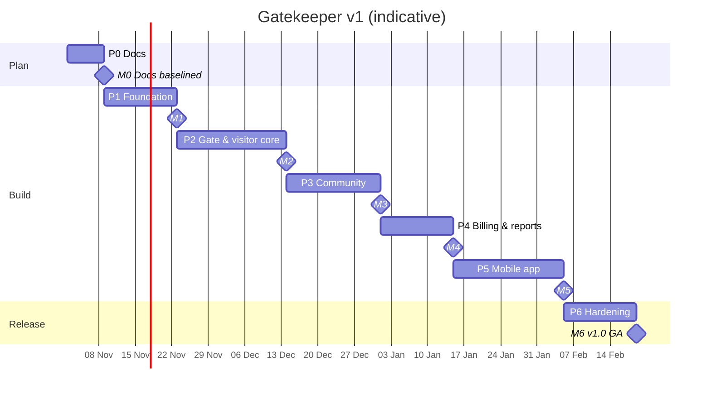
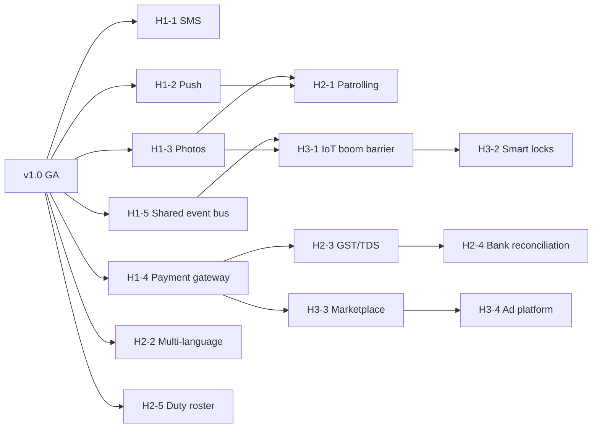

# Gatekeeper — Delivery Roadmap

| | |
|---|---|
| **Document** | 11-ROADMAP |
| **Version** | 1.0 |
| **Source of truth** | [`00-PROJECT-BRIEF.md`](./00-PROJECT-BRIEF.md) |
| **Related** | [`01-PRD.md`](./01-PRD.md) (scope and priority), [`02-SRS.md`](./02-SRS.md) (`FR-*`), [`10-TEST-PLAN.md`](./10-TEST-PLAN.md) (`TC-*`) |

---

## 1. Delivery approach

- **Vertical slices.** Each phase ships working API endpoints with integration tests, plus the matching web app screens, so every phase is demonstrable on the docker-compose stack.
- **API first within a phase.** Contract (`08-API-SPEC.md`) → service plus tests → web UI. The mobile app comes in Phase 5, once the API is stable.
- **Gate core early.** Visitor management is the product's reason to exist, so it lands right after the foundation.
- **Every phase ends with a milestone review:** demo, test summary and smoke run, then go/no-go for the next phase.

Durations are **indicative** for a small team (1–2 full-stack engineers plus part-time QA/design) and are re-estimated at each milestone review.

## 2. Phase overview

| Phase | Name | Indicative duration | Milestone | Outcome |
|---|---|---|---|---|
| 0 | Documentation | 1 week | **M0** Docs baselined | Docs 00–11 approved. Decisions locked |
| 1 | Foundation | 2 weeks | **M1** Stack boots, users sign in | Docker stack, schema, seed, auth, tenancy/RBAC, society setup, web shell |
| 2 | Gate and visitor core | 3 weeks | **M2** First live gate flow | Walk-ins, approvals, pre-approvals, gate verify, staff, SOS, notifications and SSE |
| 3 | Community | 2.5 weeks | **M3** Community features live | Notices, polls, helpdesk, amenities and bookings |
| 4 | Billing and reports | 2 weeks | **M4** Admin console complete | Invoices, mock payments, expenses, dashboard KPIs, marketing site |
| 5 | Mobile app | 3 weeks | **M5** Mobile beta | Expo app for Resident and Guard |
| 6 | Hardening and release | 2 weeks | **M6** v1.0 GA | Security, accessibility, performance, ops, docs. Release |

> Phase 5 depends only on API stability, so it can start in parallel with Phase 4 if a second engineer is available. That shortens the critical path by about 2 weeks.

## 3. Phases in detail

### Phase 0 — Documentation (M0)

**Goal:** a single, consistent specification before any code.

| Deliverable | File |
|---|---|
| Project brief (source of truth) | `00-PROJECT-BRIEF.md` |
| PRD, SRS | `01-PRD.md`, `02-SRS.md` |
| Data dictionary, ERD, DFD | `03`, `04`, `05` |
| HLD, LLD (state machines, sequences) | `06`, `07` |
| API specification | `08-API-SPEC.md` |
| UI/UX design system and screen inventory | `09-UI-UX-DESIGN-SYSTEM.md` |
| Test plan, roadmap | `10`, `11` |

**Exit criteria**
- All docs agree with the brief: entity names, endpoints, enums, error envelope and event names.
- Every FR in the SRS has a TC in the test plan (traceability matrix complete).
- Open questions in PRD §13 have an owner and a default.

### Phase 1 — Foundation (M1)

**Goal:** a running stack where users sign in, create a society and set up its structure.

| Area | Scope |
|---|---|
| Infra | `docker-compose.yml` (`db` postgres:16-alpine with healthcheck, `adminer` 8081, `api` 4000, `web` nginx 8080), `.env.example`, `README.md` quick start |
| API skeleton | Express 5 app factory, helmet, CORS allowlist, pino with redaction, request IDs, Zod validation helper, central error handler and envelope, list/limit helper, `/health`, graceful shutdown |
| Data | Full Prisma schema for **all** brief §6 entities, initial migration, idempotent seed (brief §9) |
| Auth | OTP request/verify with hashing, expiry, attempts and rate limit; `devCode` in dev only; JWT; `GET/PATCH /me` |
| Tenancy | `X-Society-Id` middleware, membership resolution, RBAC helper |
| Society | `POST /societies`, `GET /society`, blocks, flats bulk, members (incl. guard `?flatId`, LAST_ADMIN rule) |
| Web | Vite/React/Tailwind with brand tokens (light and dark), app shell, role-based navigation, login/OTP, society switcher, admin screens for blocks, flats and members |
| Testing | Vitest + supertest harness, test DB, factories, CI workflow (typecheck, lint, test) |

**FRs:** FR-SYS-01–06, FR-AUTH-01–08, FR-TEN-01–04, FR-SOC-01–09, FR-WEB-02, FR-WEB-03 (shell), FR-WEB-05.

**Exit criteria:** TC-SYS-*, TC-AUTH-*, TC-TEN-*, TC-SOC-* pass. TC-SMK-01 to TC-SMK-04 pass. TC-SEC-01, TC-SEC-02 and TC-SEC-04 pass.

### Phase 2 — Gate and visitor core (M2)

**Goal:** the end-to-end gate experience with live approvals, in the web app.

| Area | Scope |
|---|---|
| Event bus and SSE | In-process `EventEmitter` bus, notification service (persist + fan-out), SSE hub with auth, routing, heartbeat and cleanup; `/notifications` list/read/read-all |
| Visitors | Walk-in create, list with scoping and filters, decision (first-wins conditional update), leave-at-gate, check-in/out, collect, state machine, 10-minute expiry (lazy + sweeper) |
| Pre-approvals | Create, list, cancel; passcode generator unique across pre-approvals and staff; lifecycle |
| Gate | `/gate/verify` (VISITOR / STAFF), rate limit |
| Staff | CRUD, flat linking, attendance |
| SOS | Raise, list, acknowledge/resolve, fan-out to guards and admins |
| Web | **Guard gate console** (log walk-in, passcode, pending live list, inside now, SOS banner); **Resident** home with live approval cards, visitor history, pre-approvals, daily help, SOS button; **Admin** visitor log, staff management, SOS list; notification bell |

**FRs:** FR-VIS-01–10, FR-PRE-01–05, FR-GATE-01–04, FR-STF-01–05, FR-SOS-01–04, FR-NTF-01–06, FR-WEB-06.

**Exit criteria:** TC-VIS-*, TC-PRE-*, TC-GATE-*, TC-STF-*, TC-SOS-*, TC-NTF-* pass. The full smoke run (TC-SMK-01 to TC-SMK-08) passes. TC-WEB-06 is demonstrated with two browsers.

### Phase 3 — Community (M3)

**Goal:** residents and admins use Gatekeeper day to day beyond the gate.

| Area | Scope |
|---|---|
| Notices | CRUD, pinning, categories, `notice.created` fan-out |
| Polls | Create with options, vote once (unique constraint), close time, results with `myVoteOptionId` |
| Helpdesk | Tickets, scoping, ticket state machine, assignment, comments, notifications |
| Amenities | CRUD, availability calculator (IST slots), capacity-safe bookings (row lock / serializable), cancellation |
| Web | Notices feed and editor, polls, helpdesk list and detail with thread, amenity catalogue, availability picker, my bookings, admin booking calendar |

**FRs:** FR-NOT-01–04, FR-POLL-01–04, FR-TKT-01–06, FR-AMN-01–04, FR-BKG-01–04.

**Exit criteria:** TC-NOT-*, TC-POLL-*, TC-TKT-*, TC-AMN-*, TC-BKG-* pass, with TC-BKG-02 (parallel capacity test) required. axe passes on the new screens (TC-A11Y-01 subset).

### Phase 4 — Billing and reports (M4)

**Goal:** a complete admin console and a public marketing presence.

| Area | Scope |
|---|---|
| Billing | Invoice generation (unique flat + period, idempotent), listing, overdue derivation (lazy + daily sweeper), mock payment gateway (`MOCK-` reference; CASH admin-only) |
| Expenses | Create and list with filters |
| Reports | `/reports/summary` KPIs (IST month and day boundaries) |
| Web | Admin dashboard (KPI cards, tabular numerals), invoices table and generate dialog, expenses, resident invoices with a clearly labelled "Demo payment" flow |
| Marketing site | Public `/` with hero, features, gate-flow explainer, security and privacy, FAQ, CTAs; Fraunces/Manrope; responsive |
| PWA | Manifest, icons, static-asset service worker |

**FRs:** FR-BIL-01–07, FR-RPT-01, FR-WEB-01, FR-WEB-04.

**Exit criteria:** TC-BIL-*, TC-RPT-01, TC-WEB-01 to TC-WEB-05 pass. The full smoke run including TC-SMK-09 and TC-SMK-10 passes. **The web product is feature-complete for v1.**

### Phase 5 — Mobile app (M5)

**Goal:** Resident and Guard on their phones.

| Area | Scope |
|---|---|
| Foundation | Expo + expo-router + TypeScript + TanStack Query; secure token storage; API base URL config; brand theme; society switcher |
| Resident | Approval cards (approve / deny / leave at gate), visitor history, pre-approvals with share sheet, daily help attendance, notices, polls, helpdesk, bookings, invoices with mock pay, SOS, notifications |
| Guard | Gate console: block→flat picker, walk-in form, passcode keypad, live pending list, inside now, check-in/out, collect, SOS inbox with acknowledge/resolve |
| Realtime | SSE where supported, ≤ 15 s foreground polling fallback |
| Distribution | Expo Go for internal beta; EAS build profiles prepared |

**FRs:** FR-MOB-01–03.

**Exit criteria:** TC-MOB-01 to TC-MOB-03 pass on one Android and one iOS device. TC-A11Y-03 and TC-A11Y-04 pass on mobile.

### Phase 6 — Hardening and release (M6)

**Goal:** production-ready v1.0.

| Area | Scope |
|---|---|
| Security | Full TC-SEC-* suite, IDOR sweep, ZAP baseline, `npm audit`, secret scan, production config guard (refuse a weak or missing `JWT_SECRET`), Adminer locked down |
| Privacy | Retention purge job (NFR-PRIV-02), privacy notice on the marketing site |
| Accessibility | Manual keyboard and screen-reader passes, zoom and reduced motion (TC-A11Y-01–05) |
| Performance | Scaled seed, k6 runs, index tuning (TC-PERF-01–03) |
| Ops | Backups and restore drill (TC-OPS-01), graceful shutdown (TC-OPS-02), reverse-proxy SSE config notes, uptime probe on `/health` |
| Docs | README, `08-API-SPEC.md` reconciled with the implementation, runbook, release notes |

**Exit criteria:** the v1 release criteria in Test Plan §5. All Must and Should FRs pass. No open Sev-1 or Sev-2 defects. **Production go-live additionally requires an SMS provider** (see §5, item H1-1). Without one, v1.0 is a demo or pilot release using dev OTP.

## 4. Definition of Done

### 4.1 Story / feature level
A feature is done when **all** of these are true:

1. It meets the acceptance criteria in the PRD and the linked `FR-*` in the SRS.
2. The API is implemented in the `routes → controller → service → Prisma` layering, with Zod DTOs, society scoping and RBAC.
3. Business rules live in services. State changes go through the state-machine helper where one applies.
4. Integration tests for the linked `TC-*` pass against Postgres. `describe` names carry the TC ID.
5. Error responses use the standard envelope and status codes. Lists follow `{items}` and `limit`.
6. The web UI uses design tokens, shows status as dot plus label, has 44 px targets and a visible focus ring, works in dark mode, and has no axe serious or critical issues.
7. No secrets, OTPs, passcodes or tokens appear in logs or code. `.env.example` is updated for any new variable.
8. Prisma migration committed and seed updated where data shape changed.
9. `tsc --noEmit`, ESLint and the full Vitest suite are green in CI.
10. `08-API-SPEC.md` is updated if the contract changed.

### 4.2 Phase / milestone level
- Every story in the phase meets 4.1.
- The phase exit criteria in §3 are met, and the smoke test (Test Plan §8) passes on a fresh `docker compose down -v && up`.
- Demo given on the seed society. Test summary published (Test Plan §12).
- No open Sev-1 or Sev-2 defects. Sev-3 defects are triaged into the backlog.

### 4.3 Release (v1.0)
- Phase 6 exit criteria met. Release notes and a version tag published. Backup verified. Rollback procedure documented (previous image tag + DB restore).

## 5. Post-v1 roadmap

These items are out of scope for v1 (brief §3) and are planned by horizon. Each will get its own PRD and SRS addendum before development. The brief is updated first wherever an item changes a locked decision.

### Horizon 1 — v1.1 to v1.2: production readiness and engagement (about 1 quarter after GA)

| # | Item | Description | Dependencies / design notes |
|---|---|---|---|
| H1-1 | **SMS provider** | Deliver OTPs (and optionally SOS fallbacks) by SMS through a pluggable provider adapter. DLT template registration for India | Removes the go-live blocker. Keep the rate limits. Add per-phone daily caps and SMS-pumping protection |
| H1-2 | **Push notifications** | Native push (Expo push service / FCM / APNs) for visitor requests, SOS and notices, with actionable Approve/Deny on the notification | Device-token table. The notification service gains a push channel. Respect quiet hours |
| H1-3 | **Photo uploads** | Guard captures a visitor photo; staff and avatar photos; object storage with signed URLs; size and type limits; retention aligned with visitor data | Replaces URL-only fields. Malware/type checks. Privacy notice update |
| H1-4 | **Real payment gateway** | Replace the mock with an Indian PG (UPI, cards, netbanking): order creation, webhooks with signature verification, idempotency keys, refunds, reconciliation report | Keep the `Payment` model and add gateway IDs. PCI scope minimised via hosted checkout |
| H1-5 | **Scalable event bus** | Swap the in-process `EventEmitter` for a shared broker (e.g. Redis pub/sub) so the API can run multiple instances | Unblocks horizontal scaling (SRS C5, NFR-SCAL-02) |

### Horizon 2 — v1.3 to v1.5: operations depth

| # | Item | Description | Dependencies / design notes |
|---|---|---|---|
| H2-1 | **Guard patrolling** | QR/NFC checkpoints, patrol schedules, missed-checkpoint alerts, patrol reports | Needs photo uploads (H1-3) for evidence. Push (H1-2) for alerts |
| H2-2 | **Multi-language** | i18n for web and mobile (English, Hindi, Kannada, Tamil, Telugu, Marathi first), guard UI priority, locale-aware formatting | Externalise strings. Font coverage (Manrope fallback for Indic scripts) |
| H2-3 | **GST/TDS accounting** | GST-compliant invoices (GSTIN, HSN/SAC, tax lines), TDS on vendor expenses, ledgers, financial-year reports | Changes the invoice model (tax lines). Accountant review |
| H2-4 | **Bank reconciliation** | Import bank statements (CSV), auto-match payments and expenses, exceptions queue | Builds on H1-4 and H2-3 |
| H2-5 | **Shift and duty roster** | Real "on-duty" guard model (replaces PRD assumption A1); handover notes | Refines SOS fan-out |

### Horizon 3 — v2: platform and hardware

| # | Item | Description | Dependencies / design notes |
|---|---|---|---|
| H3-1 | **IoT / boom-barrier integration** | Gate controller integration: auto-open on passcode or approved vehicle, ANPR camera input, offline fallback | Hardware partner. Edge device protocol. Strict device authentication |
| H3-2 | **Smart locks** | Resident-issued time-bound digital keys for flats and amenity doors | Vendor SDKs. Audit trail. Fail-safe design |
| H3-3 | **Marketplace** | Vetted local services (cleaning, repairs, groceries) bookable by residents; vendor onboarding and ratings | Payments (H1-4). Moderation. Ad-free principle preserved |
| H3-4 | **Ad platform** | Opt-in, society-approved local promotions. Off by default to protect the "calm, trustworthy" brand | Committee consent controls. Strict privacy (no PII sharing) |

### Post-v1 sequencing

## 6. Roadmap risks

| Risk | Phase | Mitigation |
|---|---|---|
| SSE behaves differently in React Native | 5 | Polling fallback is part of the scope (FR-MOB-03). Spike SSE in week 1 of Phase 5 |
| Capacity race conditions are found late | 3 | TC-BKG-02 parallel test is mandatory for exit from Phase 3 |
| Scope creep from post-v1 items | All | The brief is the gate. Changes need a brief update and a milestone review |
| No SMS provider at go-live | 6 | Treat v1.0 as a pilot until H1-1 ships. Track it as a release dependency |
| Performance on a single node | 6 | Index review in Phase 1 schema. k6 in Phase 6. H1-5 for scale-out |
